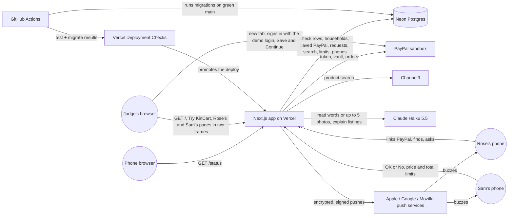
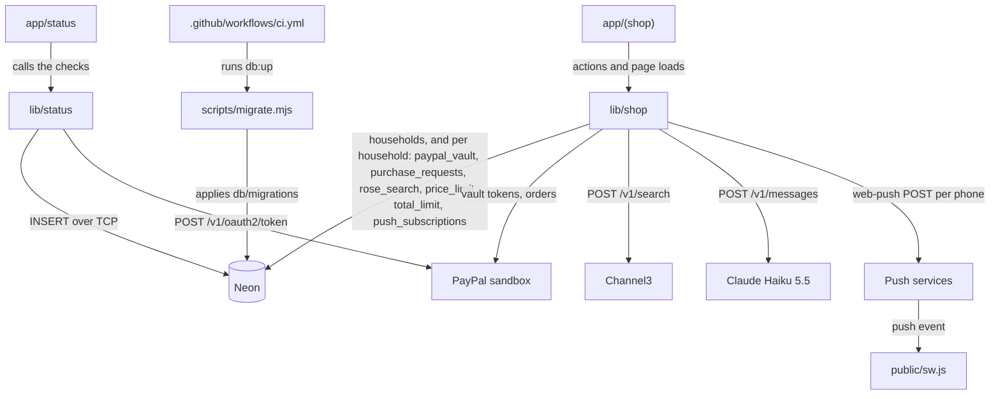

# PayPalHackathon · architecture

**Status:** Active · **Updated:** 2026-10-16 by /ship photo-ask-several

## Context

## Components

| Component | Folder | What it does |
| --------- | ------ | ------------ |
| Status page | `app/status/` | Runs the checks in parallel, logs one line, renders the three lines under the KinCart showcase head |
| Checks | `lib/status/` | Database insert, PayPal token request, build commit |
| Shop pages | `app/(shop)/` | The home page `/`, where Try KinCart starts a household and this browser keeps its two links in an httpOnly cookie. From 880px wide the home page shows two phones: still samples of Rose's and Sam's screens before Try KinCart, then their real pages in lazy frames, which leave out Notifications; Rose's and Sam's pages behind each household's secret links, the server actions behind each tap (Find, Ask Sam, OK or No, the price and total limits, Turn on notifications), Ask Sam's stop when the picks come to more than Sam's total limit, Sam's tick list for a basket, Rose's photo button, which takes up to 5 photos and shrinks each, one at a time, to a JPEG of at most 180 KB before Find sends them, Rose's link screen with the demo sandbox login and Skip, `POST /r/<token>/link`, where a home page phone sends Link PayPal in a new tab because PayPal refuses frames, the PayPal return route, a manifest per link, the words of each ping, and a refresh every 3 s |
| Shop logic | `lib/shop/` | Households: `whoIs()` turns a link into a household and a person (the env's links are household 1, any other is found by its SHA-256 hash), `startHousehold()` saves a new one with no saved PayPal, and `copyDemoVault()` gives it a copy of household 1's when Rose taps Skip. Every query below takes the household. Link check, PayPal vault and charge calls, `find()` (Haiku splits the words into up to five things; each thing gets two Channel3 searches and a Haiku pick of up to three, all at once), `findPhoto()`, which does the same from up to 5 of Rose's photos and any words, read in one Haiku call that also names the photos that showed nothing, with the photos sent to Haiku once and never stored, storage for requests and their basket lines, Rose's search, Sam's two limits and saved phones, `claim()`, which keeps only the lines Sam ticked, `pay()` with its stuck-request retry, and `notify()`, which sends one push per saved phone with `web-push` and forgets dead ones |
| Service worker | `public/sw.js` | Registered under each person's link; shows a push and opens that link on tap |
| Migrations | `db/migrations/`, `scripts/migrate.mjs` | Plain SQL up and down files, and the runner behind `pnpm db:up` and `db:down` |
| CI | `.github/workflows/ci.yml` | `test` job on every push and PR; `migrate` job on main after `test` passes |
| E2E | `e2e/` | Playwright tests at phone width unless a test sets a laptop window, one worker: `/status`, Rose's ask through Sam's OK or No to the receipt, Rose's Find with real Channel3 and Claude calls, from words, one photo or several, a three-thing basket that Sam trims before paying, a basket stopped by Sam's total limit, a real push to Sam and back to Rose in Firefox, two judges each in their own household, and a judge on a laptop playing Rose and Sam side by side while a phone loads neither frame |
