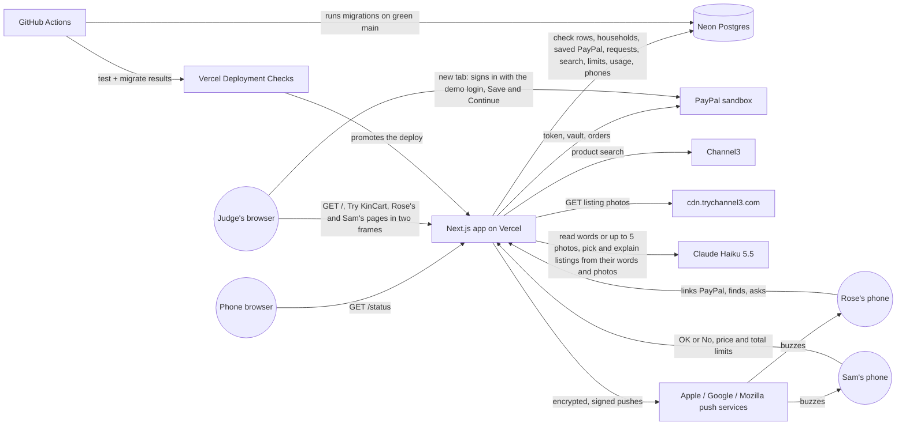
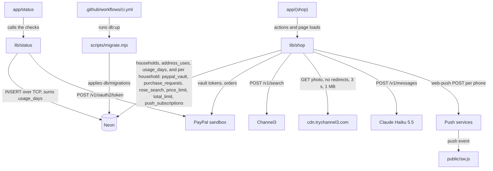

# PayPalHackathon · architecture

**Status:** Active · **Updated:** 2026-10-23 by /ship ask-again

## Context

## Components

| Component | Folder | What it does |
| --------- | ------ | ------------ |
| Status page | `app/status/` | Runs the checks and the usage read in parallel, logs one line, renders the three checks and the four usage counts under the KinCart showcase head, with the month's searches in red from 800 of 1,000 |
| Checks | `lib/status/` | Database insert, PayPal token request, build commit, and `readUsage()`, which sums `usage_days` for today and this UTC month |
| Shop pages | `app/(shop)/` | The home page `/`, where Try KinCart starts a household and this browser keeps its two links in an httpOnly cookie. From 880px wide the home page shows two phones: still samples of Rose's and Sam's screens before Try KinCart, then their real pages in lazy frames, which leave out Notifications; Rose's and Sam's pages behind each household's secret links, the server actions behind each tap (Find, Find another, Ask again, Ask Sam, OK or No, the price and total limits, Turn on notifications), Ask Sam's stop when the picks come to more than Sam's total limit, Sam's tick list for a basket, Rose's photo button, which takes up to 5 photos and shrinks each, one at a time, to a JPEG of at most 180 KB before Find sends them, Rose's link screen with the demo sandbox login and Skip, Bought before on Rose's ask screen with Sam's 3 newest paid asks, the mark and the price or shop change on the listing Rose bought last time, the notices when an address passes its daily Find or Try KinCart limit, `POST /r/<token>/link`, where a home page phone sends Link PayPal in a new tab because PayPal refuses frames, the PayPal return route, a manifest per link, the words of each ping, and a refresh every 3 s |
| Shop logic | `lib/shop/` | Households: `whoIs()` turns a link into a household and a person (the env's links are household 1, any other is found by its SHA-256 hash), `startHousehold()` saves a new one with no saved PayPal, and `copyDemoVault()` gives it a copy of household 1's when Rose taps Skip. Every query below takes the household. Link check, PayPal vault and charge calls (each charge sends one PayPal item for each thing, and its amount is their sum), `find()` (Haiku splits the words into up to five things; each thing gets two Channel3 searches, then `withPhotos()` downloads the photos of the listings under the limit from `cdn.trychannel3.com` only, shrinks each to 512 px with `sharp` and drops a listing whose photo fails, then a Haiku pick of up to three that sees each listing's photo and drops any listing that isn't the thing asked for, all things at once), `findAgain()`, behind Find another, which asks Haiku for other words for each thing in a call of its own and runs the same searches and pick without the listings Sam refused, `findRebuy()`, behind Ask again, which searches each thing Sam paid for with its last query and adds one search by last time's listing name, so that listing goes to the pick call labelled and comes first when kept, `findPhoto()`, which does the same from up to 5 of Rose's photos and any words, read in one Haiku call that also names the photos that showed nothing, with the photos sent to Haiku once and never stored, storage for requests, their basket lines and each pick's thing, query and listing id, Rose's search with its query, whether Find another ran it and last time's listing for Ask again, `boughtBefore()` and `paidAsk()` for Sam's paid asks, Sam's two limits and saved phones, `claim()`, which keeps only the lines Sam ticked, `pay()` with its stuck-request retry, `notify()`, which sends one push per saved phone with `web-push` and forgets dead ones, and `takeUse()`, which counts each address's Finds and new households over the last 24 hours under an HMAC of the address from `limits.ts`, and `countUse()`, which adds each Find, its Channel3 searches and each stopped Find or Try KinCart to today's UTC row and only logs when it can't |
| Service worker | `public/sw.js` | Registered under each person's link; shows a push and opens that link on tap |
| Migrations | `db/migrations/`, `scripts/migrate.mjs` | Plain SQL up and down files, and the runner behind `pnpm db:up` and `db:down` |
| CI | `.github/workflows/ci.yml` | `test` job on every push and PR; `migrate` job on main after `test` passes |
| E2E | `e2e/` | Playwright tests at phone width unless a test sets a laptop window, one worker: `/status`, Rose's ask through Sam's OK or No to the receipt, Rose's Find with real Channel3 and Claude calls, from words, one photo or several, a three-thing basket that Sam trims before paying, Find another after Sam's No, Ask again after Sam pays, a basket stopped by Sam's total limit, a real push to Sam and back to Rose in Firefox, two judges each in their own household, an address past its daily Find and Try KinCart limits, the usage counts on `/status`, and a judge on a laptop playing Rose and Sam side by side while a phone loads neither frame |
| Recorded set | `lib/shop/picks/` | Real Channel3 products and photos for 7 asks, each listing labelled wrong or right by its photo. `lib/shop/picks.test.ts` runs each ask through `find()` 3 times against real Haiku in `pnpm test`, and fails on any wrong pick. Two Ask again cases run `findRebuy()` 3 times each: a wrong listing labelled as bought last time never shows, and a right one comes first |
