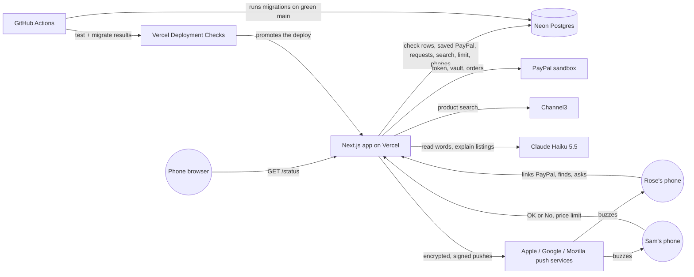
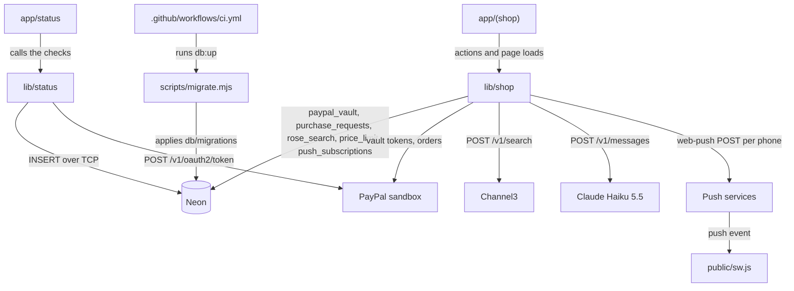

# PayPalHackathon · architecture

**Status:** Active · **Updated:** 2026-10-14 by /ship basket

## Context

## Components

| Component | Folder | What it does |
| --------- | ------ | ------------ |
| Status page | `app/status/` | Runs the checks in parallel, logs one line, renders the three lines |
| Checks | `lib/status/` | Database insert, PayPal token request, build commit |
| Shop pages | `app/(shop)/` | Rose's and Sam's pages behind secret links, the server actions behind each tap (Find, Ask Sam, OK or No, the price limit, Turn on notifications), Sam's tick list for a basket, the PayPal return route, a manifest per link, the words of each ping, and a refresh every 3 s |
| Shop logic | `lib/shop/` | Link check, PayPal vault and charge calls, `find()` (Haiku splits the words into up to five things; each thing gets two Channel3 searches and a Haiku pick of up to three, all at once), storage for requests and their basket lines, Rose's search, Sam's limit and saved phones, `claim()`, which keeps only the lines Sam ticked, `pay()` with its stuck-request retry, and `notify()`, which sends one push per saved phone with `web-push` and forgets dead ones |
| Service worker | `public/sw.js` | Registered under each person's link; shows a push and opens that link on tap |
| Migrations | `db/migrations/`, `scripts/migrate.mjs` | Plain SQL up and down files, and the runner behind `pnpm db:up` and `db:down` |
| CI | `.github/workflows/ci.yml` | `test` job on every push and PR; `migrate` job on main after `test` passes |
| E2E | `e2e/` | Playwright tests at phone width, one worker: `/status`, Rose's ask through Sam's OK or No to the receipt, Rose's Find with real Channel3 and Claude calls, a three-thing basket that Sam trims before paying, and a real push to Sam and back to Rose in Firefox |
