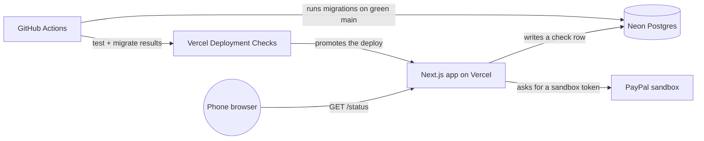
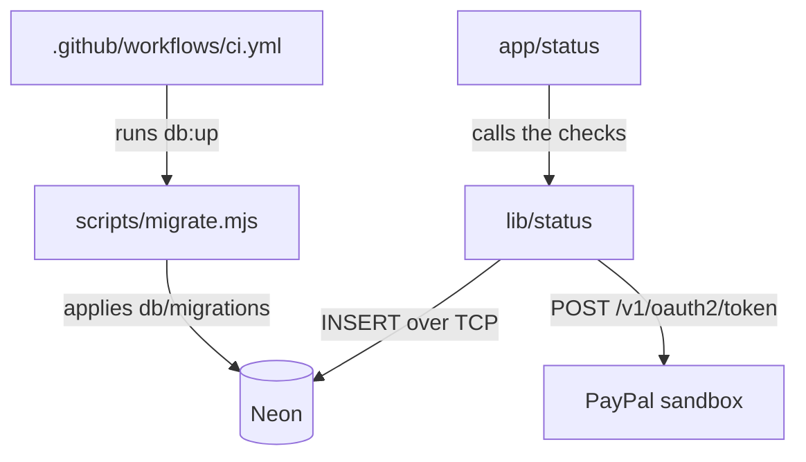

# PayPalHackathon · architecture

**Status:** Active · **Updated:** 2026-10-13 by /ship skeleton

## Context

## Components

| Component | Folder | What it does |
| --------- | ------ | ------------ |
| Status page | `app/status/` | Runs the checks in parallel, logs one line, renders the three lines |
| Checks | `lib/status/` | Database insert, PayPal token request, build commit |
| Migrations | `db/migrations/`, `scripts/migrate.mjs` | Plain SQL up and down files, and the runner behind `pnpm db:up` and `db:down` |
| CI | `.github/workflows/ci.yml` | `test` job on every push and PR; `migrate` job on main after `test` passes |
| E2E | `e2e/` | Playwright test that walks `/status` at phone width |
