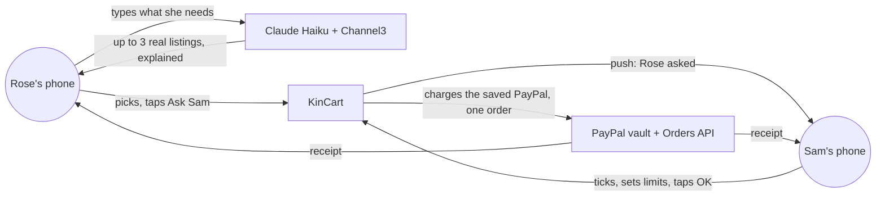
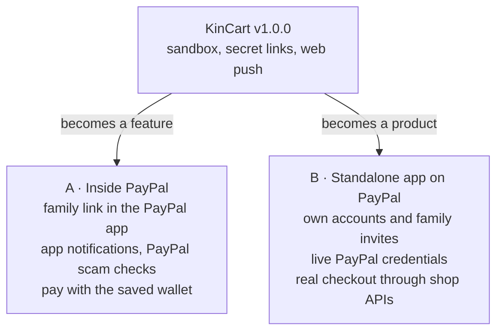

# KinCart · what's built, what's a stand-in, what comes next

**Status:** Hackathon build, v1.0.0 · **Updated:** 2026-10-16 by /ship link-paypal-onboarding

KinCart is a proof of concept for the PayPal AI hackathon. Everything on kincart.vercel.app works end to end, but some parts stand in for what a shipped product would use. This page says which, and what it would take to go further. There is no commitment to go further; if the idea lands, this is the plan.

## What's real today

- Rose links a PayPal once, from her own phone, and never shares a password.
- The listings, prices, shops and photos come from Channel3's live index, and the explanations come from Claude Haiku on each visit.
- Sam's OK makes a real PayPal API charge against the saved payment method, with no buyer present.
- Both phones get a real push notification, with the page closed.
- Every visitor gets their own Rose and Sam, split by household in the database, and the whole path is covered by Playwright tests in CI.

## What stands in for the real thing

| Today | Why | In a shipped product |
| ----- | --- | -------------------- |
| **Sandbox money.** The charge lands in a PayPal sandbox business account. No order reaches the shop, and nothing arrives at anyone's door. | The hackathon rules allow sandbox-only builds. A real order needs a shop that accepts orders by API. | A live PayPal app, and a checkout path to the shop (see the two paths below). |
| **Secret links instead of accounts.** Rose's and Sam's pages open from a long random link each. There is no sign-up, login, or recovery. | A judge can try both sides in one tap. Anyone holding Sam's link could OK a sandbox charge. | Real accounts, and a family link that Rose accepts once. |
| **One demo PayPal login, shown on screen.** A new Rose links on PayPal's own page with a shared sandbox login printed on the link screen, or taps Skip for a copy of the demo PayPal. | Judges have no sandbox login of their own. A stranger can change the shared login's password, which spoils linking but not Skip. | Each Rose links their own PayPal, with no login on screen and no Skip. |
| **Free tiers.** Channel3 allows about 1,000 searches a month and returns US listings in US dollars. Claude Haiku runs on a personal API key with a spend limit. | Enough for judging. A stranger scripting the form could use the quota up. | Paid search with the family's country and currency, rate limits per household, and abuse checks. |
| **AI that nobody checks.** Haiku reads Rose's words and explains each listing. It can misread a request or praise a poor listing. Sam's OK is the only check. | The point of the design: a person approves every purchase. | Keep Sam's OK. Add listing checks (seller rating, returns), and show Sam what the AI was unsure about. |
| **Web push.** Pings go through Apple, Google and Mozilla's push services, need https, and on iPhone only work from the Home Screen. | The web is the fastest way to reach two phones with no app to install. | Inside PayPal these would be the PayPal app's own notifications. |
| **No scam checks.** KinCart does not look at who the seller is or whether the ask looks odd. | PayPal already runs AI scam alerts on payments, with far more data than this app has. | Lean on PayPal's checks, and add a "this looks unusual" line for Sam. |

## Two ways forward

**A · Inside PayPal.** KinCart becomes a PayPal feature: a family link between two PayPal accounts, where one asks and the other approves. PayPal already holds the payment method, the identity, the notifications and the scam checks, so most of the stand-ins above go away by design. The missing piece is the AI find-and-explain step, which is what this build proves.

**B · Standalone app using PayPal.** KinCart keeps its own site and accounts, with family invites by link, each Rose linking a live PayPal, and the OK placing a real order through shops that take orders by API (or an agentic commerce rail, where one exists). Harder: the real-order step is the part no sandbox proves, and it decides which shops KinCart can buy from.

The pitch is **A**. It needs the least new trust (nobody hands a new company their parent's payment method), and every stand-in on the list above is something PayPal already has. B is the fallback if A has no owner.

## What it would take, in order

| Step | Path A | Path B |
| ---- | ------ | ------ |
| 1 | Pitch the family link to a PayPal team, with this build as the demo | Accounts and family invites, replacing secret links |
| 2 | Find-and-explain as a service the PayPal app can call | Live PayPal app credentials and a per-family vault |
| 3 | App notifications instead of web push | One shop with an order API, end to end, real money, one family |
| 4 | PayPal's scam signals shown to Sam before OK | Paid search with country and currency, rate limits per family |
| 5 | A pilot with a few real families | The same pilot |

## What stays the same either way

- Rose asks in her own words, from her own phone, and never shares a password.
- Sam sees why a listing fits, in plain words, and approves every purchase. No auto-approve, no spend-without-asking.
- One OK, one charge, one receipt both of them can read.

## Glossary

- **Sandbox** — PayPal's test environment. Fake accounts, fake money, real API.
- **Vault** — PayPal's store for a saved payment method, approved once and charged later without the holder logging in.
- **Channel3** — a hackathon sponsor whose API returns real product listings.
- **Web push** — browser notifications sent through Apple's, Google's or Mozilla's push servers, no app needed.
- **Agentic commerce** — a rail where a shop takes an order from software acting for a buyer, instead of from a person at a checkout page.
