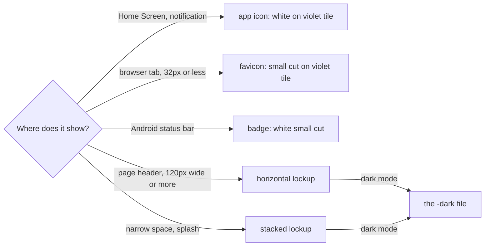

# KinCart logo guidelines

**The idea:** the helper's OK carries the shopping. A tick with a handle on two wheels is a cart.



## Versions

| Version | File (`svg/`) | Use |
| ------- | ------------- | --- |
| Horizontal | `kincart-horizontal.svg` | The default, at the top of every page |
| Stacked | `kincart-stacked.svg` | Narrow spaces, a splash or sign-in screen |
| Symbol | `kincart-symbol.svg` | Above 32px, when the name is already next to it |
| Symbol, small cut | `kincart-symbol-small.svg` | 32px and below. Heavier strokes, wider gaps |
| Wordmark | `kincart-wordmark.svg` | Only where the symbol is already shown nearby |
| App icon | `kincart-app-icon.svg` | The master for every Home Screen icon |

Each lockup also comes as `-dark`, `-ink` (one colour) and `-white`. The white and dark files use slightly thinner strokes, because light marks on dark grounds look heavier.

## Clear space and minimum size

Keep two wheel widths of empty space on every side. The space grows and shrinks with the logo.

| Version | Smallest |
| ------- | -------- |
| Horizontal | 120px wide. Below that the name drops under the design system's 16px text floor |
| Stacked | 96px wide |
| Symbol | 16px, using the small cut |

## Colour

All values come from the design system tokens. Print colours (CMYK, Pantone) are not chosen yet; get a printer's proof before anything is printed.

| Role | HEX | RGB | Token |
| ---- | --- | --- | ----- |
| Symbol on light | `#5B3AA0` | 91 58 160 | `accent`, `icon-tile` |
| Name on light | `#14181F` | 20 24 31 | `text` |
| Symbol on dark | `#C3B2F0` | 195 178 240 | `accent`, dark |
| Name on dark | `#EEF1F6` | 238 241 246 | `text`, dark |
| Mark on the tile | `#FFFFFF` | 255 255 255 | `icon-mark` |

| Pair | Contrast |
| ---- | -------- |
| White on the violet tile | 8.2:1 |
| Violet symbol on `#F7F8FA` | 7.7:1 |
| Lilac symbol on `#0F1217` | 9.8:1 |

## Type

The name is Atkinson Hyperlegible Next Bold, the app's own typeface (OFL licence, logo use allowed), turned into shapes. Two changes from the font: the K's arm is redrawn at 45° so it runs parallel to the tick, and the letters sit slightly closer. Don't retype the name; use the files.

## Don't

- Make the tick green. Green means "Paid" in the app.
- Use the full-size symbol at 32px or below. Use the small cut.
- Use the lilac `-dark` files on a light background.
- Move, resize or drop the wheels, or rearrange a lockup.
- Rotate, stretch, outline, or add a shadow or gradient.
- Recolour outside the table above. PayPal blues especially.

## Files

```
kit/
  svg/    every version and colour, the masters
  png/    horizontal 1200px, stacked 800px, symbol 1024px, app icon 1024px
  web/    favicon.ico, favicon.svg, favicon-16/32/48, apple-touch-icon (180, opaque),
          icon-192, icon-512, maskable-512, badge-96 (white on transparent)
  board/  the presentation slides with mockups
```

The web icons are not wired into the app yet. That happens in ping-helper's build, through Next.js's `app/` icon and manifest files.
