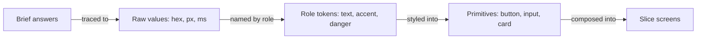

# Design system brief

**Status:** Approved · 2026-10-13 · /design-system pause A

The one design system for Shop-together. Every slice composes from it; none adds its own tokens.

## Who it's for

- **The relative.** Older, shops a few times a month on their own phone, gets lost in checkout steps.
- **The helper.** Family, on their own phone, reads one request and taps OK or No.

Slices 1 and 2 need: link PayPal once, pick or describe an item, three options with plain explanations, an approve or decline card, and a receipt. No screen offers more than three choices.

## The brief

| Question    | Answer                                                                                     |
| ----------- | ------------------------------------------------------------------------------------------ |
| Feel        | Clear, steady, kind                                                                        |
| Never feel  | Flashy, cluttered, childish                                                                |
| Stripe Checkout | Labels above fields, errors that say how to fix it, the amount always in view          |
| Monzo       | Big amounts, warm wording, a plain "you paid" receipt                                      |
| Locked      | Nothing. Colours, fonts and name are open                                                  |
| Motion ceiling | Tier 1: hover, press, focus, enter and exit                                             |

## Trace

```
older users, on a phone, a few times a month
                              → 18px body, 16px floor, 56px buttons, roomy 4px scale
"clear"                       → Atkinson Hyperlegible Next; all text 7:1 contrast (AAA)
"steady"                      → borders, not shadows; 8/12px radius; no bounce easing
"kind", never "childish"      → a helper's No shows in neutral, not red
OK / No is the core action    → one accent, violet: the next step
picked at the direction test  → violet on cool greys, from eight palettes; green only for "Paid", so it never looks like a button
clear of PayPal's blues       → accent at hue 259°; PayPal's sit at 198–225°
Stripe Checkout               → label above every field, error under it, amount stays on screen
Monzo                         → 40px amount style with tabular figures
motion ceiling: tier 1        → 120 / 180 / 240ms, ease-out; no scroll or 3D tokens
two phones, any lighting      → light and dark, both checked at 7:1
```

How the tokens flow into screens:



## Type

Atkinson Hyperlegible Next, from the Braille Institute, built so look-alike letters (I, l, 1, 0, O) stay distinct. Loaded with `next/font/google`, so it is served from our own domain. The Latin file is 34 KB and holds every weight (measured). It has tabular figures (`tnum`, checked in the font file). Fallback is `system-ui`.

Rejected: the system font, because I, l and 1 look alike in SF and Roboto, and this app shows names and amounts. Inter, because it is the default a generated UI reaches for.

| Token          | Size / line | Weight              | Use                                               |
| -------------- | ----------- | ------------------- | ------------------------------------------------- |
| `type.amount`  | 40 / 44     | 700, tabular        | The money figure on the approval and the receipt  |
| `type.heading` | 28 / 34     | 700                 | One per screen: the question or the outcome       |
| `type.title`   | 22 / 28     | 600                 | Item name, card title                             |
| `type.body`    | 18 / 28     | 400; 600 on buttons | Everything else                                   |
| `type.small`   | 16 / 24     | 400                 | Time, shop name. The floor: nothing is smaller    |
| `type.code`    | 16 / 24     | 400, `ui-monospace` | The build hash on `/status` only                  |

Steps grow by about 1.25. The amount jumps to 40 so it is read first.

## Space and size

| Token                                           | Value                        | Use                                         |
| ----------------------------------------------- | ---------------------------- | ------------------------------------------- |
| `space.1 2 3 4 6 8 12 16`                       | 4 8 12 16 24 32 48 64 px     | All gaps and padding                        |
| `page.inline`                                   | 24px                         | Side padding on every screen                |
| `page.max`                                      | 480px                        | Column width on tablets and desktops        |
| `control.height`                                | 56px                         | Buttons and inputs                          |
| `target.min`                                    | 48px                         | Smallest thing you can tap                  |
| `radius.control` / `radius.surface`             | 8px / 12px                   | Buttons and inputs / cards and the modal    |
| `border.width`                                  | 1px                          | Every border                                |
| `border.selected`                               | 2px                          | A picked option card and radio rings        |
| `focus.ring`                                    | 3px solid `text`, 2px offset | Every focusable thing                       |

## Colour

One accent, violet. Neutrals are cool greys. Every text pair is 7:1 or better; every control edge is 3:1 or better. All values are hex, which works on older phones (see assumptions).

| Token          | Light     | Dark      | Use                                     | Checked                                    |
| -------------- | --------- | --------- | --------------------------------------- | ------------------------------------------ |
| `bg`           | `#F7F8FA` | `#0F1217` | Page                                    |                                            |
| `surface`      | `#FFFFFF` | `#181C23` | Cards, inputs, the modal                |                                            |
| `sunken`       | `#EEF1F5` | `#0A0C10` | Summary bar behind the amount           |                                            |
| `text`         | `#14181F` | `#EEF1F6` | Body and headings                       | 15.1+ / 12.2+ on every background          |
| `muted`        | `#464D59` | `#B7BECA` | Secondary text                          | 7.5+ / 9.1+                                |
| `line`         | `#DDE2E9` | `#2C323C` | Dividers and card edges you can't tap   | decorative only                            |
| `control`      | `#7A8291` | `#747C8A` | Edges of inputs and tappable cards      | 3.6+ / 4.0+                                |
| `accent`       | `#5B3AA0` | `#C3B2F0` | Primary button fill: the next step      | 7.7+ / 8.9+ against the page               |
| `on-accent`    | `#FFFFFF` | `#1E1240` | Text on the accent                      | 8.2 / 9.0                                  |
| `accent-press` | `#4A2E85` | `#D3C6F4` | Button pressed                          | 10.4 / 10.8 with `on-accent`               |
| `accent-soft`  | `#F0ECFA` | `#221A3A` | The option you picked                   |                                            |
| `accent-text`  | `#4F3290` | `#CFC1F4` | Text on `accent-soft`                   | 8.2+ / 9.8+                                |
| `success`      | `#145A3A` | `#86D6AC` | "Approved", "Paid"                      | 7.0+ / 8.0+                                |
| `success-soft` | `#E4F0E8` | `#1B3127` | Approved and paid backgrounds           |                                            |
| `danger`       | `#8E241B` | `#FF9C90` | Errors: payment failed, bad input       | 7.4+ / 7.6+                                |
| `danger-soft`  | `#FBE9E6` | `#3A1D1A` | Error background                        |                                            |
| `wait`         | `#6A4008` | `#F2C27A` | "Waiting for your helper"               | 7.9+ / 8.8+                                |
| `wait-soft`    | `#FBF0DA` | `#33270F` | Waiting background                      |                                            |

A helper's No uses `muted` on `sunken` with plain words. It is not an error, so it is not red.

## Motion

| Token         | Value                       | Use                                   |
| ------------- | --------------------------- | ------------------------------------- |
| `motion.fast` | 120ms                       | Press: the button shrinks to 98%      |
| `motion.base` | 180ms                       | A hover or selected tint fading in    |
| `motion.slow` | 240ms                       | Banner, toast and modal enter or exit |
| `motion.loading` | 900ms                    | One spinner turn; one skeleton pulse  |
| `ease.out`    | `cubic-bezier(0.2, 0, 0, 1)` | Things arriving                      |
| `ease.in`     | `cubic-bezier(0.4, 0, 1, 1)` | Things leaving                       |

Only `transform` and `opacity` move. Colour changes and focus rings are instant. Under `prefers-reduced-motion: reduce` every duration is 0ms and the state still changes by colour and words.

## Depth

Cards sit flat with a 1px `line` border. Only the modal lifts: `0 8px 24px rgb(0 0 0 / 0.16)` over a `rgb(0 0 0 / 0.4)` scrim.

## Never

- An icon without a word next to it.
- Text under 16px.
- A placeholder standing in for a label.
- A shadow on a card.
- Bounce or spring easing.
- Red for a helper's No.

## Assumptions

Confirm or correct these with the brief.

| What                                                                               | Why I guessed it                                                  |
| ---------------------------------------------------------------------------------- | ----------------------------------------------------------------- |
| AAA contrast (7:1) for all text, above the AA floor                                 | The relative is older; it cost nothing in the palette above        |
| English only, no right-to-left or CJK                                               | `lang="en"`, and Channel3 search is US-first (O7)                  |
| Dark mode required, following the phone's setting                                   | Craft floor, and `/status` already does both                       |
| Oldest phone: 320px wide, iOS 15.4 or Chrome 100                                    | A relative's phone may be a few years old; so hex, not `oklch()`  |
| Icons from Lucide (`lucide-react`, a new dependency, added when a slice needs one)  | The repo has no icon set; craft bans emojis                        |

## Glossary

- **AAA / AA** — contrast levels in the web accessibility rules (WCAG). AA is 4.5:1 for body text, AAA is 7:1.
- **Tabular figures** — digits that are all the same width, so amounts line up in a column.
- **Tier 1** — the motion level: small reactions to a tap or focus, no choreography.
- **`oklch()`** — a newer CSS colour format; phones older than iOS 15.4 can't read it.
- **Lucide** — an open-source icon set with a React package.
