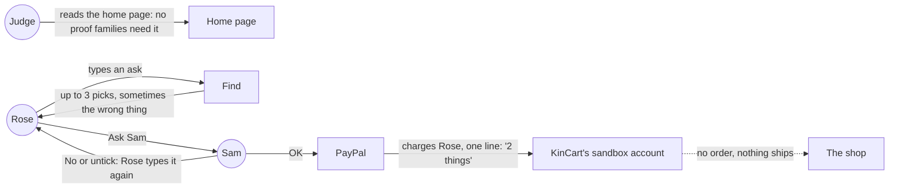
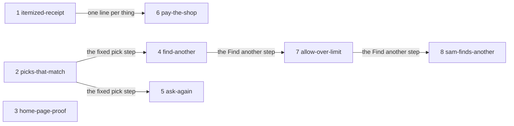

# After the review

**Project type:** Web app with UI, with an LLM path · **Status:** Shaped

A judge's review of v1.2.0 on 2026-10-22 scored KinCart 7.5 of 10. This shape takes its gaps: the judge-facing ones first, then the product step.

## Problem

Judges can see weak spots in KinCart: Rose's PayPal receipt doesn't list the items, AI picks can be wrong, and nothing proves families need it. Shoppers hit more: Rose's money goes to KinCart, not the shop, and Rose retypes to rebuy, or after a No or an empty search.

## Today

In the review's live run, the second battery pick was "Batteries, $2.99 at containerstore.com", with a photo of an empty bin and a note about Energizer AA batteries.

## Slices

Slices 1 to 3 are for judges. Slices 4 and 5 are the AI's new legwork, and slice 6 is the product step.

| # | Slice | What ships | Why this order |
|---|-------|-----------|----------------|
| 1 | `itemized-receipt` | Rose's PayPal activity lists each thing with its price. KinCart's receipt says who got the money: KinCart's sandbox shop, for now. | Smallest change, and PayPal judges see it in the sandbox. `pay-the-shop` splits its lines by shop. |
| 2 | `picks-that-match` | A listing that isn't the thing Rose asked for, such as a storage case sold as "Batteries", never reaches Rose. A /poc first finds where the wrong pick came from (O10). | A judge's first Find can show a wrong pick. `find-another` and `ask-again` reuse the same pick step. |
| 3 | `home-page-proof` | The home page quotes a real older shopper or helper who tried KinCart, cites one checked study, and says Rose can send a photo. | Judges score a "credible, specific case". It is copy and a quote, and it waits on the quote (O13). |
| 4 | `find-another` | On a thing with no fit, a No or an untick, Rose or Sam taps Find another. The AI tries other words, then shows the nearest listings over the limit, and Sam can allow one. | The AI's biggest new legwork. It comes after `picks-that-match` so it reuses the fixed pick step. |
| 5 | `ask-again` | Rose taps a past ask to repeat it. The AI finds today's listings for the same things and says what changed. | Older shoppers rebuy the same things. It stands alone, so it can move up if `find-another` runs long. |
| 6 | `pay-the-shop` | Sam's OK pays each shop's own PayPal account, and the receipt names the shop. KinCart never holds Rose's money. In sandbox, stand-in business accounts play the shops. | The product step, last as the user asked. It rests on two unproven PayPal claims (O3, O4), so a /poc starts it. |
| 7 | `allow-over-limit` | When Find another's other words still find nothing under Sam's limit, Rose sees the nearest listings over it, and Sam can allow one. | Split from `find-another` at its pause 1 (find-another O1). |
| 8 | `sam-finds-another` | Sam taps Find another on Sam's own page. | Split from `find-another` at its pause 1 (find-another O2). It decides who picks (O20). |

## Not doing

- **Accounts and family invites.** Secret links give a judge both people in one tap. Accounts add a sign-up and show nothing new in sandbox (O16, D85).
- **Auto-buy or a standing OK.** A person approves every buy (O6, D83). The first shape's "Not doing: auto-approve" stands.
- **A scheduled search.** Find another runs only when Rose or Sam taps it (O7, D84). Vercel Hobby runs crons once a day.
- **KinCart as a reseller.** Refunds, returns and fraud would become KinCart's (O2, D82).
- **The demo video.** It lives in `Misc/paypal-video`, outside this repo (O15). Later fixes: a real phone clip of Sam's push, a Public upload, and the new slices.
- **Housekeeping outside the slices.** PR #19 is open, but OVERVIEW marks usage-on-status Shipped. The Devpost draft says 188 unit and 22 e2e tests; CI ran 222 and 25.

## Open items

| ID | What | Type | Raised at | Owner | Status | Answer |
| -- | ---- | ---- | --------- | ----- | ------ | ------ |
| O1 | What "improving" aims at, with the deadline set aside | question | shape | user | Resolved | Judges first, then the product. 2026-10-22 |
| O2 | How a purchase reaches a real store. Today Rose's money lands in KinCart's sandbox account | question | shape | user | Resolved | Sam's OK pays the shop's own PayPal, and KinCart never holds the money (D82). 2026-10-22 |
| O3 | A charge from Rose's saved PayPal (`vault_id`) can name another merchant as payee in sandbox, with no partner onboarding | unproven | shape | poc | Handed to pay-the-shop | — |
| O4 | A basket from several shops can be one PayPal order with one payee for each shop, or it needs one order for each shop | unproven | shape | poc | Handed to pay-the-shop | — |
| O5 | In sandbox, a stand-in business account plays each shop. Nothing ships, and the listing's real shop never sees the order | flag | shape | user | Handed to pay-the-shop | — |
| O6 | Should the AI ever buy on its own? | question | shape | user | Resolved | No. A person approves every buy, and the AI does more legwork (D83). 2026-10-22 |
| O7 | Which legwork the AI does | question | shape | user | Resolved | Ask again, a swap after a No, and keep looking. Keep looking runs only when Rose or Sam asks, never on a schedule. The swap and keep looking are one slice, `find-another` (D84). 2026-10-22 |
| O8 | What keep looking does when tapped | question | shape | user | Resolved | Other words first. If still nothing, the nearest listings over Sam's limit, and Sam can allow one (D84). 2026-10-22 |
| O9 | `find-another` may pass five scenarios with the step over the limit | flag | shape | spec | Handed to find-another | — |
| O10 | The review's wrong pick ("Batteries", $2.99 at containerstore.com, a photo of an empty bin, a note about Energizer AA) came from Channel3's listing text, not from Haiku | unproven | shape | poc | Handed to picks-that-match | — |
| O11 | Line items reverse D33, which rejected them. PayPal refuses an order when the item amounts don't add up to the total | flag | shape | user | Handed to itemized-receipt | — |
| O12 | How to show the problem is real | question | shape | user | Resolved | Both: a real person tries KinCart and is quoted, and one published study is cited. 2026-10-22 |
| O13 | Assuming the user's contact agrees to try KinCart and be quoted, by name or by role | assumption | shape | user | Handed to home-page-proof | — |
| O14 | Which published study on password sharing or elder fraud, checked at its source | question | shape | research | Handed to home-page-proof | — |
| O15 | Is the demo video part of this shape? | question | shape | user | Resolved | No. It stays separate, listed in Not doing. 2026-10-22 |
| O16 | Should accounts and family invites replace the secret links? | question | shape | user | Resolved | Not now (D85). 2026-10-22 |
| O17 | When Sam taps Find another, who picks the new listing: Sam, or Rose after Sam's tap | question | shape | user | Handed to find-another | — |
| O18 | What "what changed" means in `ask-again`: price, shop, a listing gone, or all three | question | shape | user | Handed to ask-again | — |
| O19 | This shape's branch stacks on `feat/usage-on-status`, because PR #19 adds D78 to D81 to DECISIONS.md | flag | shape | user | Accepted risk | Merge PR #19 first, then this branch. 2026-10-22 |
| O20 | When Sam taps Find another, who picks the new listing: Sam, or Rose after Sam's tap (from find-another O2, which carried O17) | question | spec | user | Handed to sam-finds-another | — |
| O21 | What Sam allowing a listing over the limit means: Rose picks it and Sam's OK pays it, or Sam allows it first | question | spec | user | Handed to allow-over-limit | — |

## Glossary

- **Payee** — the PayPal account that receives the money in an order.
- **Line items** — the `items` list in a PayPal order, with a name and a price for each thing. PayPal shows them on the payer's receipt.
- **Stand-in shop account** — a sandbox business account that plays a shop such as walmart.com.
- **Agentic commerce** — AI that does shopping work for a person. In KinCart it searches and explains, and a person still approves.
- **/poc** — zuko's timeboxed spike. It answers one risky question with throwaway code.
- **Channel3** — the hackathon sponsor whose API returns real product listings.
- **e2e** — end to end: an automated test that drives the app the way a person would, start to finish.
- **CI** — the service that runs the tests on every push, here GitHub Actions.
