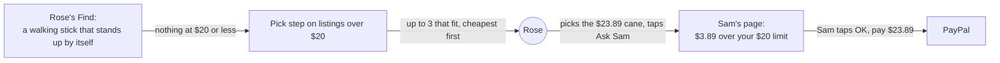
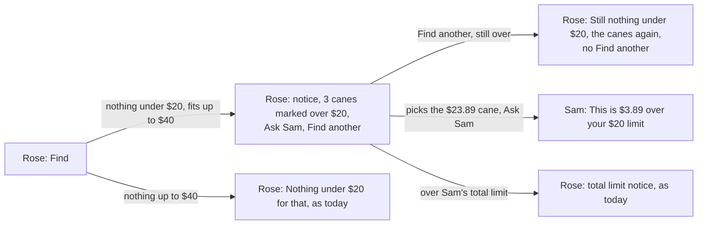
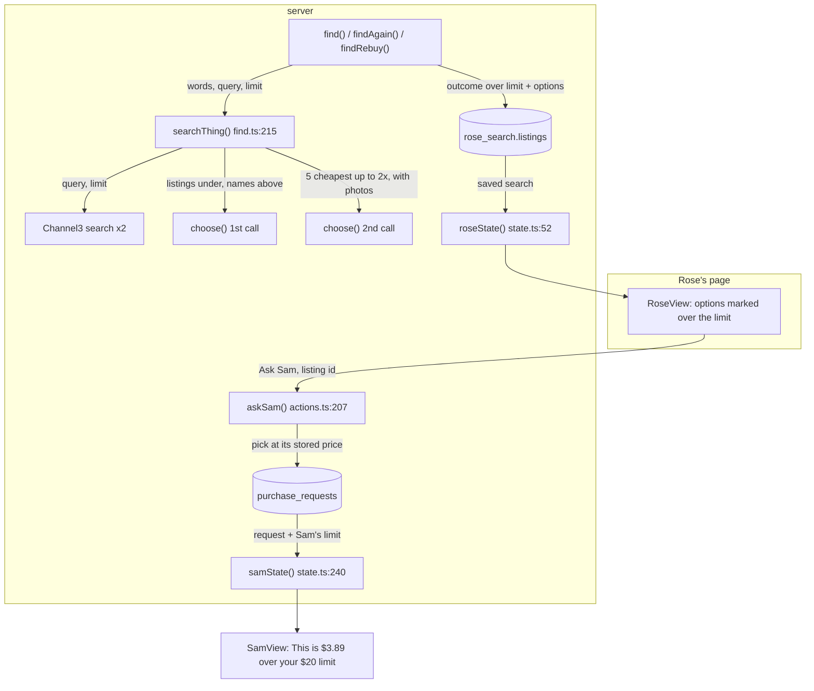
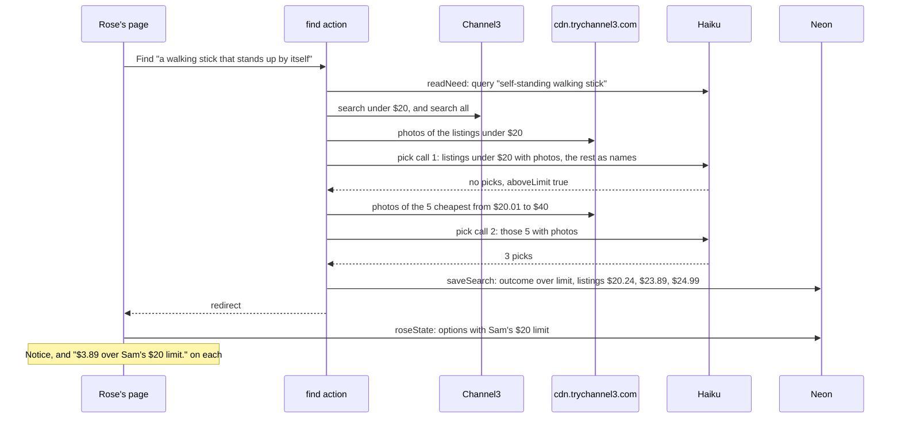
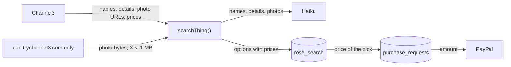

# Allow over limit

**Version:** v1 · **Status:** Built · **Type:** Feature · **Project type:** Web UI, with an LLM path

**Shape doc:** docs/specs/after-review/shape.md
**Depends on:** find-another
**Page:** none. Skipped: you read the `.md` directly.

When nothing fits under Sam's price limit, Rose sees the nearest listings over it, and Sam's OK pays one. It ships now because Find another's other words never fixed an over-limit ask in find-another's measurement.

## Problem

Sam's price limit hides every listing above it. When the thing Rose needs costs more, Rose sees "Nothing under $20 for that. Try different words, or ask Sam to raise the limit." (`app/(shop)/RoseView.tsx:214`). Rose must ask Sam outside KinCart, Sam raises the limit, and Rose searches again.

Find another doesn't help here. Its /build ran 3 real over-limit asks 3 times each with other words, and none of the 9 runs found the right thing under the limit (find-another O10). Find already sees the listings above the limit: the pick call gets their names and says whether one is the thing (`lib/shop/find.ts:253`, D92). Rose never sees them.

## Slice test

| Check                         | Result |
| ----------------------------- | ------ |
| Cuts every layer it needs     | yes: Find's pick step for listings over the limit, Rose's options marked over the limit, and the mark on Sam's page |
| One e2e test walks it         | yes: Rose finds a walking stick, sees canes over Sam's $20 limit, picks one, and Sam's OK pays it |
| Worth shipping alone          | yes: Rose can ask for the nearest thing that fits instead of giving up, and Sam sees the price before saying OK |
| Fits (≤5 scenarios, ≤2 areas) | yes, at the edge: 5 scenarios, in Find in `lib/shop/` and Rose's and Sam's pages in `app/(shop)/` |

**Path:** full. It changes what Find shows, adds a mark on Rose's and Sam's pages, and changes D84.

## User story

As Rose, when nothing fits under Sam's limit, I want to see the nearest things that cost a little more, so that I can ask Sam about one instead of giving up.

## Flow



When nothing fits under Sam's limit, the pick step shows Rose the nearest listings over it, Rose asks Sam for one, and Sam sees how far over it is before tapping OK.

## Acceptance criteria

```gherkin
Scenario: Rose sees listings over Sam's limit when nothing fits under it
  Given Sam's limit is $20
  And Rose's Find for "a walking stick that stands up by itself" finds nothing that fits at $20 or less
  When the Find finishes
  Then Rose sees that nothing fits under $20
  And Rose sees up to 3 options over $20, cheapest first, such as "Four Point Cane" at $20.24 from lowes.com, "Small Base Aluminum Quad Cane" at $23.89 from staples.com and "Walgreens Quad Cane Small Base" at $24.99 from walgreens.com
  And each option says it is over Sam's $20 limit
  And no option costs more than $40, double Sam's limit
  And Rose can pick one and tap Ask Sam, or tap Find another, as today

Scenario: Sam's OK pays a listing over the limit
  Given Sam's limit is $20
  And Rose picked "Small Base Aluminum Quad Cane" at $23.89 from staples.com and tapped Ask Sam
  When Sam opens Sam's page
  Then Sam sees the cane at $23.89, marked $3.89 over Sam's $20 limit
  When Sam taps "OK, pay $23.89"
  Then Rose's saved PayPal pays $23.89, and both receipts show it as today

Scenario: One thing in a basket is over the limit
  Given Sam's limit is $30
  And Rose's Find for "AA batteries, a folding shower chair" shows AA battery options
  And nothing fits under $30 for the shower chair
  Then the shower chair group shows "Folding Bath Seat Bench Shower Chair" at $44.99 from bestbuy.com, marked $14.99 over Sam's $30 limit
  And the AA batteries group shows its options as today
  And Rose can pick one in each group and tap Ask Sam once
  And Sam's page marks only the shower chair's line as over the limit

Scenario: Nothing fits within double the limit
  Given Sam's limit is $20
  And the only shower chairs that fit cost $44.99 and more
  When Rose's Find for "a folding shower chair" finishes
  Then Rose sees "Nothing under $20 for that. Try different words, or ask Sam to raise the limit.", as today
  And Rose sees no options, and one Find another, as today

Scenario: Sam's total limit still stops the ask
  Given Sam's limit is $20 and Sam's total limit is $20
  And Rose picked "Small Base Aluminum Quad Cane" at $23.89 over Sam's limit
  When Rose taps Ask Sam
  Then the ask doesn't reach Sam, and Rose sees the total limit notice, as today (D34)
```

The canes and the $44.99 shower chair are real Channel3 listings from 2026-10-23. `/build` swaps the examples for listings it finds then.

## Scope

**In:**

- When a search finds nothing that fits under Sam's limit, Rose sees up to 3 listings over it that the pick step says fit, cheapest first, up to double the limit.
- The same rule for each thing in a basket, and for Find another and Ask again, since they share Find's search and pick step.
- The pick step checks each listing over the limit as it checks those under it, with its photo (D89).
- Each option over the limit says so on Rose's page. Sam's page marks the ask, or the basket line, as over the limit and by how much.
- Sam's OK pays it as today. Sam's total limit still stops any ask over it at Ask Sam (D34).

**Out:**

- Ask again's listing from last time when it is over the limit now and other options fit under it. It stays shown as today, with its price, and can't be picked. No later slice.
- Sam raising the limit from the ask. Sam changes it in the limit form, as today. No later slice.
- A different push for an ask over the limit. The push says what it says today. No later slice.
- Sam's own Find another, and who picks after it. `sam-finds-another` picks these up.

## Interface

Rose's and Sam's pages each get one line on a listing over the limit, and one notice. Every piece comes from the design system: no new component, class or token.



Rose sees the dearer options with a notice and a mark on each, and Sam sees how far over the limit the ask is before tapping OK.

| Where | What it says |
| ----- | ------------ |
| Rose, one thing, on top | "Nothing under $20 for that. These cost a little more, and Sam sees the price before saying OK." After Find another: "Still nothing under $20 for that." and the same second sentence |
| Rose, a basket group | Under the group's heading: "Nothing under $30 for this one. These cost a little more, and Sam sees the price before saying OK." The group keeps its Find another and None of these |
| Rose, each listing over the limit | Under its price, in bold: "$3.89 over Sam's $20 limit." |
| Rose, one thing, under the options | Find another, with "KinCart tries other words for you.", until it has run once. Try other words stays, as on every options screen |
| Rose, one thing, after a stopped Find another | The day's limit notice on top, as on the basket screen (D101, O12) |
| Sam, one thing, on top | "This is $3.89 over your $20 limit." |
| Sam, a basket line | Under its price, in bold: "$14.99 over your $30 limit." |

The marks compare the price with Sam's limit on each redraw. When Sam raises the limit past a price, that listing's mark goes, as Ask again's notice does (D103). The heading's "Only 2 found at $20 or less" line is left out when every option is over the limit.

**Motion tier:** 1, as before (O5). Nothing new moves: the notices rise and fade like every notice, and Ask Sam turns the existing spinner. Under reduced motion, nothing moves.

**Components used:** `Notice` (`neutral`), `ListingPicker` (with a new `limitCents` prop that adds one line), `BasketAnswer` (with a new `limitCents` prop that adds one line), `Summary`, `Button` (secondary), `AnotherForm`, `.heading`, `.stack` and `.small`. The tokens come from `docs/design/design-system/` (D15).

**Built at pause 2:** `ListingPicker` and `BasketAnswer` take `limitCents`. Rose's options screen and basket groups pass it, show the notice, and offer Find another on an over-limit options screen. Sam's request state takes `limitCents` and shows the notice.

**Preview:** `/preview/allow-over-limit` on `pnpm dev`, from `app/(shop)/preview/allow-over-limit/page.tsx`. It shows Rose's and Sam's real pages in 12 frames, one or more for each scenario.

## Technical plan

### Approach

`searchThing()` runs a second pick call when the first one finds nothing under Sam's limit and says a listing above it fits. The second call gets the 5 cheapest listings over the limit and up to double it, with their photos, through the same `choose()`. Its picks come back cheapest first, after last time's listing in Ask again, as the search's options, with outcome `over limit`. `rose_search` keeps them in its `listings` column, and Rose's page shows them as options, with the marks built at pause 2. Nothing in the schema changes.

Relies on: D19, D23, D31, D34, D73, D83, D89, D90, D91, D93, D95, D97, D103, D104, D109, D110, D111, D112



Find's search and pick step return the options over the limit, Neon keeps them, and Rose's and Sam's pages compare each price with Sam's limit as they draw.





Listing data from Channel3 crosses into Haiku and Neon as today. Photos come only from Channel3's CDN (D95), and the price charged comes only from Neon (D23).

### Changes

| File | What changes | Why |
| ---- | ------------ | --- |
| `lib/shop/find.ts:17` | `Single`'s `over limit` outcome takes optional `options` | Scenarios 1, 3 |
| `lib/shop/find.ts:215` | After the first `choose()` finds nothing under the limit and says `aboveLimit`, take the 5 cheapest listings over the limit and up to double it, and last time's listing when it is within double. `withPhotos()` them, call `choose(words, kept, [], lastId)`, and return the picks cheapest first, last time's first, as `{ outcome: "over limit", options }`. No picks, no listing within double, or a failed call give `{ outcome: "over limit" }`, as today (D93). The `checked` and `unloaded` counts add the second call's photos | Scenarios 1, 3, 4; O7, O9, O10 |
| `lib/shop/find.ts:151` | `groupOf()` keeps an over-limit result's options in the group, with `problem: "over limit"` | Scenario 3 |
| `lib/shop/find.ts:272` | `counts()` counts an over-limit search's options, so the log line says `listings=3` | Proof it works |
| `lib/shop/requests.ts:249` | `saveSearch()` stores the options of an `over limit` search too | Scenario 1 |
| `app/(shop)/state.ts:52` | `roseState()` shows an `over limit` search that has options as the options screen. `emptyOf()` already offers it one Find another | Scenario 1; O6 |
| `app/(shop)/state.ts:240` | `samState(request, limitCents)` puts Sam's limit on the request state | Scenarios 2, 3 |
| `app/(shop)/h/[token]/page.tsx:51` | Passes `limitCents` to `samState()` | Scenarios 2, 3 |
| `app/(shop)/ui.tsx`, `RoseView.tsx`, `SamView.tsx`, `BasketAnswer.tsx` | Built at pause 2: the marks and notices | Scenarios 1 to 3 |
| `e2e/db.ts:15` | `reset()`'s search takes an `outcome`, so a test can seed an over-limit search | The e2e |
| `lib/shop/find.test.ts`, `lib/shop/requests.test.ts`, `app/(shop)/state.test.ts`, `app/(shop)/actions.test.ts`, `app/(shop)/RoseView.test.tsx`, `app/(shop)/SamView.test.tsx` | The tests in the plan below | Every scenario |
| `e2e/allow-over-limit.spec.ts` | New. The e2e below | Scenarios 1, 2 |

Reusing: `choose()` and its prompt as they are, `withPhotos()` and its CDN rules (D95), `groupOf()`, `saveSearch()` and `getSearch()`, `emptyOf()` and `againOf()` for Find another, `askSam()` and its total-limit check (D34) unchanged, `lastPick()` for last time's listing, `stubServices()` and `product()` in `find.test.ts`, and `reset()`, `listing()` and `sql()` in `e2e/db.ts`.

`choose()` labels the second call's listings "Under their price limit, pick from these". They are over it. Haiku never sees a price, and the /poc found the right listings with this exact call, so the label stays and the first call's text stays as the recorded set tests it (D90).

### Earn-it

| Added | Triggered by |
| ----- | ------------ |
| A second `choose()` call in `searchThing()` | Scenario 1, and D89: a listing Rose can pick must pass the photo check. O7 |
| The cap of 5 listings for the second call | O8 and O10: 8 photos took a one-thing Find to 14.9 s, against D91's 15 s |
| `options` on the `over limit` outcome | Scenario 1: the options must survive the 3 s redraw (D19) and Ask Sam reads them from Neon (D23) |
| `limitCents` on Sam's request state | Scenario 2: Sam's page must say how far over the limit the ask is |
| An `outcome` on `reset()`'s search in `e2e/db.ts` | The e2e seeds an over-limit search. No helper seeds one today |

### Non-functionals

|                      |                                                                               |
| -------------------- | ----------------------------------------------------------------------------- |
| **Load**             | The second call runs only on a thing whose first call finds nothing under the limit and says one above fits: all 3 over-limit asks in the /poc, and none of the AA batteries or night light runs. It adds one Haiku call with up to 5 photos for that thing, and no Channel3 search |
| **Breaks first**     | At 10 times the Finds, many pick calls with photos at once time Haiku out, as 10 Finds at once did (learning: run real Finds two at a time). The thing then falls back to today's "Nothing under $20" (D93). D73's 20 Finds a day bound each address |
| **Security surface** | No new route or caller: `find`, `askSam` and `answer` check Rose's or Sam's link as today. Channel3's listing data is trusted as before, and photos come only from `cdn.trychannel3.com` (D95). The amount charged comes from Neon (D23). No new secret. `rose_search.listings` stores over-limit options as it stores options today |
| **Proof it works**   | In Vercel's logs, `find outcome=over-limit listings=3 searches=2 ms=<n> checked=<n> unloaded=0`. Today an over-limit Find logs `listings=0`. Mask the link tokens in any log line before sharing it |
| **Rollout**          | No flag, no migration, no new env value. Merge, CI tests, and Vercel promotes (D10). Rollback: revert the merge. A saved over-limit search with options then shows today's "Nothing under $20" screen, and an ask already sent to Sam stays payable |

### Test plan

| Scenario | Test | Command |
| -------- | ---- | ------- |
| 1 Rose sees listings over the limit | `find.test.ts`: a first call with no picks and `aboveLimit` sends a second call only the listings from $20.01 to $40, with photos, and returns its picks cheapest first as `over limit` with options. The log line says `listings=3`. `requests.test.ts`: an `over limit` search with options saves and reads back. `state.test.ts`: it shows as the options screen, and `againOf()` offers Find another until it has run. `RoseView.test.tsx`: the notice, each mark, Find another before it has run and not after, no "Only 2 found" line, and no mark once the limit covers the price | `pnpm test` |
| 2 Sam's OK pays it | `state.test.ts`: `samState()` carries Sam's limit. `SamView.test.tsx`: "This is $3.89 over your $20 limit." `actions.test.ts`: Ask Sam sends an over-limit pick at its stored $23.89. The e2e | `pnpm test`, `pnpm test:e2e e2e/allow-over-limit.spec.ts` |
| 3 A basket with one thing over | `find.test.ts`: the shower chair's group comes back with `problem: "over limit"` and its option, and the batteries' group as today. `RoseView.test.tsx`: the group's notice and mark. `SamView.test.tsx`: only the chair's line is marked | `pnpm test` |
| 4 Nothing within double | `find.test.ts`: with the only fit at $44.99 on a $20 limit, no second call runs, and the outcome is `over limit` with no options. A second call that fails gives the same | `pnpm test` |
| 5 The total limit still stops it | `actions.test.ts`: Ask Sam with the $23.89 cane and a $20 total limit redirects with `over=` and asks Sam nothing | `pnpm test` |
| O9 Last time's listing first | `find.test.ts`: in Ask again, last time's listing at $24.99 comes first among the options over the limit, ahead of a $21.23 one | `pnpm test` |
| O10 The 5 cheapest | `find.test.ts`: with 7 listings up to double the limit, the second call gets the 5 cheapest | `pnpm test` |

**E2E:** `e2e/allow-over-limit.spec.ts`, from an already-saved PayPal (D20). It seeds Sam's $20 limit and an over-limit search for "a walking stick that stands up by itself" with the three canes. Rose sees "Nothing under $20 for that." and "$3.89 over Sam's $20 limit.", picks "Small Base Aluminum Quad Cane" and taps Ask Sam. Sam's page says "This is $3.89 over your $20 limit.", and Sam taps "OK, pay $23.89". Both pages show the $23.89 receipt. It seeds the search, as `basket-cap.spec.ts` does, so Channel3 and Haiku answers don't change the walk. Stop `pnpm dev` before it runs (learning: stop pnpm dev before running the e2e).

### Chunks

Single chunk. It changes about 60 lines of app code beyond pause 2's, and its unit tests and e2e share the local database (learning: build chunks one after another when their tests share the local database).

### Risks

| Risk | Mitigation |
| ---- | ---------- |
| An over-limit Find runs close to D91's 15 s. The walking stick took 14.9 s with 8 photos | The cap of 5 (O10). Each Haiku call keeps its 10 s timeout, and a timed-out second call shows today's "Nothing under $20" (D93). The page's `maxDuration` is 30 s |
| `CHANNEL3_API_KEY` is out of free credits (O11). Every Find fails with `channel3 402` where it is set | Local runs use `CHANNEL3_API_KEY_II` (O11). The e2e above seeds its search. The e2e specs that call Channel3 for real (D24) fail in CI until GitHub's key has credits |
| The second call finds nothing for a real ask. The sock aid's call found a fit in 1 of 3 runs | Rose sees today's "Nothing under $10" screen and Find another, as before |
| Sam lowers the limit after Rose asks, so an ask made under the old limit shows as over it | The mark is true for the limit Sam has now. Sam's OK still pays it |

### Decisions to record

Recorded as D109, D110, D111, D112.

## Review

2026-10-23 · 3 raw findings, 2 survived, 2 fixed.

- correctness · `app/(shop)/RoseView.tsx:266` · the over-limit notice and Find another need a search over the limit, not only prices over Sam's limit now · `e49f0bf`
- correctness · `lib/shop/find.ts:308` · Ask again's `same=` log count reads an over-limit search's options · `dad06fc`

## Open items

| ID | What | Type | Raised at | Owner | Status | Answer |
| -- | ---- | ---- | --------- | ----- | ------ | ------ |
| O1 | What Sam allowing a listing over the limit means: Rose picks it and Sam's OK pays it, or Sam allows it first (from shape O21) | question | shape | user | Resolved | Rose picks it and taps Ask Sam, as for any pick. Sam's page shows how far over the limit it is, and Sam's OK pays it. 2026-10-23 |
| O2 | When Rose sees listings over the limit: straight after any search that finds nothing under it, or only after Find another also finds nothing, as D84 says | question | spec p1 | user | Resolved | Straight after any search that finds nothing under the limit, and Find another stays on the screen. Other words fixed 0 of 9 over-limit runs (find-another O10). D84 changes (D110). 2026-10-23 |
| O3 | Which listings over the limit Rose sees, how many, and in what order | question | spec p1 | user | Resolved | Up to 3 that the pick step says are the thing, cheapest first. 2026-10-23 |
| O4 | How far over Sam's limit a listing can be. For "a folding shower chair" at a $30 limit, the fits run $44.99, $90.99 and more | question | spec p1 | user | Resolved | Up to double Sam's limit. For a $30 limit, nothing above $60. 2026-10-23 |
| O5 | Which motion tier the slice uses. The new notices rise and fade like every notice, and nothing else moves | question | spec p2 | user | Resolved | Tier 1, as before. Nothing new moves. 2026-10-23 |
| O6 | Rose's one-thing screen over the limit shows Find another and Try other words, both under Ask Sam | question | spec p2 | user | Resolved | Keep both. Try other words stays, as on every options screen. 2026-10-23 |
| O7 | How the pick step checks listings over the limit. D92 rejected one more call in a row, and photos for listings above the limit | question | spec p3 | user | Resolved | A second pick call, with photos, on the listings up to double the limit. It runs only when the first call finds nothing under the limit and says one above fits. The pick prompt stays as the recorded set tests it. Supersedes D92 (D112). 2026-10-23 |
| O8 | A Find that needs the second pick call stays within D91: one thing within 15 s, five within 20 s | unproven | spec p3 | poc | Resolved | Yes, with no margin for the walking stick. A /poc ran real Haiku and Channel3 on `CHANNEL3_API_KEY_II`: 12 searches, each run once and timed, and the Haiku calls and photo downloads run 3 times. One thing, two at a time: the walking stick at $20 took 13.8, 14.9 and 14.9 s, the shower chair at $30 5.8 to 8.0 s, and the sock aid at $10 7.7 to 8.4 s. Five things at $20 took 12.9 to 15.7 s. The second call took 1.5 to 2.4 s with 1 photo, 2.8 to 3.6 s with 5, and 5.1 to 6.3 s with 8. It found canes at $21.23 to $29.99, the $44.99 chair, and once a $15.99 sock aid. 2026-10-23 |
| O9 | In Ask again, last time's listing can be over the limit now and among the options over it. D104 puts it first, and D111 says cheapest first | question | spec p3 | user | Resolved | Last time's listing comes first and picked, as D104 says. The rest follow cheapest first. 2026-10-23 |
| O10 | How many listings the second pick call sees. The walking stick sent 8 photos and took 14.9 s | question | spec p3 | user | Resolved | The 5 cheapest up to double the limit, and last time's listing when it is within double. 2026-10-23 |
| O11 | `CHANNEL3_API_KEY` in `.env.local` is out of Channel3's free credits: every search answers `402`. Vercel's production key and GitHub's CI key may be the same one | flag | spec p3 | user | Resolved | Use `CHANNEL3_API_KEY_II`. `/build` runs its tests with `CHANNEL3_API_KEY="$CHANNEL3_API_KEY_II"` in the shell, which wins over `.env.local`, so no code changes. Swapping the key on Vercel and in GitHub's secrets is the user's call. 2026-10-23 |
| O12 | The plan's options screen had no day's limit notice. A stopped Find another on Rose's over-limit options screen would show the same screen and say nothing, where D101 puts the limit notice on top | flag | build | user | Decided alone | Chose: the options screen takes `waitMinutes` and shows the day's limit notice on top, as the basket screen does. Other: no notice there, so Rose's tap seems to do nothing. Undo: remove the `waitMinutes` lines from `roseState()` and from the options screen in `RoseView.tsx`, added in c7450a4. 2026-10-23 |

_Never delete this section or its rows. See references/ledger.md._

## Glossary

- **Price limit** — the most Sam lets one thing cost, $50 until Sam sets it, from $5 to $500.
- **Total limit** — the most Sam lets one ask cost in all, off until Sam sets it (D34).
- **Pick step** — the Haiku call that checks each listing's photo and words and picks up to 3 that are the thing Rose asked for.
- **Channel3** — the hackathon sponsor whose API returns real product listings.
- **e2e** — end to end: an automated test that drives the app the way a person would, start to finish.
