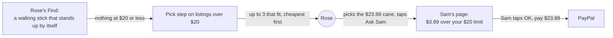

# Allow over limit

**Version:** v1 · **Status:** Draft · **Type:** Feature · **Project type:** Web UI, with an LLM path

**Shape doc:** docs/specs/after-review/shape.md
**Depends on:** find-another
**Page:** added at pause 3.

When nothing fits under Sam's price limit, Rose sees the nearest listings over it, and Sam's OK pays one. It ships now because Find another's other words never fixed an over-limit ask in find-another's measurement.

## Problem

Sam's price limit hides every listing above it. When the thing Rose needs costs more, Rose sees "Nothing under $20 for that. Try different words, or ask Sam to raise the limit." (`app/(shop)/RoseView.tsx:214`). Rose must ask Sam outside KinCart, Sam raises the limit, and Rose searches again.

Find another doesn't help here. Its /build ran 3 real over-limit asks 3 times each with other words, and none of the 9 runs found the right thing under the limit (find-another O10). Find already sees the listings above the limit: the pick call gets their names and says whether one is the thing (`lib/shop/find.ts:253`, D92). Rose never sees them.

## Slice test

| Check                         | Result |
| ----------------------------- | ------ |
| Cuts every layer it needs     | yes: Find's pick step for listings over the limit, Rose's options marked over the limit, and the mark on Sam's page |
| One e2e test walks it         | yes: Rose finds a walking stick, sees canes over Sam's $20 limit, picks one, and Sam's OK pays it |
| Worth shipping alone          | yes: Rose can ask for the nearest thing that fits instead of giving up, and Sam sees the price before saying OK |
| Fits (≤5 scenarios, ≤2 areas) | yes, at the edge: 5 scenarios, in Find in `lib/shop/` and Rose's and Sam's pages in `app/(shop)/` |

**Path:** full. It changes what Find shows, adds a mark on Rose's and Sam's pages, and changes D84.

## User story

As Rose, when nothing fits under Sam's limit, I want to see the nearest things that cost a little more, so that I can ask Sam about one instead of giving up.

## Flow



When nothing fits under Sam's limit, the pick step shows Rose the nearest listings over it, Rose asks Sam for one, and Sam sees how far over it is before tapping OK.

## Acceptance criteria

```gherkin
Scenario: Rose sees listings over Sam's limit when nothing fits under it
  Given Sam's limit is $20
  And Rose's Find for "a walking stick that stands up by itself" finds nothing that fits at $20 or less
  When the Find finishes
  Then Rose sees that nothing fits under $20
  And Rose sees up to 3 options over $20, cheapest first, such as "Four Point Cane" at $20.24 from lowes.com, "Small Base Aluminum Quad Cane" at $23.89 from staples.com and "Walgreens Quad Cane Small Base" at $24.99 from walgreens.com
  And each option says it is over Sam's $20 limit
  And no option costs more than $40, double Sam's limit
  And Rose can pick one and tap Ask Sam, or tap Find another, as today

Scenario: Sam's OK pays a listing over the limit
  Given Sam's limit is $20
  And Rose picked "Small Base Aluminum Quad Cane" at $23.89 from staples.com and tapped Ask Sam
  When Sam opens Sam's page
  Then Sam sees the cane at $23.89, marked $3.89 over Sam's $20 limit
  When Sam taps "OK, pay $23.89"
  Then Rose's saved PayPal pays $23.89, and both receipts show it as today

Scenario: One thing in a basket is over the limit
  Given Sam's limit is $50
  And Rose's Find for "AA batteries, a folding shower chair" shows 3 AA battery options
  And nothing fits under $50 for the shower chair
  Then the shower chair group shows "Folding Bath Seat Bench Shower Chair" at $64.99 from bestbuy.com, marked over Sam's $50 limit
  And the AA batteries group shows its options as today
  And Rose can pick one in each group and tap Ask Sam once
  And Sam's page marks only the shower chair's line as over the limit

Scenario: Nothing fits within double the limit
  Given Sam's limit is $20
  And the only shower chairs that fit cost $44.99 and more
  When Rose's Find for "a folding shower chair" finishes
  Then Rose sees "Nothing under $20 for that. Try different words, or ask Sam to raise the limit.", as today
  And Rose sees no options, and one Find another, as today

Scenario: Sam's total limit still stops the ask
  Given Sam's limit is $20 and Sam's total limit is $20
  And Rose picked "Small Base Aluminum Quad Cane" at $23.89 over Sam's limit
  When Rose taps Ask Sam
  Then the ask doesn't reach Sam, and Rose sees the total limit notice, as today (D34)
```

The canes and the $44.99 shower chair are real Channel3 listings from 2026-10-23. Scenario 3's $64.99 price is made up to sit over a $50 limit. `/build` swaps the examples for listings it finds then.

## Scope

**In:**

- When a search finds nothing that fits under Sam's limit, Rose sees up to 3 listings over it that the pick step says fit, cheapest first, up to double the limit.
- The same rule for each thing in a basket, and for Find another and Ask again, since they share Find's search and pick step.
- The pick step checks each listing over the limit as it checks those under it, with its photo (D89).
- Each option over the limit says so on Rose's page. Sam's page marks the ask, or the basket line, as over the limit and by how much.
- Sam's OK pays it as today. Sam's total limit still stops any ask over it at Ask Sam (D34).

**Out:**

- Ask again's listing from last time when it is over the limit now and other options fit under it. It stays shown as today, with its price, and can't be picked. No later slice.
- Sam raising the limit from the ask. Sam changes it in the limit form, as today. No later slice.
- A different push for an ask over the limit. The push says what it says today. No later slice.
- Sam's own Find another, and who picks after it. `sam-finds-another` picks these up.

## Open items

| ID | What | Type | Raised at | Owner | Status | Answer |
| -- | ---- | ---- | --------- | ----- | ------ | ------ |
| O1 | What Sam allowing a listing over the limit means: Rose picks it and Sam's OK pays it, or Sam allows it first (from shape O21) | question | shape | user | Resolved | Rose picks it and taps Ask Sam, as for any pick. Sam's page shows how far over the limit it is, and Sam's OK pays it. 2026-10-23 |
| O2 | When Rose sees listings over the limit: straight after any search that finds nothing under it, or only after Find another also finds nothing, as D84 says | question | spec p1 | user | Resolved | Straight after any search that finds nothing under the limit, and Find another stays on the screen. Other words fixed 0 of 9 over-limit runs (find-another O10). D84 changes (D110). 2026-10-23 |
| O3 | Which listings over the limit Rose sees, how many, and in what order | question | spec p1 | user | Resolved | Up to 3 that the pick step says are the thing, cheapest first. 2026-10-23 |
| O4 | How far over Sam's limit a listing can be. For "a folding shower chair" at a $30 limit, the fits run $44.99, $90.99 and more | question | spec p1 | user | Resolved | Up to double Sam's limit. For a $30 limit, nothing above $60. 2026-10-23 |

_Never delete this section or its rows. See references/ledger.md._

## Glossary

- **Price limit** — the most Sam lets one thing cost, $50 until Sam sets it, from $5 to $500.
- **Total limit** — the most Sam lets one ask cost in all, off until Sam sets it (D34).
- **Pick step** — the Haiku call that checks each listing's photo and words and picks up to 3 that are the thing Rose asked for.
- **Channel3** — the hackathon sponsor whose API returns real product listings.
- **e2e** — end to end: an automated test that drives the app the way a person would, start to finish.
