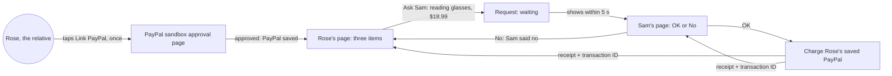
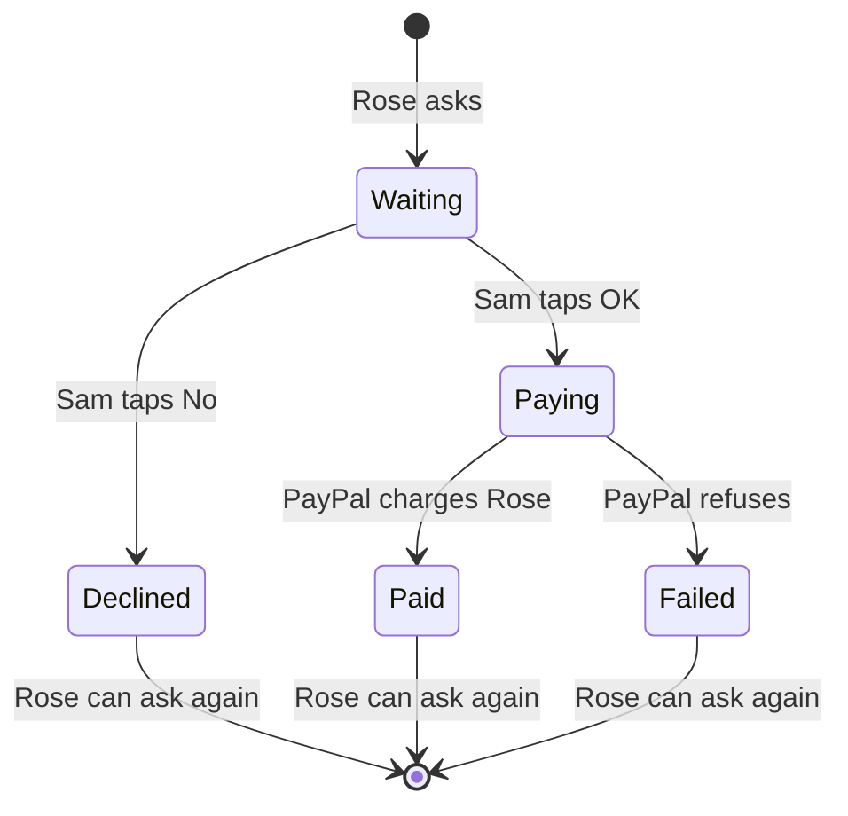
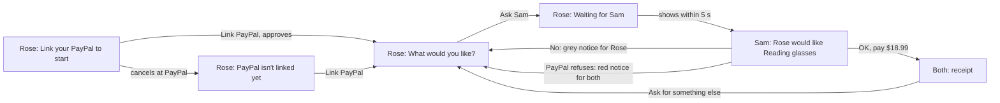
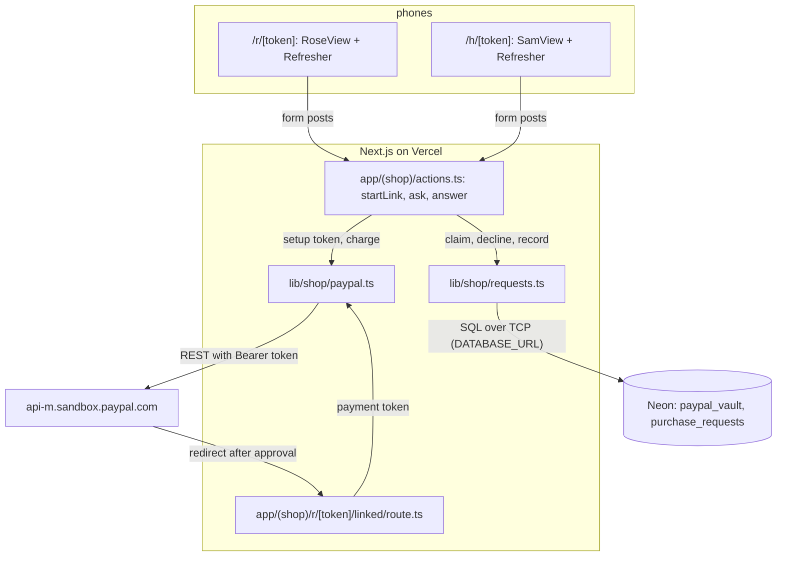
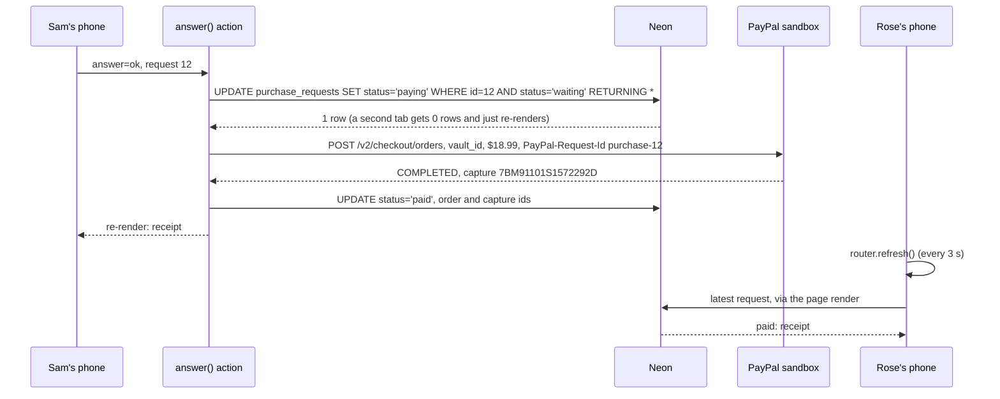
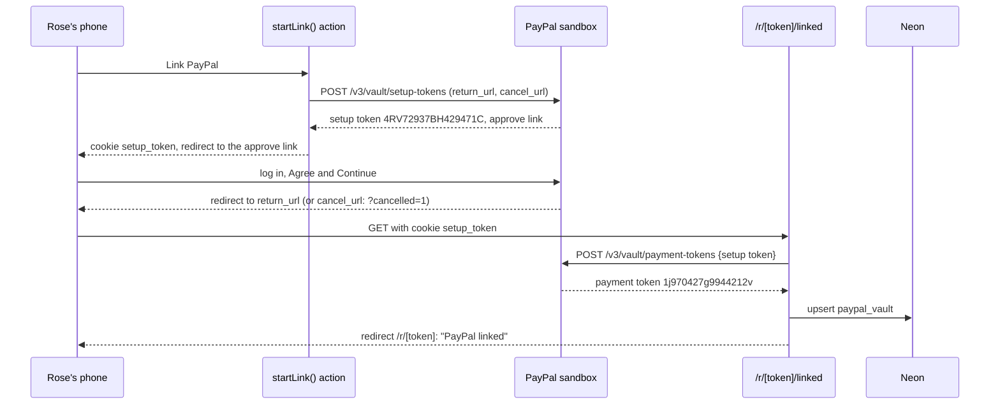
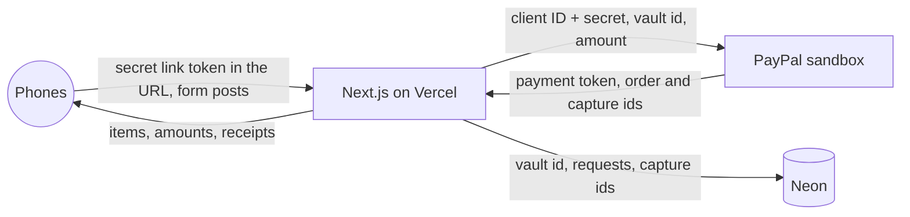
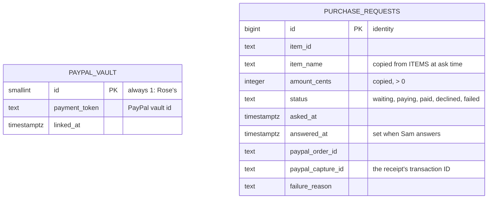

# Approve and pay

**Version:** v1 · **Status:** Built · **Type:** Feature · **Project type:** Web UI

**Shape doc:** docs/specs/shop-together/shape.md
**Depends on:** skeleton; the design system (D15)
**Page:** none. Skipped: you read the `.md` directly.

Rose, the relative, links their sandbox PayPal once and picks one of three items. Sam, the helper, taps OK or No on their own phone, and an OK charges Rose's saved PayPal and shows both of them a receipt. It ships first after the skeleton because it rests on the riskiest claim, the vault (O1), and it is the core value: nobody hands over a password.

## Problem

Today, when your relative wants something online, you log in as them with their passwords and buy it. That happens a few times a month. Each time it costs you the time of a full checkout, and it means you hold their passwords. This slice takes both away: their PayPal is linked once, and from then on a purchase needs only your tap.

## Slice test

| Check                         | Result |
| ----------------------------- | ------ |
| Cuts every layer it needs     | yes: Rose's page and Sam's page, the request and answer endpoints, a requests table, the PayPal vault and charge, deployed |
| One e2e test walks it         | yes: one Playwright test with two pages, Rose's and Sam's, walks link, ask, OK and receipt. Whether it can drive PayPal's own sandbox login page is O6 |
| Worth shipping alone          | yes: with nothing else, Rose gets one of three items paid from their own PayPal on Sam's tap, and no password changes hands |
| Fits (≤5 scenarios, ≤2 areas) | yes, at the limit: 5 scenarios, two areas (the two people's pages, the PayPal vault and charge) |

**Path:** full. New pages, a new table, a new PayPal integration.

## User story

As Rose, I want to ask for something and have it paid from my PayPal once Sam says OK, so that I don't have to get through checkout or give anyone my passwords.

As Sam, I want to approve Rose's purchase from my own phone, so that I don't have to log in as Rose.

## Flow



Rose links PayPal once; after that each purchase is a pick and an ask. Sam's OK charges the saved PayPal and both pages show the receipt; Sam's No goes back to Rose with nothing charged.

## States



A request only moves forward. Once it leaves Waiting, no tap sends it back, which is what keeps scenario 5 to one charge.

## Acceptance criteria

```gherkin
Scenario Outline: Rose links PayPal once
  Given Rose opens their link and the page says "Link your PayPal to start"
  When Rose taps "Link PayPal" and <does> on PayPal's sandbox page
  Then Rose is back on their page and it says "<message>"
  And the page <items>

  Examples:
    | does     | message                 | items                                           |
    | approves | PayPal linked           | shows three items, and still does a day later   |
    | cancels  | PayPal isn't linked yet | shows the "Link PayPal" button again, no items  |

Scenario: Sam says OK and Rose's PayPal pays
  Given Rose has linked PayPal
  And Sam's page is open and says "Nothing to approve"
  When Rose picks "Reading glasses, +2.00" at $18.99 and taps "Ask Sam"
  Then Rose's page says "Waiting for Sam" with the glasses and $18.99, and no item list
  And within 5 seconds Sam's page shows "Rose would like Reading glasses, +2.00" for $18.99 with OK and No
  When Sam taps OK
  Then Rose's sandbox PayPal is charged $18.99
  And Sam's page shows the receipt: Reading glasses, +2.00, $18.99, Paid, the date and time, and PayPal's transaction ID
  And within 5 seconds Rose's page shows the same receipt

Scenario: Sam says no
  Given Rose is waiting on Sam for "AA batteries, pack of 8" at $9.99
  When Sam taps No
  Then within 5 seconds Rose's page says "Sam said no to AA batteries, pack of 8", in neutral grey, not as an error
  And Rose's PayPal is not charged
  And Rose can pick an item and ask again
  And Sam's page says "Nothing to approve"

Scenario: The charge fails after Sam's OK
  Given Rose is waiting on Sam for "Weekly pill organiser" at $12.50
  And PayPal will refuse to charge Rose's saved PayPal
  When Sam taps OK
  Then Sam's page says "Payment didn't go through. Nothing was taken from Rose's PayPal."
  And within 5 seconds Rose's page says "Payment didn't go through. Nothing was taken."
  And Rose's page shows the three items again

Scenario: An answered request can't be answered again
  Given Sam has Rose's request for "Reading glasses, +2.00" at $18.99 open in two tabs
  When Sam taps OK in the first tab, then OK in the second
  Then Rose's PayPal is charged $18.99 once
  And the second tab shows the same receipt, with the same PayPal transaction ID
```

## Scope

**In:**

- Two fixed people, Rose (the relative) and Sam (the helper), each with one long random secret link. No sign-up (O3). The two names are fixed in code; change them before filming if your relative takes part (shape O4).
- Who can do what: Rose's link can link PayPal, pick, ask, and see the answer and receipt. It has no OK or No. Sam's link can see the waiting request, tap OK or No, and see the receipt. It can't link PayPal or ask. Any other link says it doesn't work.
- Rose links a sandbox PayPal once, and it stays linked.
- A fixed list of three items in US dollars (O4): Reading glasses, +2.00 at $18.99; Weekly pill organiser at $12.50; AA batteries, pack of 8 at $9.99.
- One waiting request at a time (O5).
- Both pages check for changes every 3 seconds while open, so a request or an answer shows within 5 seconds without a reload.
- On OK: one charge to Rose's saved PayPal, paid into the app's sandbox business account. Both pages show the receipt: item, amount, Paid, date and time, PayPal's transaction ID.
- On No: Rose sees it in plain, neutral words, and nothing is charged.
- Each page shows the latest request's outcome until Rose asks for something new.
- Screens composed from the design system (D15).

**Out:**

- Typed requests and AI explanations of options: `find-and-explain`.
- Notifications when the page is closed: `ping-helper`.
- Asking by voice: `ask-by-voice`.
- Sam paying from their own PayPal: not built. The vault works (O1, D16), so the O2 fallback isn't needed.
- Cancelling a waiting request, refunds, a history of past purchases, unlinking or switching PayPal accounts: no slice planned.
- More than one relative or helper, and sign-up: no slice planned (O3).
- Spend limits, auto-approve, real shop orders: shape's Not doing list.

## Interface

Two phone pages built from the design system's tokens (D15), one for Rose and one for Sam, plus a page for a broken link. Each is a pure view that takes one state and renders it, the same pattern as `StatusView`.



Rose's page loops through pick, wait and outcome. Every outcome returns Rose to the three items. Sam's page keeps the latest outcome until Rose asks again.

| Page | State | Heading | What else shows |
| ---- | ----- | ------- | --------------- |
| Rose | not linked | Link your PayPal to start | one line on what linking does; Link PayPal |
| Rose | cancelled at PayPal | PayPal isn't linked yet | "Nothing was saved"; Link PayPal |
| Rose | pick | What would you like? | "PayPal linked. Nothing is paid until Sam says OK."; three radio cards with prices; Ask Sam |
| Rose | pick, no item chosen | What would you like? | red line under the cards: "Pick one of the three first." |
| Rose | pick, after No | What would you like? | grey notice above: "Sam said no to AA batteries, pack of 8." |
| Rose | pick, after a failed charge | What would you like? | red notice above: "Payment didn't go through. Nothing was taken." |
| Rose | waiting | Waiting for Sam | amber notice: "Asked at 10:15 AM. This page changes by itself when Sam answers."; item and amount |
| Rose | paid | Sam said OK. It's paid. | green receipt; Ask for something else |
| Sam | nothing | Nothing to approve | "Keep this page open." After a No, a grey notice: "You said no to AA batteries, pack of 8. Rose can see that." |
| Sam | request | Rose would like Reading glasses, +2.00 | $18.99 with "Paid from Rose's PayPal if you say OK."; asked time; OK, pay $18.99; No |
| Sam | paid | Paid from Rose's PayPal | green receipt; "Rose sees this receipt too." |
| Sam | failed | Payment didn't go through | red notice: "Nothing was taken from Rose's PayPal for Weekly pill organiser. Rose can ask again." |
| either | wrong or cut-off link | This link doesn't work | open the whole link again, or ask the sender |

The receipt shows Paid, the amount at 40px, the item, the day and time, and the PayPal transaction ID. Rose and Sam see the same one.

Busy states: Link PayPal becomes "Opening PayPal…", Ask Sam becomes "Asking Sam…", and OK becomes "Paying…" with No hidden, so it can't be tapped mid-charge. No loading screen: the server sends each page complete. No empty state beyond Sam's "Nothing to approve".

Checked: no sideways scroll at 320px and 390px wide; light and dark both rendered; text on the green receipt is 15.2:1 light and 12.2:1 dark, and "Paid" on it is 7.0:1 and 8.1:1. Every other pair is in the brief's table. Radio cards are real radio inputs, so the arrow keys move between them and the focus ring shows on the card.

Craft checks: a one-line "approve a purchase" prompt gives a card with a shadow, a gradient header, and green and red Approve and Decline buttons. Here, No is a plain grey button, cards are flat, and the amount is the one big thing. Against the brief's references: Monzo's large amount and plain "you paid" receipt, and Stripe Checkout's amount kept in view, with an error that says how to fix it ("Pick one of the three first."). It holds up next to both. One thing it lacks: Monzo's receipt names who was paid, and there's no real shop here (shape O9).

**Motion tier:** 1. Buttons shrink to 98% on press (120ms). Notices and the receipt rise 8px and fade in (240ms, ease-out). Spinners turn once every 900ms. Colour changes are instant. Under reduced motion nothing moves, and the words still change.

**Components used:** tokens only, as the system has no component library (its conventions say to build each control from the tokens). Built here from them: `Button` (primary, secondary, busy), `ItemPicker` (radio cards), `Notice` (wait, neutral, danger), `Summary`, `ReceiptCard`, in `app/(shop)/ui.tsx`.

**Preview:** `/preview/approve-and-pay` on `pnpm dev`. The views are `app/(shop)/RoseView.tsx`, `SamView.tsx` and `BrokenLinkView.tsx`. Tokens come from `docs/design/design-system/tokens/` through `app/(shop)/layout.tsx`, and the font from `next/font` in `app/layout.tsx`.

## Technical plan

### Approach

Rose's and Sam's pages are server components at `/r/[token]` and `/h/[token]`. Each one reads the saved PayPal and the latest request from Neon, maps them to one state, and renders the pause 2 view. Taps are server actions. Linking uses PayPal's vault, as the spike did (D16): a setup token, Rose's approval, then a payment token saved in one row. Sam's OK claims the request with one conditional `UPDATE`, so only one tab can win (scenario 5). Then it charges the saved PayPal with `PayPal-Request-Id` set to the request's ID, so a retry can't charge twice. A small client component calls `router.refresh()` every 3 seconds while the page is on screen, which is how each phone sees the other's change within 5 seconds.

Relies on: D2, D3, D4, D5, D6, D7, D10, D11, D12, D13, D15, D16, D17, D18, D19, D20



Each phone posts to server actions. The actions and the return route are the only code that talks to PayPal and Neon.



Sam's OK claims, charges, records, then re-renders. Rose's page picks the result up on its next refresh.



The setup token rides in an httpOnly cookie, so the return route doesn't depend on which query parameters PayPal adds. Nobody checked those parameters in the spike.



The PayPal secret and the vault ID never reach a phone. A phone only gets what its screen shows.

### Changes

| File | What changes | Why |
| ---- | ------------ | --- |
| `db/migrations/0002_purchase_requests.up.sql`, `.down.sql` | create and drop `paypal_vault` and `purchase_requests`, plus a unique partial index allowing one open request | 1 to 5; reverse path |
| `lib/shop/items.ts` | `type Item`, `ITEMS` (the three from Scope), `findItem(id)`. The amount always comes from here, never from the form | 2 |
| `lib/shop/people.ts` | `whoIs(token): "rose" \| "sam" \| null`: compares against `ROSE_LINK_TOKEN` and `SAM_LINK_TOKEN` with `crypto.timingSafeEqual`, and gives null when either is unset | who can do what (Scope) |
| `lib/shop/paypal.ts` | plain `fetch` (D17), same shape as `lib/status/paypal.ts:13`: `createSetupToken(returnUrl, cancelUrl)`, `createPaymentToken(setupTokenId)`, `charge(vaultId, item, requestId)`. A `charge` that completes gives `paid` with the order and capture ids. A 4xx, or a capture that isn't `COMPLETED`, gives `refused` (403 `PERMISSION_DENIED` for an unknown vault ID, checked). A 5xx, timeout or network error gives `unknown`. 15 s timeout | 1, 2, 4, 5 |
| `lib/shop/requests.ts` | one `pg` `Client` per call, like `lib/status/database.ts:12`. `getVault`, `saveVault` (upsert row 1), `latest`, `ask(item)` (a unique violation `23505` means one is already open, so it does nothing), `decline(id)`, `claim(id)` (`waiting` to `paying`, sets `answered_at`), `record(id, result)`, `stuck()` (`paying` for over 15 s) | 2 to 5 |
| `lib/shop/pay.ts` | `pay(request)`: reads the vault, calls `charge` with `purchase-{id}`, then records `paid`, records `failed`, or leaves `paying` on `unknown`. Logs one line | 2, 4, 5 |
| `lib/shop/*.test.ts` | Vitest; see Test plan | 1 to 5 |
| `scripts/migrate.test.ts` | the up, down, up test also checks both new tables | reverse path |
| `app/(shop)/actions.ts` | `"use server"`. `startLink(token)`: setup token, httpOnly `setup_token` cookie scoped to `/r/{token}`, redirect to PayPal. `ask(token, formData)`: no item redirects to `?pick=missing`. `answer(token, requestId, formData)`: `no` calls `decline`; `ok` calls `claim` then `pay`. Each action re-checks `whoIs` first | 1 to 5 |
| `app/(shop)/r/[token]/linked/route.ts` | GET: Rose only. Reads the cookie, calls `createPaymentToken`, then `saveVault`, clears the cookie, and redirects to `/r/{token}`. Any failure redirects to `?cancelled=1` and logs the reason | 1 |
| `app/(shop)/state.ts` | pure `roseState(vault, latest, params)` and `samState(latest)`, mapping database rows to the pause 2 states | 1 to 5 |
| `app/(shop)/r/[token]/page.tsx`, `h/[token]/page.tsx` | `await connection()`, `whoIs` (wrong person calls `notFound()`), retry one `stuck()` request with `pay`, render the view and `<Refresher />` | 1 to 5 |
| `app/(shop)/r/[token]/not-found.tsx`, `h/[token]/not-found.tsx` | render `BrokenLinkView` | wrong link |
| `app/(shop)/Refresher.tsx` | client: `router.refresh()` every 3 s while `document.visibilityState` is `visible` | 2 to 4 (D19) |
| `app/(shop)/LocalTime.tsx` | client: formats a time in the phone's own time zone after hydration. The server runs in UTC on Vercel | 2, receipt |
| `app/(shop)/Button.tsx` | `Button` moves out of `ui.tsx` as a client component: `useFormStatus()` pending, or the preview's `busy` prop, shows the spinner and the busy label | busy states |
| `app/(shop)/ui.tsx`, `RoseView.tsx`, `SamView.tsx` | `Item` imported from `lib/shop/items.ts`; forms take the actions; times use `LocalTime`; "Ask for something else" becomes a link to `?ask=1` | 1 to 5 |
| `app/(shop)/preview/approve-and-pay/page.tsx` | `notFound()` when `VERCEL_ENV` is `production` | agreed at pause 3 |
| `e2e/approve-and-pay.spec.ts` | the e2e; see Test plan. It resets both tables with `pg` before each test, and seeds `paypal_vault` from `PAYPAL_E2E_VAULT_ID` | 1 to 5 |
| `playwright.config.ts` | loads `.env.local` when present, as `vitest.config.mts` does, so the e2e can reach the database and read the link tokens. Missed by the plan; added at `/build` | e2e |
| `.github/workflows/ci.yml` | `test` job env: `ROSE_LINK_TOKEN: ci-rose-link`, `SAM_LINK_TOKEN: ci-sam-link` (they guard only CI's throwaway database), and `PAYPAL_E2E_VAULT_ID` from secrets | e2e |
| `.env.example`, `README.md` | the two link tokens and how to make them (`openssl rand -base64 32`); how to open each person's link; the US sandbox app and "Save payment methods" (learning) | setup |

Reusing: `scripts/migrate.mjs` (no change; 0002 is picked up by name), the per-call `pg` client pattern from `lib/status/database.ts`, the `fetch` with `AbortSignal.timeout` pattern from `lib/status/paypal.ts`, the views and `ui.tsx` from pause 2, and `renderToStaticMarkup` view tests like `app/status/StatusView.test.tsx`.

Set by hand at `/build` (dashboards, not files):
- Vercel Production env: `PAYPAL_CLIENT_ID` and `PAYPAL_CLIENT_SECRET` switch to the US app's pair; add `ROSE_LINK_TOKEN` and `SAM_LINK_TOKEN`.
- GitHub secrets: the same PayPal pair, plus `PAYPAL_E2E_VAULT_ID` = `1j970427g9944212v`.
- After the first deploy, link Rose's PayPal on the live site with the US personal sandbox account. That is scenario 1, checked by hand (O6).

### Data



The two tables don't reference each other: there is one relative and one saved PayPal. `purchase_requests_one_open` is a unique index on `((true)) WHERE status IN ('waiting', 'paying')`, so the database itself allows only one open request (O5).

**Migration:** expand only. Two new tables with `CREATE TABLE IF NOT EXISTS` and `CREATE UNIQUE INDEX IF NOT EXISTS`, since `migrate up` reruns every file. Nothing to backfill, nothing to switch.
**Reverse:** `pnpm db:down` runs `0002_purchase_requests.down.sql`: `DROP TABLE IF EXISTS purchase_requests; DROP TABLE IF EXISTS paypal_vault;`. That drops the saved vault ID and the sandbox request history. `scripts/migrate.test.ts` runs up, down, up.

### Earn-it

| Added | Triggered by |
| ----- | ------------ |
| `paypal_vault` table | scenario 1: the vault ID must outlive the request that saved it |
| `purchase_requests` table | scenarios 2 to 5: a request crosses two phones and many page loads |
| unique partial index | O5: one waiting request, held by the database rather than by a read-then-write race |
| conditional `UPDATE` claim | scenario 5: two tabs tapping OK charge once |
| `PayPal-Request-Id` = request ID, and the `stuck()` retry | scenarios 4 and 5: a function cut off mid-charge must neither charge twice nor stay unpaid with no receipt |
| `setup_token` cookie | scenario 1: the return route needs the setup token without trusting PayPal's query parameters |
| `Refresher` | scenarios 2 to 4: within 5 s on the other phone (D19) |
| `LocalTime` | scenario 2's receipt: the server's UTC time would be wrong on both phones |
| `state.ts` split from the pages | the mapping from row to screen is the slice's main logic; it gets tested without a database |

Not added: the PayPal SDK (D17), a connection pool, a people table, webhooks, a feature flag (see Rollout), any new dependency.

### Non-functionals

|                      |                                                                               |
| -------------------- | ----------------------------------------------------------------------------- |
| **Load**             | Two people, a few requests a day. While a page is on screen it re-renders every 3 s: one page render and two small queries. |
| **Breaks first**     | Neon's free compute-hours, again. A tab left visible keeps Neon awake: about 6 of the 100 free hours a month for each day it stays open (O8). Polling stops when the tab is hidden or the phone sleeps. Fix if it bites: stop refreshing after 15 quiet minutes. |
| **Security surface** | Anyone holding Rose's link can link a PayPal and ask. Anyone holding Sam's link can approve one open request at a time, for at most $18.99 of sandbox money (O3). Every action and route re-checks the token, compared in constant time. The amount comes from `ITEMS`, never from the form. A request ID only acts on a `waiting` row. Server actions reject cross-origin posts (Next.js checks the Origin header). Secrets: the PayPal pair and both link tokens (Vercel env); the PayPal pair and `PAYPAL_E2E_VAULT_ID` (GitHub secrets). Stored: the vault ID, and per request the item, amount, times, and PayPal order and capture IDs. No names, emails or card details. Logs never include the vault ID or a link token. |
| **Proof it works**   | One Vercel log line per payment: `purchase id=12 item=glasses status=paid capture=7BM91101S1572292D`, or `status=failed reason=PERMISSION_DENIED`. One per link: `paypal link status=linked` or `status=failed reason=…`. In PayPal, the US sandbox business account's activity lists the payment. |
| **Rollout**          | No flag. The pages only answer to the two link tokens; with them unset, every link says it doesn't work, which is the off switch. Rollback: revert on `main`; Deployment Checks promote the revert (D10). Schema: `pnpm db:down` against Neon. |

### Test plan

| Scenario | Test | Command |
| -------- | ---- | ------- |
| 1 Link PayPal | `lib/shop/paypal.test.ts`: setup and payment token calls, `fetch` stubbed. `app/(shop)/state.test.ts`: no vault gives "not linked"; `?cancelled=1` gives "cancelled". `app/(shop)/r/[token]/linked/route.test.ts`: the return route saves the PayPal from the cookie, and says not linked when PayPal refuses or the cookie is gone. `e2e/approve-and-pay.spec.ts`: with no vault, Rose's page says "Link your PayPal to start"; `?cancelled=1` says "PayPal isn't linked yet". PayPal's own page is checked by hand once at `/build` (O6) | `pnpm test`, `pnpm test:e2e` |
| 2 OK and paid | e2e (below), against real PayPal sandbox | `pnpm test:e2e` |
| 3 Sam says no | e2e: Rose asks for AA batteries, Sam taps No, Rose sees "Sam said no to AA batteries, pack of 8" within 5 s, Sam sees "Nothing to approve", and the row has no order ID | `pnpm test:e2e` |
| 4 Charge fails | e2e: seeds the vault with `e2e-not-a-real-token`; PayPal answers 403; both pages show the failure, and Rose sees the items again. `lib/shop/paypal.test.ts`: 4xx gives `refused`, 5xx and timeout give `unknown` | `pnpm test:e2e`, `pnpm test` |
| 5 Answered once | e2e: a second Sam tab taps OK after the first and shows the same transaction ID; the database has one `paid` row and one capture. `lib/shop/requests.test.ts`: the second `claim` returns null; `decline` after `claim` returns false; a second `ask` while one is open adds no row | `pnpm test:e2e`, `pnpm test` |
| Stuck charge | `lib/shop/pay.test.ts`: a `paying` row over 15 s old is charged again with the same `PayPal-Request-Id` (`fetch` stubbed) | `pnpm test` |
| Who can do what | `lib/shop/people.test.ts`: right tokens, wrong token, unset env. e2e: `/r/wrong` answers 404 with "This link doesn't work" | `pnpm test`, `pnpm test:e2e` |
| Reverse path | `scripts/migrate.test.ts`: up, down, up, with both new tables | `pnpm test` |

`pnpm test:e2e` needs `ROSE_LINK_TOKEN`, `SAM_LINK_TOKEN`, `PAYPAL_E2E_VAULT_ID` and the US PayPal pair: CI env and secrets, or `.env.local`.

**E2E:** `e2e/approve-and-pay.spec.ts`, test "Rose asks, Sam says OK, both see one receipt". At 390×844 it seeds the saved PayPal, then on Rose's page picks Reading glasses and waits 4 s (one refresh must keep the pick) before tapping Ask Sam. Sam's page shows the request within 5 s. Sam taps OK, a second Sam tab taps OK too, and both Sam tabs and Rose's page show Paid, $18.99 and the same transaction ID. That is a real sandbox charge on every CI run.

### Chunks

| Chunk | Scenarios | Files owned |
| ----- | --------- | ----------- |
| A | 1 to 5: data and payment | `db/migrations/0002_*`, `lib/shop/**`, `scripts/migrate.test.ts` |
| B | 1 to 5: pages and wiring | `app/(shop)/**`, `e2e/approve-and-pay.spec.ts`, `.github/workflows/ci.yml`, `.env.example`, `README.md` |

No new dependencies, so the lockfile doesn't change. B codes against A's signatures in Changes, and its e2e runs once both chunks are merged.

### Risks

| Risk | Mitigation |
| ---- | ---------- |
| The e2e now makes a real sandbox charge, so a PayPal sandbox outage turns CI red with nothing wrong in the code | Rerun the job. Unit tests stub PayPal, so a red unit test is always ours |
| The CI vault ID stops working (sandbox account reset, or the token is deleted) | e2e fails at the charge with `PERMISSION_DENIED`. Link a sandbox PayPal once by hand and update `PAYPAL_E2E_VAULT_ID` |
| A retried `paying` request charges twice if PayPal has already forgotten the `PayPal-Request-Id` | Retries come from page loads 15 s or more after the claim, so within a minute while a page is open. The spike saw the key honoured on an immediate repeat. Longer retention is unchecked |
| `router.refresh()` resets Rose's picked radio before Ask Sam | The e2e waits 4 s between pick and Ask to catch it. Fix: make the picker a client component holding its own state |
| Vercel and GitHub still hold the MY app's keys, which have no vault access | The `/build` dashboard steps above. Until then the live charge fails with `NOT_AUTHORIZED` and shows scenario 4's screen |
| Text shifts slightly when the font finishes loading (no metric-matched fallback for this font, a build warning) | Accept for now; it's a one-time shift on first load |

### Decisions to record

Recorded as D17, D18, D19, D20.

## Open items

| ID | What | Type | Raised at | Owner | Status | Answer |
| -- | ---- | ---- | --------- | ----- | ------ | ------ |
| O1 | Saving Rose's PayPal once (vault), then charging it later on Sam's OK alone, works in sandbox (from shape O1) | unproven | shape | poc | Resolved | Yes, with the v3 vault, once "Save payment methods" is ticked on the sandbox app. It was off, and PayPal answered `NOT_AUTHORIZED`. Personal account `sb-tvgg853347282` approved setup token `4RV72937BH429471C` once; payment token `1j970427g9944212v` was charged $18.99 later with no buyer present: `POST /v2/checkout/orders` with `payment_source.paypal.vault_id` came back `COMPLETED` at once, capture `7BM91101S1572292D`. The same `PayPal-Request-Id` sent twice returned the same order and one capture. Billing Agreements v1 also worked, but PayPal lists it as deprecated. `.env.local` now holds a US sandbox app (merchant `sb-qe3zu53303991`); Vercel and GitHub still hold the MY app's keys. Spike, 2026-10-13 |
| O2 | Fallback if the vault fails. Normal checkout puts Rose's PayPal login back in the path (from shape O2) | question | shape | user | Resolved | Sam pays from their own PayPal: OK opens normal PayPal checkout on Sam's phone. No shared passwords; the money comes from Sam. Built only if O1 fails, and then scenario 1 goes and scenarios 2, 4 and 5 charge Sam. 2026-10-13 |
| O3 | Two fixed demo people and no sign-up. Anyone holding Sam's link could approve a sandbox charge (from shape O8) | assumption | shape | user | Accepted risk | One long random secret link each. A leaked link for Sam can approve a charge in sandbox money only. Agreed 2026-10-13 |
| O4 | Assuming US dollars and US sandbox accounts: a US personal account for Rose, a US business account receiving the money. Which countries PayPal offers the vault in is unchecked; the spike uses US accounts | assumption | spec p1 | user | Resolved | Confirmed with pause 1 approval, 2026-10-13 |
| O5 | Assuming one waiting request at a time, with no cancel. If Sam never answers, Rose can't ask for anything else | assumption | spec p1 | user | Resolved | Confirmed with pause 1 approval, 2026-10-13 |
| O6 | The e2e can drive PayPal's sandbox login and approval page in CI, or it has to start from an already-linked PayPal | unproven | spec p1 | spec p3 | Resolved | It starts already linked: the spike's saved vault ID sits in a GitHub secret, and every run makes a real sandbox charge. PayPal's approval page is checked by hand once at /build (D20). 2026-10-13 |
| O7 | A personal sandbox account can approve the billing agreement and be charged. Both spike approvals were made by the MY business account (`sb-hnzlq53312161`), so a personal payer is untested | unproven | poc | user | Resolved | Yes. Personal account `sb-tvgg853347282` approved agreement `B-0K795184PM582223H`, and $9.99 was charged later with no buyer present: capture `8VU82241V0834892E`, `COMPLETED`. The same account then passed the vault test in O1. 2026-10-13 |
| O8 | Pages re-render every 3 s while on screen. A tab left visible keeps Neon awake: about 6 of the 100 free compute-hours a month for each day it stays open | flag | spec p3 | user | Accepted risk | Refreshing stops when the tab is hidden or the phone sleeps, and demo use is minutes a day. If it bites, stop after 15 quiet minutes. Agreed 2026-10-13 |

_Never delete this section or its rows. See references/ledger.md._

## Glossary

- **Vault** — PayPal's store for a saved payment method. The account holder approves once, and the app can charge later without them logging in.
- **Billing agreement** — PayPal's older form of a saved PayPal. The buyer approves once and the shop gets an ID (`B-…`) it can charge later. Deprecated; the spike tried it before the vault was switched on (O1).
- **PayPal-Request-Id** — a header PayPal uses to spot a repeated request and return the first result instead of charging again.
- **Sandbox** — PayPal's test environment. Fake accounts, fake money, real API.
- **Secret link** — a URL with a long random part nobody can guess. Holding the link is the only key.
- **Transaction ID** — the reference PayPal gives each payment, shown on the receipt so either person can find it in PayPal.
- **Server action** — a function that runs on the server when a form is posted. Next.js checks the request came from our own site.
- **`router.refresh()`** — asks the server to re-render the current page and swaps in the changes without a reload.
- **Setup token / payment token** — the vault's two steps: a setup token is what Rose approves; the payment token (vault ID) is what we keep and charge.
- **Capture** — the moment the money moves. Its ID is the transaction ID on the receipt.
- **Idempotent** — safe to repeat: sending it twice has the same effect as once.
- **e2e** — end to end: one test that drives the app in a real browser the way a person would.
- **Backfill** — filling a new column or table from data already there. Nothing to backfill here: both tables are new.
- **Lockfile** — `pnpm-lock.yaml`: pins the exact version of every dependency. This slice adds none, so it doesn't change.
- **Spike** — a short throwaway experiment (`/poc`) that answers one risky question.
