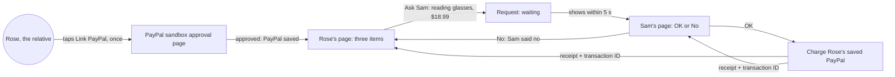
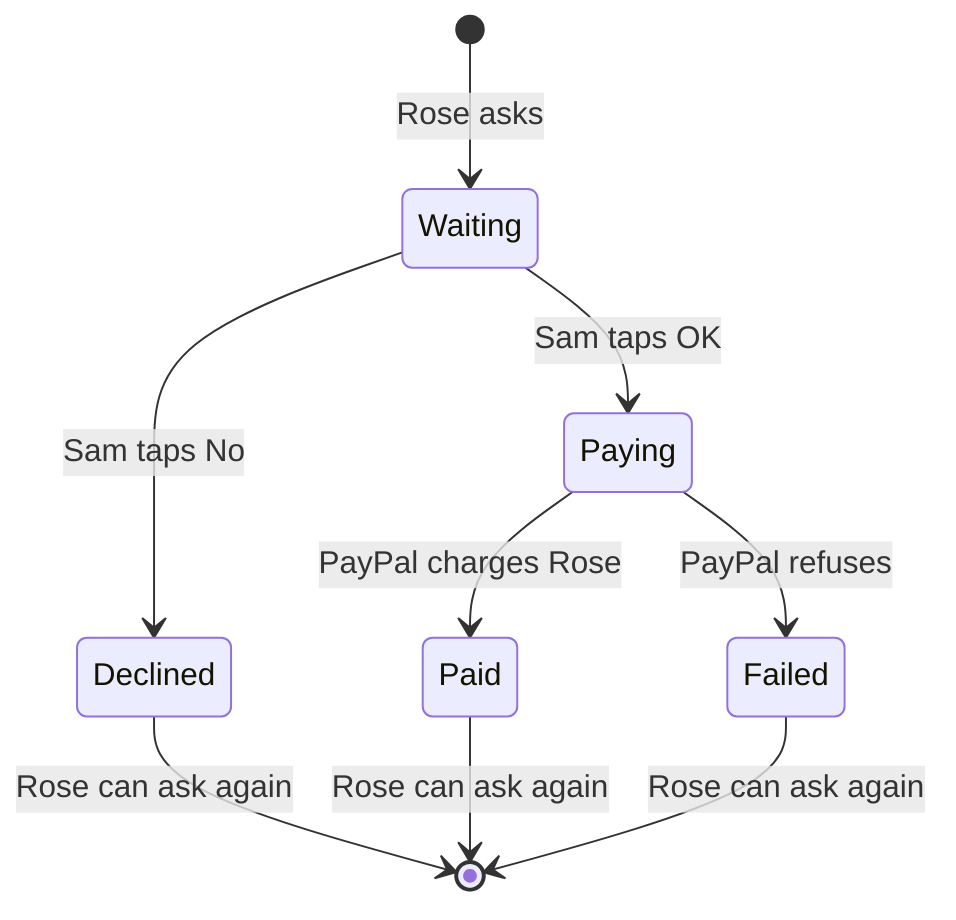

# Approve and pay

**Version:** v1 · **Status:** Draft · **Type:** Feature · **Project type:** Web UI

**Shape doc:** docs/specs/shop-together/shape.md
**Depends on:** skeleton; the design system (D15)
**Page:** none. Skipped: you read the `.md` directly.

Rose, the relative, links their sandbox PayPal once and picks one of three items. Sam, the helper, taps OK or No on their own phone, and an OK charges Rose's saved PayPal and shows both of them a receipt. It ships first after the skeleton because it rests on the riskiest claim, the vault (O1), and it is the core value: nobody hands over a password.

## Problem

Today, when your relative wants something online, you log in as them with their passwords and buy it. That happens a few times a month. Each time it costs you the time of a full checkout, and it means you hold their passwords. This slice takes both away: their PayPal is linked once, and from then on a purchase needs only your tap.

## Slice test

| Check                         | Result |
| ----------------------------- | ------ |
| Cuts every layer it needs     | yes: Rose's page and Sam's page, the request and answer endpoints, a requests table, the PayPal vault and charge, deployed |
| One e2e test walks it         | yes: one Playwright test with two pages, Rose's and Sam's, walks link, ask, OK and receipt. Whether it can drive PayPal's own sandbox login page is O6 |
| Worth shipping alone          | yes: with nothing else, Rose gets one of three items paid from their own PayPal on Sam's tap, and no password changes hands |
| Fits (≤5 scenarios, ≤2 areas) | yes, at the limit: 5 scenarios, two areas (the two people's pages, the PayPal vault and charge) |

**Path:** full. New pages, a new table, a new PayPal integration.

## User story

As Rose, I want to ask for something and have it paid from my PayPal once Sam says OK, so that I don't have to get through checkout or give anyone my passwords.

As Sam, I want to approve Rose's purchase from my own phone, so that I don't have to log in as Rose.

## Flow



Rose links PayPal once; after that each purchase is a pick and an ask. Sam's OK charges the saved PayPal and both pages show the receipt; Sam's No goes back to Rose with nothing charged.

## States



A request only moves forward. Once it leaves Waiting, no tap sends it back, which is what keeps scenario 5 to one charge.

## Acceptance criteria

```gherkin
Scenario Outline: Rose links PayPal once
  Given Rose opens their link and the page says "Link your PayPal to start"
  When Rose taps "Link PayPal" and <does> on PayPal's sandbox page
  Then Rose is back on their page and it says "<message>"
  And the page <items>

  Examples:
    | does     | message                 | items                                           |
    | approves | PayPal linked           | shows three items, and still does a day later   |
    | cancels  | PayPal isn't linked yet | shows the "Link PayPal" button again, no items  |

Scenario: Sam says OK and Rose's PayPal pays
  Given Rose has linked PayPal
  And Sam's page is open and says "Nothing to approve"
  When Rose picks "Reading glasses, +2.00" at $18.99 and taps "Ask Sam"
  Then Rose's page says "Waiting for Sam" with the glasses and $18.99, and no item list
  And within 5 seconds Sam's page shows "Rose would like Reading glasses, +2.00" for $18.99 with OK and No
  When Sam taps OK
  Then Rose's sandbox PayPal is charged $18.99
  And Sam's page shows the receipt: Reading glasses, +2.00, $18.99, Paid, the date and time, and PayPal's transaction ID
  And within 5 seconds Rose's page shows the same receipt

Scenario: Sam says no
  Given Rose is waiting on Sam for "AA batteries, pack of 8" at $9.99
  When Sam taps No
  Then within 5 seconds Rose's page says "Sam said no to AA batteries, pack of 8", in neutral grey, not as an error
  And Rose's PayPal is not charged
  And Rose can pick an item and ask again
  And Sam's page says "Nothing to approve"

Scenario: The charge fails after Sam's OK
  Given Rose is waiting on Sam for "Weekly pill organiser" at $12.50
  And PayPal will refuse to charge Rose's saved PayPal
  When Sam taps OK
  Then Sam's page says "Payment didn't go through. Nothing was taken from Rose's PayPal."
  And within 5 seconds Rose's page says "Payment didn't go through. Nothing was taken."
  And Rose's page shows the three items again

Scenario: An answered request can't be answered again
  Given Sam has Rose's request for "Reading glasses, +2.00" at $18.99 open in two tabs
  When Sam taps OK in the first tab, then OK in the second
  Then Rose's PayPal is charged $18.99 once
  And the second tab shows the same receipt, with the same PayPal transaction ID
```

## Scope

**In:**

- Two fixed people, Rose (the relative) and Sam (the helper), each with one long random secret link. No sign-up (O3). The two names are fixed in code; change them before filming if your relative takes part (shape O4).
- Who can do what: Rose's link can link PayPal, pick, ask, and see the answer and receipt. It has no OK or No. Sam's link can see the waiting request, tap OK or No, and see the receipt. It can't link PayPal or ask. Any other link says it doesn't work.
- Rose links a sandbox PayPal once, and it stays linked.
- A fixed list of three items in US dollars (O4): Reading glasses, +2.00 at $18.99; Weekly pill organiser at $12.50; AA batteries, pack of 8 at $9.99.
- One waiting request at a time (O5).
- Both pages check for changes every 3 seconds while open, so a request or an answer shows within 5 seconds without a reload.
- On OK: one charge to Rose's saved PayPal, paid into the app's sandbox business account. Both pages show the receipt: item, amount, Paid, date and time, PayPal's transaction ID.
- On No: Rose sees it in plain, neutral words, and nothing is charged.
- Each page shows the latest request's outcome until Rose asks for something new.
- Screens composed from the design system (D15).

**Out:**

- Typed requests and AI explanations of options: `find-and-explain`.
- Notifications when the page is closed: `ping-helper`.
- Asking by voice: `ask-by-voice`.
- Sam paying from their own PayPal: built only if the vault spike fails (O2).
- Cancelling a waiting request, refunds, a history of past purchases, unlinking or switching PayPal accounts: no slice planned.
- More than one relative or helper, and sign-up: no slice planned (O3).
- Spend limits, auto-approve, real shop orders: shape's Not doing list.

## Open items

| ID | What | Type | Raised at | Owner | Status | Answer |
| -- | ---- | ---- | --------- | ----- | ------ | ------ |
| O1 | Saving Rose's PayPal once (vault), then charging it later on Sam's OK alone, works in sandbox (from shape O1) | unproven | shape | poc | Resolved | Yes, with Billing Agreements v1, not the v3 vault. Vault setup tokens answer `NOT_AUTHORIZED` on both sandbox apps, MY and US. A billing agreement approved once (`B-8T410996G4242493E`) was charged $18.99 later with no buyer: `POST /v2/checkout/orders` with `payment_source.token` of type `BILLING_AGREEMENT` came back `COMPLETED` at once, capture `50G56147LD7319003`. Resending it with the same `PayPal-Request-Id` returned the same order and one capture. Billing Agreements v1 is on PayPal's deprecated list. `.env.local` now holds a US sandbox app (merchant `sb-qe3zu53303991`); Vercel and GitHub still hold the MY app's keys. Spike, 2026-10-13 |
| O2 | Fallback if the vault fails. Normal checkout puts Rose's PayPal login back in the path (from shape O2) | question | shape | user | Resolved | Sam pays from their own PayPal: OK opens normal PayPal checkout on Sam's phone. No shared passwords; the money comes from Sam. Built only if O1 fails, and then scenario 1 goes and scenarios 2, 4 and 5 charge Sam. 2026-10-13 |
| O3 | Two fixed demo people and no sign-up. Anyone holding Sam's link could approve a sandbox charge (from shape O8) | assumption | shape | user | Accepted risk | One long random secret link each. A leaked link for Sam can approve a charge in sandbox money only. Agreed 2026-10-13 |
| O4 | Assuming US dollars and US sandbox accounts: a US personal account for Rose, a US business account receiving the money. Which countries PayPal offers the vault in is unchecked; the spike uses US accounts | assumption | spec p1 | user | Resolved | Confirmed with pause 1 approval, 2026-10-13 |
| O5 | Assuming one waiting request at a time, with no cancel. If Sam never answers, Rose can't ask for anything else | assumption | spec p1 | user | Resolved | Confirmed with pause 1 approval, 2026-10-13 |
| O6 | The e2e can drive PayPal's sandbox login and approval page in CI, or it has to start from an already-linked PayPal | unproven | spec p1 | spec p3 | Open | — |
| O7 | A personal sandbox account can approve the billing agreement and be charged. Both spike approvals were made by the MY business account (`sb-hnzlq53312161`), so a personal payer is untested | unproven | poc | user | Open | — |

_Never delete this section or its rows. See references/ledger.md._

## Glossary

- **Vault** — PayPal's store for a saved payment method. The account holder approves once, and the app can charge later without them logging in.
- **Billing agreement** — PayPal's older form of a saved PayPal. The buyer approves once and the shop gets an ID (`B-…`) it can charge later. Deprecated, but it works where the vault doesn't (O1).
- **PayPal-Request-Id** — a header PayPal uses to spot a repeated request and return the first result instead of charging again.
- **Sandbox** — PayPal's test environment. Fake accounts, fake money, real API.
- **Secret link** — a URL with a long random part nobody can guess. Holding the link is the only key.
- **Transaction ID** — the reference PayPal gives each payment, shown on the receipt so either person can find it in PayPal.
- **e2e** — end to end: one test that drives the app in a real browser the way a person would.
- **Spike** — a short throwaway experiment (`/poc`) that answers one risky question.
