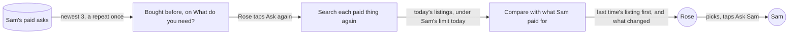
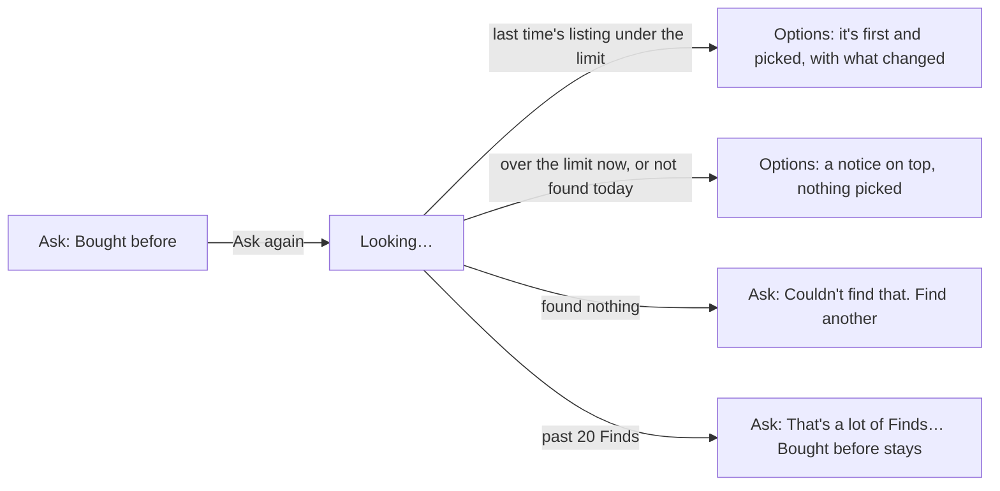
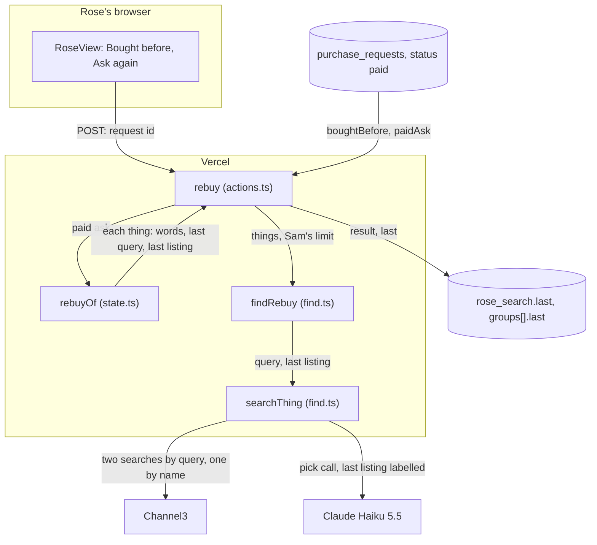
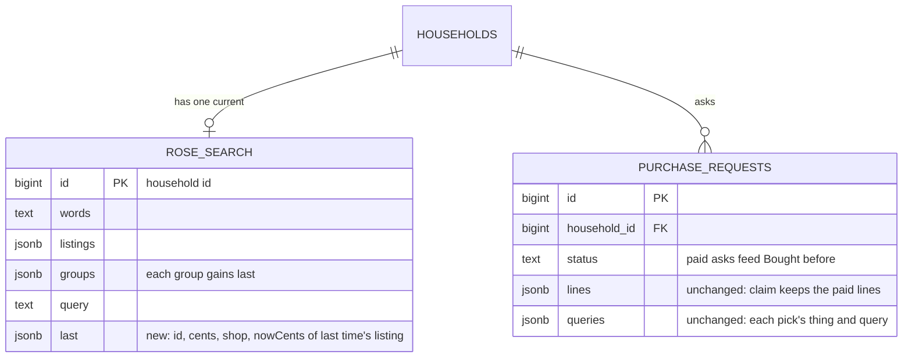

# Ask again

**Version:** v1 · **Status:** Built · **Type:** Feature · **Project type:** Web UI, with an LLM path

**Shape doc:** docs/specs/after-review/shape.md
**Depends on:** find-another
**Page:** none. Skipped: you read the `.md` directly.

Rose taps Ask again next to something Sam paid for before. KinCart finds today's listings for the same things, puts the one Rose bought last time first, and says what changed. It ships now because older shoppers rebuy the same things, and today Rose must type them again.

## Problem

To buy AA batteries again, Rose types "AA batteries" again. Rose may not remember the words they used, or which pack Sam approved. The new Find can show other packs first, so Rose can't tell which one they had. Rose also can't see if the price went up.

Rose's page only reads the latest ask (`lib/shop/requests.ts:121`), so nothing on it shows what Sam paid for before. I don't have a count of rebuys. No log line tells a rebuy from a new ask.

## Slice test

| Check                         | Result |
| ----------------------------- | ------ |
| Cuts every layer it needs     | yes: a "Bought before" list with Ask again on Rose's page, a server action, Find's search and pick step on the stored queries, and a read of Sam's past paid asks |
| One e2e test walks it         | yes: Rose finds AA batteries, Sam taps OK, Rose taps Ask again under "Bought before", sees today's options with what changed, and asks Sam again |
| Worth shipping alone          | yes: Rose rebuys with one tap, and sees if the pack or its price changed |
| Fits (≤5 scenarios, ≤2 areas) | yes: 5 scenarios, and two areas, Rose's page and Find |

**Path:** full. It adds a new control on Rose's page, a new read of past asks, and a compare step after Find's search.

## User story

As Rose, I want to buy again something Sam paid for before with one tap, so that I don't type it again and I can see if it changed.

## Flow



Rose's page lists the 3 newest asks that Sam paid for. Rose taps Ask again on one. KinCart searches each paid thing again, puts last time's listing first when it can, says what changed, and Rose asks Sam as today.

## Acceptance criteria

```gherkin
Scenario: Bought before shows Rose's 3 newest paid asks
  Given Rose's household has these asks:
    | asked  | what                                                                      | Sam's answer                         |
    | Oct 18 | "GE Plug-In LED Night Light, 2 Pack", $7.98                               | paid                                 |
    | Oct 19 | "Dearfoams Women's Cozy Slippers", $24.99                                 | said no                              |
    | Oct 20 | "Energizer MAX AA Batteries, 8 Pack", $8.99                               | paid                                 |
    | Oct 21 | the Energizer pack and "Anker 312 USB C Charger, 20W", $24.98 in all      | paid, and left out "a night light"   |
    | Oct 22 | "Energizer MAX AA Batteries, 8 Pack", $8.99                               | paid                                 |
  When Rose opens their page at "What do you need?"
  Then "Bought before" lists the Energizer pack from Oct 22, the 2 things from Oct 21, and the night lights from Oct 18, each with Ask again
  And the Energizer pack from Oct 20 isn't listed, because Oct 22 bought the same
  And the slippers that Sam said no to aren't listed

Scenario Outline: Ask again finds the one Rose bought last time
  Given Sam paid $8.99 for "Energizer MAX AA Batteries, 8 Pack" from walmart.com on Oct 22, found for "AA batteries"
  And Sam's limit is $20
  And today's search has the Energizer pack at <price> from <shop>
  When Rose taps Ask again next to it
  Then Rose sees up to 3 options for "AA batteries", each at $20 or less
  And the first is the Energizer pack, marked "You bought this last time"
  And it says "<what changed>"
  And /status shows one more Find and its Channel3 searches
  And Rose can pick one and tap Ask Sam, as today

  Examples:
    | price | shop        | what changed                                  |
    | $8.99 | walmart.com | Same price as last time.                      |
    | $9.49 | walmart.com | Now $9.49. It was $8.99.                      |
    | $8.99 | target.com  | Now from target.com. It was from walmart.com. |

Scenario Outline: The one Rose bought last time isn't there to pick
  Given Sam paid $8.99 for "Energizer MAX AA Batteries, 8 Pack" on Oct 22, found for "AA batteries"
  And <today>
  When Rose taps Ask again next to it
  Then <result>

  Examples:
    | today                                                                       | result                                                                                                                  |
    | Sam's limit is now $8, and today's search has the Energizer pack at $9.49  | Rose sees up to 3 other options at $8 or less, and "The one you bought last time is $9.49 now, over Sam's $8 limit."    |
    | Sam's limit is $20, and today's search doesn't have the Energizer pack     | Rose sees up to 3 other options at $20 or less, and "Couldn't find the one you bought last time today."                |
    | Sam's limit is $20, and today's search finds nothing for "AA batteries"    | Rose sees "Couldn't find that. Try different words." and Find another, as after a Find                                  |

Scenario: Ask again on a basket repeats only what Sam paid for
  Given on Oct 21 Rose asked for "AA batteries, a night light and a phone charger"
  And Sam paid for "Energizer MAX AA Batteries, 8 Pack" and "Anker 312 USB C Charger, 20W", and left out "a night light"
  When Rose taps Ask again next to that ask
  Then Rose sees a basket of 2 things: "AA batteries" and "a phone charger"
  And "a night light" isn't in it
  And each group shows the one Sam paid for last time first, when it can, and what changed
  And Rose picks one for each thing and asks Sam once, as today

Scenario: Ask again past the address's daily Finds
  Given this network address ran 20 Finds in the last 24 hours
  When Rose taps Ask again next to the Energizer pack
  Then nothing reaches Claude or Channel3
  And Rose sees "That's a lot of Finds from here today. Try again in 3 hours."
  And "Bought before" and its Ask again stay
  And /status shows one more stopped Find
```

## Scope

**In:**
- "Bought before" on Rose's "What do you need?" screen: the 3 newest asks that Sam paid for, newest first. An ask that paid for the same listings as a newer one shows once (O3). A household with no paid ask shows no list.
- Ask again: KinCart searches each paid thing again, under Sam's limit today, with Find's search and pick step.
- When today's search has last time's listing under Sam's limit, and the pick step keeps it, it shows first and picked, marked "You bought this last time". The pick step fills up to 2 more (O5, O10, O13).
- What changed, about last time's listing, worked out by code: the same price, a new price, a new shop, over Sam's limit now, or not found today (O1).
- On a basket, Ask again repeats only the things Sam paid for (O4).
- Each Ask again counts as a Find: toward the address's 20 a day (D73), and on `/status` (D78) (O6).
- An Ask again that finds nothing for a thing offers one Find another, as after a Find (D97) (O7).

**Out:**
- Ask again for an ask that Sam said no to, or that failed to pay (O2). Find another covers a No. No later slice.
- Sam's page saying that an ask is a rebuy (O8). No later slice.
- More than 3 past asks, or a full order history. No later slice.
- Ask again on the fixed list of items, when search is off. No later slice.
- A rebuy without Ask Sam. A person approves every buy (D83). Never.
- A reminder to rebuy, such as each month. KinCart searches only when Rose or Sam taps (D84). No later slice.

## Interface

Rose's page gets one new section, "Bought before", and one new line on a listing. Sam's page doesn't change. Every piece comes from the design system: no new component, class or token.



Rose taps Ask again under "Bought before". The search ends in options with last time's listing picked, options with a notice about it, an empty search with Find another, or the daily-limit notice.

**Bought before.** It sits under the Find form and the limit line, above Notifications (O9). It shows only when Sam paid for something.

- A heading, "Bought before", and one hint under it: "Ask again looks for the same things at today's prices."
- One card for each paid ask, newest first. A card lists each paid listing with its price, as the waiting screen does. A basket's card has "2 things" on top. The last line is "Paid Thu, Oct 22, 10:16 AM", in Rose's own time.
- A secondary Ask again button under each card. Each card is its own form, so only the pressed button shows "Looking…".

**After the tap:**

| Result | What Rose sees |
| ------ | -------------- |
| Last time's listing is under Sam's limit | "Which one would you like?", with `For "AA batteries". Today's prices for what you bought before.` Last time's listing is first and already picked (O10). Under its price: **You bought this last time.** and the change: "Same price as last time.", "Now $9.49. It was $8.99.", "Now from target.com. It was from walmart.com.", or "Now $9.49 from target.com. It was $8.99 from walmart.com." |
| It's over Sam's limit now | A notice on top: "The one you bought last time is $9.49 now, over Sam's $8 limit." Nothing is picked |
| It isn't in today's search | A notice on top: "Couldn't find the one you bought last time today." Nothing is picked |
| Nothing found | The ask screen after an empty Find: "Couldn't find that. Try different words.", Find another, and "AA batteries" in the box. Bought before stays |
| Stopped by the daily limit | The ask screen with "That's a lot of Finds from here today. Try again in 3 hours." on top. Bought before and its Ask again stay |
| A basket | "Which ones would you like?", with the same line. Each group shows its own mark or notice, under the group's heading. Only the things Sam paid for come back |

**Motion tier:** 1, as before (O11). Nothing new moves: the notices rise and fade like every notice, and "Looking…" turns the existing spinner. Under reduced motion, nothing moves.

**Components used:** `Notice`, `Button` (secondary), `LineItems`, `LocalTime` (`day`), `ListingPicker` (with a new `bought` prop that adds one line), `.summary`, `.summary-title`, `.groups`, `.heading`, `.stack` and `.small`. The tokens come from `docs/design/design-system/` (D15).

**Built at pause 2:** `RoseView` takes `rebuy`, the ask screen takes `bought`, and the options screen takes `last`. `Group` gains `last` (`lib/shop/find.ts`), with a new `Last` type: last time's listing id, price and shop, and its price today when it's over the limit.

**Preview:** `/preview/ask-again` on `pnpm dev`, from `app/(shop)/preview/ask-again/page.tsx`. It shows Rose's real page in 10 frames, one or more for each scenario.

## Technical plan

### Approach

A new server action, `rebuy`, reads the paid ask from Neon by the id in the form, for Rose's household only. `rebuyOf()` turns it into the things to search: each paid thing's words, last time's query, and last time's listing. For each thing at once, `findRebuy()` runs Find's two searches on last time's query, and a third, unfiltered search by last time's listing name (D105). Last time's listing goes to the pick call when it's under Sam's limit, labelled as bought last time, and comes first when the pick step keeps it (D104). Over the limit, its price today is kept. The search is saved with `last` (D107), counts as a Find (D106), and Rose's page picks last time's listing and says what changed (D103).

Relies on: D10, D11, D12, D19, D22, D23, D24, D31, D46, D73, D78, D81, D83, D84, D88, D89, D90, D91, D92, D93, D94, D95, D97, D99, D100, D101, D102, D103, D104, D105, D106, D107



`rebuyOf` decides what to search, and Find's `searchThing` searches it, with one more search to find last time's listing.

```mermaid
sequenceDiagram
    participant R as Rose's browser
    participant A as rebuy
    participant N as Neon
    participant F as findRebuy
    participant C as Channel3
    participant H as Haiku 5.5
    R->>A: POST Ask again, request=41
    A->>N: paidAsk(household, 41), latest
    N-->>A: paid ask: AA batteries, Energizer pack, $8.99, walmart.com
    A->>A: rebuyOf: one thing, query, last listing
    A->>N: takeUse find, 20 a day
    A->>F: findRebuy(things, limit)
    F->>C: query under the limit, query, and the Energizer name, at once
    C-->>F: listings; the Energizer pack at $9.49
    F->>F: add it to the listings under the limit, download photos
    F->>H: choose, with "they bought this one last time" on it
    H-->>F: picks, the Energizer pack first
    F-->>A: options, last = $8.99 at walmart.com
    A->>N: saveSearch(words, result, last), usage +1 Find and 3 searches
    A-->>R: redirect /r/<token>
    R->>N: page: Energizer first and picked, "Now $9.49. It was $8.99."
```

An Ask again sends one Channel3 search more than a Find, at the same time as the other two. It sends no other-words call, so it stays within D91's times.

### Changes

| File | What changes | Why |
| ---- | ------------ | --- |
| `lib/shop/ai.ts:108` | `choose()` takes `lastId`. That listing's label reads `Listing <id> (they bought this one last time):`, and the system prompt is `CHOOSE` and a new `LAST` sentence: "If a listing says they bought it last time, pick it first when it passes every check above." Without `lastId`, the call is as today, so the recorded set still tests `CHOOSE` (D90) | 2, 3, 4 |
| `lib/shop/find.ts:17` | `Single` gains `last`. A new `Rebuy` type: a thing's words, its last query, and last time's listing id, name, price and shop. `searchThing()` (`:176`) takes `last`. It then adds an unfiltered search by its name, counts 3 searches, finds the listing by id in all three results, puts it with the listings under the limit when it fits, passes its id to `choose()`, moves it first when picked, and returns `last` with `nowCents` when it's over the limit. `groupOf()` (`:114`) keeps `last`. A new `findRebuy(words, things, limitCents, sent)` searches every thing at once, as `searchThings()` does (D31). One thing gives a `Single`. Several give a basket, or "nothing found" with its groups (D99). `logged()` (`:129`) takes a mark in place of `again`, and a rebuy logs ` rebuy=1 same=<shown>/<things>` | 2 to 4 |
| `lib/shop/requests.ts:65` | `SavedSearch` gains `last`. `getSearch()` (`:163`) reads it, and `saveSearch()` (`:199`) writes the result's `last`. A new `boughtBefore(household)` returns the 3 newest paid asks with a listing, newest first, one for each set of paid listing ids, in one `DISTINCT ON` query. A new `paidAsk(household, id)` returns that household's paid ask, or null | 1 to 5 |
| `app/(shop)/state.ts:134` | A new `rebuyOf(request)`: null unless paid. A one-thing ask uses its `queries` row, or its item's name as the words and the query. A basket uses its paid lines, each with its `queries` query or its thing. `SearchOn` (`:22`) gains `bought`. `roseState` passes `bought` to the ask screen, `last` to options, and picks last time's listing in options and in each basket group, unless `?over=` or `?picked=` already picks | 1 to 5 |
| `app/(shop)/actions.ts:173` | A new `rebuy(token, formData)`: Rose's link only, and `searchOn()`. No paid ask, or an open ask → redirect, and nothing runs. Past 20 Finds → a stopped Find is counted, nothing is saved, and the redirect is `?ask=1&find=limit&until=`, so the ask screen stays. Otherwise `findRebuy()`, `saveSearch()`, and one Find with its searches (D81) | 2 to 5 |
| `app/(shop)/r/[token]/page.tsx:40` | Reads `boughtBefore()` with the rest, and passes `rebuy` to `RoseView` | 1 |
| `app/(shop)/RoseView.tsx`, `app/(shop)/ui.tsx`, `app/(shop)/preview/ask-again/page.tsx` | Built at pause 2. `/build` breaks each new line once, as the lesson says | 1 to 5 |
| `lib/shop/find.ts:11` | `Last`, and `Group.last`, built at pause 2 | 2 to 4 |
| `db/migrations/0014_ask_again.up.sql`, `.down.sql` | Add `rose_search.last jsonb` with `IF NOT EXISTS`, so a rerun of `db:up` passes. Down drops it | 2, 3 |
| `scripts/migrate.test.ts:27` | The first test checks `rose_search.last` up, down and up. `downToHouseholds()` also runs `0013_find_another.down.sql` by hand, as the lesson says | migration |
| `e2e/ask-again.spec.ts` | The slice's e2e | 1, 2 |

Reusing: `searchListings()`, `withPhotos()` and `choose()`, `searchThing()` and `groupOf()`, `logged()` and the `Sent` tally, `takeUse()`, `countUse()` and `minutesUntil()` as `findAnother` uses them, `latest()`, `toRequest()`, `listed()`, `roseState`'s current-search rule, `reset()` from `e2e/db.ts`, and the pause 2 view.

### Data



**Migration:** expand only. `0014_ask_again.up.sql` adds `rose_search.last jsonb` with `IF NOT EXISTS`. There is no backfill: an old search has no `last`, and shows as today. Old code ignores the column. CI runs `db:up` on Neon after tests pass on main (D11), and Vercel promotes after that (D10). There is no contract step.

**Reverse:** promote the previous deploy on Vercel. Then, if wanted, `pnpm db:down` runs `0014_ask_again.down.sql`, which drops the column. `scripts/migrate.test.ts` tests this path.

### Earn-it

| Added | Triggered by |
| ----- | ------------ |
| `boughtBefore()` | Scenario 1: the 3 newest paid asks, a repeat once. `latest()` reads one ask only |
| `paidAsk()` and `rebuyOf()` | Scenarios 2 to 4: what to search, from Neon only (D23), and only the paid lines (O4) |
| The search by name | Scenarios 2 and 3: last time's query alone found 8 of 14 listings a day later (O12, D105) |
| `lastId` and `LAST` in `choose()` | Scenario 2, and O13: last time's listing comes first when it passes D89's check |
| `rose_search.last` and each group's `last` | Scenarios 2 to 4: the mark and the change survive the 3 s redraw (D19) and a reopened link (D107) |
| `findRebuy()` | Scenarios 2 to 4: one thing or several, each with its last listing. `findAgain()` writes other words, which a rebuy doesn't want |
| `?ask=1` on a stopped rebuy | Scenario 5: after a paid ask, the page shows the receipt unless `?ask=1` |

### Non-functionals

|                      |                                                                               |
| -------------------- | ----------------------------------------------------------------------------- |
| **Load**             | Judges and the video: a few Ask agains a day. Each sends 3 Channel3 searches and one pick call for each thing, inside the address's 20 Finds a day (D73, D106) |
| **Breaks first**     | Channel3's 1,000 free searches a month, as for Find. A rebuy costs 3 searches for each thing, against 2 for a Find. The e2e adds 5 searches each CI run: one Find and one rebuy. `/status` counts them (D78) |
| **Security surface** | Rose's link only. The form gives only a request id, which `paidAsk()` checks against the household and `status = 'paid'` in SQL. Words, queries and listings come from Neon (D23). The listing name goes to Channel3 as a search, and it came from Channel3. Sam still approves every charge (D83). Secrets: `ANTHROPIC_API_KEY`, `CHANNEL3_API_KEY` and `ADDRESS_KEY`, as Find. Stored: last time's listing id, price and shop, and no new personal data |
| **Proof it works**   | `find outcome=options listings=3 searches=3 ms=9120 checked=9 unloaded=0 rebuy=1 same=1/1` in Vercel's logs, and one more Find on `/status`. The numbers are whatever the run gave. A `same=0/1` that repeats says that the pick step or Channel3 drops listings that Sam paid for |
| **Rollout**          | No flag. CI migrates Neon, then Vercel promotes (D10, D11). Rollback: the two steps under Reverse |

### Test plan

| Scenario | Test | Command |
| -------- | ---- | ------- |
| 1, 2 | `e2e/ask-again.spec.ts`, real Haiku, Channel3 and a sandbox charge (D24) | `pnpm test:e2e e2e/ask-again.spec.ts` |
| 2 to 4 | `lib/shop/ai.test.ts`: `choose()` with `lastId` sends `LAST` and the label; without it, the request is as today | `pnpm test lib/shop/ai.test.ts` |
| 2 to 4 | `lib/shop/find.test.ts`: `findRebuy()` sends the name search unfiltered, at once with the other two; last time's listing under the limit reaches the pick call and comes first; over the limit, it never reaches the pick call as a pick, and `nowCents` is its price; not found, `last` has no `nowCents`; dropped by the pick step, it isn't shown; two things search at once, each group with its `last`; every group empty gives "nothing found" with groups; the tally counts 3 searches for each thing; the log line has `rebuy=1 same=` | `pnpm test lib/shop/find.test.ts` |
| 2, 3 | `lib/shop/picks.test.ts`: two rebuy cases from the recorded set, 3 runs each with real Haiku (D90). The empty basket sold as "AA Batteries" (`qYGxLFs`), labelled as bought last time, is never shown. The Duracell pack (`VISeFk2`), labelled the same, is first | `pnpm test lib/shop/picks.test.ts` |
| 1 to 5 | `app/(shop)/state.test.ts`: `rebuyOf()` for a one-thing ask with and without `queries`, a basket with a thing left out, and an unpaid ask; `bought` reaches the ask screen; `last` and its pick reach options and each basket group, and `?over=` still wins | `pnpm test "app/(shop)/state.test.ts"` |
| 2 to 5 | `app/(shop)/actions.test.ts`: Sam's link can't call it; another household's id, an unpaid id or an open ask runs nothing; past 20 Finds, it counts a stopped Find, saves nothing, and redirects with `?ask=1&find=limit`; a run calls `findRebuy()` with the paid things only, saves `last`, and adds one Find and its searches | `pnpm test "app/(shop)/actions.test.ts"` |
| 1 to 5 | `app/(shop)/RoseView.test.tsx`: Bought before's cards, "2 things", one Ask again each, and none for no paid ask; the mark and each change line; the over-limit and not-found notices, also in a basket group | `pnpm test "app/(shop)/RoseView.test.tsx"` |
| 1, storage | `lib/shop/requests.test.ts`: `boughtBefore()` keeps paid asks with a listing, the 3 newest, the same listings once, and this household's only; `paidAsk()` refuses another household's and an unpaid ask; `last` round trips. `scripts/migrate.test.ts`: 0014 up, down, up | `pnpm test lib/shop/requests.test.ts scripts/migrate.test.ts` |

**E2E:** `e2e/ask-again.spec.ts`, one test: "Rose asks again for the AA batteries Sam paid for, and sees the same pack first". It sets `test.setTimeout(90_000)`, as the lesson says, and resets with the saved PayPal. Rose finds "AA batteries", keeps the first option's name, and asks Sam. Sam taps "OK, pay …", and Rose's page says "Sam said OK. It's paid." Rose taps "Ask for something else". "Bought before" lists that exact name, as the lesson says. Rose taps Ask again. Within 30 s, "Which one would you like?" shows with "Today's prices for what you bought before.", and the first option has that exact name, is picked, and says "You bought this last time." Rose taps Ask Sam, and Sam's page shows "Rose would like this". Stop `pnpm dev` first, as the lesson says.

### Chunks

The two chunks share the local database in their tests, so they run one after the other, as the lesson says.

| Chunk | Scenarios | Files owned |
| ----- | --------- | ----------- |
| A | 1 to 4 (the search and storage) | `db/migrations/0014_ask_again.*`, `scripts/migrate.test.ts`, `lib/shop/ai.ts`, `lib/shop/ai.test.ts`, `lib/shop/find.ts`, `lib/shop/find.test.ts`, `lib/shop/picks.test.ts`, `lib/shop/requests.ts`, `lib/shop/requests.test.ts` |
| B | 1 to 5 (the action and pages) | `app/(shop)/actions.ts`, `app/(shop)/actions.test.ts`, `app/(shop)/state.ts`, `app/(shop)/state.test.ts`, `app/(shop)/RoseView.tsx`, `app/(shop)/RoseView.test.tsx`, `app/(shop)/ui.tsx`, `app/(shop)/r/[token]/page.tsx`, `app/(shop)/preview/ask-again/page.tsx`, `e2e/ask-again.spec.ts` |

Chunk A owns the shared types: `Last`, `Group`, `Single`, `Rebuy` and `SavedSearch`.

### Risks

| Risk | Mitigation |
| ---- | ---------- |
| The spike's gap was one day. Over weeks, Channel3 may change a listing's id, so Ask again says "Couldn't find the one you bought last time today." | `same=` in the log line shows it in prod. If it drops, match by exact name and shop too |
| The pick step leaves out last time's listing, though it's the right thing, so the e2e fails | The `LAST` sentence asks for it first, and the recorded-set cases run it 3 times. A failure here is the signal O13 accepted |
| An ask from before Oct 22 has no `queries`, so its rebuy searches the listing name, and the other options are mostly the same product | Accepted. Every ask since find-another keeps its query (D100) |
| A third search and one more photo slow Find past D91's 15 s | They run at the same time as the other two searches. `/build` times 3 real rebuys and writes the numbers here. **Measured by /build, 2026-10-23:** 8.8 s for AA batteries in the e2e, 9.3 s for a phone charger and 8.8 s for reading glasses +2.0, each a few minutes after its Find, and each with `same=1/1` |
| The e2e makes one more sandbox charge each CI run | The approve-and-pay and itemized-receipt e2e do the same, on the saved e2e PayPal (D20) |

### Decisions to record

Recorded as D102, D103, D104, D105, D106, D107.

## Open items

| ID | What | Type | Raised at | Owner | Status | Answer |
| -- | ---- | ---- | --------- | ----- | ------ | ------ |
| O1 | What "what changed" means in `ask-again`: price, shop, a listing gone, or all three (from shape O18) | question | shape | user | Resolved | About the listing Rose bought last time: the same price, a new price, a new shop, or not found today. Code compares the listing, not the AI. 2026-10-23 |
| O2 | Which past asks Rose can ask again | question | spec p1 | user | Resolved | Only asks that Sam paid for. Find another already covers a No. 2026-10-23 |
| O3 | How many past asks Rose sees | question | spec p1 | user | Resolved | The 3 newest paid asks, newest first. The same listings bought twice show once. 2026-10-23 |
| O4 | After a basket where Sam left a thing out, what Ask again repeats | question | spec p1 | user | Resolved | Only what Sam paid for. The left-out thing has Find another on the receipt. 2026-10-23 |
| O5 | When today's search has last time's listing under Sam's limit, does it always show first? | question | spec p1 | user | Resolved | Yes, first and marked "You bought this last time". Sam approved it once. The pick step fills up to 2 more. 2026-10-23 |
| O6 | Does an Ask again count as a Find? | question | spec p1 | user | Resolved | Yes: toward the address's 20 a day, and on `/status`, as Find another (D97). 2026-10-23 |
| O7 | When an Ask again finds nothing for a thing, does Rose get Find another? | question | spec p1 | user | Resolved | Yes, one, as after a Find (D97). 2026-10-23 |
| O8 | Does Sam's page say that an ask is a rebuy? | question | spec p1 | user | Resolved | No, not in this slice. Sam sees the ask as today. 2026-10-23 |
| O9 | Where "Bought before" sits on the ask screen | question | spec p2 | user | Resolved | Under the Find form and the limit line. A new ask stays first. 2026-10-23 |
| O10 | Is last time's listing already picked, when today's options have it? | question | spec p2 | user | Resolved | Yes. Rose taps Ask again, then Ask Sam, and Sam still approves. 2026-10-23 |
| O11 | Which motion tier | question | spec p2 | user | Resolved | Tier 1, as before. Nothing new moves. 2026-10-23 |
| O12 | Channel3 keeps a listing's id from day to day, and last time's query still returns the listing Sam paid for, in its 10 results under or over the limit | unproven | spec p3 | poc | Resolved | Ids yes, the query alone no. /poc, 2026-10-23: it ran the recorded set's 7 asks from Oct 22 (`lib/shop/picks/asks.json`) again, with 42 searches. No listing came back under a new id, and 0 of 65 changed price or shop. Rose's words as the query found 8 of 14 right listings by id. One unfiltered search by each listing's name found 13 of 13, at rank 1 to 7, in 0.8 to 1.8 s. So Ask again adds that search (D105). Limits: the gap was one day, the query was Rose's words, not Haiku's stored query, and live Neon wasn't read, because pulling the production env was blocked |
| O13 | D89 says a listing whose photo shows something else never reaches Rose. Does last time's listing still go through the pick step's photo check? | question | spec p3 | user | Resolved | Yes. It goes to the pick call with its photo, labelled as last time's, and stays first unless it fails the check. D89 stands. A dropped one reads "Couldn't find the one you bought last time today." This narrows O5: first and marked when the pick step keeps it. 2026-10-23 |
| O14 | What Ask again searches Channel3 for | question | spec p3 | user | Resolved | Last time's query, so the other options are other packs of the thing, as a Find gives. 2026-10-23 |

_Never delete this section or its rows. See references/ledger.md._

## Glossary

- **Channel3** — the hackathon sponsor whose API returns real product listings.
- **Pick step** — the Haiku call that drops listings that aren't the thing, and picks up to 3.
- **Rebuy** — buying again something Sam paid for before.
- **e2e** — end to end: an automated test that drives the app as a person would, start to finish.
- **Haiku** — Claude Haiku, the small Claude model that reads Rose's words and picks listings.
- **Backfill** — filling a new column from the data already there, before the code reads it. This slice has none.
- **jsonb** — a Postgres column type that holds a JSON value, such as a list of objects.
- **Neon** — the hosted Postgres database that KinCart uses.
- **Server action** — a Next.js function that runs on the server when a form is sent.
- **Recorded set** — real Channel3 listings and photos saved in `lib/shop/picks/`, which `picks.test.ts` runs against real Haiku.
- **DISTINCT ON** — a Postgres query clause that keeps the first row for each value of a key.
- **/poc** — zuko's timeboxed spike. It answers one risky question with throwaway code.
