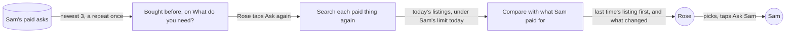

# Ask again

**Version:** v1 · **Status:** Draft · **Type:** Feature · **Project type:** Web UI, with an LLM path

**Shape doc:** docs/specs/after-review/shape.md
**Depends on:** find-another

Rose taps Ask again next to something Sam paid for before. KinCart finds today's listings for the same things, puts the one Rose bought last time first, and says what changed. It ships now because older shoppers rebuy the same things, and today Rose must type them again.

## Problem

To buy AA batteries again, Rose types "AA batteries" again. Rose may not remember the words they used, or which pack Sam approved. The new Find can show other packs first, so Rose can't tell which one they had. Rose also can't see if the price went up.

Rose's page only reads the latest ask (`lib/shop/requests.ts:121`), so nothing on it shows what Sam paid for before. I don't have a count of rebuys. No log line tells a rebuy from a new ask.

## Slice test

| Check                         | Result |
| ----------------------------- | ------ |
| Cuts every layer it needs     | yes: a "Bought before" list with Ask again on Rose's page, a server action, Find's search and pick step on the stored queries, and a read of Sam's past paid asks |
| One e2e test walks it         | yes: Rose finds AA batteries, Sam taps OK, Rose taps Ask again under "Bought before", sees today's options with what changed, and asks Sam again |
| Worth shipping alone          | yes: Rose rebuys with one tap, and sees if the pack or its price changed |
| Fits (≤5 scenarios, ≤2 areas) | yes: 5 scenarios, and two areas, Rose's page and Find |

**Path:** full. It adds a new control on Rose's page, a new read of past asks, and a compare step after Find's search.

## User story

As Rose, I want to buy again something Sam paid for before with one tap, so that I don't type it again and I can see if it changed.

## Flow



Rose's page lists the 3 newest asks that Sam paid for. Rose taps Ask again on one. KinCart searches each paid thing again, puts last time's listing first when it can, says what changed, and Rose asks Sam as today.

## Acceptance criteria

```gherkin
Scenario: Bought before shows Rose's 3 newest paid asks
  Given Rose's household has these asks:
    | asked  | what                                                                      | Sam's answer                         |
    | Oct 18 | "GE Plug-In LED Night Light, 2 Pack", $7.98                               | paid                                 |
    | Oct 19 | "Dearfoams Women's Cozy Slippers", $24.99                                 | said no                              |
    | Oct 20 | "Energizer MAX AA Batteries, 8 Pack", $8.99                               | paid                                 |
    | Oct 21 | the Energizer pack and "Anker 312 USB C Charger, 20W", $24.98 in all      | paid, and left out "a night light"   |
    | Oct 22 | "Energizer MAX AA Batteries, 8 Pack", $8.99                               | paid                                 |
  When Rose opens their page at "What do you need?"
  Then "Bought before" lists the Energizer pack from Oct 22, the 2 things from Oct 21, and the night lights from Oct 18, each with Ask again
  And the Energizer pack from Oct 20 isn't listed, because Oct 22 bought the same
  And the slippers that Sam said no to aren't listed

Scenario Outline: Ask again finds the one Rose bought last time
  Given Sam paid $8.99 for "Energizer MAX AA Batteries, 8 Pack" from walmart.com on Oct 22, found for "AA batteries"
  And Sam's limit is $20
  And today's search has the Energizer pack at <price> from <shop>
  When Rose taps Ask again next to it
  Then Rose sees up to 3 options for "AA batteries", each at $20 or less
  And the first is the Energizer pack, marked "You bought this last time"
  And it says "<what changed>"
  And /status shows one more Find and its Channel3 searches
  And Rose can pick one and tap Ask Sam, as today

  Examples:
    | price | shop        | what changed                                  |
    | $8.99 | walmart.com | Same price as last time.                      |
    | $9.49 | walmart.com | Now $9.49. It was $8.99.                      |
    | $8.99 | target.com  | Now from target.com. It was from walmart.com. |

Scenario Outline: The one Rose bought last time isn't there to pick
  Given Sam paid $8.99 for "Energizer MAX AA Batteries, 8 Pack" on Oct 22, found for "AA batteries"
  And <today>
  When Rose taps Ask again next to it
  Then <result>

  Examples:
    | today                                                                       | result                                                                                                                  |
    | Sam's limit is now $8, and today's search has the Energizer pack at $9.49  | Rose sees up to 3 other options at $8 or less, and "The one you bought last time is $9.49 now, over Sam's $8 limit."    |
    | Sam's limit is $20, and today's search doesn't have the Energizer pack     | Rose sees up to 3 other options at $20 or less, and "Couldn't find the one you bought last time today."                |
    | Sam's limit is $20, and today's search finds nothing for "AA batteries"    | Rose sees "Couldn't find that. Try different words." and Find another, as after a Find                                  |

Scenario: Ask again on a basket repeats only what Sam paid for
  Given on Oct 21 Rose asked for "AA batteries, a night light and a phone charger"
  And Sam paid for "Energizer MAX AA Batteries, 8 Pack" and "Anker 312 USB C Charger, 20W", and left out "a night light"
  When Rose taps Ask again next to that ask
  Then Rose sees a basket of 2 things: "AA batteries" and "a phone charger"
  And "a night light" isn't in it
  And each group shows the one Sam paid for last time first, when it can, and what changed
  And Rose picks one for each thing and asks Sam once, as today

Scenario: Ask again past the address's daily Finds
  Given this network address ran 20 Finds in the last 24 hours
  When Rose taps Ask again next to the Energizer pack
  Then nothing reaches Claude or Channel3
  And Rose sees "That's a lot of Finds from here today. Try again in 3 hours."
  And "Bought before" and its Ask again stay
  And /status shows one more stopped Find
```

## Scope

**In:**
- "Bought before" on Rose's "What do you need?" screen: the 3 newest asks that Sam paid for, newest first. An ask that paid for the same listings as a newer one shows once (O3). A household with no paid ask shows no list.
- Ask again: KinCart searches each paid thing again, under Sam's limit today, with Find's search and pick step.
- When today's search has last time's listing under Sam's limit, it shows first, marked "You bought this last time". The pick step fills up to 2 more (O5).
- What changed, about last time's listing, worked out by code: the same price, a new price, a new shop, over Sam's limit now, or not found today (O1).
- On a basket, Ask again repeats only the things Sam paid for (O4).
- Each Ask again counts as a Find: toward the address's 20 a day (D73), and on `/status` (D78) (O6).
- An Ask again that finds nothing for a thing offers one Find another, as after a Find (D97) (O7).

**Out:**
- Ask again for an ask that Sam said no to, or that failed to pay (O2). Find another covers a No. No later slice.
- Sam's page saying that an ask is a rebuy (O8). No later slice.
- More than 3 past asks, or a full order history. No later slice.
- Ask again on the fixed list of items, when search is off. No later slice.
- A rebuy without Ask Sam. A person approves every buy (D83). Never.
- A reminder to rebuy, such as each month. KinCart searches only when Rose or Sam taps (D84). No later slice.

## Open items

| ID | What | Type | Raised at | Owner | Status | Answer |
| -- | ---- | ---- | --------- | ----- | ------ | ------ |
| O1 | What "what changed" means in `ask-again`: price, shop, a listing gone, or all three (from shape O18) | question | shape | user | Resolved | About the listing Rose bought last time: the same price, a new price, a new shop, or not found today. Code compares the listing, not the AI. 2026-10-23 |
| O2 | Which past asks Rose can ask again | question | spec p1 | user | Resolved | Only asks that Sam paid for. Find another already covers a No. 2026-10-23 |
| O3 | How many past asks Rose sees | question | spec p1 | user | Resolved | The 3 newest paid asks, newest first. The same listings bought twice show once. 2026-10-23 |
| O4 | After a basket where Sam left a thing out, what Ask again repeats | question | spec p1 | user | Resolved | Only what Sam paid for. The left-out thing has Find another on the receipt. 2026-10-23 |
| O5 | When today's search has last time's listing under Sam's limit, does it always show first? | question | spec p1 | user | Resolved | Yes, first and marked "You bought this last time". Sam approved it once. The pick step fills up to 2 more. 2026-10-23 |
| O6 | Does an Ask again count as a Find? | question | spec p1 | user | Resolved | Yes: toward the address's 20 a day, and on `/status`, as Find another (D97). 2026-10-23 |
| O7 | When an Ask again finds nothing for a thing, does Rose get Find another? | question | spec p1 | user | Resolved | Yes, one, as after a Find (D97). 2026-10-23 |
| O8 | Does Sam's page say that an ask is a rebuy? | question | spec p1 | user | Resolved | No, not in this slice. Sam sees the ask as today. 2026-10-23 |

_Never delete this section or its rows. See references/ledger.md._

## Glossary

- **Channel3** — the hackathon sponsor whose API returns real product listings.
- **Pick step** — the Haiku call that drops listings that aren't the thing, and picks up to 3.
- **Rebuy** — buying again something Sam paid for before.
- **e2e** — end to end: an automated test that drives the app as a person would, start to finish.
- **Haiku** — Claude Haiku, the small Claude model that reads Rose's words and picks listings.
