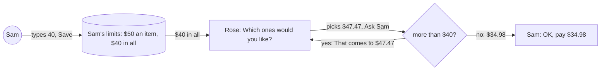
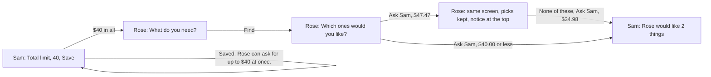
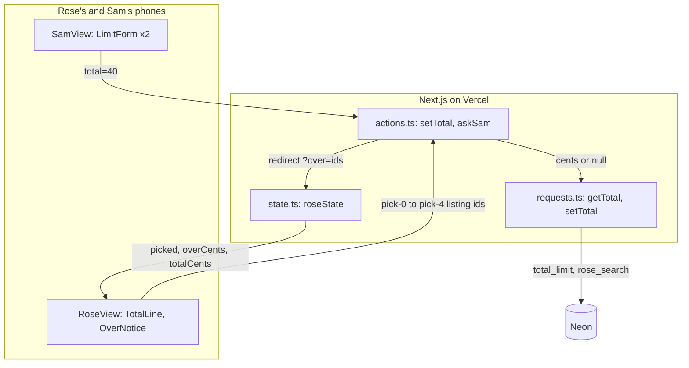
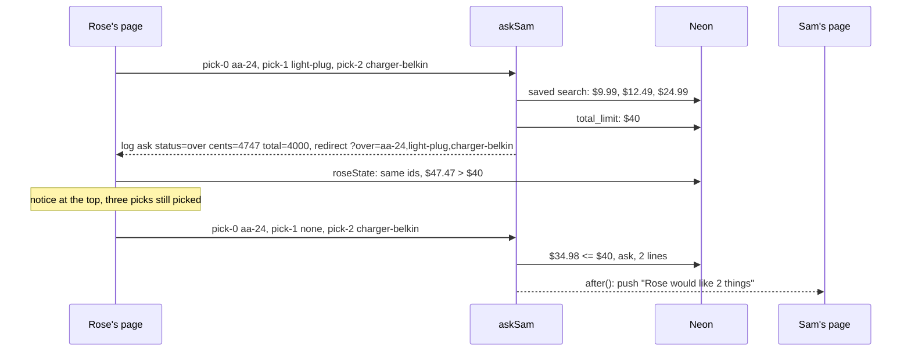
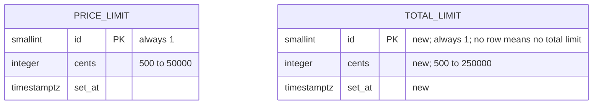

# Basket cap

**Version:** v1 · **Status:** Built · **Type:** Feature · **Project type:** Web UI

**Shape doc:** docs/specs/shop-together/shape.md
**Depends on:** basket
**Page:** none. Skipped: you read the `.md` directly.

Sam sets a total limit for everything Rose asks for at once, such as $40. Rose's picks that come to more than that never reach Sam. It is slice 7 in the shape, split from `basket` at its pause 1 (basket O1), and built only if time is left.

## Problem

Sam's only control over spend is the price limit, which caps one item. A basket holds up to 5 things, so at the default $50 an item Rose can ask Sam for $250 at once, and up to $2,500 at the top price limit. Sam can untick anything before paying (basket O10), but only after the basket arrives. Rose doesn't know what is too much until Sam trims it.

## Slice test

| Check                         | Result |
| ----------------------------- | ------ |
| Cuts every layer it needs     | yes: a field on Sam's page, the stored total limit, the check when Rose taps Ask Sam, Rose's screens, deployed |
| One e2e test walks it         | yes: Sam sets a total limit, Rose's three picks come to more and are stopped, Rose leaves one out, and the basket reaches Sam |
| Worth shipping alone          | yes, but thin: Sam can already untick anything, so the total limit saves Sam a trim and tells Rose the budget first (O1) |
| Fits (≤5 scenarios, ≤2 areas) | yes: 3 scenarios; two areas, Sam's limit form and Rose's Ask Sam |

**Path:** full. It adds a stored value and a field on Sam's page, which the light path doesn't allow.

## User story

As Sam, I want to set the most Rose can ask for at once, so that a basket never arrives bigger than I'd pay for.

As Rose, I want to know Sam's total before I ask, so that Sam doesn't have to trim what I picked.

## Flow



Sam saves a total limit, Rose's screen shows it, and when Rose's picks come to more than it, Rose is told and leaves something out before anything reaches Sam.

## Acceptance criteria

Pause 2 can change the exact words.

```gherkin
Scenario Outline: Sam sets, changes or clears the total limit
  Given Sam's price limit is $50 an item and Sam's total limit is <before>
  When Sam types "<typed>" under "Total limit" and taps Save
  Then Sam sees "<message>"
  And Rose's page says "<Rose's line>"

  Examples:
    | before | typed | message                                                      | Rose's line                                      |
    | none   | 40    | Saved. Rose can ask for up to $40 at once.                   | Sam's limit is $50 an item and $40 in all.        |
    | $40    |       | Saved. No total limit.                                        | Sam's limit is $50 an item.                       |
    | $40    | 12.50 | Pick a whole-dollar amount from $5 to $2,500, or leave it empty. | Sam's limit is $50 an item and $40 in all.     |

Scenario: Rose's picks come to more than the total limit
  Given Sam's total limit is $40
  And Rose sees groups for AA batteries, a night light and a phone charger
  When Rose picks AA batteries at $9.99, a night light at $12.49 and a phone charger at $24.99, and taps "Ask Sam"
  Then Rose sees "That comes to $47.47. Sam's limit is $40 in all. Leave something out."
  And Rose's three picks are still picked
  And nothing reaches Sam, and Sam's phone doesn't buzz
  When Rose picks "None of these" for the night light and taps "Ask Sam"
  Then Sam's page shows "Rose would like 2 things" and "OK, pay $34.98"

Scenario Outline: The total limit counts everything Rose asks for at once
  Given Sam's price limit is $50 an item and Sam's total limit is <limit>
  When Rose asks Sam for <picks>
  Then <result>

  Examples:
    | limit | picks                                                     | result                                                                     |
    | $40   | a phone charger at $24.99 and a night light at $15.01     | Sam's page shows "OK, pay $40.00"                                          |
    | $40   | one desk lamp at $44.99                                   | Rose sees "That comes to $44.99. Sam's limit is $40 in all. Pick a cheaper one." |
    | none  | five things at $112.48 in all                             | Sam's page shows "OK, pay $112.48", as basket does today                    |
```

## Scope

**In:**
- A "Total limit" field on Sam's page, under the price limit, saved with its own Save. Whole dollars from $5 to $2,500, or empty for no total limit. No total limit until Sam sets one (O2).
- Rose's line about Sam's limit names the total when there is one, on the ask, options and groups screens.
- When Rose taps Ask Sam, the server adds up the stored prices of the picks. More than the total limit: Rose sees the total and the limit, the picks stay, and nothing reaches Sam (O3).
- The check counts a one-item ask too, and the total limit can be lower than the price limit (O4).

**Out:**
- Sam's OK held to the total limit. Sam approves every request and can untick. No later slice.
- A limit per week or month. The shape's "Not doing" rules out spend limits beyond one ask. No later slice.
- The fixed three-item list, which shows only when search is off. No later slice.

## Interface

Sam's idle page gets a second limit form under the price limit, the same shape: a label, a hint, a `$` box and Save. An empty box means no total limit. Rose's ask screen names the total in its last line. On the options and groups screens, a small line above Ask Sam says the total limit. When the picks come to more, a grey notice at the top gives the sum and what to do.



Sam's saved total shows on Rose's screens. An ask over it comes back to the same screen with the picks still picked and a notice naming the sum. An ask at or under it reaches Sam as today.

| Who | State | Heading | What's on it |
| --- | ----- | ------- | ------------ |
| Sam | no total limit | Nothing to approve | under "Price limit", a second form: "Total limit", "The most Rose can ask for at once. Leave it empty for no total limit.", an empty `$` box, Save |
| Sam | saved | Nothing to approve | under the box: "Saved. Rose can ask for up to $40 at once." |
| Sam | cleared | Nothing to approve | an empty box; "Saved. No total limit." |
| Sam | invalid | Nothing to approve | the box keeps the stored $40 and gets the red edge; red under it: "Pick a whole-dollar amount from $5 to $2,500, or leave it empty." |
| Sam | saving | Nothing to approve | Save becomes "Saving…" with the spinner |
| Rose | asking | What do you need? | the last line: "Sam's limit is $50 an item and $40 in all. Nothing is paid until Sam says OK."; with no total limit, as today |
| Rose | groups or options | Which ones would you like? | above Ask Sam, small grey: "Sam's limit is $40 in all."; with no total limit, nothing |
| Rose | over, several picks | Which ones would you like? | grey notice at the top: "That comes to $47.47. Sam's limit is $40 in all. Leave something out."; the picks still picked |
| Rose | over, one pick | Which one would you like? | grey notice at the top: "That comes to $44.99. Sam's limit is $40 in all. Pick a cheaper one."; the pick still picked |
| Rose | Ask Sam with no pick | Which ones would you like? | grey notice at the top: "Pick at least one first." On the options screen: "Pick one first." Both move up from under the listings (O6) |

The notice sits at the top because the page comes back scrolled to the top after Ask Sam (O5). It is grey like "Up to 5 things at a time", since red is for real failures. Rose's total shows only after the tap, as scenario 2 says, so Rose's picker stays a plain server form.

Checked: no sideways scroll at 420px; light and dark both rendered. No new colours, sizes or CSS. The notice is `Notice` with the neutral tone, the line above Ask Sam is `small`, and the second form reuses `.limit`, whose top rule now also separates the two limits.

Craft checks: a one-line "add a budget cap" prompt gives a progress meter like "$47.47 / $40", a toggle to turn the cap on, and a red badge. Here an empty box turns it off, and the over state is one sentence with the sum and the fix. Against Stripe's form errors: the message says what is wrong and how to fix it, and it shows where Rose's eyes land.

**Motion tier:** 1, as before. Nothing new moves: the notice rises and fades like every notice, and "Saving…" and "Asking Sam…" turn the spinner.

**Components used:** from the system, Button, Notice and ListingPicker, and the `small` and `.limit` styles. Composed here: Sam's `LimitForm` now takes its label, hint and messages as props, so both limits use it. Rose's `TotalLine` sits above Ask Sam and `OverNotice` at the top, on the options and groups screens.

**Preview:** http://localhost:3000/preview/basket-cap with `pnpm dev`. It answers 404 in production.

## Technical plan

### Approach

Sam's total limit lives in a new one-row table, `total_limit`, beside `price_limit`; no row means no total limit (D35). `askSam` already reads every pick's price from Rose's saved search (D23). Now it adds those prices up and reads the total limit before it asks. When the sum is over, it logs, and it redirects back to Rose's page with the picked listing ids in the address (D36). `roseState` turns those ids back into picks and a sum from the saved search, and shows the notice while the sum is still over the current total. Nothing else in the ask, pay or ping path changes.

There is no new switch. The total limit is off until Sam saves one, and it rides `searchOn()` like the price limit.

Relies on: D12, D18, D19, D23, D24, and the drafted D34, D35 and D36 below.



Sam's form writes one integer, Rose's picks go in as ids, and every price and the total come out of Neon.



The first ask stops before `ask()`, so no request row and no push. The second goes through basket's path unchanged.

### Changes

| File | What changes | Why |
| ---- | ------------ | --- |
| `db/migrations/0006_total_limit.up.sql`, `.down.sql` (new) | Up: `CREATE TABLE IF NOT EXISTS total_limit (id smallint PRIMARY KEY DEFAULT 1 CHECK (id = 1), cents integer NOT NULL CHECK (cents BETWEEN 500 AND 250000), set_at timestamptz NOT NULL DEFAULT now())`, the shape of `price_limit` (`0003_find_and_explain.up.sql:15`). Down: `DROP TABLE IF EXISTS total_limit` | 1 |
| `scripts/migrate.test.ts:30` | Up expects `total_limit`. Down now undoes 0006 only, so it expects `total_limit` gone and `purchase_requests.lines` still there; up brings the table back | reverse path |
| `lib/shop/requests.ts:137` | New `getTotal(): Promise<number \| null>` reads the row, null when absent. New `setTotal(cents \| null)` upserts like `setLimit`, or deletes the row for null | 1 |
| `lib/shop/requests.test.ts:42`, `:252` | The reset also empties `total_limit`. New test: null at first, 4000 after `setTotal(4000)`, null after `setTotal(null)`, and `setTotal(300)` rejected by the check | 1 |
| `app/(shop)/actions.ts:62` | `askSam`, after the pick-missing check: adds the picks' stored cents and reads `getTotal()`. Over: logs `ask status=over cents=4747 total=4000` and redirects to `?over=` the picked ids, joined by commas. One pick or several, the same check (D34). The fixed list, with search off, is untouched | 2, 3 |
| `app/(shop)/actions.ts:110` | New `setTotal(token, formData)` beside `setLimit`, from Sam's link only (`whoIs`). An empty box clears; a whole number from 5 to 2500 saves; anything else redirects to `?total=invalid`. Saved: `?total=saved` | 1 |
| `app/(shop)/actions.test.ts:39` | The reset also empties `total_limit`. New tests below | 1, 2, 3 |
| `app/(shop)/state.ts:7`, `:9`, `:30` to `:52` | `RoseParams` gains `over?: string[]`; `SearchOn` gains `totalCents: number \| null`. The ask, options and basket states carry `totalCents`. For options and basket, `over` ids found in the saved listings give `picked` and `overCents`, counting each id once. Ids not found, or a sum no longer over the current total, show no notice | 2, 3 |
| `app/(shop)/r/[token]/page.tsx:34` | Reads `getTotal()` with the others when search is on; passes `over` from `?over=` split on commas | 2 |
| `app/(shop)/h/[token]/page.tsx:31` | Reads `getTotal()` when search is on; passes `total` with `saved` and `error` from `?total=`, and `setTotal` | 1 |
| `app/(shop)/RoseView.tsx`, `SamView.tsx`, `preview/basket-cap/page.tsx` | As built at pause 2. Plus O6 in `RoseView.tsx`: "Pick at least one first." on the groups screen and "Pick one first." on the options screen become a neutral `Notice` at the top, like `OverNotice` | 1, 2, 3, O6 |
| `app/(shop)/ui.tsx:111`, `:166` | `ListingPicker` loses its `error` prop and its "Pick one first." line, which move to `RoseView.tsx` | O6 |
| `e2e/db.ts:14` | `reset()` also empties `total_limit`, and seeds a basket search when given `groups`, as it seeds one-thing options today | 2 |
| `e2e/basket-cap.spec.ts` (new) | The e2e below | 1, 2 |
| `e2e/find-and-explain.spec.ts:68`, `:72` | Sam's page now has two Save buttons, so the test clicks the one in the price-limit form | 1 |

No change: `pay.ts`, `paypal.ts`, `pings.ts`, `find.ts`, `.github/workflows/ci.yml`, `package.json`.

Reusing: `whoIs()`, `query()`, the `price_limit` table's shape and `setLimit`'s upsert, `basketPicks()`, `money()` and `wholeDollars()`, `Notice`, the `picked` props on Rose's options and groups screens, `reset()` and `sql()` in `e2e/db.ts`.

### Data



The two tables stay unlinked; each holds at most one row.

**Migration:** expand only. One new table, nothing to backfill, and no code reads it until the deploy that writes it. CI runs it on Neon after tests pass on main (D11). No contract step.
**Reverse:** `0006_total_limit.down.sql` drops `total_limit`. `pnpm db:down` runs it, and `scripts/migrate.test.ts` checks up, down, up. A saved total limit is lost; Rose's asks then work as today.

### Earn-it

| Added | Triggered by |
| ----- | ------------ |
| `total_limit` table, `getTotal`, `setTotal` | Scenario 1 and O2: a total Sam can save and clear, absent by default (D35) |
| `setTotal` action and the second form | Scenario 1 |
| The sum check in `askSam` | Scenarios 2 and 3: nothing over the total reaches Sam (D34) |
| `?over=` ids and `overCents` in `roseState` | Scenario 2: the picks stay after the redirect, and the notice names the sum (D36) |
| `OverNotice` at the top | O5: the page comes back scrolled to the top |
| The two "Pick…" errors at the top | O6: the same redirect hides them today |
| `ask status=over` log line | Proof it works in prod |
| `reset()` seeding a basket search | The e2e needs fixed prices to land over $40 and back under it |

Cut: a live running total on Rose's screen (scenario 2 tells Rose after the tap); a picks column on `rose_search` (D36); a flag (off until Sam saves a total); re-checking the total on Sam's OK (D34).

### Non-functionals

|                      |                                                                               |
| -------------------- | ----------------------------------------------------------------------------- |
| **Load**             | Two people, a few asks a month. Ask Sam and both pages each add one single-row read |
| **Breaks first**     | Nothing new at 10×. The basket Find's Channel3 quota stays the first limit (basket O7) |
| **Security surface** | `setTotal` runs only from Sam's link, `askSam` only from Rose's (`whoIs`). The sum uses the saved search's prices, never the form's. `?over=` ids only choose which saved listings show as picked; a forged one shows a notice to whoever holds Rose's link, and charges nothing. No new secrets. New stored data: one integer |
| **Proof it works**   | In Vercel's log: `ask status=over cents=4747 total=4000` when Rose is stopped. A save shows on Sam's page as "Saved. Rose can ask for up to $40 at once." |
| **Rollout**          | No flag; the total limit is off until Sam saves one. Rollback: promote the previous deploy on Vercel. Old code ignores `total_limit`, so asks over it reach Sam, who can untick. `pnpm db:down` drops the table if needed |

### Test plan

| Scenario | Test | Command |
| -------- | ---- | ------- |
| 1 Sam sets, changes or clears | `requests.test.ts`: get and set round-trip, null clears, the check refuses $3. `actions.test.ts`: "40" saves 4000 and redirects `?total=saved`; "" clears; "3", "2501", "12.50" and "abc" redirect `?total=invalid` and keep $40; Rose's link saves nothing. `state.test.ts`: `totalCents` reaches the ask, options and basket states. e2e below | `pnpm test`, `pnpm test:e2e` |
| 2 Over, then leave one out | `actions.test.ts`: with $40 saved, three basket picks at $47.47 redirect `?over=prod_3Ba7aA,prod_6Nl2tL,prod_7Bk2wC`, make no request and send no push; the same picks without the night light ask Sam for 2 things at $34.98. `state.test.ts`: `?over=` gives the three picks and 4747; an unknown id is skipped; a sum no longer over the total gives no notice. e2e below | `pnpm test`, `pnpm test:e2e` |
| 3 Counts everything at once | `actions.test.ts`: $40.00 exactly asks Sam; one option at $44.99 redirects `?over=` its id; with no total limit, $112.48 asks Sam | `pnpm test` |
| O6 Pick errors on screen | e2e below. `e2e/approve-and-pay.spec.ts:79` now checks "Pick one first." is in the viewport (O7) | `pnpm test:e2e` |
| Migration | `scripts/migrate.test.ts`: up, down, up | `pnpm test` |

**E2E:** `e2e/basket-cap.spec.ts`, test "Rose's picks over Sam's total limit are stopped, and leaving one out reaches Sam". `reset()` seeds the saved PayPal and a basket search with AA batteries at $9.99, a night light at $12.49 and a phone charger at $24.99. Sam types 40 under "Total limit", taps that form's Save, and sees "Saved. Rose can ask for up to $40 at once." Rose's page shows "Sam's limit is $40 in all." Rose scrolls to Ask Sam and taps it with nothing picked, and "Pick at least one first." is in the viewport (O6). Rose picks one listing in each group, scrolls to Ask Sam and taps it. Then "That comes to $47.47. Sam's limit is $40 in all. Leave something out." is in the viewport, the three picks are still checked, and `purchase_requests` is empty. Rose picks "None of these" for the night light and taps Ask Sam. Rose's page says "Waiting for Sam", and Sam's says "Rose would like 2 things" with "OK, pay $34.98". It makes no charge and no Channel3 or Claude call. Stop `pnpm dev` before running it.

### Chunks

Single chunk. Every test file shares the local database, and the change is about 13 files.

### Risks

| Risk | Mitigation |
| ---- | ---------- |
| Rose doesn't see why Ask Sam didn't go through | Measured: after Ask Sam the page comes back at the top (`scrollY` 2264 to 0), so the notices sit at the top (O5, O6). The e2e checks both are in the viewport |
| Sam raises the total while Rose looks at an old notice | `roseState` shows the notice only while the sum is over the current total; the 3 s refresh (D19) drops it |
| Sam's second Save breaks the price-limit e2e's `getByRole("button", { name: "Save" })` | The test clicks the Save inside the price-limit form |
| A rollback while a total is saved | Old code ignores it, so an ask over the total reaches Sam, who can untick. Accepted |

### Decisions to record

Recorded as D34, D35, D36.

## Open items

| ID | What | Type | Raised at | Owner | Status | Answer |
| -- | ---- | ---- | --------- | ----- | ------ | ------ |
| O1 | Thin value. Since basket folded in Sam's unticking (basket O10), Sam already decides what gets paid. The total limit saves Sam a trim and tells Rose the budget first. The hours left also go to the video and README (shape O10) | flag | spec p1 | user | Resolved | Build it: small, and it gives the video a moment where Sam stays in control. 2026-10-14 |
| O2 | No total limit until Sam sets one, and an empty box clears it. Whole dollars from $5 to $2,500 (5 things at the top $500 price limit). The other choice is $100 from the start | question | spec p1 | user | Resolved | Off until Sam sets one; an empty box clears it; whole dollars from $5 to $2,500. 2026-10-14 |
| O3 | Rose is stopped before anything reaches Sam, with the picks kept. The other choice lets the basket through with a warning on Sam's page | question | spec p1 | user | Resolved | Stop Rose first: the picks stay, and nothing reaches Sam. 2026-10-14 |
| O4 | The total limit counts a one-item ask too, and Sam's two limits stay independent. The other choice makes the total limit at least the price limit, so one item can never be over it, and both forms refuse a clash | question | spec p1 | user | Resolved | Yes: one check for any ask, and the two limits stay independent. 2026-10-14 |
| O5 | Measured on the dev server: after Ask Sam, the page comes back scrolled to the top (`scrollY` 2264 to 0), so the red line approved above Ask Sam at pause 2 would be off screen. The over message moves to a grey notice at the top, where Rose lands | flag | spec p3 | user | Resolved | Notice at the top, as in the preview; the e2e checks it is in the viewport. 2026-10-14 |
| O6 | Basket's shipped "Pick at least one first." and the options screen's "Pick one first." sit below the listings, so they are off screen after the same redirect. Fixing them means moving each to a notice at the top in `RoseView.tsx`, the file this slice already changes | question | spec p3 | user | Resolved | Fold it in: both move to a notice at the top in `RoseView.tsx`, and `ListingPicker` loses its `error` prop. 2026-10-14 |
| O7 | O6's options-screen half has no test that failed first. `e2e/approve-and-pay.spec.ts:79`, tightened to `toBeInViewport()`, passed before the fix, because its three fixed items make a page that fits the screen | flag | build | user | Decided alone | Chose: move "Pick one first." to the top anyway, as O6 agreed, and keep the tighter check. Other: leave it under the listings until a real-length options page proves it off screen. Undo: put the line back in `ListingPicker` from b58324f. 2026-10-14 |
| O8 | The feat and fix commits on this branch add no CHANGELOG line | flag | build | user | Decided alone | Chose: leave the lines to /ship, which wrote them for every earlier slice. Other: add them in each commit. Undo: add them in a docs commit. 2026-10-14 |

_Never delete this section or its rows. See references/ledger.md._

## Glossary

- **Basket**: several things Rose asks for at once, approved with one OK and paid with one charge.
- **Price limit**: the most one item may cost. Sam sets it, and Rose is never shown anything above it.
- **Total limit**: the most everything Rose asks for at once may cost together. Sam sets it.
- **e2e**: end-to-end, one test that walks the whole slice as a user would.
- **Backfill**: filling a new column or table for rows that already exist; this slice has none to fill.
- **Viewport**: the part of the page that shows on the screen without scrolling.
