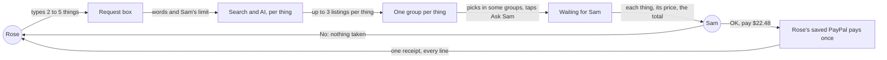
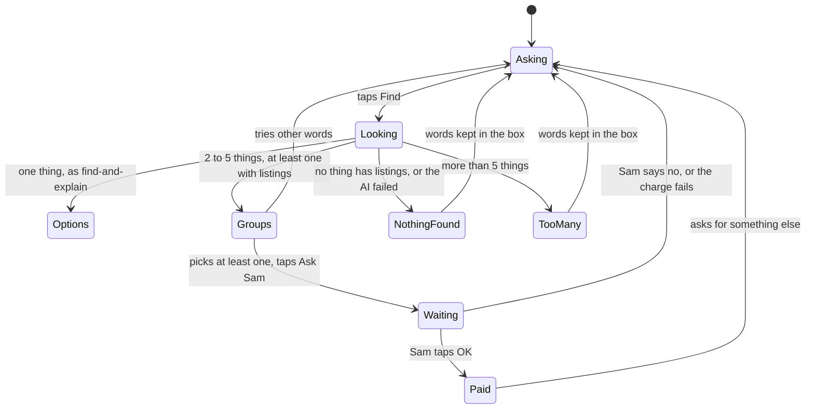

# Basket

**Version:** v1 · **Status:** Draft · **Type:** Feature · **Project type:** Web UI

**Shape doc:** docs/specs/shop-together/shape.md
**Depends on:** find-and-explain, ping-helper

Rose types several things at once, picks a listing for each one they want, and Sam pays them all with one OK and one charge. It is slice 5 in the shape, built now because slices 0 to 3 shipped and ask-by-voice was dropped.

## Problem

A request is one item today. When Rose types "AA batteries, a night light and a phone charger", the page says "One thing at a time for now. What would you like first?" (find-and-explain scenario 3). Three things means three Finds, three Ask Sams, three buzzes on Sam's phone, three OKs and three charges. Rose also can't ask for the second thing until Sam answers the first, because only one request can be open at a time (`purchase_requests_one_open`, `lib/shop/requests.ts:71`).

## Slice test

| Check                         | Result |
| ----------------------------- | ------ |
| Cuts every layer it needs     | yes: Rose's box and a screen with a group of options per thing, the AI splitting the list and searching each thing, a stored basket, one PayPal charge for the total, Sam's page, both receipts and the notifications, deployed |
| One e2e test walks it         | yes: Rose types three things and picks one listing for two of them; Sam sees two lines and the total and taps OK; both pages show one receipt with both lines |
| Worth shipping alone          | yes: Rose asks for several things at once, and Sam answers once instead of once per thing |
| Fits (≤5 scenarios, ≤2 areas) | yes, at the limit, after a split: 5 scenarios; two areas, the shop pages and the find-and-pay path in `lib/shop`. All four answers together came to 8 scenarios over three areas, so Sam unticking things and the total cap move to their own slices (O1) |

**Path:** full. A new screen, a new kind of request, and one charge for several items.

## User story

As Rose, I want to ask for several things at once, so that I don't have to wait for Sam's answer before asking for the next one.

As Sam, I want to see the whole list and pay it with one OK, so that one shopping run is one decision and one charge.

## Flow



Rose types several things and gets a group of up to three listings for each; Rose picks the ones they want, and Sam's one OK pays the total in one charge.

## States



## Acceptance criteria

```gherkin
Scenario: Rose asks for several things and sees options for each
  Given Rose's PayPal is linked and Sam's limit is $50 an item
  When Rose types "AA batteries, a night light and a phone charger" and taps Find
  Then within 20 seconds Rose sees three groups: AA batteries, a night light, a phone charger
  And each group has up to three real listings at $50 or less
  And each listing shows its own name and price and the three short sentences from find-and-explain

Scenario: Rose asks Sam for two of them, and Sam pays both in one go
  Given Rose sees the three groups
  When Rose picks AA batteries at $9.99 and a night light at $12.49, leaves the phone charger unpicked, and taps "Ask Sam"
  Then Sam's phone, with notifications on, shows "Rose would like 2 things" and "$22.48 in total"
  And Sam's page lists both, each with its price, shop, why it fits and a link to the listing, and a total of $22.48
  When Sam taps "OK, pay $22.48"
  Then Rose's saved PayPal is charged $22.48, once
  And both pages show one receipt listing both things, their prices and the $22.48 total

Scenario: Some of the things can't be shown
  Given Sam's limit is $30 an item
  When Rose types "AA batteries, a tablet for video calls and a left-handed teapot for a cat" and taps Find
  Then Rose sees up to three listings for AA batteries
  And under "a tablet for video calls" Rose sees "Nothing under $30 for this one."
  And under "a left-handed teapot for a cat" Rose sees "Couldn't find this one."
  And Rose can still pick the batteries and ask Sam

Scenario: More than five things
  Given Rose's PayPal is linked
  When Rose types "batteries, a night light, a phone charger, a doormat, a kettle and a flashlight" and taps Find
  Then Rose sees "Up to 5 things at a time. Which 5 do you need most?"
  And Rose's words are still in the box

Scenario: Sam says no to the basket
  Given Sam's page shows Rose's 2 things, $22.48 in total
  When Sam taps "No"
  Then nothing is charged
  And Rose's page says "Sam said no to your 2 things. Nothing was taken." above an empty box
```

## Scope

**In:**
- A list of 2 to 5 things typed into Rose's box. The AI splits it into things, and each is searched and explained as in find-and-explain: up to three real US listings at or under Sam's per-item limit.
- One group per thing. Rose picks one listing in any group, or none to leave that thing out. Ask Sam needs at least one pick (O2).
- A thing with nothing to show gets one grey line in its group: "Couldn't find this one." or "Nothing under $30 for this one." When no thing has listings, "Couldn't find that. Try different words." as today (O3).
- More than five things: "Up to 5 things at a time. Which 5 do you need most?", with Rose's words kept.
- Sam's page lists every picked thing with its price, shop, why it fits and a link, and the total. OK pays the total; No refuses all of it.
- One PayPal charge for the total, from Rose's saved PayPal. One receipt on both pages, listing every line and the total.
- The notifications from ping-helper, worded for several things.
- One thing typed works exactly as today: up to three options and one request (O6).

**Out:**
- Sam unticking things and paying for the rest: `basket-trim` (O1).
- A total cap for one basket, set by Sam: `basket-cap` (O1).
- Groceries. Channel3 doesn't list them (O4). No later slice.
- One charge per shop when the things come from different shops. The sandbox charge lands in one test business account (shape O9). No later slice.
- Rose changing a pick after asking. Sam says no, and Rose asks again. No later slice.

## Open items

| ID | What | Type | Raised at | Owner | Status | Answer |
| -- | ---- | ---- | --------- | ----- | ------ | ------ |
| O1 | The four answers together fail the slice test: up to 3 options per thing, Sam unticking things, a total cap and up to 5 things come to 8 scenarios over three areas (Rose's find, Sam's approval, Sam's limit form). This spec keeps up to 3 options per thing and the 5-thing cap. Sam unticking moves to `basket-trim` and the total cap to `basket-cap`, both added to the shape after this slice | flag | spec p1 | user | Resolved | Split agreed. `basket-trim` and `basket-cap` go into the shape after `basket`, only if time is left. 2026-10-14 |
| O2 | Assuming a thing Rose leaves unpicked is left out of the basket, and Ask Sam with no pick at all says "Pick at least one first." | assumption | spec p1 | user | Resolved | Confirmed with pause 1 approval, 2026-10-14 |
| O3 | Assuming a thing with nothing to show gets a grey line in its group while the other groups still show, and only when no thing has listings does Rose see "Couldn't find that. Try different words." | assumption | spec p1 | user | Resolved | Confirmed with pause 1 approval, 2026-10-14 |
| O4 | Channel3 doesn't list groceries, which the shape gave as the example. Searched under $50: "milk" returned skin lotions and a baby formula, "sliced bread" a squishy toy and bread knives, "a dozen eggs" egg crates and ornaments. A basket is household things, such as batteries, a night light and a charger | flag | spec p1 | user | Resolved | Accepted. A basket is household things; the shape's "such as groceries" is changed to match. 2026-10-14 |
| O5 | Assuming up to 20 seconds is acceptable for a basket of up to 5 things, with "Looking…" shown meanwhile. One thing took 9.9 s in find-and-explain's spike (its O11) | assumption | spec p1 | user | Resolved | Confirmed with pause 1 approval, 2026-10-14 |
| O6 | Assuming one thing typed still works exactly as find-and-explain: up to three options and a one-item request | assumption | spec p1 | user | Resolved | Confirmed with pause 1 approval, 2026-10-14 |
| O7 | A 5-thing basket uses up to 10 Channel3 searches, against 2 per Find today. find-and-explain O14 accepted the free tier, assumed 1,000 a month, for a few hundred Finds. The basket e2e adds about 6 searches to every CI run | flag | spec p1 | user | Accepted risk | The demo, testing and CI need a few hundred searches a month at most. If Channel3 refuses for quota, Rose sees "Couldn't find that" and the log says why, as in find-and-explain O14. Agreed 2026-10-14 |

_Never delete this section or its rows. See references/ledger.md._

## Glossary

- **Basket**: several things Rose asks for at once, approved with one OK and paid with one charge.
- **Listing**: one product for sale in an online shop, with its name, price, photo and link.
- **Channel3**: a hackathon sponsor whose API searches real product listings across shops.
- **Price limit**: the most one item may cost. Sam sets it, and Rose is never shown anything above it.
- **Sandbox**: PayPal's test environment. Fake accounts, fake money, real API.
- **e2e**: end-to-end, one test that walks the whole slice as a user would.
