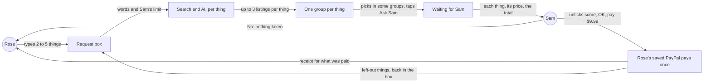
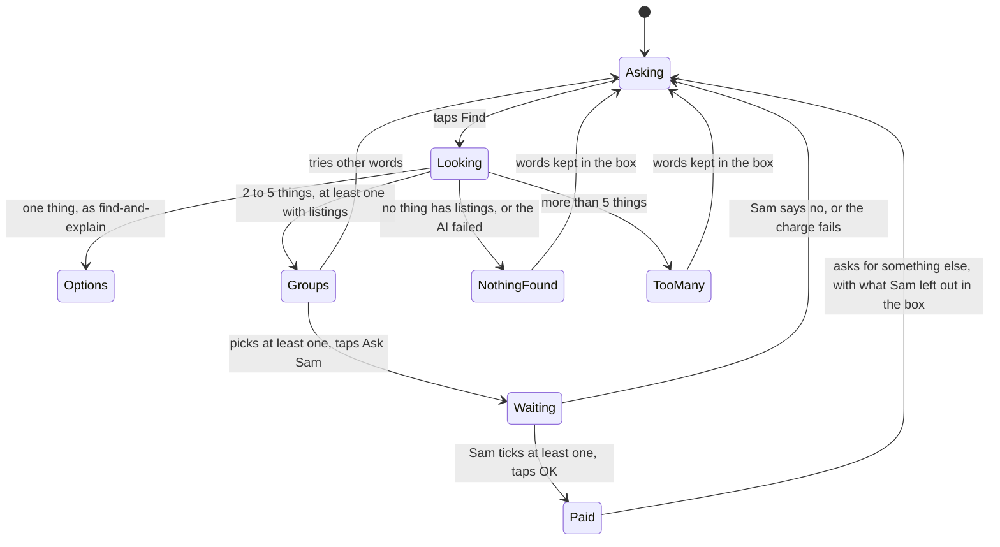
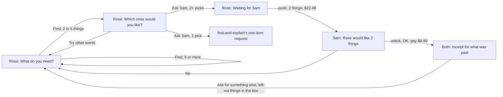

# Basket

**Version:** v1 · **Status:** Draft · **Type:** Feature · **Project type:** Web UI

**Shape doc:** docs/specs/shop-together/shape.md
**Depends on:** find-and-explain, ping-helper

Rose types several things at once and picks a listing for each one they want. Sam ticks the ones to pay for, and one OK makes one charge; anything Sam leaves out goes back to Rose. It is slice 5 in the shape, built now because slices 0 to 3 shipped and ask-by-voice was dropped.

## Problem

A request is one item today. When Rose types "AA batteries, a night light and a phone charger", the page says "One thing at a time for now. What would you like first?" (find-and-explain scenario 3). Three things means three Finds, three Ask Sams, three buzzes on Sam's phone, three OKs and three charges. Rose also can't ask for the second thing until Sam answers the first, because only one request can be open at a time (`purchase_requests_one_open`, `lib/shop/requests.ts:71`).

## Slice test

| Check                         | Result |
| ----------------------------- | ------ |
| Cuts every layer it needs     | yes: Rose's box and a screen with a group of options per thing, the AI splitting the list and searching each thing, a stored basket, one PayPal charge for the total, Sam's page, both receipts and the notifications, deployed |
| One e2e test walks it         | yes: Rose types three things and picks one listing for two of them; Sam unticks one and pays the other; both pages show the receipt, and Rose's box gets the left-out thing back |
| Worth shipping alone          | yes: Rose asks for several things at once, and Sam answers once instead of once per thing |
| Fits (≤5 scenarios, ≤2 areas) | yes, at the limit: 5 scenarios; two areas, the shop pages and the find-and-pay path in `lib/shop`. All four answers together came to 8 scenarios over three areas, so the total cap moved to `basket-cap` (O1). Sam's ticking was split out too, then folded back at pause 2 (O10); Sam's answers share one scenario |

**Path:** full. A new screen, a new kind of request, and one charge for several items.

## User story

As Rose, I want to ask for several things at once, so that I don't have to wait for Sam's answer before asking for the next one.

As Sam, I want to see the whole list, untick what Rose doesn't need, and pay the rest with one OK, so that one shopping run is one decision and one charge.

## Flow



Rose types several things and gets a group of up to three listings for each; Rose picks the ones they want, Sam ticks the ones to pay for, one OK pays them in one charge, and what Sam left out goes back into Rose's box.

## States



## Acceptance criteria

```gherkin
Scenario: Rose asks for several things and sees options for each
  Given Rose's PayPal is linked and Sam's limit is $50 an item
  When Rose types "AA batteries, a night light and a phone charger" and taps Find
  Then within 20 seconds Rose sees three groups: AA batteries, a night light, a phone charger
  And each group has up to three real listings at $50 or less
  And each listing shows its own name and price and the three short sentences from find-and-explain

Scenario: Rose asks Sam for two, Sam pays for one, and the other goes back to Rose
  Given Rose sees the three groups
  When Rose picks AA batteries at $9.99 and a night light at $12.49, leaves the phone charger unpicked, and taps "Ask Sam"
  Then Sam's phone, with notifications on, shows "Rose would like 2 things" and "$22.48 in total"
  And Sam's page lists both, ticked, each with its price, shop, why it fits and a link to the listing, and "OK, pay $22.48"
  When Sam unticks the night light
  Then the total and the button change to $9.99
  When Sam taps "OK, pay $9.99"
  Then Rose's saved PayPal is charged $9.99, once
  And both pages show a receipt for the batteries at $9.99
  And Rose's page says "Sam left out a night light."
  When Rose taps "Ask for something else"
  Then Rose's box holds "a night light"

Scenario: Some of the things can't be shown
  Given Sam's limit is $30 an item
  When Rose types "AA batteries, a tablet for video calls and a left-handed teapot for a cat" and taps Find
  Then Rose sees up to three listings for AA batteries
  And under "a tablet for video calls" Rose sees "Nothing under $30 for this one."
  And under "a left-handed teapot for a cat" Rose sees "Couldn't find this one."
  And Rose can still pick the batteries and ask Sam

Scenario: More than five things
  Given Rose's PayPal is linked
  When Rose types "batteries, a night light, a phone charger, a doormat, a kettle and a flashlight" and taps Find
  Then Rose sees "Up to 5 things at a time. Which 5 do you need most?"
  And Rose's words are still in the box

Scenario Outline: Sam pays for all of it, or none
  Given Sam's page shows Rose's AA batteries at $9.99 and night light at $12.49, both ticked
  When Sam <does>
  Then Rose's saved PayPal is charged <charged>
  And Rose's page shows <what Rose sees>

  Examples:
    | does                                       | charged       | what Rose sees                                                   |
    | leaves both ticked and taps "OK, pay $22.48" | $22.48, once | one receipt listing both things, their prices and the $22.48 total |
    | taps "No"                                  | nothing       | "Sam said no to your 2 things. Nothing was taken." above an empty box |
```

## Scope

**In:**
- A list of 2 to 5 things typed into Rose's box. The AI splits it into things, and each is searched and explained as in find-and-explain: up to three real US listings at or under Sam's per-item limit.
- One group per thing. Rose picks one listing in any group, or none to leave that thing out. Ask Sam needs at least one pick (O2).
- A thing with nothing to show gets one grey line in its group: "Couldn't find this one." or "Nothing under $30 for this one." When no thing has listings, "Couldn't find that. Try different words." as today (O3).
- More than five things: "Up to 5 things at a time. Which 5 do you need most?", with Rose's words kept.
- Sam's page lists every picked thing with its price, shop, why it fits and a link, each ticked at first, and the total of the ticked ones. OK pays that total; No refuses all of it. With nothing ticked, OK can't be tapped (O11).
- One PayPal charge for the ticked total, from Rose's saved PayPal. One receipt on both pages, listing every paid line and the total.
- What Sam leaves out goes back to Rose: both receipts name it, and Rose's "Ask for something else" puts it in the box in Rose's own words, ready for Find.
- The notifications from ping-helper, worded for several things.
- One thing typed works exactly as today: up to three options and one request (O6).

**Out:**
- A total cap for one basket, set by Sam: `basket-cap` (O1).
- Groceries. Channel3 doesn't list them (O4). No later slice.
- One charge per shop when the things come from different shops. The sandbox charge lands in one test business account (shape O9). No later slice.
- Rose changing a pick after asking. Sam says no, and Rose asks again. No later slice.

## Interface

Rose's options screen becomes one group per thing: the thing's name as a heading, find-and-explain's listing cards under it, and a "None of these" card last. Sam's request screen leads with the total of the ticked things, then lists each as a ticked card with its price, shop and reason, and its link under the card. The waiting screen and both receipts list every line under the total.



Rose's Find with 2 to 5 things opens the groups screen; two or more picks go to Sam as one basket, Sam's OK pays for the ticked ones and shows both of them the same receipt, and Rose's next ask starts with what Sam left out.

| Who | State | Heading | What's on it |
| --- | ----- | ------- | ------------ |
| Rose | asking | What do you need? | the hint becomes "Say it the way you'd tell Sam, one thing or up to 5. For example: AA batteries, a night light and a phone charger."; the rest as find-and-explain |
| Rose | looking | What do you need? | as find-and-explain: the box locked, "Looking…" with the spinner |
| Rose | groups | Which ones would you like? | "For "AA batteries, a night light and a phone charger". Pick one for each thing you want."; per thing, its name at title size, up to three listing cards, then "None of these"; Ask Sam; Try other words |
| Rose | Ask Sam with no pick | Which ones would you like? | red above Ask Sam: "Pick at least one first." |
| Rose | asking Sam | Which ones would you like? | Ask Sam becomes "Asking Sam…" with the spinner; Try other words goes |
| Rose | a thing with nothing | Which ones would you like? | in that thing's group, a grey notice instead of cards: "Couldn't find this one." or "Nothing under $30 for this one." |
| Rose | more than five | What do you need? | grey notice: "Up to 5 things at a time. Which 5 do you need most?"; Rose's words still in the box |
| Rose | waiting | Waiting for Sam | approve-and-pay's notice; a summary with "2 things", $22.48 at 40px, and each line's name and price |
| Rose | paid | Sam said OK. It's paid. | the receipt: Paid, $22.48, each line's name and price, the date, the PayPal transaction |
| Rose | paid, some left out | Sam said OK. It's paid. | the receipt for the paid lines only; under it a grey notice: "Sam left out a night light." |
| Rose | asking again | What do you need? | after "Ask for something else", the box holds what Sam left out, in Rose's words: "a night light" |
| Rose | Sam said no | What do you need? | grey notice: "Sam said no to your 2 things. Nothing was taken."; an empty box |
| Rose | charge failed | What do you need? | approve-and-pay's red notice, unchanged |
| Sam | request | Rose would like 2 things | a summary: "In total", $22.48 at 40px, "Paid from Rose's PayPal if you say OK."; "Untick anything you don't want to pay for."; per line, a ticked card with the name, "$9.99 at amazon.com" and "Why it fits: …", and "See it on amazon.com" under it; asked time; OK, pay $22.48; No |
| Sam | one unticked | Rose would like 2 things | the card loses its violet edge and tick; the summary and the button say $9.99 at once |
| Sam | nothing ticked | Rose would like 2 things | the summary says $0.00; the OK button reads "Tick at least one to pay" and does nothing (O11); No still works |
| Sam | paying | Rose would like 2 things | the summary becomes "Paying", the ticked total and the ticked lines; one "Paying…" button |
| Sam | paid | Paid from Rose's PayPal | the same receipt as Rose's; with something left out, a grey notice: "You left out a night light. Rose can ask for it again." |
| Sam | said no | Nothing to approve | grey notice: "You said no to Rose's 2 things. Rose can see that." |
| Sam | charge failed | Payment didn't go through | red notice: "Nothing was taken from Rose's PayPal for the 2 things. Rose can ask again." |

When Rose picks only one thing from a basket, it goes to Sam as a one-item request, exactly as find-and-explain, so no screen ever says "1 things" (O8).

The notifications from ping-helper, for a basket:

| To | Title | Text |
| -- | ----- | ---- |
| Sam | Rose would like 2 things | $22.48 in total. Tap to see them and say OK or No. |
| Rose | Sam said OK | Your 2 things are paid: $22.48. Tap to see the receipt. |
| Rose | Sam said OK | Sam paid $9.99 for 1 thing and left out a night light. Tap to see the receipt. |
| Rose | Sam said no | Sam said no to your 2 things. Nothing was taken. |

A failed charge keeps ping-helper's text, which names no item.

"None of these" is there because a radio can't be unticked: it is how Rose takes back a pick. Nothing is ticked at first, and a group left alone is left out (O2). Ask Sam keeps its plain label, and Sam sees the total before paying. Sam's OK button is different: it names the ticked total and changes on every tick, so Sam's basket form runs in the browser (`BasketAnswer`, a client component like `NotifyControl`). With the browser's script off, the boxes still tick and OK still pays for the ticked ones; only the total on the button stays as it loaded.

Checked: no sideways scroll at 420px; light and dark both rendered. No new colour pairs: the line list uses body text on the summary's and receipt's existing backgrounds, the tick box's edge is the `control` colour every option ring uses, and the ticked box is the button's `on-accent` on `accent`. The focus ring shows on "None of these" and on Sam's cards like on any option card, which is 56px tall at least.

Craft checks: a one-line "shopping basket" prompt gives quantity steppers, a cart badge, subtotal, tax and shipping rows, and a Checkout button. Here there are no quantities and no checkout: each thing keeps Rose's own words as its heading, and the only next step is Ask Sam. Against Stripe Checkout's order summary: line names on the left, prices on the right in tabular figures, the total above them. Against Monzo: Sam's total stays at 40px with plain words around it, and it follows Sam's ticks, so the number on the button is always the number that leaves Rose's PayPal.

**Motion tier:** 1, as before. Nothing new moves: the grey notices rise and fade like every notice, a tick changes the card and the total at once, and "Looking…", "Asking Sam…" and "Paying…" turn the spinner.

**Components used:** from the system, Button, Notice, Summary, ReceiptCard and ListingPicker. Three gain an optional prop: Summary and ReceiptCard take `lines`, and ListingPicker takes `name` and `none`. Composed from tokens here: the line list (`LineItems`, `space-2`, tabular figures), the group stack (`space-8`), and Sam's tick card, which is the listing card with a square box (`space-6`, `border-selected`, `radius-control`, `control`, `accent`, `on-accent`) where the radio ring sits. Changing three system components and adding the tick box is O9.

**Preview:** http://localhost:3000/preview/basket with `pnpm dev`. It answers 404 in production. The listings are written examples and grey squares stand in for photos; real results replace both at /build.

## Open items

| ID | What | Type | Raised at | Owner | Status | Answer |
| -- | ---- | ---- | --------- | ----- | ------ | ------ |
| O1 | The four answers together fail the slice test: up to 3 options per thing, Sam unticking things, a total cap and up to 5 things come to 8 scenarios over three areas (Rose's find, Sam's approval, Sam's limit form). This spec keeps up to 3 options per thing and the 5-thing cap. Sam unticking moves to `basket-trim` and the total cap to `basket-cap`, both added to the shape after this slice | flag | spec p1 | user | Resolved | Split agreed. `basket-trim` and `basket-cap` go into the shape after `basket`, only if time is left. 2026-10-14 |
| O2 | Assuming a thing Rose leaves unpicked is left out of the basket, and Ask Sam with no pick at all says "Pick at least one first." | assumption | spec p1 | user | Resolved | Confirmed with pause 1 approval, 2026-10-14 |
| O3 | Assuming a thing with nothing to show gets a grey line in its group while the other groups still show, and only when no thing has listings does Rose see "Couldn't find that. Try different words." | assumption | spec p1 | user | Resolved | Confirmed with pause 1 approval, 2026-10-14 |
| O4 | Channel3 doesn't list groceries, which the shape gave as the example. Searched under $50: "milk" returned skin lotions and a baby formula, "sliced bread" a squishy toy and bread knives, "a dozen eggs" egg crates and ornaments. A basket is household things, such as batteries, a night light and a charger | flag | spec p1 | user | Resolved | Accepted. A basket is household things; the shape's "such as groceries" is changed to match. 2026-10-14 |
| O5 | Assuming up to 20 seconds is acceptable for a basket of up to 5 things, with "Looking…" shown meanwhile. One thing took 9.9 s in find-and-explain's spike (its O11) | assumption | spec p1 | user | Resolved | Confirmed with pause 1 approval, 2026-10-14 |
| O6 | Assuming one thing typed still works exactly as find-and-explain: up to three options and a one-item request | assumption | spec p1 | user | Resolved | Confirmed with pause 1 approval, 2026-10-14 |
| O7 | A 5-thing basket uses up to 10 Channel3 searches, against 2 per Find today. find-and-explain O14 accepted the free tier, assumed 1,000 a month, for a few hundred Finds. The basket e2e adds about 6 searches to every CI run | flag | spec p1 | user | Accepted risk | The demo, testing and CI need a few hundred searches a month at most. If Channel3 refuses for quota, Rose sees "Couldn't find that" and the log says why, as in find-and-explain O14. Agreed 2026-10-14 |
| O8 | Assuming one pick from a basket goes to Sam as a one-item request, exactly as find-and-explain, so Sam's screen, the receipt and the notifications never say "1 things" | assumption | spec p2 | user | Open | — |
| O9 | Summary, ReceiptCard and ListingPicker are design-system components, and this slice gives each an optional prop. Sam's ticking also needs a tick box, which the system doesn't have; it is built from the option ring's tokens. craft.md asks for both to be a deliberate choice: accept them here as composition, as find-and-explain did with the listing card, or take them through `/design-system`. Either way the Claude Design bundle in `docs/design/design-system/ds-bundle/` shows the old versions until `/design-sync` | flag | spec p2 | user | Open | — |
| O10 | Sam ticking which things to pay for, split out as `basket-trim` at O1, comes back into this slice at pause 2. Unticked things go back to Rose: both receipts name them, and Rose's next ask starts with them in the box. The slice stays at 5 scenarios in the same two areas: Sam's answers share one scenario, and the untick path is scenario 2 | flag | spec p2 | user | Resolved | Asked for at pause 2 review; "back in Rose's box" picked over a note only or reopening the old options. `basket-trim` comes off the shape. 2026-10-14 |
| O11 | Assuming Sam can't pay with nothing ticked: OK reads "Tick at least one to pay" and does nothing, and No is how Sam refuses all of it | assumption | spec p2 | user | Open | — |

_Never delete this section or its rows. See references/ledger.md._

## Glossary

- **Basket**: several things Rose asks for at once, approved with one OK and paid with one charge.
- **Listing**: one product for sale in an online shop, with its name, price, photo and link.
- **Channel3**: a hackathon sponsor whose API searches real product listings across shops.
- **Price limit**: the most one item may cost. Sam sets it, and Rose is never shown anything above it.
- **Sandbox**: PayPal's test environment. Fake accounts, fake money, real API.
- **e2e**: end-to-end, one test that walks the whole slice as a user would.
