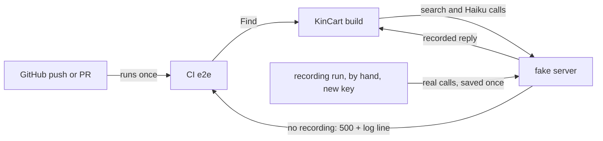
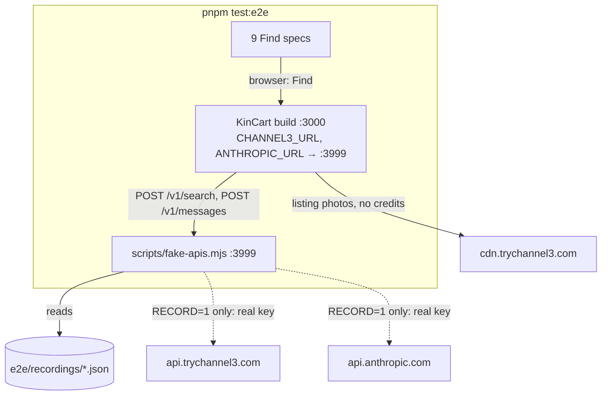
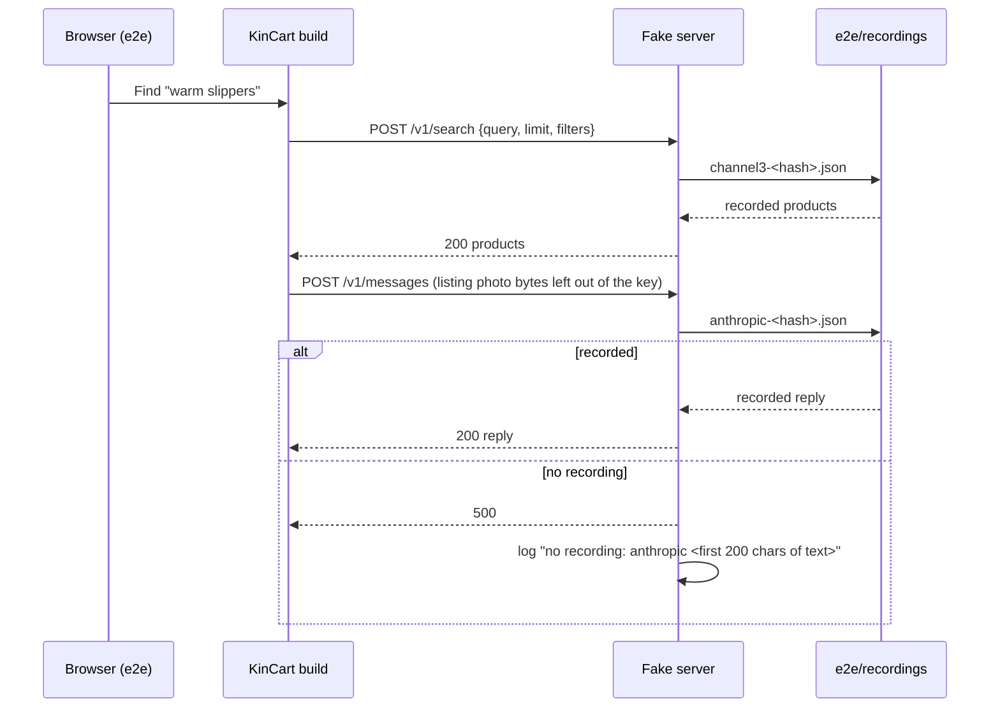

# CI without Channel3

**Version:** v1 · **Status:** Built · **Type:** Technical · **Project type:** Web UI

**Depends on:** None
**Page:** none. Skipped: you read the `.md` directly.

CI's e2e gets Channel3's and Claude's answers from recorded replies, so a push spends no Channel3 credits. It comes now because CI used all 1,000 of October's credits in 4 days, and every Find e2e has failed with HTTP 402 since.

## Problem

Channel3 gives 1,000 free searches a month, reset on the 1st. CI spent them all from Oct 22 to Oct 26 (KL time): about 370 searches on Oct 23 and about 750 on Oct 26, against 13 CI runs on each of those days. Each run's e2e makes about 55 real searches (D24). `ci.yml` runs on both `push` and `pull_request`, so a push to a branch with a PR runs CI twice.

Since then, the 9 e2e tests that run a real Find fail with `reason=channel3 402`. PR #30 (confirm-ok) and #31 (security-story) can't merge, because a red main skips the Neon migration (D11). At this rate, CI would also use December's credits before judging, Dec 1 to 15.

## Slice test

| Check                         | Result                                                                            |
| ----------------------------- | --------------------------------------------------------------------------------- |
| Cuts every layer it needs     | yes — the CI workflow, the Channel3 and Claude clients, and the e2e setup         |
| One e2e test walks it         | yes — the 9 real-Find e2e pass in CI with no Channel3 call                        |
| Worth shipping alone          | yes — CI goes green, #30 and #31 can merge, and December's credits stay for judges |
| Fits (≤5 scenarios, ≤2 areas) | yes — 4 scenarios, CI and the e2e harness                                         |

**Path:** full — it changes the CI workflow, two API clients and the e2e setup, and supersedes D24. Pause 2 is skipped: nothing changes on screen.

## Flow



CI runs the e2e once per push. KinCart's search and Haiku calls go to a local fake server, which answers from replies recorded once with real calls. A call with no recorded reply fails its test.

## Acceptance criteria

```gherkin
Scenario: A push spends no Channel3 credits
  Given Channel3's dashboard shows 412 of 1,000 credits used
  When a push to feat/confirm-ok runs CI
  Then the 9 real-Find e2e pass, with find-and-explain's slippers and basket's three things as recorded
  And the dashboard still shows 412 of 1,000

Scenario: A call with no recorded reply fails its test
  Given an e2e Find for "hearing aid batteries", which has no recorded reply
  When KinCart asks the fake server for it
  Then the fake server answers 500
  And CI's log names the request, such as "no recording: channel3 search hearing aid batteries"
  And no request reaches api.trychannel3.com or api.anthropic.com

Scenario: A push to a branch with a PR runs CI once
  Given PR #30 is open from feat/confirm-ok
  When a commit is pushed to feat/confirm-ok
  Then GitHub runs one CI test job, from the pull_request event
  And a push to main still runs the test job and then the Neon migration (D11)

Scenario: The replies are recorded once, by hand
  Given a new Channel3 API key in .env.local
  When you run the recording command
  Then every Channel3 and Claude reply the 9 e2e need is saved in the repo
  And the run uses about 55 Channel3 searches, once
```

## Scope

**In:**

- A fake server that the e2e's KinCart build sends its Channel3 searches and Claude calls to.
- Recorded replies in the repo, and a command that records them with real calls.
- `ci.yml` runs on `pull_request`, and on `push` to main only.
- All 9 real-Find e2e: ask-again, basket, find-and-explain, find-another, find-limits, photo-ask, photo-ask-several, sam-finds-another and usage-on-status.

**Out:**

- `lib/shop/picks.test.ts` keeps calling real Haiku in `pnpm test` (D94), at about 3 to 5 cents a run. Claude has a spend cap, not a monthly quota.
- An e2e run against real Channel3. None runs, by hand or on a timer (O2).
- The live site's Find, which is out of credits until Nov 1. A new key on Vercel is your call, and not part of this slice (O5).

## Technical plan

### Approach

The two clients read their base URL from the env, and fall back to the real host. Playwright starts a fake server on port 3999 before the KinCart build, and gives the build that server's URL. The fake server answers each call from a recorded reply in `e2e/recordings/`. With `RECORD=1`, it forwards a call that has no recording to the real service, with the real key from `.env.local`, and saves the reply.

Relies on: D10, D11, D20, D94, D95, and the drafted D127, D128, D129, D130. D127 supersedes D24, and D130 supersedes D129.





The key for a recording is the SHA-256 of the call's service and its body. For a Claude call, each listing photo becomes `{type: "image"}` first, so only its text counts (O7). Each of Rose's photos, the image after a `Photo n:` label, becomes a SHA-256 of its bytes instead (D130): they come from the fixed files in `e2e/photos/`, and without them two photo Finds with no words would match the same recording (O9).

### Changes

| File | What changes | Why |
| ---- | ------------ | --- |
| `lib/shop/search.ts:26` | The search URL is `${process.env.CHANNEL3_URL ?? "https://api.trychannel3.com"}/v1/search` | scenario 1 |
| `lib/shop/ai.ts:136` | The messages URL is `${process.env.ANTHROPIC_URL ?? "https://api.anthropic.com"}/v1/messages` | scenario 1 |
| `scripts/fake-apis.mjs` | New. A `node:http` server: `POST /v1/search` and `POST /v1/messages`, answered from `e2e/recordings/`. A miss answers 500 and logs `no recording: <service> <text>`. With `RECORD=1`, a miss goes to the real host with the real key and is saved | scenarios 1, 2, 4 |
| `scripts/fake-apis.test.ts` | New. Starts the server on a free port: a recorded call replays, a miss answers 500 with its log line, listing photo bytes don't change the key, and Rose's photos do | scenario 2 |
| `e2e/recordings/` | New. One JSON file for each recorded reply, with the call's text beside the reply so a reviewer can read what it answers | scenario 1 |
| `playwright.config.ts:24` | `webServer` becomes a list: the fake server first, then KinCart with `env` set to `CHANNEL3_URL` and `ANTHROPIC_URL` on `http://localhost:3999`, and both API keys set to `recorded` | scenario 1 |
| `.github/workflows/ci.yml:3` | `push` runs on `branches: [main]` only. `CHANNEL3_API_KEY` becomes `recorded`, not a secret | scenarios 1, 3 |
| `package.json` | A `test:e2e:record` script: `RECORD=1 playwright test` | scenario 4 |
| `README.md` | The Checks paragraph says the e2e plays recorded Channel3 and Claude replies, and how to record them | scenario 4 |
| `lib/shop/search.test.ts`, `lib/shop/ai.test.ts` | One test each: with the env URL set, the call goes there | scenario 1 |

Reusing: the `node:http` local-server pattern from `e2e/security-headers.spec.ts:26`, and `process.loadEnvFile(".env.local")` in `playwright.config.ts:4`, which gives the fake server the real keys in a recording run.

`ANTHROPIC_API_KEY` stays a CI secret, because `lib/shop/picks.test.ts` calls real Haiku in `pnpm test` (D94). The e2e specs' skip checks (`e2e/find-and-explain.spec.ts` and the others) still see both keys set, so no spec changes.

### Earn-it

| Added | Triggered by |
| ----- | ------------ |
| `CHANNEL3_URL` and `ANTHROPIC_URL` | scenario 1. Next's server calls Channel3 and Claude itself, so Playwright can't route them, and only an env URL sends them elsewhere |
| `scripts/fake-apis.mjs` | scenarios 1 and 2 |
| `RECORD=1` and `test:e2e:record` | scenario 4. A prompt change needs new Claude replies, and recording by hand would mean writing JSON from logs |

### Non-functionals

|                      |                                                                                                   |
| -------------------- | ------------------------------------------------------------------------------------------------- |
| **Load**             | About 55 Channel3 calls and 60 Claude calls for each e2e run, all local now.                     |
| **Breaks first**     | A prompt change: every Claude call it touches misses. Run `pnpm test:e2e:record`, which costs Claude cents and no Channel3 credits, since Channel3 replies replay. |
| **Security surface** | Production sets neither URL, so it calls the real hosts. Only someone with Vercel env access could set one, and they already hold the keys. Recordings hold public listings and Haiku's answers, with no key, link or address. |
| **Proof it works**   | Channel3's dashboard count stays the same after a CI run, and CI's e2e passes with `CHANNEL3_API_KEY: recorded`. |
| **Rollout**          | No flag: production is unchanged. `git revert` brings back real calls in CI.                     |

### Test plan

| Scenario | Test | Command |
| -------- | ---- | ------- |
| 1 | the 9 Find e2e, replaying | `pnpm test:e2e` with `CHANNEL3_API_KEY=recorded` |
| 1 | the env URLs | `pnpm test lib/shop/search.test.ts lib/shop/ai.test.ts` |
| 2 | replay, miss and photo keys | `pnpm test scripts/fake-apis.test.ts` |
| 3 | one test job for each push to a PR branch | `gh pr checks` on this PR lists one `test` job |
| 4 | one recording run | `pnpm test:e2e:record`, then the dashboard shows about 55 more searches |

**E2E:** `pnpm test:e2e` in CI, all 9 Find specs green with no call to Channel3.

### Chunks

Single chunk.

### Risks

| Risk | Mitigation |
| ---- | ---------- |
| Your new key is in the same Channel3 organization, and shares its 0 credits left | Check the new key's org on the dashboard first. With no credits, the recording waits for Nov 1 (O5) |
| A Claude call's text changes from run to run, such as a time in a prompt, so it never matches | The first replay run in `/build` shows it. That call then matches on fewer fields, as a decided-alone row (O6) |
| A deleted CDN photo drops its listing, so the pick call's text changes and misses | The miss log names it. Run `pnpm test:e2e:record` again: Claude cents, no Channel3 credits |
| Recorded replies go stale, and the e2e no longer shows what Channel3 returns today | Accepted with O2: nothing checks live Channel3. `picks.test.ts` still checks real Haiku |
| #30 and #31 branch from before this slice | After this merges, rebase #30 onto main, then #31 onto #30. Their CI then replays too |

### Decisions to record

Recorded as D127, D128, D129, D130.

## Review

2026-11-02 · 2 raw findings, 1 survived, 1 fixed.

- quality · `scripts/fake-apis.mjs:92` · listen on 3999 alone, dropping the unread FAKE_APIS_PORT · `7893a39`

## Open items

| ID  | What                                                                                                         | Type     | Raised at | Owner | Status   | Answer |
| --- | ------------------------------------------------------------------------------------------------------------ | -------- | --------- | ----- | -------- | ------ |
| O1  | What CI's e2e calls for real on each push                                                                    | question | spec p1   | user  | Resolved | Nothing. Channel3 and Claude both answer from recorded replies. `picks.test.ts` keeps real Haiku in `pnpm test` (D94). Real Claude with recorded Channel3 was turned down. 2026-10-27 |
| O2  | When the e2e runs against real Channel3                                                                      | question | spec p1   | user  | Resolved | Never. By hand before the freeze, and once a night, were turned down. 2026-10-27 |
| O3  | A push to a branch with a PR runs CI twice                                                                   | question | spec p1   | user  | Resolved | `push` runs on main only, and branches run through `pull_request`. Keeping both was turned down. 2026-10-27 |
| O4  | What happens when an e2e call has no recorded reply                                                          | question | spec p1   | user  | Resolved | The fake server answers 500, and the log names the request. Falling back to the real service was turned down. 2026-10-27 |
| O5  | Where the recorded Channel3 replies come from, while the key is out of credits until Nov 1                   | question | spec p1   | user  | Resolved | You get a new Channel3 API key, and one recording run uses it. Hand-built replies and waiting for Nov 1 were turned down. 2026-10-27 |
| O6  | Each Claude call's text is the same on every e2e run, so a recorded reply always matches                     | unproven | spec p3   | build | Resolved | `/build` checks it on the first replay run. A call whose text changes each run then matches on fewer fields, as a decided-alone row. A `/poc` first was turned down. 2026-10-27. Checked 2026-11-02: two replay runs after recording passed 33 of 33 with no `no recording:` line |
| O7  | Whether listing photos download from the real CDN in the e2e                                                 | question | spec p3   | user  | Resolved | Yes, from cdn.trychannel3.com, which costs no credits. The fake server leaves photo bytes out of a Claude call's key (D129). Recorded photos were turned down. 2026-10-27 |
| O8  | Scenario 4's recording run needs the new Channel3 key in `.env.local` as `CHANNEL3_API_KEY`, and the key needs credits. `.env.local` was last changed on Oct 23, so the key there is the old one, with 0 credits left. Everything else is built: with no recordings, the 9 Find e2e fail on `no recording:` lines, the 17 others pass, and no call reached Channel3 | question | build | user | Resolved | Keep the key in `.env.local`. Channel3's credits reset on Nov 1, and credits count per organization, so the old key's organization has credits again. A 402 during the run saves nothing and logs `not recorded:`. 2026-11-02 |
| O9  | The first recording run failed the blank-wall photo test: with photo bytes left out of the key, it and the written-list test both sent `Photo 1: Photo 2: They typed nothing.`, so the blank wall replayed the list's 4 things. Rose's own photos now keep a fingerprint in the key, and listing photos still don't (D130, superseding D129). Other choice: a counter for calls with the same key, which breaks running one test alone | decision | build | claude | Decided alone | Fingerprint of Rose's photos. 2026-11-02 |

_Never delete this section or its rows. See references/ledger.md._

## Glossary

- **e2e** — end-to-end: a script drives a real browser through the app, the way a person would.
- **Fake server** — a small local web server that stands in for Channel3 and Claude in the e2e, and answers with saved replies.
- **Recorded reply** — a real Channel3 or Claude answer, saved once in the repo and played back in each test run.
- **HTTP 402** — "Payment Required": Channel3 refuses the call because the month's free credits are used up.
- **Credits** — Channel3's free monthly allowance: 1,000 API requests, reset on the 1st.
- **SHA-256** — a one-way fingerprint of some text. The same call always gives the same fingerprint, which names its recording file.
- **Env** — environment variables: settings a program reads when it starts, such as `CHANNEL3_URL`.
- **Base URL** — the start of an address that every call to a service shares, such as `https://api.trychannel3.com`.
