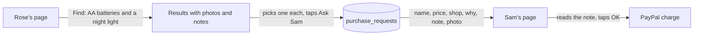
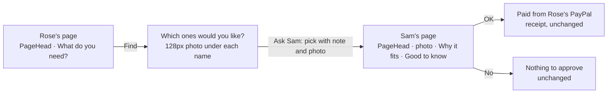
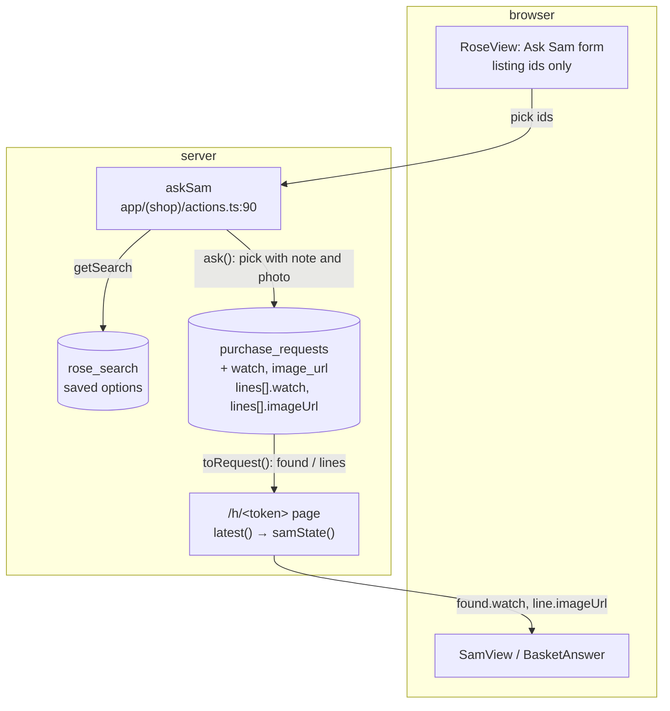
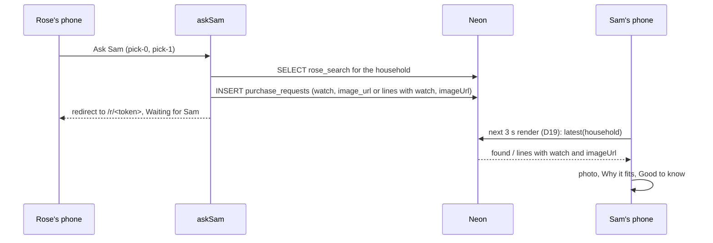
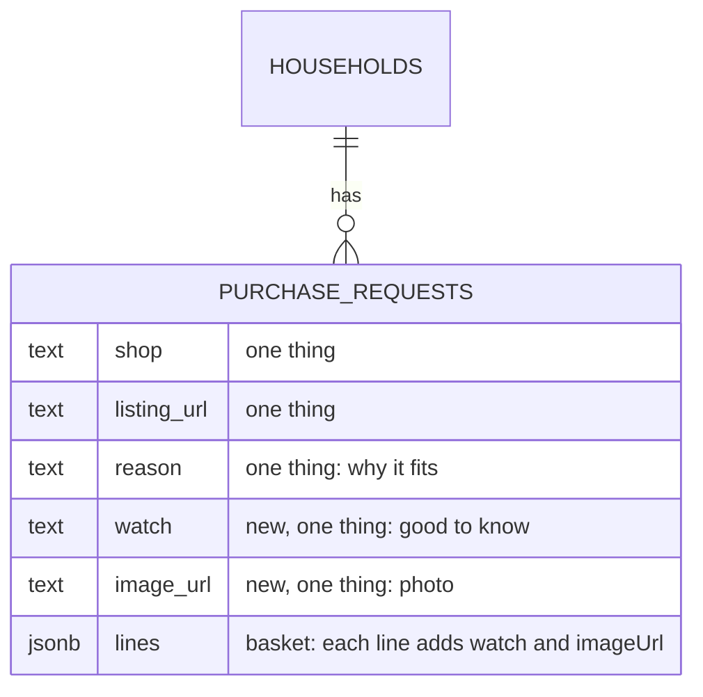

# Clearer pages

**Version:** v1 · **Status:** Shipped · **Type:** Enhancement · **Project type:** Web UI

**Shape doc:** docs/specs/shop-together/shape.md
**Depends on:** None

Sam sees the photo and the AI's "Good to know" note for each thing before paying. Rose's and Sam's pages show the KinCart name, and the listing photos get bigger. It comes now because a judge's UI pass of v1.0.0 found these three gaps, and judging starts on 2026-12-01.

## Problem

Sam pays, but Sam sees less than Rose does. Rose sees each listing's photo and a "Good to know" note, such as "It needs 3 AAA batteries, which aren't included." Sam sees only the name, the price, the shop and "Why it fits". The ask stores only the "why" sentence (`app/(shop)/actions.ts:115`), so the photo and the note never reach Sam.

Rose's page and Sam's page show no KinCart name or mark. A page with no name that asks an older person to shop looks like a scam page.

The listing photos are 64px (`app/(shop)/shop.css:233`). That is small for older eyes to tell what the thing is.

On a 390px-wide phone, the home page puts the full stop after the "what comes next" link on a line of its own.

## Slice test

| Check                         | Result |
| ----------------------------- | ------ |
| Cuts every layer it needs     | yes: Rose's pick, the stored ask, Sam's page, and the shared page styles |
| One e2e test walks it         | yes: Rose finds and asks for two things, and Sam's page shows the name, the photos and the notes |
| Worth shipping alone          | yes: Sam sees the AI's warning before paying, and both pages show whose app they are |
| Fits (≤5 scenarios, ≤2 areas) | yes: 5 scenarios, in the shop pages and the request storage |

**Path:** full. It touches more than three files and adds two fields to a stored ask.

## User story

As Sam, I want to see each thing's photo and the AI's warning before I tap OK, so that I don't pay for the wrong thing.

## Flow



Rose asks for two things, the ask keeps each pick's note and photo, and Sam's page shows them above OK.

## Acceptance criteria

```gherkin
Scenario Outline: Sam sees the photo and the note for each thing
  Given Sam's price limit is $30
  And Rose found "<words>" and picked "Motion Sensor Stick-On Night Light, Battery Powered" at $16.99 from amazon.com
  And its note says "It needs 3 AAA batteries, which aren't included."
  When Rose taps Ask Sam
  Then Sam's page shows the night light's photo
  And Sam's page shows "Good to know: It needs 3 AAA batteries, which aren't included."
  And Sam's page still shows "Why it fits" for the night light

  Examples:
    | words                         |
    | a night light                 |
    | AA batteries and a night light |

Scenario: A thing with no photo, or an ask from before this change
  Given Rose's ask holds "Duracell Coppertop AA Batteries, 8 Pack" at $8.79, which has no photo
  When Sam opens Sam's page
  Then Sam's page shows no empty photo box for the batteries
  And an ask made before this change shows as it does today, with no empty "Good to know"

Scenario: Rose's and Sam's pages show the KinCart name
  Given Rose opens Rose's link in a phone browser
  When the page loads
  Then the top of the page shows the KinCart mark and the name "KinCart"
  And Sam's page shows the same at its top
  And the home page's two phones show the same header inside each phone

Scenario: Photos are big enough to see the thing
  Given Rose's results on a 390px-wide phone
  When Rose looks at "Winter Knitted House Slippers" at $29.99 from dreampairs.com
  Then its photo is at least 120px wide
  And Sam's page shows the photo at the same size

Scenario: The home page keeps the full stop with its link
  Given the home page on a 390px-wide phone
  When the page loads
  Then "what's real, what stands in, and what comes next." ends on one line with its full stop
```

## Scope

**In:**

- The note and the photo stored with each pick, for an ask of one thing and an ask of several.
- Sam's page showing them while Sam decides.
- A KinCart header on Rose's page and Sam's page.
- Bigger listing photos on Rose's results and on Sam's page.
- The full stop on the phone-width home page.

**Out:**

- A shorter results page for Rose, such as one thing at a time. Not planned: it needs new video footage.
- Photos on the receipt and on Rose's "Waiting for Sam" summary. Not planned.
- New video footage. Not planned: the rules ask that the app does what the video shows, and this slice only adds to it.

## Interface



Rose's two screens and Sam's approve screen change, and the screens after OK or No stay as they are.

What changes on screen:

- **`PageHead`** sits above Rose's and Sam's pages. It holds the `/icon.svg` tile at `--space-8` (32px) and "KinCart" in `--type-title`, with `--space-6` above. It reuses the brand lockup from `/` and `/status` (`.brand`, `.brand-mark`). It has no violet block, because the showcase stays on `/` and `/status`. The home page's phones show it too (D55).
- **Listing photos** are `--photo-size` (128px, a new token) and sit under the name and price, above the text. This applies to Rose's results (`ListingPicker`), Sam's lines (`BasketAnswer`) and Sam's one-thing ask (`SamView`). A listing without a photo shows no box.
- **"Good to know"** follows "Why it fits" on Sam's lines and on Sam's one-thing ask, when the ask stored it. An ask from before this change shows as it does today.
- **The home page link** holds its full stop, so the full stop never wraps alone. `.link` is `inline-flex`, so a line can break after it (`app/(shop)/shop.css:256`).

**Motion tier:** 0. Nothing new moves.

**Components used:** `ListingPicker`, `Summary`, `Button`, `PhoneFrame`, and the `.brand` lockup as `PageHead`. One token added: `--photo-size: 128px` in `docs/design/design-system/tokens/spacing.css` (D56).

**Preview:** `/preview/clearer-pages` on `pnpm dev` (404 in production). Checks run: `check-design-drift.sh` passed over 10 files, light and dark were looked at, and photos measure 130px with the border.

## Technical plan

### Approach

Rose's Ask Sam already copies each pick from her saved search on the server. It now copies the pick's `watch` and `imageUrl` too. A one-thing ask stores them in two new nullable columns on `purchase_requests`. A basket stores them inside each line of the `lines` jsonb, so a basket needs no schema change (D32). Sam's page reads them back, and the screens from pause 2 show them when they are there.

Relies on: D10, D11, D12, D13, D24, D32, D49, D54, D55, D56, D57



The form sends only listing ids, so the stored note and photo come from the server's saved search and never from Rose's browser.



### Changes

| File | What changes | Why |
| ---- | ------------ | --- |
| `db/migrations/0008_clearer_pages.up.sql` | `ALTER TABLE purchase_requests ADD COLUMN IF NOT EXISTS watch text, ADD COLUMN IF NOT EXISTS image_url text` | Scenario 1, one thing. `IF NOT EXISTS` because `db:up` reruns every file (D49) |
| `db/migrations/0008_clearer_pages.down.sql` | `ALTER TABLE purchase_requests DROP COLUMN IF EXISTS watch, DROP COLUMN IF EXISTS image_url` | The reverse path |
| `lib/shop/requests.ts:8` | `Source` gains optional `watch` and `imageUrl` (done at pause 2). `Row` gains `watch` and `image_url` | Scenarios 1 and 2 |
| `lib/shop/requests.ts:109` | `ask()` inserts `source?.watch` and `source?.imageUrl` as `$9`, `$10` | Scenario 1, one thing |
| `lib/shop/requests.ts:303` | `toRequest()` adds `watch` and `imageUrl` to `found` only when the column is not null | Scenario 2: an old ask shows as today |
| `app/(shop)/actions.ts:115` | The one-thing `ask()` passes `watch: option.watch, imageUrl: option.imageUrl`. The basket `lines` map adds `watch` and `imageUrl` | Scenario 1, both examples |
| `app/(shop)/SamView.tsx`, `BasketAnswer.tsx`, `ui.tsx`, `shop.css`, `HomeView.tsx`, `r/[token]/page.tsx`, `h/[token]/page.tsx` | Built at pause 2: `PageHead`, the photo at `--photo-size`, "Good to know", the full stop | Scenarios 1 to 5 |
| `docs/design/design-system/tokens/spacing.css` and its `readme.md` and `guidelines/spacing.html` | `--photo-size: 128px` (done at pause 2) | Scenario 4 (D56) |
| `app/(shop)/preview/clearer-pages/page.tsx` | Every screen of the slice (done at pause 2) | Pause 2 review |
| `app/(shop)/actions.test.ts`, `lib/shop/requests.test.ts`, `app/(shop)/SamView.test.tsx` (new), `app/(shop)/HomeView.test.tsx`, `e2e/basket.spec.ts`, `e2e/find-and-explain.spec.ts`, `e2e/demo-home.spec.ts` | The tests in the test plan | All scenarios |

Reusing: `getSearch()` and the pick lookup in `askSam`, `ask()`, `toRequest()`, the `.listing-photo` and `.listing-text` styles, the `.brand` lockup, `renderToStaticMarkup` in the view tests, and the e2e helpers `roseFinds`, `heading` and `reset`.

### Data



**Migration:** expand only. Old code ignores the two new columns and the extra keys in `lines`. No backfill is possible or needed: an ask clears Rose's saved search, so an old ask's note and photo are gone, and scenario 2 shows it as today. CI runs `db:up` on Neon after tests pass on main (D11), and Vercel promotes after that (D10). There is no contract step.
**Reverse:** promote the previous deploy on Vercel. Then, if wanted, `pnpm db:down` drops the two columns. The old code runs with or without them. `/build` tests this path: `pnpm db:down`, `pnpm db:up`, then `pnpm test` on the local container.

### Earn-it

| Added | Triggered by |
| ----- | ------------ |
| `watch` and `image_url` columns | Scenario 1, one thing: a one-thing ask lives in columns, not in `lines` (D57) |
| `--photo-size` token | Scenario 4, and the system has no size above 64px (D56) |
| `PageHead` component | Scenario 3: two pages and the preview show the same header |
| `SamView.test.tsx` | Scenario 2 has no other test that renders Sam's page without a photo or a note |

### Non-functionals

|                      |                                                                               |
| -------------------- | ----------------------------------------------------------------------------- |
| **Load**             | One ask writes two more short values. Sam's page loads 1 to 5 photos, which Rose's page already loaded. |
| **Breaks first**     | Photos are hotlinked from `cdn.trychannel3.com`. The one checked is 2000 × 2000 webp, 88 KB, so 5 cost Sam about 440 KB. If the CDN stops serving them, Sam sees grey squares, as Rose already would. |
| **Security surface** | Only Rose's link can call `askSam` (`whoIs`). The note and the photo URL come from the server's saved search: Claude's text and Channel3's `https://` image URL (`lib/shop/search.ts:43`). Nothing comes from the form. React escapes both. No secrets. Neon stores two more text values for each ask. |
| **Proof it works**   | On Neon after the deploy: `SELECT id, watch IS NOT NULL, image_url IS NOT NULL, lines->0 ? 'watch' FROM purchase_requests ORDER BY id DESC LIMIT 5` shows true for new asks. |
| **Rollout**          | No flag. CI migrates Neon, then Vercel promotes (D10, D11). Rollback: the two steps under Reverse. |

### Test plan

| Scenario | Test | Command |
| -------- | ---- | ------- |
| 1, one thing | `app/(shop)/actions.test.ts`: the one-thing ask stores `watch` and `imageUrl`. `lib/shop/requests.test.ts`: `ask()` and `latest()` round-trip them. `e2e/find-and-explain.spec.ts`: Sam sees "Good to know:", and as many photos as Rose's pick had | `pnpm test`, `pnpm test:e2e` |
| 1, two things | `app/(shop)/actions.test.ts`: each line stores `watch` and `imageUrl`. `e2e/basket.spec.ts`: Sam sees two "Good to know:" lines, and as many photos as Rose's picks had | `pnpm test`, `pnpm test:e2e` |
| 2 | `app/(shop)/SamView.test.tsx`: a line with no `imageUrl` renders no `img`, and a line or `found` with no `watch` renders no "Good to know". `lib/shop/requests.test.ts`: a row with null columns gives `found` without `watch` | `pnpm test` |
| 3 | `e2e/basket.spec.ts`: the banner on Rose's and Sam's pages says "KinCart". `e2e/demo-home.spec.ts`: the same inside both phones | `pnpm test:e2e` |
| 4 | `e2e/find-and-explain.spec.ts` at 390 px: Rose's and Sam's photos are at least 120 px wide, when the pick has one | `pnpm test:e2e` |
| 5 | `app/(shop)/HomeView.test.tsx`: the link's text ends with "what comes next." | `pnpm test` |

**E2E:** `e2e/basket.spec.ts` › "Rose asks for three things, Sam pays for one, and the other goes back to Rose" walks the slice: the headers, Rose's picks, then Sam's notes and photos before OK.

Before `pnpm test`, run `pnpm db:up` on the local Postgres container. Before `pnpm test:e2e`, stop `pnpm dev`. A dev server is running on port 3000 at this pause.

The pause 2 code already passes these tests, so `/build` breaks each line under test once and watches its test fail (docs/learnings/break-code-built-at-pause-2.md).

### Chunks

Single chunk. The change is small, and `requests.ts`, `actions.ts` and their tests are shared by every scenario.

### Risks

| Risk | Mitigation |
| ---- | ---------- |
| Real Channel3 results vary, and a pick may have no photo (D24) | The e2e counts the photos in Rose's picks and expects the same count on Sam's page. It never expects a fixed number. |
| A photo URL that is not 2000 px wide looks soft at 128 px | One URL was checked. Soft photos are a looks issue, not a broken one. Look at the live page after the deploy. |
| Each listing card is about 140px taller, so Rose's three-thing page gets longer | Accepted at pause 2 (D56). A shorter results page is out of scope. |
| The header takes about 56px inside the home page's phones | Accepted at pause 1 (D55). The phone screens scroll. |

### Decisions to record

Recorded as D54, D55, D56, D57.

## Review

2026-10-15 · 0 raw findings, 0 survived. Clean.

## Open items

| ID | What | Type | Raised at | Owner | Status | Answer |
| -- | ---- | ---- | --------- | ----- | ------ | ------ |
| O1 | What more does Sam see for each thing: the photo and "Good to know", or also Rose's "what it is" sentence? | question | spec p1 | user | Resolved | The photo and "Good to know" only. The name and the photo already say what it is, so Sam's page stays short. 2026-10-15 |
| O2 | What does the header say: the mark and "KinCart" only, or also whose page it is? | question | spec p1 | user | Resolved | The mark and "KinCart" only. The page heading under it already says what to do. 2026-10-15 |
| O3 | Does the header show inside the home page's two phones too? The home page already names each phone and shows the brand beside them. | question | spec p1 | user | Resolved | Yes, the same page everywhere. The phones show the real page, and no frame check is needed. 2026-10-15 |
| O4 | The video shows today's Sam page. After this ships, the live page shows more than the video. | flag | spec p1 | user | Accepted risk | The rules ask that the app does what the video shows, and this slice only adds to it. No new footage. 2026-10-15 |
| O5 | The system's largest size is 64px (`--space-16`). How do the photos get bigger? | question | spec p2 | user | Resolved | Add `--photo-size: 128px` to the system's spacing tokens, with the photo under the name and price. 2026-10-15 |
| O6 | The Claude Design copy of the system has no `--photo-size` and no new photo layout. | flag | spec p2 | user | Accepted risk | The repo tokens drive the app, and the copy matters only for work in Claude Design. Re-sync at the next system change. 2026-10-15 |
| O7 | The plan did not name `scripts/migrate.test.ts`. Its households test called `db:down` once to undo 0007. With 0008 in place, that call undoes only 0008, and the test failed. | flag | build | user | Decided alone | Chose: the first test checks that 0008 adds, drops and adds back its two columns. The households test steps down past 0008, then runs 0007's down file. Other: delete the households test, because 0007 has shipped. Undo: delete `downToHouseholds` and the households test from `scripts/migrate.test.ts`. 2026-10-15 |

_Never delete this section or its rows. See references/ledger.md._

## Glossary

- **Backfill**: filling a new column from the data already there, before the code reads it.
- **e2e**: end-to-end. One test that walks the whole slice as a user would.
- **Good to know**: the AI's one-sentence warning about a listing, such as size, pack count, fit or delivery (`lib/shop/ai.ts:28`).
