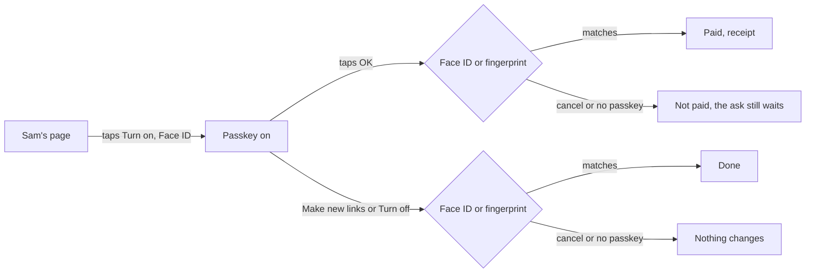
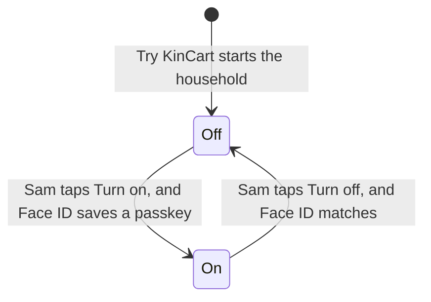
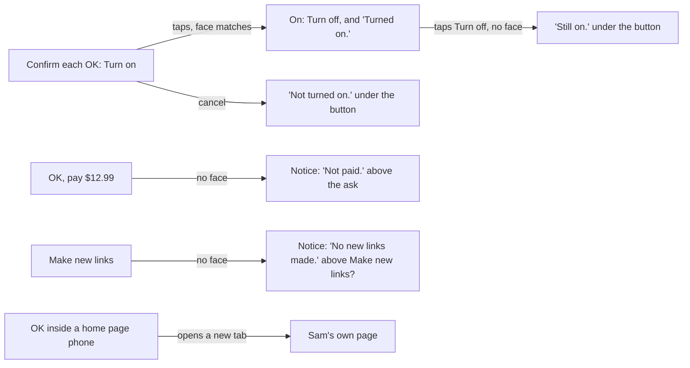
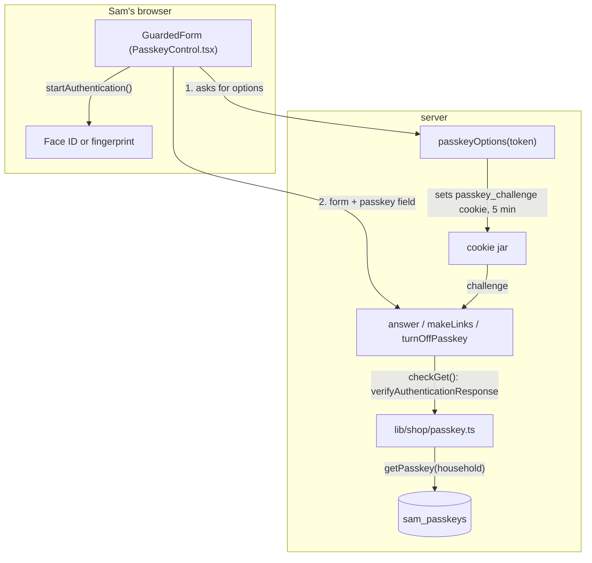
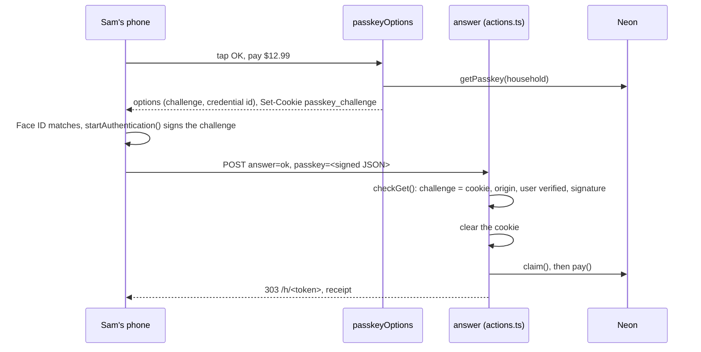
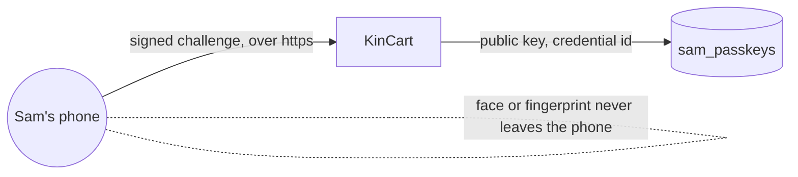
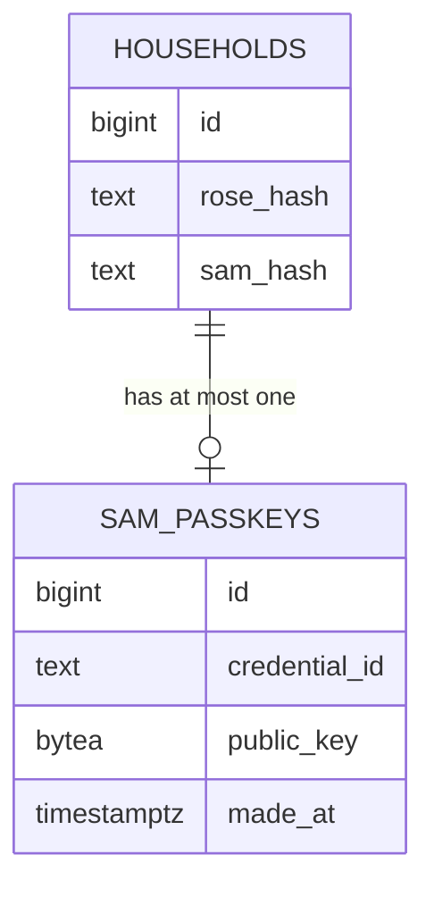

# Confirm OK

**Version:** v1 · **Status:** Shipped · **Type:** Feature · **Project type:** Web UI

**Shape doc:** docs/specs/security/shape.md
**Depends on:** new-links
**Page:** none. Skipped: you read the `.md` directly.

Sam can turn on a passkey, so that each OK asks for Sam's face or fingerprint. It ships now because a leaked Sam link still approves charges, and it can also make new links that lock the family out (new-links O7).

## Problem

Whoever holds Sam's link can tap OK and charge Rose's saved PayPal. Since new-links, that person can also tap Make new links first and lock the real Rose and Sam out. The money is sandbox money, but a judge who reads the security story asks what stops a leaked link. Today the answer is nothing.

## Slice test

| Check                         | Result                                                                                      |
| ----------------------------- | ------------------------------------------------------------------------------------------- |
| Cuts every layer it needs     | yes: Sam's page, the OK, New links and passkey actions, and a new table for Sam's passkey  |
| One e2e test walks it         | yes: Sam turns it on, a phone without it can't pay, Sam's face pays, Sam turns it off       |
| Worth shipping alone          | yes: a leaked Sam link alone can no longer pay or make new links                            |
| Fits (≤5 scenarios, ≤2 areas) | yes: 5 scenarios, Sam's page and the actions behind it                                      |

**Path:** full. A feature with a new browser API, new screen states and a new table.

## User story

As Sam, I want each OK to ask for my face or fingerprint, so that someone who sees my link can't spend Rose's money.

## Flow



Once Sam turns the passkey on, OK, Make new links and Turn off each go through only after Sam's face or fingerprint matches.

## States



## Acceptance criteria

```gherkin
Scenario: Sam turns the passkey on
  Given a household started from Try KinCart on 2026-10-26, with Rose's demo PayPal linked
  And Sam opens their own page on a phone that has passkeys, not inside the home page's phones
  When Sam taps Turn on under Confirm each OK, and Face ID saves a passkey
  Then Sam's page says each OK now asks for Sam's face or fingerprint
  And it says that a lost passkey means Start a new one, unless the phone's passkeys sync

Scenario: A leaked link can't pay
  Given Sam's passkey is on, and Rose asks for "AA batteries" at $12.99
  When someone opens Sam's link on a laptop without Sam's passkey and taps "OK, pay $12.99"
  Then nothing is paid, the page says "Not paid. This OK needs your face or fingerprint, on the phone that turned it on.", and the ask still waits
  When Sam taps "OK, pay $12.99" on Sam's own phone, and Face ID matches
  Then Sam and Rose each see the receipt for $12.99

Scenario: Sam cancels the prompt
  Given Sam's passkey is on, and Rose's basket of 2 things waits
  When Sam taps OK and then Cancel on the Face ID prompt
  Then nothing is paid, and the basket and its OK still wait

Scenario: New links and Turn off ask too
  Given Sam's passkey is on, and no ask waits
  When someone without Sam's passkey taps Make new links, or Turn off
  Then the links and the passkey stay as they are
  When Sam taps Turn off on Sam's own phone, and Face ID matches
  Then the next OK pays with one tap, as before

Scenario: No switch where it can't or shouldn't run
  Given household 1, whose links live in Vercel's env
  Or Sam's page inside the home page's phones
  Or a browser with no passkeys
  When Sam's page shows
  Then it has no Confirm each OK
  And inside the home page's phones, an OK on a household with the passkey on opens Sam's page in a new tab
```

## Scope

**In:** Confirm each OK on Sam's own page for households started from Try KinCart, off by default. One passkey for each household. With it on, OK on one thing or a basket, Make new links and Turn off each ask for it. Inside the home page's phones, such an OK opens Sam's page in a new tab.

**Out:**

- A second passkey, or any way back after a lost one. A passkey that syncs through iCloud or Google moves to a new phone. Otherwise Sam starts a new household (O5). No later slice.
- A passkey on No, the limits, Find another or Notifications. None of these spend money or lock anyone out. No later slice.
- A passkey on Rose's page. A leaked Rose link can ask, but never pay. No later slice.
- Household 1 (O6). No later slice.
- A new shot in the demo video. The passkey is off by default, so the video stays true (O2). No later slice.
- The README's word on this. `security-story` (slice 6).

## Interface

The new states on Sam's page are built in the repo behind `/preview/confirm-ok`, and shown in light and dark.



- **Confirm each OK**, under the total limit and above Your links: one line on what it guards, one on a lost phone, and a secondary Turn on or Turn off. While the phone asks, the button says "Checking it's you…" with the spinner. "Turned on." or "Turned off." shows under it, and a cancel or a refusal shows as a field error.
- **A refused OK or Make new links** puts a neutral notice at the top of the screen: "Not paid. This OK needs your face or fingerprint, on the phone that turned it on." The ask and its buttons stay as they were. Neutral, because the guard worked and nothing broke.
- **Inside the home page's phones**, with the passkey on, the OK button keeps its label and opens Sam's page in a new tab. A line under the buttons says why. A basket's ticks don't carry over, so Sam ticks again there.
- The OK button keeps its label when the passkey is on. While the phone asks and KinCart pays, its busy label is "Checking it's you…".

**Motion tier:** 1. The button press and spinner the pages already have. No animation is new.

**Components used:** `Button`, `Notice`, `OkInTabHint` (a new line of `small` text in `ui.tsx`), and a new `PasskeySection` in `app/(shop)/Passkey.tsx`, built like `NotifySection`. It uses the `heading`, `field-label`, `small` and `field-error` styles. `shop.css` adds `.passkey` to the divider rule of `.limit, .notify, .links`. No new token or value.

**Preview:** `app/(shop)/preview/confirm-ok/page.tsx`, at `/preview/confirm-ok` on `pnpm dev`. Not served in production.

## Technical plan

### Approach

Sam's passkey is one row in a new `sam_passkeys` table, keyed by the household id (D46), so New links keeps it. A small client form asks the phone for the passkey before it sends OK, Make new links or Turn off, and puts the phone's answer in a hidden `passkey` field. The server action checks that answer with `@simplewebauthn/server` against the stored key and a one-time challenge in a cookie. With no match, nothing happens and the page says so.

Relies on: D44, D46, D47, D52, D60, D117, D121, and D122 to D125 (drafted here)





A phone without the passkey sends an empty `passkey` field, and `answer` redirects to `/h/<token>?refused=ok` before `claim()`, so nothing is paid.



### Changes

| File | What changes | Why |
| ---- | ------------ | --- |
| `db/migrations/0016_sam_passkeys.up.sql`, `.down.sql` (new) | `CREATE TABLE IF NOT EXISTS sam_passkeys (id bigint PRIMARY KEY REFERENCES households (id) ON DELETE CASCADE, credential_id text NOT NULL, public_key bytea NOT NULL, made_at timestamptz NOT NULL DEFAULT now())`. Down: `DROP TABLE IF EXISTS sam_passkeys` | 1, 4 |
| `lib/shop/requests.ts:123` | New `getPasskey(household)`, `savePasskey(household, credentialId, publicKey)` as `INSERT ... ON CONFLICT (id) DO NOTHING RETURNING id`, so the first passkey wins and a second Turn on can't replace it, and `dropPasskey(household)`. Same query style as `getVault()` | 1, 4 |
| `lib/shop/passkey.ts` (new) | `createOptions()`, `getOptions(credentialId)`, `checkCreate(json, challenge, origin)` and `checkGet(json, stored, challenge, origin)`. They wrap `@simplewebauthn/server`'s generate and verify calls with `userVerification: "required"` and the rp id from `origin()`'s host. Each check returns `false` on any throw | 1, 2, 3, 4 |
| `app/(shop)/actions.ts:79` | New `passkeyOptions(token)`, `turnOnPasskey(token, json)` and `turnOffPasskey(token, json)`, each only for Sam of a household other than 1. A private `confirmed(household, formData)` reads the `passkey` field and the `passkey_challenge` cookie, then clears the cookie. `answer()` (`:294`) checks it for `ok` only when the household has a passkey. `makeLinks()` takes `formData` and checks it the same way. A refusal logs `passkey household=<id> status=refused for=<ok\|links\|off>` and redirects with `?refused=` | 2, 3, 4 |
| `app/(shop)/PasskeyControl.tsx` (new, client) | `PasskeyControl`: hides itself in a frame (as `NotifyControl` does) or without `PublicKeyCredential`, and runs Turn on and Turn off with `@simplewebauthn/browser`. `GuardedForm`: a form that, when the passkey is on, gets a signed challenge before it sends anything but No | 1, 2, 3, 4, 5 |
| `app/(shop)/h/[token]/page.tsx:63` | Reads `getPasskey()`. Passes `passkey` (the control) only for a household other than 1 and without `?in=phone`, `refused` from `?refused=`, `guarded` when on, and `okInTab` as `/h/<token>` when on and `?in=phone` | 2, 5 |
| `app/(shop)/SamView.tsx`, `app/(shop)/BasketAnswer.tsx`, `app/(shop)/Passkey.tsx`, `app/(shop)/ui.tsx`, `app/(shop)/shop.css`, `app/(shop)/preview/confirm-ok/page.tsx` | Built at pause 2. `/build` swaps the OK and Make new links forms for `GuardedForm` when `guarded`, and breaks each new line once, as the lesson says | 1 to 5 |
| `package.json`, `pnpm-lock.yaml` | `pnpm add @simplewebauthn/server@14.0.3 @simplewebauthn/browser` at the matching version | 1, 2 |
| `lib/shop/passkey.test.ts` (new) | `checkGet` refuses a wrong challenge, a wrong origin, no user verification and another key's signature. It passes a real response, made in the test with a key from `node:crypto` | 2, 3 |
| `lib/shop/requests.test.ts` | `savePasskey` keeps the first passkey, and `dropPasskey` removes only this household's | 1, 4 |
| `app/(shop)/actions.test.ts` | `answer` with a passkey on: no `claim()` without a match, `claim()` with one, and No goes through without it. `makeLinks` and `turnOffPasskey` refuse without a match. Household 1 gets no options | 2, 3, 4, 5 |
| `app/(shop)/SamView.test.tsx` | The refused notices, `okInTab`'s button and hint, and no section without `passkey` | 2, 5 |
| `scripts/migrate.test.ts:33` | Steps back past 0016 too | — |
| `e2e/confirm-ok.spec.ts` (new) | Walks scenarios 1 to 4 in Chromium with a virtual authenticator | 1 to 4 |

Reusing: `whoIs()` and the household 1 check from `makeLinks()`, `origin()` from `app/(shop)/origin.ts`, `new_rose`'s cookie options, `NotifyControl`'s frame check, `startOwn()` and `skipsLinking()` from `e2e/households.spec.ts`, and the PayPal approval helpers in `e2e/paypal.ts`.

### Data



**Migration:** expand only: one new table, and no code reads anything else from it. No backfill: every household starts with the passkey off.
**Reverse:** `pnpm db:down` runs `0016_sam_passkeys.down.sql`, which drops the table. `scripts/migrate.test.ts` runs it. Every passkey is then off.

### Earn-it

| Added | Triggered by |
| ----- | ------------ |
| `sam_passkeys` table | Scenarios 1 and 2: the public key must outlive the page, and New links must keep it (D46) |
| `@simplewebauthn/server` | Scenario 2: checking the phone's signature, in every passkey format. D123 |
| `@simplewebauthn/browser` | Scenarios 1 to 4: turns the server's JSON options into what `navigator.credentials` takes, and back, the way the server library expects |
| `passkey_challenge` cookie | Scenario 2: a signed answer must be for this OK, not an old one. D124 |
| `GuardedForm` | Scenarios 2 to 4: the phone must sign before the form is sent |

### Non-functionals

|                      |                                                                                                                                                                                     |
| -------------------- | ----------------------------------------------------------------------------------------------------------------------------------------------------------------------------------- |
| **Load**             | A few OKs a day. Each guarded one adds one server action, one SQL read and one signature check, well under 100 ms, with no Claude, Channel3 or PayPal call |
| **Breaks first**     | Nothing at 10×. Two OKs at once: `claim()` already lets only one pay. A second tab's challenge replaces the first's cookie, so the first tab's OK is refused and Sam taps again |
| **Security surface** | Callable by whoever holds a Sam link of a household other than 1. Trusts the token through `whoIs`, and the passkey answer only after the library checks the challenge, origin, user verification and signature. Stores a public key and a credential id, never a face or fingerprint. The challenge cookie is httpOnly, secure, sent only to `/h/<token>`, for 5 minutes. A leaker who turns it on first locks Sam out of OK (O5) |
| **Proof it works**   | `passkey household=<id> status=on`, then `status=refused for=ok` or a `purchase id=<n> status=paid` line in Vercel's logs |
| **Rollout**          | No flag: off by default. Vercel promotes after main's CI (D10). Rollback: promote the previous deploy. The old code ignores `sam_passkeys`, so every household pays with one tap again |

### Test plan

| Scenario | Test | Command |
| -------- | ---- | ------- |
| 2, 3 | `lib/shop/passkey.test.ts`: `checkGet` | `pnpm test lib/shop/passkey.test.ts` |
| 1, 4 | `lib/shop/requests.test.ts`: `savePasskey`, `dropPasskey` | `pnpm test lib/shop/requests.test.ts` |
| 2 to 5 | `app/(shop)/actions.test.ts`: `answer`, `makeLinks`, `turnOffPasskey` | `pnpm test "app/(shop)/actions.test.ts"` |
| 2, 5 | `app/(shop)/SamView.test.tsx` | `pnpm test "app/(shop)/SamView.test.tsx"` |
| reverse | `scripts/migrate.test.ts` | `pnpm test scripts/migrate.test.ts` |
| 1 to 4 | `e2e/confirm-ok.spec.ts`: Try KinCart, Skip, Turn on with a virtual authenticator, Rose asks for AA batteries, a second context with an empty authenticator taps OK and sees "Not paid", Sam's context pays and both see the receipt, Make new links refused in the second context, Turn off in Sam's context | `pnpm test:e2e e2e/confirm-ok.spec.ts --workers=1` |

**E2E:** `e2e/confirm-ok.spec.ts`. Scenario 3's Cancel is proven by the unit tests, since Cancel and a missing passkey reach the server the same way. Scenario 5 is proven by `SamView.test.tsx` and the page's conditions.

### Chunks

Single chunk.

### Risks

| Risk | Mitigation |
| ---- | ---------- |
| A leaker turns the passkey on first, and Sam can't OK (O5) | Accepted. The turn-on text says a lost passkey means a new KinCart |
| Playwright's virtual authenticator (Chrome's `WebAuthn` DevTools domain) acts differently from a real phone | The unit tests check a real signature. Before ship, turn it on and pay once on a real phone at kincart.vercel.app |
| A judge's browser has passkeys but no synced one, and they lose it on a reload of a private window | Off by default, and the text says so. The household can still be started again |
| Two new packages on the payment path | Pinned in the lockfile. `checkGet` returns false on any throw, so a library fault refuses the OK and never pays |

### Decisions to record

Recorded as D122, D123, D124, D125.

## Review

2026-10-26 · 2 raw findings, 2 survived, 2 fixed.

- correctness · `app/(shop)/actions.ts:381` · Sam's answer forms send `in=phone` from a home page phone, and `answer()` keeps it, so the next OK still opens a new tab · `e6c754c`
- A03 Software Supply Chain Failures · `package.json:16` · the two `@simplewebauthn` packages stay pinned exactly, with no advisory, as D123 accepts · `28db10f`

## Open items

| ID | What | Type | Raised at | Owner | Status | Answer |
| -- | ---- | ---- | --------- | ----- | ------ | ------ |
| O1 | Passkeys work inside the home page's phone frames in Chrome and Safari (from shape O10) | unproven | shape | poc | Resolved | No spike. Inside the phones, an OK on a household with the passkey on opens Sam's page in a new tab, as PayPal does (D60), and the switch shows only on Sam's own page. 2026-10-26 |
| O2 | A new step on Sam's OK makes the app differ from the video that judges watch (from shape O11) | flag | shape | user | Resolved | The passkey is off by default, so a household works as the video shows. The video stays as it is. 2026-10-26 |
| O3 | This guards sandbox money and the new-links lockout, and costs about a day before the Nov 5 freeze | flag | spec p1 | user | Resolved | Go ahead. 2026-10-26 |
| O4 | What the passkey guards once it's on | question | spec p1 | user | Resolved | OK, Make new links and Turn off. Without Turn off, a leaker turns it off first. 2026-10-26 |
| O5 | Sam loses the phone, or a leaker turns the passkey on first and locks Sam out of OK | flag | spec p1 | user | Accepted risk | No recovery. Synced passkeys move to a new phone, and otherwise Sam starts a new household. The turn-on screen says so. It's sandbox money and two demo people. 2026-10-26 |
| O6 | Whether household 1, whose links live in Vercel's env and which the e2e tests use, gets the switch | question | spec p1 | user | Resolved | No, as with New links. 2026-10-26 |
| O7 | How the server checks Sam's passkey | question | spec p3 | user | Resolved | `@simplewebauthn/server` v14.0.3 (D123). 2026-10-26 |
| O8 | Where the one-time challenge lives between asking the phone and checking its answer | question | spec p3 | user | Resolved | An httpOnly cookie on Sam's link for 5 minutes, cleared once checked (D124). 2026-10-26 |
| O9 | The plan's table had a plain `REFERENCES households (id)`. Every test and e2e reset deletes households other than 1 without deleting their passkeys first | flag | build | user | Decided alone | Chose: `ON DELETE CASCADE` on `sam_passkeys`, so a deleted household takes its passkey with it, and no reset changes. Other: a plain reference, and `DELETE FROM sam_passkeys` added to each reset in `lib/shop/requests.test.ts`, `app/(shop)/actions.test.ts`, `scripts/migrate.test.ts` and `e2e/db.ts`. Undo: drop `ON DELETE CASCADE` from `0016_sam_passkeys.up.sql`, and add the deletes. 2026-10-26 |
| O10 | The plan named no shared test phone. `lib/shop/passkey.test.ts` and `app/(shop)/actions.test.ts` both need a phone that answers Turn on and signs a challenge | flag | build | user | Decided alone | Chose: `lib/shop/passkeyPhone.ts`, imported by both tests. Other: a copy of the phone in each test. Undo: inline the file into both tests. 2026-10-26 |
| O11 | The full e2e run had 9 failures: ask-again, basket, find-and-explain, find-another, find-limits, photo-ask-several, photo-ask, sam-finds-another and usage-on-status. Every one ran a real Find, and Channel3 answered each search with HTTP 402 | flag | build | user | Decided alone | Chose: leave them. This slice changes no Find code, and `confirm-ok.spec.ts` and the 18 others passed. Other: stub Channel3 in those e2e (D24 says they call it for real). Undo: none needed once Channel3's quota or plan is back; run `pnpm test:e2e --workers=1` again. 2026-10-26 |

_Never delete this section or its rows. See references/ledger.md._

## Glossary

- **Passkey** — a sign-in key kept on the phone and unlocked with Face ID or a fingerprint. The website never sees the face or the fingerprint.
- **Synced passkey** — a passkey that iCloud Keychain or Google Password Manager copies to the owner's other devices.
- **Secret link** — the page address that is the only key to Rose's or Sam's page, such as `/h/<token>`.
- **Household** — one Rose and one Sam, with their own asks, limits, phones and saved PayPal (D42).
- **Challenge** — a random value the server makes for one OK. The phone signs it, so an old signed answer can't be sent again.
- **Virtual authenticator** — a fake passkey device that Chrome's DevTools give a test, so an e2e can turn the passkey on without a real phone.
- **rp id** — the site name a passkey belongs to, here the host of `kincart.vercel.app`. A passkey made for one site doesn't work on another.
- **@simplewebauthn** — a pair of open-source packages that make and check passkey requests, one for the server and one for the browser.
- **Lockfile** — `pnpm-lock.yaml`, the file that pins the exact version of every package.
- **Pentest** — a penetration test: someone attacks the app on purpose to find holes.
- **Backfill** — filling a new table or column from the data already there. This slice needs none.
- **e2e** — end to end: an automated test that drives the app the way a person would, start to finish.
