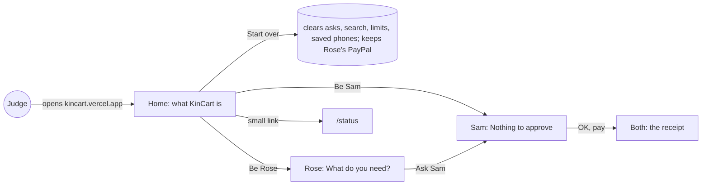
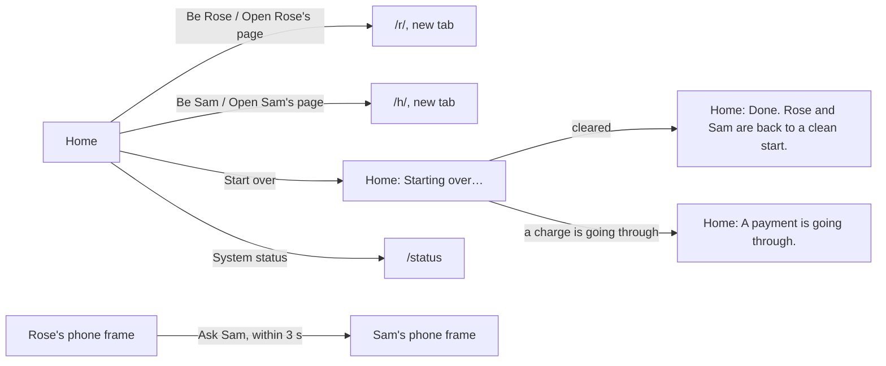

# Demo home

**Version:** v1 · **Status:** Draft · **Type:** Feature · **Project type:** Web UI

**Shape doc:** docs/specs/shop-together/shape.md
**Depends on:** households

A judge who opens kincart.vercel.app sees what KinCart is, can be Rose and Sam from there, and can start over from a clean slate. It comes now because every slice in the shape has shipped, and the URL is what judges get.

**Reopened:** 2026-10-15, at pause 3. Every judge gets their own Rose and Sam from the `households` slice, which comes first (O8). Pause 1 is redone once `households` is refined. Until then, Problem, Scope, the scenarios and the Start over parts of Interface describe the old shared demo.

## Problem

Judges get one URL. Today it lands on `/status` (`app/page.tsx` redirects there), which shows database and PayPal checks and has no way on to Rose or Sam. The two pages open only with secret links that nobody gives a judge.

Every judge also shares one Rose and one Sam. Whatever the last judge left is what the next one sees: a waiting ask, a $20 total limit, a receipt, a phone that still buzzes. Only clearing the database by hand resets it.

## Slice test

| Check                         | Result |
| ----------------------------- | ------ |
| Cuts every layer it needs     | yes: a home screen, a start-over action, the database, deployed |
| One e2e test walks it         | yes: a judge opens `/`, taps Start over, asks as Rose, approves as Sam, and both show the receipt |
| Worth shipping alone          | yes: a judge with only the URL can try KinCart |
| Fits (≤5 scenarios, ≤2 areas) | yes: 4 scenarios; two areas, the home page and a start-over in `lib/shop` |

**Path:** full. It adds a screen and an action that clears data, which the light path doesn't allow.

## User story

As a hackathon judge with only the URL, I want to see what KinCart does and try both people in a few minutes from a clean start, so that I judge the real thing with no setup.

## Flow



A judge lands on the home page, can start over, opens Rose and Sam from it, and walks one ask through to a receipt; the status page stays one tap away.

## Acceptance criteria

Pause 2 sets the exact words and layout.

```gherkin
Scenario: A judge opens the site and sees what KinCart is
  Given a judge on a laptop or a phone with only "kincart.vercel.app"
  When they open it
  Then they see what KinCart is in a few plain sentences, and "Sandbox money only. Nothing real is bought."
  And they see a way to be Rose and a way to be Sam
  And a small link to /status

Scenario: A judge tries both people from the home page
  Given Rose's PayPal is linked and nothing is waiting
  When the judge, as Rose, finds "AA batteries" and asks Sam for one at $9.99
  Then within 5 seconds Sam's page shows "Rose would like this" and "OK, pay $9.99"
  When the judge, as Sam, taps "OK, pay $9.99"
  Then both pages show the same receipt

Scenario: Start over clears what the last judge left
  Given the last judge left a $20 total limit, a $30 price limit, an ask for a night light waiting, a saved search, and Sam's phone with notifications on
  When the next judge taps "Start over" on the home page
  Then Rose's page shows "What do you need?" and "Sam's limit is $50 an item."
  And Sam's page shows "Nothing to approve", with an empty Total limit
  And Sam's old phone gets no buzz when Rose next asks
  And Rose's PayPal is still linked

Scenario: Start over while a payment is going through
  Given Sam has just tapped "OK, pay $9.99" and the charge is still going through
  When a judge taps "Start over"
  Then they see "A payment is going through. Try again in a few seconds."
  And nothing is cleared
```

## Scope

**In:**
- A home page at `/` in place of the redirect: what KinCart is, the sandbox line, the two ways in, Start over, and a small link to `/status` (D9 keeps it).
- Start over, for anyone on the home page. It clears every ask and its receipt, Rose's search, both of Sam's limits and every saved phone. It keeps Rose's saved PayPal, so no judge meets a PayPal login (O3).
- Start over refuses while a charge is going through, so no payment is lost.
- The two people stay the ones the fixed links open. The home page opens those same links for anyone (O1, D37).
- On a wide screen, Rose's and Sam's real pages sit side by side on the home page, live. On a phone, a button for each (O2).

**Out:**
- A fresh Rose and Sam for each visitor. Every one-row table would need a household, against D18 and the shape's "Not doing: sign-up and logins". No later slice.
- Linking a different PayPal from the home page. Rose's saved PayPal stays (D20). No later slice.
- Starting over on its own at a set time. A judge taps it. No later slice.

## Interface

One page at `/`, in two shapes. On a phone it is one column: the KinCart mark, what it is, the sandbox line, Be Rose and Be Sam, then Start over and the status link. From 880px wide and 480px high, Rose's and Sam's real pages appear as two 390 by 844 phones, live, and the two buttons go. From 1280px the text sits in a column to their left, so all three fit on one laptop screen.



The home page opens each person in a new tab or shows both live in frames. Start over comes back to the home page with a notice saying it cleared, or that a charge is still going through.

| Width | State | What's on it |
| ----- | ----- | ------------ |
| phone | default | the mark at 64px; "KinCart"; lead: "An older shopper buys online with a relative's OK, and no shared passwords."; "Rose says what they need. AI finds real listings and explains each one. Sam taps OK on their own phone, and Rose's saved PayPal pays."; "**Sandbox money only.** Nothing real is bought."; Be Rose (primary) and Be Sam (secondary), each opening a new tab; small: "Someone may have tried it before you. Start over clears their asks, limits and phones. Rose's PayPal stays linked."; Start over (secondary); "System status" link |
| phone | starting over | Start over becomes "Starting over…" with the spinner; Be Rose and Be Sam stay |
| any | done | grey notice at the top: "Done. Rose and Sam are back to a clean start." |
| any | a charge is going through | amber notice at the top: "A payment is going through. Try again in a few seconds." |
| 880px and up, 480px high | default | the text above; below it, "Rose's phone" and "Sam's phone", each with "Open Rose's page" or "Open Sam's page" and a 390 by 844 frame of the real page; Be Rose and Be Sam go |
| 1280px and up, 480px high | default | the text in a column up to 480px wide on the left, the two phones on the right |

The frames are the real pages, so their 3 s refresh (D19) shows Sam the ask and both the receipt with no extra code. A frame's height is kept within the window, and each page scrolls inside its frame.

Checked: no sideways scroll at 390, 1024, 1280 and 1440px, and a 900 by 420 window keeps the phone column. A 1280 by 800 window shows all three with no scroll. Light and dark both rendered. The live site sends no `X-Frame-Options` or CSP header, so same-origin frames load (checked on `/status` with curl, 2026-10-15). No new colours: the frame edge is `color-control` on `color-bg` (D40), the notices are the existing neutral and wait tones, and the buttons and links are the system's.

Craft checks: a one-line "landing page for a hackathon app" prompt gives a gradient hero, three feature cards with icons, a "Get started" button and a screenshot. Here the page has no marketing: the product runs live on it, as two real phones. Against Vercel's restraint: one accent, hierarchy from type size alone, and no decoration. Against Stripe's interactive docs: the real thing to try, beside the words that explain it.

**Motion tier:** 1, as before. Nothing new moves: the notices rise and fade like every notice, and "Starting over…" turns the spinner.

**Components used:** from the system, Button, Notice, PhoneFrame, and the `screen`, `heading`, `lead`, `small`, `link` and `button` styles. The layout uses the system's two breakpoints, `two-phones` and `text-beside` (D40). Composed here: `HomeView`, and the home layout in `shop.css` from `space` and `page` tokens.

**Preview:** http://localhost:3000/preview/demo-home with `pnpm dev`, and `?state=done`, `?state=paying` or `?state=busy`. Resize the window to see the three shapes. It answers 404 in production.

## Technical plan

### Decisions to record

## D39 · 2026-10-15 · A wide home page shows Rose's and Sam's real pages side by side

Why: a judge sees Sam's screen change within seconds of Rose's ask without switching tabs, which is the product's point (O2).
Rejected: a button for each that opens a new tab (the judge switches tabs to see the ask arrive), a button plus a QR code for each (a second device for every judge).
Source: docs/specs/demo-home.md
Status: active

## Open items

| ID | What | Type | Raised at | Owner | Status | Answer |
| -- | ---- | ---- | --------- | ----- | ------ | ------ |
| O1 | The home page opens Rose's and Sam's links for anyone, so the links stop being secret. D18 chose secret links for two fixed demo people moving sandbox money; the worst case is a stranger's ask or a spoiled demo, not lost money. The other choice is a short demo code that judges get with the submission | question | spec p1 | user | Resolved | Open to anyone: sandbox money only, and Start over fixes a spoiled demo. Supersedes D18 (D37). 2026-10-15 |
| O2 | How a judge plays both people. Recommended: on a wide screen, Rose's and Sam's pages side by side on the home page, live, so Sam's screen changes as Rose asks; on a phone, a button for each. Other choices: a button for each that opens a new tab, or a button plus a QR code to open the other person on a phone | question | spec p1 | user | Resolved | Side by side on a wide screen, live; a button for each on a phone (D39). 2026-10-15 |
| O3 | What Start over clears. Recommended: every ask and receipt, Rose's search, both limits back to $50 and none, and every saved phone; Rose's PayPal stays. The other choice keeps past receipts and phones, and only ends a waiting ask and resets the limits | question | spec p1 | user | Resolved | Everything but Rose's PayPal: asks and receipts, the search, both limits and saved phones (D38). 2026-10-15 |
| O4 | Two judges at the same moment still share one Rose and one Sam. One judge's ask shows on the other's Sam page, and one can start over in the middle of the other's turn. Judging runs Dec 1 to 15 (D3), so it is unlikely | flag | spec p1 | user | Accepted risk | Judging runs Dec 1 to 15, so two judges at once is unlikely, and Start over cleans up after. Agreed 2026-10-15 |
| O5 | The design system is phone-only: `page-max` is 480px and it has no breakpoints. The home page adds two widths (54em and 80em) and a 390 by 844 phone frame, written into `shop.css` from existing tokens. craft.md asks for this to be a choice: accept it as composition for the home page, as basket did with its tick box, or take a wide layout through `/design-system` | flag | spec p2 | user | Resolved | Through `/design-system`: add wide breakpoints and a phone frame to the system first, then compose the home page from them. Pause 2 resumes with `/spec continue demo-home`. 2026-10-15. Done in D40: breakpoints at 880 and 1280px, and `PhoneFrame`. |
| O6 | Public links let anyone run Find. Each Find calls Channel3 and Claude Haiku, so a stranger in a loop spends on both keys and can use up Channel3's quota during judging. Recommended: accept, and set a spend limit on the Anthropic workspace. Other: a cap on Finds an hour, in this slice | flag | spec p3 | user | Resolved | Moved to `households` as shape O11: there, any visitor can start a household and run Find. 2026-10-15 |
| O7 | An old judge who opens their Rose or Sam page again saves their phone again: `NotifyControl.tsx:19` puts back a phone the server forgot. Recommended: accept, because opening the page is using it again. Other: drop the put-back, so a phone the push service dropped stays off until someone taps the control | flag | spec p3 | user | Resolved | No longer applies: with households, an old judge's phone belongs to the old judge's own household (O8). 2026-10-15 |
| O8 | Should every judge get their own Rose and Sam, as every family would in production? Today all judges share one pair, which needs Start over (D37, D38, D41) and leaves O4 and O7 | question | spec p3 | user | Resolved | Yes. Split: a `households` slice first, where a visitor starts their own Rose and Sam with the demo sandbox PayPal already linked and every table is keyed by household. Then demo-home redoes pause 1 on top of it. Start over, D37, D38 and D41 go; D18 stands. 2026-10-15 |

_Never delete this section or its rows. See references/ledger.md._

## Glossary

- **Sandbox**: PayPal's test environment. Fake accounts, fake money, real API.
- **Start over**: one tap on the home page that puts Rose and Sam back to a clean start for the next judge.
- **e2e**: end-to-end, one test that walks the whole slice as a user would.
