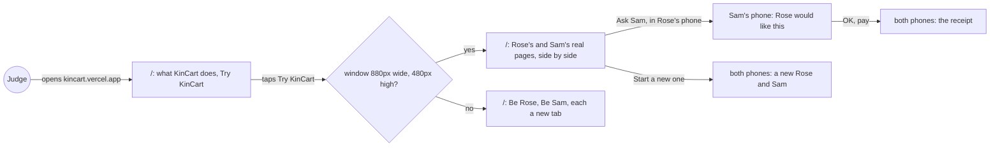
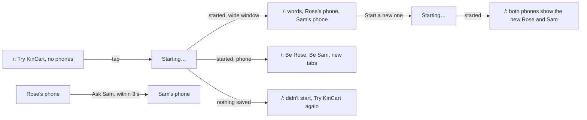

# Demo home

**Version:** v1 · **Status:** Draft · **Type:** Feature · **Project type:** Web UI

**Shape doc:** docs/specs/shop-together/shape.md
**Depends on:** households

On a laptop, a judge's own Rose and Sam run side by side on kincart.vercel.app, live, beside a few plain sentences on what each one does. It comes now because `households` shipped, so every judge has their own pair to show.

**Reopened:** 2026-10-15, at pause 3, for the `households` slice (O8). `households` shipped the same day, and pause 1 below is redone on top of it. Pause 2 is redone on top of it too.

## Problem

Since `households`, `/` gives each judge their own Rose and Sam (`app/(shop)/HomeView.tsx`). It says what KinCart is in one line: "An older shopper buys online with a relative's OK, and no shared passwords." It does not say what Rose does, what the AI does or what Sam does.

Be Rose and Be Sam each open a new tab. On a laptop, a judge asks as Rose, then switches tabs to see Sam's page change. The product's point is that Sam answers from another phone, and two tabs hide that moment.

## Slice test

| Check                         | Result |
| ----------------------------- | ------ |
| Cuts every layer it needs     | yes: the home page only, deployed. No data or action changes, because `households` already gives each browser its two links |
| One e2e test walks it         | yes: a judge in a 1280 by 800 window taps Try KinCart, asks in Rose's phone, taps OK in Sam's phone, and both phones show the receipt |
| Worth shipping alone          | yes: a judge on a laptop reads what KinCart does, and sees Sam's page change as Rose asks, with no tab switch |
| Fits (≤5 scenarios, ≤2 areas) | yes: 4 scenarios; two areas, the home page in `app/(shop)` and the rename and restyle of `/status` (O12), on the design system's breakpoints and phone frame (D40) and its showcase extension (O10) |

**Path:** full. It adds a wide layout, which is new interface, and the light path doesn't allow that.

## User story

As a hackathon judge on a laptop, I want to see my Rose and Sam side by side and read what each one does, so that I see Sam's OK arrive as if from another phone, in a few minutes.

## Flow



A judge reads what KinCart does and taps Try KinCart. On a laptop, Rose and Sam then run side by side on the same page. On a phone, a button opens each one.

## Acceptance criteria

Pause 2 sets the exact words and layout.

```gherkin
Scenario: A judge reads what KinCart does before trying it
  Given a judge with only "kincart.vercel.app", on a phone or a laptop
  When they open it
  Then they read what Rose does, what the AI does and what Sam does, in a few plain sentences
  And they see "Sandbox money only. Nothing real is bought." and "Try KinCart"
  And on a laptop, no phones show until they tap "Try KinCart"

Scenario: A judge on a laptop plays both people side by side
  Given a judge in a 1280 by 800 window
  When they tap "Try KinCart"
  Then Rose's phone shows "What do you need?" and Sam's phone shows "Nothing to approve", side by side, with the words beside them
  When, in Rose's phone, they find "AA batteries" and ask Sam for one at $9.99
  Then within 5 seconds Sam's phone shows "Rose would like this" and "OK, pay $9.99"
  When, in Sam's phone, they tap "OK, pay $9.99"
  Then both phones show the same receipt

Scenario: A judge on a phone gets a button for each
  Given a judge on a 390 by 844 phone, with a household started
  When they open "kincart.vercel.app"
  Then they see "Be Rose" and "Be Sam", and each opens a new tab
  And the home page loads no copy of Rose's or Sam's page

Scenario: Start a new one on a laptop swaps both phones
  Given Ana's phones in a 1280 by 800 window show AA batteries waiting for Sam
  When she taps "Start a new one"
  Then she sees "Your new Rose and Sam are ready."
  And Rose's phone shows "What do you need?" and Sam's phone shows "Nothing to approve"
```

## Scope

**In:**
- More words on `/`: what Rose does, what the AI does and what Sam does. Every width, before and after Try KinCart.
- From 880px wide and 480px high, once this browser has a household, Rose's and Sam's real pages show side by side in two phone frames, live, in place of Be Rose and Be Sam (D39, D40). From 1280px wide, the words sit in a column to their left.
- Below 880px wide or 480px high, the phone column from `households`, with Be Rose and Be Sam. It loads no frames.
- Start a new one swaps both phones to the new household.
- `/status` and the default tab title say KinCart, not Shop-together, and `/status` takes the system's type and colours (O12).

**Out:**
- Start over. Each judge has their own household, so nobody clears what another left (O8). No later slice.
- A QR code or link that sends Sam's page to a second phone (`households` O5). No later slice.
- Wide layouts for Rose's and Sam's own pages. They stay phone-sized, and the frames show them at that size. No later slice.

## Interface

One page at `/`, built on the `households` home page, in two shapes. On a phone it is one column: the KinCart mark, what it is, what Rose, the AI and Sam each do, the sandbox line, then Try KinCart, or Be Rose, Be Sam and Start a new one. From 880px wide and 480px high, once this browser has a household, Rose's and Sam's real pages appear as two 390 by 844 phones, live, and Be Rose and Be Sam go. From 1280px the text sits in a column to their left, so all three fit on one laptop screen.



The words come first on every width. The phones appear only once this browser has a household (O9).

| Width | State | What's on it |
| ----- | ----- | ------------ |
| any | new | the mark at 64px; "KinCart"; lead: "An older shopper buys online with a relative's OK, and no shared passwords."; "Rose says what they need. AI finds real listings and explains each one. Sam taps OK on their own phone, and Rose's saved PayPal pays."; "**Sandbox money only.** Nothing real is bought."; "You get your own Rose and Sam to try. Rose's sandbox PayPal is already linked."; Try KinCart (primary); "System status" link. No phones on a wide screen |
| any | starting | Try KinCart becomes "Starting…" with the spinner |
| any | failed | red notice at the top: "Your Rose and Sam didn't start. Nothing was saved. Try again in a moment."; then new |
| phone | yours | the mark, "KinCart", the lead, what each one does and the sandbox line; small: "Each opens in a new tab. Come back here to open them again."; Be Rose (primary) and Be Sam (secondary), links that open a new tab; small: "Want a clean start? A new Rose and Sam have nothing asked and no limits. Your old links keep working."; Start a new one (secondary); "System status" link |
| 880px and up, 480px high | yours | the text of yours without the new-tab line, Be Rose and Be Sam; below it, "Rose's phone" and "Sam's phone", each with "Open Rose's page" or "Open Sam's page" and a 390 by 844 frame of the real page |
| 1280px and up, 480px high | yours | the text in a column up to 480px wide on the left, the two phones on the right |
| any | ready | grey notice at the top: "Your Rose and Sam are ready."; then yours |
| any | restarting | Start a new one becomes "Starting…" with the spinner |
| any | fresh | grey notice at the top: "Your new Rose and Sam are ready. Tabs you already have open still show the old ones."; then yours, with the phones on the new links |

The new state's last line was "You get your own Rose, who asks for things, and Sam, who says OK." in `households`. The new sentence above it now says what each one does, so that line only says the pair is theirs.

The frames are the real pages, so their 3 s refresh (D19) shows Sam the ask and both the receipt with no extra code. A frame's height is kept within the window, and each page scrolls inside its frame. Each frame loads lazily, so on a phone or a short window, where the frames are hidden, neither page loads (scenario 3).

Checked on the preview, 2026-10-15, in Chromium and Firefox: no sideways scroll at 390, 900, 1024, 1280 and 1440px. A 900 by 420 window keeps the phone column. A 1280 by 800 window shows all three with no scroll. Light and dark both rendered. On 390 by 844 and 900 by 420, neither frame loads; on 1024 and up, both do. The keyboard order follows the page: Start a new one, System status, Open Rose's page, Rose's page, Open Sam's page, Sam's page. No new colours: the frame edge is `color-control` on `color-bg` (D40), the notices are the existing neutral and danger tones, and the buttons and links are the system's.

Craft checks: a one-line "landing page for a demo app" prompt gives a gradient hero, three feature cards with icons, a "Get started" button and a screenshot. Here the page has no marketing: one sentence says what each person does, and on a laptop the product runs live beside it as two real phones. Against Vercel's restraint: one accent, hierarchy from type size alone, and no decoration. Against Stripe's interactive docs: the real thing to try, beside the words that explain it.

**Motion tier:** 1, as in `households`. Nothing new moves: the notices rise and fade like every notice, and "Starting…" turns the spinner.

**Components used:** from the system, Button, Notice, PhoneFrame, and the `screen`, `heading`, `lead`, `small`, `stack`, `link` and `button` styles. The layout uses the system's two breakpoints, `two-phones` and `text-beside` (D40). Composed here: `HomeView`, and the home layout in `shop.css` from `space` and `page` tokens.

**Preview:** http://localhost:3000/preview/demo-home with `pnpm dev`, and `?state=new`, `starting`, `failed`, `ready`, `yours`, `restarting` or `fresh`. Resize the window to see the three shapes. The phones show household 1's real pages. It answers 404 in production. It replaces `/preview/households`, whose made-up links would show a broken page in each phone.

## Technical plan

### Decisions to record

## D39 · 2026-10-15 · A wide home page shows Rose's and Sam's real pages side by side

Why: a judge sees Sam's screen change within seconds of Rose's ask without switching tabs, which is the product's point (O2).
Rejected: a button for each that opens a new tab (the judge switches tabs to see the ask arrive), a button plus a QR code for each (a second device for every judge).
Source: docs/specs/demo-home.md
Status: active

## Open items

| ID | What | Type | Raised at | Owner | Status | Answer |
| -- | ---- | ---- | --------- | ----- | ------ | ------ |
| O1 | The home page opens Rose's and Sam's links for anyone, so the links stop being secret. D18 chose secret links for two fixed demo people moving sandbox money; the worst case is a stranger's ask or a spoiled demo, not lost money. The other choice is a short demo code that judges get with the submission | question | spec p1 | user | Resolved | Open to anyone: sandbox money only, and Start over fixes a spoiled demo. Supersedes D18 (D37). 2026-10-15. No longer applies: each household has its own secret links (D42), and D37 was dropped (O8). |
| O2 | How a judge plays both people. Recommended: on a wide screen, Rose's and Sam's pages side by side on the home page, live, so Sam's screen changes as Rose asks; on a phone, a button for each. Other choices: a button for each that opens a new tab, or a button plus a QR code to open the other person on a phone | question | spec p1 | user | Resolved | Side by side on a wide screen, live; a button for each on a phone (D39). 2026-10-15 |
| O3 | What Start over clears. Recommended: every ask and receipt, Rose's search, both limits back to $50 and none, and every saved phone; Rose's PayPal stays. The other choice keeps past receipts and phones, and only ends a waiting ask and resets the limits | question | spec p1 | user | Resolved | Everything but Rose's PayPal: asks and receipts, the search, both limits and saved phones (D38). 2026-10-15. No longer applies: Start over and D38 were dropped (O8). |
| O4 | Two judges at the same moment still share one Rose and one Sam. One judge's ask shows on the other's Sam page, and one can start over in the middle of the other's turn. Judging runs Dec 1 to 15 (D3), so it is unlikely | flag | spec p1 | user | Accepted risk | Judging runs Dec 1 to 15, so two judges at once is unlikely, and Start over cleans up after. Agreed 2026-10-15. No longer applies: two judges at once each have their own household (O8). |
| O5 | The design system is phone-only: `page-max` is 480px and it has no breakpoints. The home page adds two widths (54em and 80em) and a 390 by 844 phone frame, written into `shop.css` from existing tokens. craft.md asks for this to be a choice: accept it as composition for the home page, as basket did with its tick box, or take a wide layout through `/design-system` | flag | spec p2 | user | Resolved | Through `/design-system`: add wide breakpoints and a phone frame to the system first, then compose the home page from them. Pause 2 resumes with `/spec continue demo-home`. 2026-10-15. Done in D40: breakpoints at 880 and 1280px, and `PhoneFrame`. |
| O6 | Public links let anyone run Find. Each Find calls Channel3 and Claude Haiku, so a stranger in a loop spends on both keys and can use up Channel3's quota during judging. Recommended: accept, and set a spend limit on the Anthropic workspace. Other: a cap on Finds an hour, in this slice | flag | spec p3 | user | Resolved | Moved to `households` as shape O11: there, any visitor can start a household and run Find. 2026-10-15 |
| O7 | An old judge who opens their Rose or Sam page again saves their phone again: `NotifyControl.tsx:19` puts back a phone the server forgot. Recommended: accept, because opening the page is using it again. Other: drop the put-back, so a phone the push service dropped stays off until someone taps the control | flag | spec p3 | user | Resolved | No longer applies: with households, an old judge's phone belongs to the old judge's own household (O8). 2026-10-15 |
| O8 | Should every judge get their own Rose and Sam, as every family would in production? Today all judges share one pair, which needs Start over (D37, D38, D41) and leaves O4 and O7 | question | spec p3 | user | Resolved | Yes. Split: a `households` slice first, where a visitor starts their own Rose and Sam with the demo sandbox PayPal already linked and every table is keyed by household. Then demo-home redoes pause 1 on top of it. Start over, D37, D38 and D41 go; D18 stands. 2026-10-15 |
| O9 | What a laptop shows before Try KinCart. Recommended: the words and Try KinCart only, and the two phones appear once this browser has a household. Other choices: two empty phone outlines that say where Rose and Sam will show; or start a household on the first visit, so the phones show at once, which makes a household and a vault copy for every visit, crawlers too | question | spec p1 | user | Resolved | The words and Try KinCart only; the phones appear once this browser has a household. Empty outlines and a household on the first visit were turned down. 2026-10-15 |
| O10 | The home page sells KinCart, so it needs a premium feel. The system lacks it: 28px is its largest type, cards and frames sit flat with no shadow, D40 turned down a bezel, and its motion stops at tier 1. Recommended: a showcase extension through `/design-system`, used only on `/`. Other: rework the page from today's tokens | flag | spec p2 | user | Resolved | A showcase extension through `/design-system`, used only on `/`: a display type step, phone frames with depth, a stage behind them and a tier-2 load reveal. Rose's and Sam's own pages stay as they are. 2026-10-15 |
| O11 | Which reference the selling page aims at. Recommended: an Apple product page. Others: Monzo, Stripe's homepage, Linear | question | spec p2 | user | Resolved | Build two directions, Apple and Monzo, and compare them at the `/design-system` direction test. 2026-10-15 |
| O12 | `/status` still says "Shop-together status" (`app/status/StatusView.tsx:13`), and the tab title is "Shop-together" (`app/layout.tsx:7`). The page also uses `system-ui` and the browser's default colours, not the system | flag | spec p2 | user | Resolved | Rename both to KinCart, and restyle `/status` from the system. In this slice. 2026-10-15 |

_Never delete this section or its rows. See references/ledger.md._

## Glossary

- **Sandbox**: PayPal's test environment. Fake accounts, fake money, real API.
- **Start over**: a dropped plan for one tap that cleared the shared Rose and Sam for the next judge. Households made it unneeded.
- **Household**: one Rose and one Sam with their own links, PayPal, asks, limits and phones. Each judge starts their own.
- **Phone frame**: a 390 by 844 box on the home page that shows a real page inside it, live, like a phone held up beside the text.
- **e2e**: end-to-end, one test that walks the whole slice as a user would.
