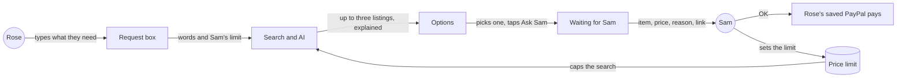
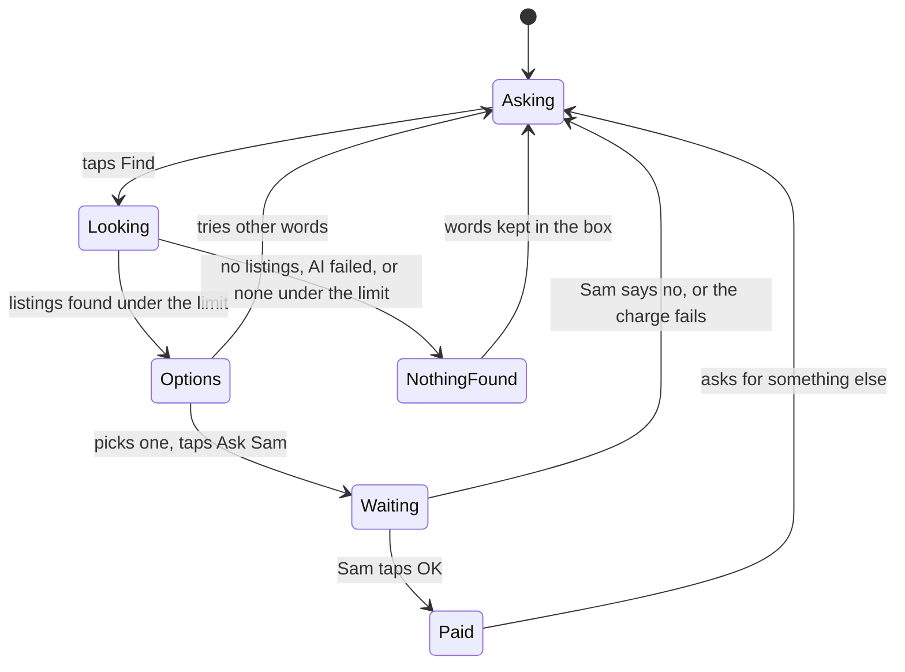
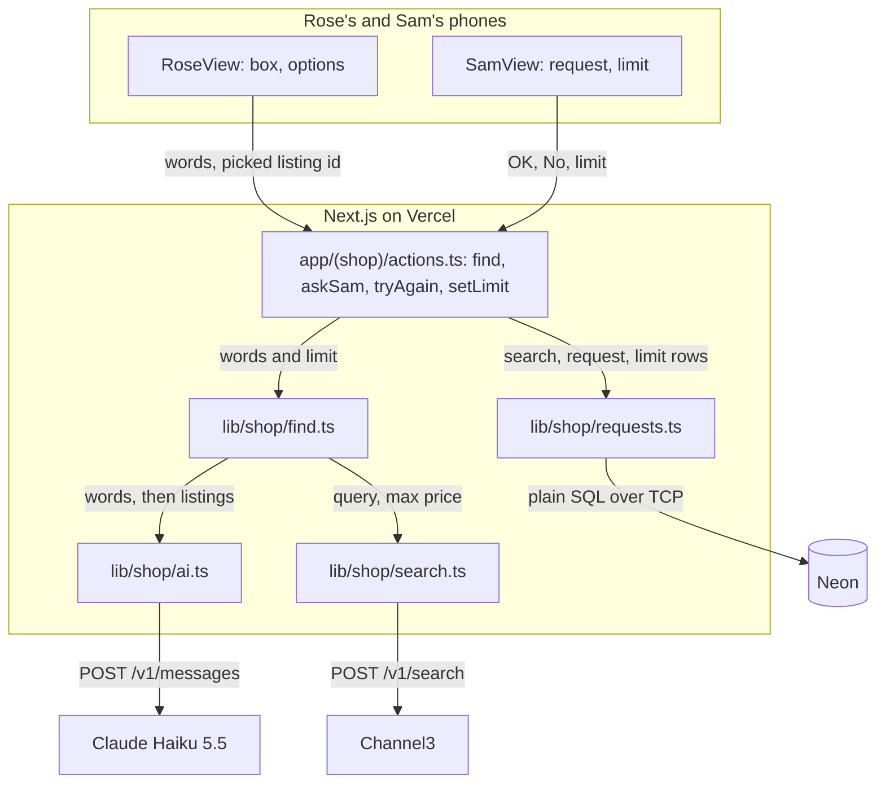
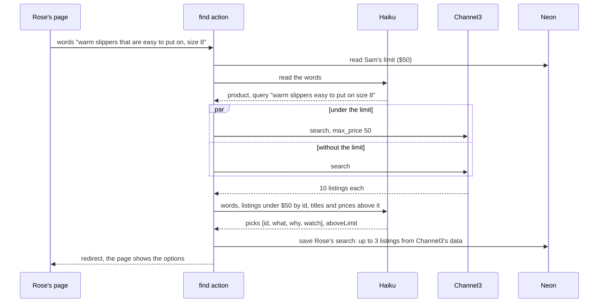
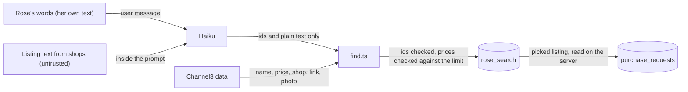
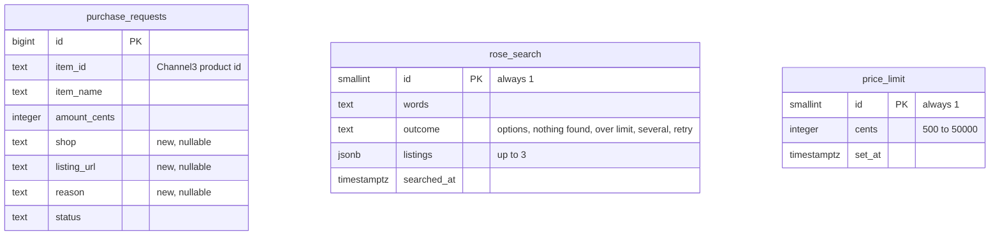

# Find and explain

**Version:** v1 · **Status:** Shipped · **Type:** Feature · **Project type:** Web UI

**Shape doc:** docs/specs/shop-together/shape.md
**Depends on:** approve-and-pay
**Page:** none. Skipped: you read the `.md` directly.

Rose types what they need in plain words, and AI shows up to three real listings under Sam's price limit, each explained plainly. Rose's pick goes into approve-and-pay's request, replacing the fixed list of three. It ships now because the hackathon rules require AI, and this is where it arrives.

## Problem

Rose can only ask for one of three fixed items today: reading glasses, a pill organiser or AA batteries. Anything else means a relative searching a shop on Rose's behalf, which is the chore this app exists to remove. Shops show dozens of near-identical listings with small print that Rose can't easily compare. This slice lets Rose say what they need in their own words and get at most three real options with a plain explanation of each, while Sam still approves every purchase and sets how much one can cost.

## Slice test

| Check                         | Result |
| ----------------------------- | ------ |
| Cuts every layer it needs     | yes: Rose's request box and options, search and AI, the stored request, Sam's limit, deployed |
| One e2e test walks it         | yes: Rose types a need, picks one of the options, Sam sees the reason and link and taps OK, both see the receipt |
| Worth shipping alone          | yes: Rose can ask for anything in their own words instead of three fixed items |
| Fits (≤5 scenarios, ≤2 areas) | yes: 5 scenarios; two areas, search with AI (new) and the shop pages (existing) |

**Path:** full. It adds a screen, an outside service, AI and stored data.

## User story

As Rose, I want to say what I need in my own words and see a few options explained plainly, so that I can pick one without wading through a shop.

## Flow



Rose types a need, the search and AI return up to three listings under Sam's limit, and Rose's pick goes to Sam, whose OK pays as in approve-and-pay.

## States



## Acceptance criteria

```gherkin
Scenario: Rose asks in their own words and sees options explained
  Given Rose's PayPal is linked and Sam's limit is $50, which it is until Sam changes it
  When Rose types "warm slippers that are easy to put on, size 8" and taps Find
  Then within 15 seconds Rose sees up to three real listings, each $50 or less
  And each shows the listing's own name and price, never a price the AI wrote
  And each has two or three short sentences: what it is, why it fits what Rose asked, and one thing to watch for

Scenario: Rose picks one, and Sam checks it before paying
  Given Rose sees three slipper listings
  When Rose picks the second and taps "Ask Sam"
  Then Sam's page shows that listing's name and price, the AI's one-line reason it fits, and a link to the real listing
  When Sam taps "OK, pay" with that price
  Then Rose's saved PayPal is charged the price Rose saw, and both pages show the receipt as in approve-and-pay

Scenario Outline: Nothing to show
  Given Rose's PayPal is linked
  When Rose types <words> and taps Find, and <what happens>
  Then Rose sees "<message>"
  And Rose's words are still in the box

  Examples:
    | words                            | what happens                     | message                                                   |
    | "a left-handed teapot for a cat" | the search returns no listings   | Couldn't find that. Try different words.                  |
    | "what time is it in Ohio"        | there is no product to look for  | Couldn't find that. Try different words.                  |
    | "warm slippers, size 8"          | the AI service doesn't answer    | Couldn't find that. Try different words.                  |
    | "milk, bread and eggs"           | it is a list of several things   | One thing at a time for now. What would you like first?   |

Scenario: Nothing under Sam's limit
  Given Sam's limit is $30
  When Rose types "a tablet for video calls" and every listing found costs more than $30
  Then Rose sees "Nothing under $30 for that. Try different words, or ask Sam to raise the limit."
  And Rose's words are still in the box

Scenario: Sam sets the price limit
  Given Sam's page shows the price limit at $50
  When Sam changes it to $30 and taps Save
  Then Sam's page says "Saved. Rose's next search stays at $30 or less."
  And Rose's next search shows only listings at $30 or less
```

## Scope

**In:**
- One box where Rose types what they need. It replaces the fixed list of three.
- A search of real US listings in US dollars, and up to three shown, all at or under Sam's limit.
- An AI explanation for each: what it is, why it fits Rose's words, and one thing to watch for, such as size, pack count or delivery time.
- Rose picks one and taps Ask Sam, as in approve-and-pay. The request keeps the name, price, listing link and reason as Rose saw them, and Sam's OK charges that price.
- Sam's page shows the item, price, the AI's one-line reason and a link to the real listing, then OK or No as in approve-and-pay.
- Sam's page has a price limit Sam can change. It is $50 until Sam changes it.
- "Couldn't find that. Try different words." when the search finds nothing or the AI fails, "Nothing under $X" when everything found costs more than the limit, and "One thing at a time for now. What would you like first?" when Rose types a list. Rose's words stay in the box.

**Out:**
- Rose setting their own limit. Sam sets it (O9).
- Asking by voice: slice 4, `ask-by-voice`.
- A notification on Sam's phone: slice 3, `ping-helper`.
- A real order with the shop. Sandbox money only (shape O9). No later slice.
- A list of several things in one ask, such as groceries, approved once and paid as one total: a later `basket` slice, only if time is left (shape O10).
- More than three options, or "show more". No later slice.
- Remembering past searches. No later slice.

## Interface

Rose's request box replaces approve-and-pay's pick screen. The options reuse its radio cards, with the listing's price, photo and explanation inside. Sam's approval adds "Why it fits" and a link to the listing, and a price limit field sits under Sam's other screens.

| Who | State | Heading | What's on it |
| --- | ----- | ------- | ------------ |
| Rose | asking | What do you need? | Hint: "Say it the way you'd tell Sam. For example: warm slippers that are easy to put on, size 8."; a 3-line box; Find; "Sam's limit is $50 an item. Nothing is paid until Sam says OK." |
| Rose | Find with an empty box | What do you need? | red under the box: "Type what you need first." |
| Rose | looking | What do you need? | the box locked with Rose's words; Find becomes "Looking…" with the spinner |
| Rose | options | Which one would you like? | For "warm slippers that are easy to put on, size 8"; up to three radio cards, each with the name, "$24.99 at walmart.com", the photo with what and why beside it, and "Good to know:" with the catch; Ask Sam; Try other words |
| Rose | fewer than three | Which one would you like? | adds "Only 2 found at $30 or less." |
| Rose | Ask Sam with no pick | Which one would you like? | red under the cards: "Pick one first." |
| Rose | nothing found | What do you need? | grey notice: "Couldn't find that. Try different words."; Rose's words still in the box |
| Rose | a list of several things | What do you need? | grey notice: "One thing at a time for now. What would you like first?" |
| Rose | nothing under the limit | What do you need? | grey notice: "Nothing under $30 for that. Try different words, or ask Sam to raise the limit." |
| Rose | waiting | Waiting for Sam | as approve-and-pay, plus "From amazon.com" |
| Rose | Sam said no, or the charge failed | What do you need? | approve-and-pay's notices, above the box |
| Sam | request | Rose would like this | the name, $32.50 at 40px, "From amazon.com. Paid from Rose's PayPal if you say OK."; "Why it fits: …"; "See it on amazon.com", opening in a new tab; asked time; OK, pay $32.50; No |
| Sam | nothing, paid or failed | as approve-and-pay | under a divider: "Price limit" with "Rose is only shown items at or under this price.", a $ field holding 50, and Save |
| Sam | limit saved | as approve-and-pay | "Saved. Rose's next search stays at $30 or less." |
| Sam | limit out of range | as approve-and-pay | red under the field: "Pick a whole-dollar amount from $5 to $500." |

"Nothing found" and "nothing under the limit" are grey, not red: nothing is broken, and the brief keeps red for real failures. The photo is the listing's first one, 64px, with a 1px border, on the `sunken` colour while it loads; a listing with no photo shows none. Its alt text is empty because the name sits right next to it.

Checked: no sideways scroll at 320px and 390px; light and dark both rendered. New colour pairs: the listing link 9.0:1 light and 11.3:1 dark; the shop name on a picked card 7.3:1 and 8.8:1; field edges 3.6:1 and 4.5:1. The focus ring shows on the box, the limit field, the link and the cards, and the link is 48px tall.

Craft checks: a one-line "AI product picker" prompt gives star ratings, a sparkle "AI picks" badge and "Buy now" buttons. Here there is no badge, the explanation is plain text with a "Good to know" catch, and the only next step is Ask Sam. Against Stripe Checkout: the heading labels the box, the hint gives an example, and the empty-box error sits under the box and says what to do. Against Monzo: Sam's amount stays at 40px, with plain wording around it.

**Motion tier:** 1, as approve-and-pay. Nothing new moves: notices rise and fade as before, and "Looking…" turns the spinner.

**Components used:** the design system is tokens only. From approve-and-pay: Button, Notice, Summary, ReceiptCard and the radio option cards. Composed from tokens here: the text box and limit field (`control.height`, `control` edge, `radius.control`), the listing card (an option card with a photo), and the text link (`accent-text`, `target.min`).

**Preview:** http://localhost:3000/preview/find-and-explain with `pnpm dev`. It answers 404 in production. The listings are written examples and grey squares stand in for photos; real results replace both at /build.

## Technical plan

### Approach

Rose's Find is a server action that runs `find(words, limit)` in `lib/shop/find.ts`. Haiku reads Rose's words and says whether they are one product, a list or not a product, and gives a search query for a product. Two Channel3 searches then run at once, one with Sam's limit and one without. Haiku picks up to three listings from the limited set, writes what, why and one catch for each, and says whether the thing Rose asked for exists above the limit (O13). Haiku only ever names listings by ID. Names, prices, shops, links and photos come from Channel3's data, so a price is never AI-written.

The result is saved as Rose's one current search in Neon, so the 3-second refresh (D19) redraws it. Ask Sam reads the picked listing from that saved search, never from the form, and stores a request with the shop, link and reason. Sam's OK, `pay()` and the receipt are approve-and-pay's, unchanged. Sam's limit is one row in Neon, $50 until it is set.

The off switch: with `ANTHROPIC_API_KEY` or `CHANNEL3_API_KEY` unset, Rose's page shows approve-and-pay's fixed list, as it does today.

Relies on: D12 (pg and plain SQL), D16 and D17 (PayPal over plain fetch), D18 (secret links), D19 (refresh every 3 s), D20 (the e2e charges a saved PayPal), and the drafted D21 to D24.







### Changes

| File | What changes | Why |
| ---- | ------------ | --- |
| `db/migrations/0003_find_and_explain.up.sql`, `.down.sql` | add `shop`, `listing_url` and `reason` to `purchase_requests`, nullable; create `rose_search` (one row: words, outcome, listings as `jsonb`, time) and `price_limit` (one row: cents, 500 to 50000) | 1 to 5; reverse path |
| `lib/shop/search.ts` (new) | `type Listing`, a listing as Channel3 gives it, and `type Found`, which adds the details the AI reads. `searchListings(query, maxCents?)`: `POST /v1/search` with `x-api-key`, `limit: 10`, `filters.price.max_price`, 5 s timeout, the `fetch` and `AbortSignal.timeout` pattern of `lib/status/paypal.ts:9`. Maps each product's first `USD`, `InStock` offer to a listing, with the description cut to 300 characters plus its sizes and attributes for the AI; skips the rest | 1, 3, 4 |
| `lib/shop/ai.ts` (new) | `readNeed(words)` gives `{ kind, query }`; `choose(words, under, above)` gives `{ picks: [{ id, what, why, watch }], aboveLimit }`. Plain `fetch` to `POST https://api.anthropic.com/v1/messages`, `claude-haiku-5-5`, `output_config: { effort: "low", format: json_schema }`, 10 s timeout | 1, 3, 4 |
| `lib/shop/find.ts` (new) | `type Option`, a listing with what, why and watch, which replaces the preview's `Listing` in `app/(shop)/ui.tsx`. `searchOn()`: both keys set. `find(words, limitCents)`: `readNeed`; for a list, `several`; for a non-product, `nothing found`; else both searches with `Promise.all`, then `choose`. Keeps picks whose id is in the limited set and whose price is within the limit, at most 3. No picks: `over limit` when `aboveLimit`, else `nothing found`. Any error: `nothing found`. Logs one line, with the reason from `reasonOf`, now exported from `lib/shop/paypal.ts` | 1, 3, 4 |
| `lib/shop/requests.ts:53` | `ask(listing)` also stores `shop`, `listing_url` and `reason` (the AI's `why`); `PurchaseRequest` gains them, null on fixed-list rows. New `getSearch`, `saveSearch`, `clearSearch`, `getLimit` (5000 when unset) and `setLimit`, using `query` at `lib/shop/requests.ts:104` | 2, 5 |
| `lib/shop/*.test.ts` | Vitest; see Test plan | 1 to 5 |
| `scripts/migrate.test.ts` | the up, down, up test also checks 0003's tables and columns | reverse path |
| `app/(shop)/actions.ts` | `find(token, formData)`: Rose only; empty words redirect to `?find=empty`; runs `find` with `getLimit()`, `saveSearch`, redirects. `askSam` at `app/(shop)/actions.ts:33`: with search on, the picked id is looked up in `getSearch()`, so the price is the server's; no pick redirects to `?pick=missing`; then `ask(listing)` and `clearSearch`. `tryAgain(token)`: keeps the words and drops the listings. `setLimit(token, formData)`: Sam only; a whole number from 5 to 500 is saved, anything else redirects to `?limit=invalid` | 1 to 5 |
| `app/(shop)/state.ts:8` | `roseState` takes an optional fourth argument, the saved search and the limit, passed only when search is on. A search newer than the latest request shows its options or problem; with search off, today's fixed list. `samState` passes the shop, link and reason as `found` | 1 to 5, off switch |
| `app/(shop)/r/[token]/page.tsx`, `h/[token]/page.tsx` | Rose's page reads the saved search and the limit, and passes `find`, `askSam` and `tryAgain`; `maxDuration = 30`, since Find takes about 10 s. Sam's page reads the limit, passes `setLimit` and shows `?limit=saved` or `invalid` | 1 to 5 |
| `app/(shop)/RoseView.tsx`, `SamView.tsx`, `ui.tsx` | pause 2's screens, wired to the actions. "Try other words" becomes a form calling `tryAgain`. The photo stays a plain `` with the lint rule turned off on that line: a 64 px photo from Channel3's CDN gains nothing from Vercel's image optimizer. After a rejected limit, the field shows the saved limit with the error under it | 1 to 5 |
| `app/(shop)/preview/find-and-explain/page.tsx` | imports `Listing` from `lib/shop/search.ts` | pause 2 |
| `e2e/find-and-explain.spec.ts` (new) | the e2e; see Test plan | 1 to 5 |
| `e2e/approve-and-pay.spec.ts` | seeds Rose's search with three fixed listings in `rose_search`, so it stays the same every run and makes no AI calls; "Pick one first." replaces "Pick one of the three first." | approve-and-pay still holds |
| `e2e/db.ts` (new) | `sql` and `reset`, moved out of the approve-and-pay spec so both specs share them; a spec can't import another without running its tests twice. Missed by the plan; added at `/build` | e2e |
| `playwright.config.ts` | `workers: 1`, because both specs reset the same tables. Missed by the plan; added at `/build` | e2e |
| `.github/workflows/ci.yml` | `test` job env: `ANTHROPIC_API_KEY` and `CHANNEL3_API_KEY` from secrets | e2e (O12) |
| `.env.example`, `README.md` | the two keys and where to get them | setup |

Reusing: the per-call `pg` client and `query` in `lib/shop/requests.ts`, the `fetch` with `AbortSignal.timeout` pattern from `lib/status/paypal.ts`, approve-and-pay's request, claim, `pay()` and receipt path, `whoIs` for every action, and pause 2's views.

### Data



**Migration:** expand only. Three nullable columns and two new tables; nothing existing is rewritten, and approve-and-pay's rows keep working with the new columns empty. Nothing to backfill or switch.
**Reverse:** `0003_find_and_explain.down.sql` drops `price_limit` and `rose_search`, then the three columns. `scripts/migrate.test.ts` runs up, down, up.

### Earn-it

| Added | Triggered by |
| ----- | ------------ |
| `lib/shop/search.ts` | scenario 1: real listings, from Channel3 (D21) |
| `lib/shop/ai.ts` | scenarios 1 and 3: reading Rose's words and explaining the options (D22) |
| `lib/shop/find.ts` | scenario 4 needs both searches and the AI's verdict combined, and scenario 3 needs every failure to end as "Couldn't find that" in one place |
| `rose_search` table | the page redraws every 3 s (D19), and Ask Sam must take the price from the server, not the form (D23) |
| `price_limit` table | scenario 5 |
| `shop`, `listing_url`, `reason` columns | scenario 2: Sam sees the shop, the link and the reason; Rose's waiting screen shows the shop |
| The two API keys as the off switch | rollback without a revert; the fixed-list code already exists |
| A second, unfiltered search | scenario 4, because the price filter never comes back empty (O13) |

No SDK: Channel3 and Claude are one endpoint each, called with plain `fetch` like PayPal (D17).

### Non-functionals

|                      |    |
| -------------------- | -- |
| **Load**             | A few Finds a day. Each is 2 Haiku calls and 2 Channel3 searches, about 10 s and $0.0005 (O11) |
| **Breaks first**     | Channel3's free tier, at 2 searches a Find (O14). Rose then sees "Couldn't find that" and the log says `reason=channel3 429`. The fix: drop the unfiltered search, losing "Nothing under $X", or a paid plan |
| **Security surface** | Anyone with Rose's link can run Finds, about $0.0005 each plus Channel3 quota, as with O3. Anyone with Sam's link can set the limit, checked as a whole number from 5 to 500 on the server. Rose's words reach Haiku as her own text. Listing text from shops is untrusted and sits inside the prompt: a crafted listing can change which listings Haiku picks and how it words them, but names, prices, shops and links come from Channel3's data by ID, picked IDs are checked against the limited set, and prices against the limit. React escapes all text; only `https` links and photos from Channel3 are rendered, links with `rel="noopener noreferrer"`. Secrets: `ANTHROPIC_API_KEY` and `CHANNEL3_API_KEY` in Vercel, GitHub and `.env.local`. Stored: Rose's latest words and up to three listings, and per request the shop, link and reason. Logs never hold Rose's words, a key or a link token |
| **Proof it works**   | One Vercel log line per Find: `find outcome=options listings=3 ms=9870`, or `find outcome=nothing-found listings=0 ms=10012 reason=anthropic 529`. Then approve-and-pay's `purchase id=… status=paid capture=…` |
| **Rollout**          | The off switch is either key unset: Rose's page shows approve-and-pay's fixed list. Rollback: unset `CHANNEL3_API_KEY` on Vercel and redeploy, or revert on `main`; Deployment Checks promote it (D10). Schema: `pnpm db:down` against Neon |

### Test plan

| Scenario | Test | Command |
| -------- | ---- | ------- |
| 1 Rose asks and sees options | `lib/shop/search.test.ts`: request shape (`x-api-key`, `max_price`, `limit`), mapping to listings, skipping offers that aren't `USD` or `InStock`. `lib/shop/ai.test.ts`: request shape (model, `output_config`) and parsing. `lib/shop/find.test.ts` (`fetch` stubbed): three listings come out with Channel3's names and prices, even when Haiku's text says otherwise; an id Haiku made up is dropped. e2e below | `pnpm test`, `pnpm test:e2e` |
| 2 Pick, and Sam checks | `lib/shop/requests.test.ts`: `ask(listing)` stores the shop, link and reason. `app/(shop)/actions.test.ts`: `askSam` takes the price from the saved search, not the form. `app/(shop)/state.test.ts`: `samState` passes `found`. e2e below | `pnpm test`, `pnpm test:e2e` |
| 3 Nothing to show | `lib/shop/find.test.ts`: no listings, a non-product, a list, a Haiku timeout or 5xx, a Channel3 error. e2e: "milk, bread and eggs" shows "One thing at a time for now. What would you like first?" | `pnpm test`, `pnpm test:e2e` |
| 4 Nothing under the limit | `lib/shop/find.test.ts`: no picks with `aboveLimit` gives `over limit`; a pick above the limit is dropped | `pnpm test` |
| 5 Sam sets the limit | `lib/shop/requests.test.ts`: $50 when unset, then saved. `app/(shop)/actions.test.ts`: 30 is saved; 3 and "abc" are refused; Rose's link can't set it. e2e: Sam saves $30, and Rose's page says "Sam's limit is $30 an item." | `pnpm test`, `pnpm test:e2e` |
| Off switch | `app/(shop)/state.test.ts`: with search off, the fixed list | `pnpm test` |
| Reverse path | `scripts/migrate.test.ts`: up, down, up, with 0003 | `pnpm test` |

`pnpm test:e2e` now also needs `ANTHROPIC_API_KEY` and `CHANNEL3_API_KEY`: CI secrets, or `.env.local`. Stop `pnpm dev` first (learning).

**E2E:** `e2e/find-and-explain.spec.ts`, test "Rose finds slippers, Sam checks the listing and pays". At 390×844 it seeds the saved PayPal and a $50 limit. Rose types "warm slippers that are easy to put on, size 8" and taps Find. Within 20 s the page shows one to three options, each priced at $50 or less and each with "Good to know". Rose picks the first and taps Ask Sam. Sam's page shows "Why it fits" and a "See it on" link starting `https://`; Sam taps OK, and both pages show the same receipt. Real Channel3, Haiku and PayPal sandbox calls on every run (O12, D20).

### Chunks

| Chunk | Scenarios | Files owned |
| ----- | --------- | ----------- |
| A | 1 to 5: data, search and AI | `db/migrations/0003_*`, `lib/shop/**`, `scripts/migrate.test.ts` |
| B | 1 to 5: pages and wiring | `app/(shop)/**`, `e2e/find-and-explain.spec.ts`, `e2e/approve-and-pay.spec.ts`, `.github/workflows/ci.yml`, `.env.example`, `README.md` |

`type Listing` moves to `lib/shop/search.ts`, owned by A; B imports it. No new dependencies, so the lockfile doesn't change.

### Risks

| Risk | Mitigation |
| ---- | ---------- |
| Haiku picks something that isn't the thing asked for, such as a tablet case for "a tablet" | It may pick nothing and say the thing exists above the limit (O13); Sam sees the reason and the real listing before OK |
| Haiku's text claims something the listing doesn't say | The prompt forbids prices and says to use only the listing's own details; the price shown is always Channel3's; Sam checks the link |
| Explanations read poorly in Haiku's words | The model is one constant in `lib/shop/ai.ts`; Sonnet 5.5 is the fallback (D22) |
| A Channel3 or Claude outage turns CI red and holds deploys (D10) | Rerun the job; accepted with O12 |
| Channel3's free quota runs out (O14) | "Couldn't find that" plus the log line; drop the unfiltered search if it bites |
| Find runs past Vercel's time limit for the page | `maxDuration = 30` on Rose's page; the spike took 9.9 s |

### Decisions to record

Recorded as D21, D22, D23, D24.

## Open items

| ID | What | Type | Raised at | Owner | Status | Answer |
| -- | ---- | ---- | --------- | ----- | ------ | ------ |
| O1 | Which AI model, and what a demo's worth of calls costs (from shape O6) | question | shape | user | Resolved | Claude Haiku 5.5 (`claude-haiku-5-5`), in two fixed steps: read Rose's words into a search, then pick up to three and explain them. At $0.10 in and $0.50 out per million tokens, a search of about 5,500 tokens in and 550 out costs about $0.001, so 200 demo searches cost about $0.20 (estimate, before the spike). Rejected: Sonnet 5.5 (about $0.017 a search, slower) and Opus 5.5 (about $0.033, slowest), and letting the AI search a second time (no scenario needs it, and it adds 3 to 5 seconds). Agreed 2026-10-13 |
| O2 | Whose listings and which currency. Channel3 search is US-first (from shape O7) | question | shape | user | Resolved | US listings in US dollars, matching approve-and-pay's US sandbox accounts and USD (approve-and-pay O4). Confirmed with pause 1 approval, 2026-10-13 |
| O3 | Link tokens sit in the page address, so they appear in Vercel's request log on every refresh and in PayPal's return address when Rose links | flag | spec p1 | user | Accepted risk | Only the project owner can read Vercel's logs, PayPal doesn't publish return addresses, and the money is sandbox only. Change both tokens on Vercel after recording the demo video, since a video or screenshot showing the address bar would expose them. A cookie-based fix was drafted as approve-and-pay v2 and dropped as not worth the hours. Agreed 2026-10-13 |
| O4 | Channel3's search returns real US listings with a name, price, photo, link and enough detail to explain them, within the 1,000 free searches a month | unproven | spec p1 | poc | Resolved | Yes. `POST https://api.trychannel3.com/v1/search` with `x-api-key`, `query`, `limit` and `filters.price.max_price` returned 10 slipper listings in 1.8 s, all `USD` and `InStock`, each with an offer `url`, `domain` and `price.price`, and a photo at `images[0].url` on `cdn.trychannel3.com`. Products also carry `description`, `variants.options` (sizes 6, 8, 10, 12) and `structured_attributes`. The price filter never returns nothing: "tablet for video calls" under $30 gave cases and sleeves (see O13). No rate-limit headers came back, so the free-tier size is unchecked (O14). Spike, 2026-10-13 |
| O5 | Assuming fewer than three listings under the limit shows the one or two there are, rather than nothing | assumption | spec p1 | user | Resolved | Confirmed with pause 1 approval, 2026-10-13 |
| O6 | Assuming Sam's limit is whole dollars from $5 to $500 | assumption | spec p1 | user | Resolved | Confirmed with pause 1 approval, 2026-10-13 |
| O7 | A listing's price can change between Rose's search and Sam's OK. Sam pays the price Rose saw, because no real order is placed | flag | spec p1 | user | Accepted risk | No real order reaches the shop, so the charge only has to match what Rose and Sam saw. Agreed with pause 1 approval, 2026-10-13 |
| O8 | Assuming 15 seconds is acceptable for results, with "Looking…" shown meanwhile | assumption | spec p1 | user | Resolved | Confirmed with pause 1 approval, 2026-10-13 |
| O9 | The shape rules out spend limits. Is Sam's price limit one? | question | spec p1 | user | Resolved | No. It only caps what Rose is shown; Sam still approves every purchase, and nothing is ever approved automatically. Sam sets it on Sam's page, $50 by default. Agreed 2026-10-13 |
| O10 | Rose may type a list, such as groceries, but a request is one item, one price and one charge | question | spec p2 | user | Resolved | One thing at a time: the AI spots a list and Rose sees "One thing at a time for now. What would you like first?". A `basket` slice (several items, one OK, one total) goes after slice 4, only if time is left. Agreed 2026-10-13 |
| O11 | Reading Rose's words with Haiku, one Channel3 search, and Haiku picking and explaining finish within 15 seconds (O8) | unproven | spec p3 | poc | Resolved | Yes: 9.9 s in total. Reading took 3.0 s (326 tokens in, 28 out), the search 1.8 s, and picking and explaining 5.1 s (1,811 in, 550 out). About $0.0005 a search. A list ("milk, bread and eggs") and a non-product ("what time is it in Ohio") were spotted in 1.7 to 1.8 s with no search. Structured output in `output_config.format` with `effort: low` worked on `claude-haiku-5-5` with no beta header. Spike, 2026-10-13 |
| O12 | CI's e2e calls Channel3 and Claude for real, as it already does PayPal (D20) | question | spec p3 | user | Resolved | Real calls. Results change from run to run, so the e2e checks the shape: up to three options, each at or under the limit, each explained. A Channel3 or Claude outage turns CI red until it is rerun. Rejected: recorded replies behind a test-only switch. Agreed 2026-10-13 |
| O13 | Channel3's price filter always returns something cheap, so an empty search can't mean "nothing under the limit" | flag | poc | spec p3 | Resolved | Run two searches at once, one with `max_price` and one without. The AI picks only from the first, and says whether the thing Rose asked for exists above the limit; that decides between "Nothing under $30" and "Couldn't find that". One AI call, so the time stays about 10 s; each Find uses 2 searches. 2026-10-13 |
| O14 | Channel3's free tier is assumed to be 1,000 searches a month (shape glossary). The API showed no limit, and each Find uses 2 searches | assumption | poc | user | Accepted risk | The demo, CI's e2e and testing need a few hundred Finds at most. If Channel3 refuses for quota, Rose sees "Couldn't find that" and the log says why. Agreed 2026-10-13 |

_Never delete this section or its rows. See references/ledger.md._

## Glossary

- **Listing**: one product for sale in an online shop, with its name, price, photo and link.
- **Channel3**: a hackathon sponsor whose API searches real product listings across shops. 1,000 free searches a month.
- **Price limit**: the most one item may cost. Sam sets it, and Rose is never shown anything above it.
- **Sandbox**: PayPal's test environment. Fake accounts, fake money, real API.
- **e2e**: end-to-end, one test that walks the whole slice as a user would.
- **Backfill**: filling a new column or table from the data already there, before the code switches to read it. Not needed here: the new columns start empty.
- **Lockfile**: the file that pins the exact version of every dependency (`pnpm-lock.yaml`). This slice adds no dependency, so it doesn't change.
