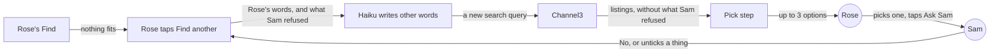
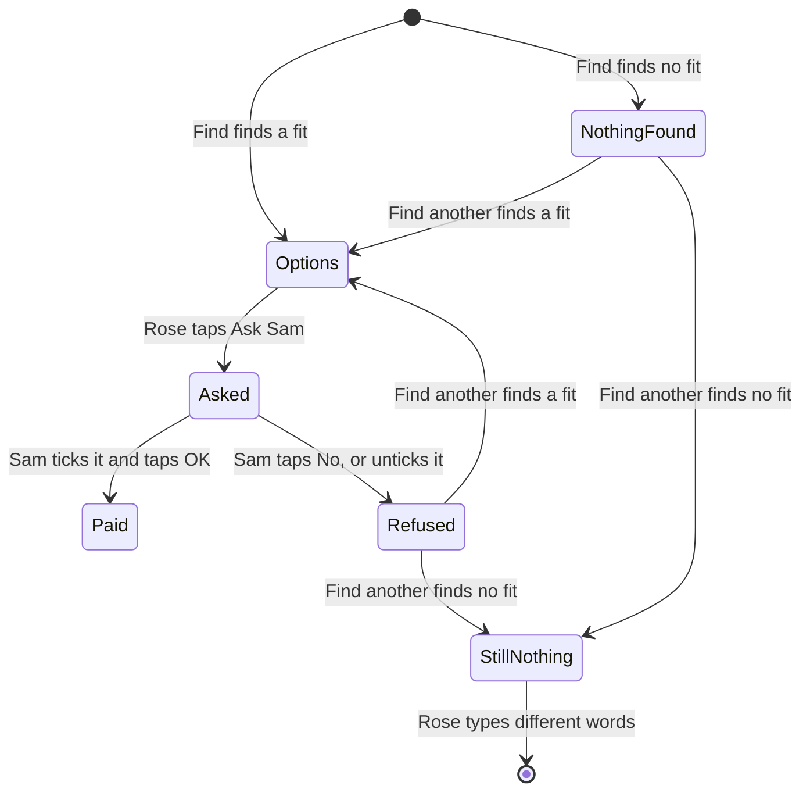
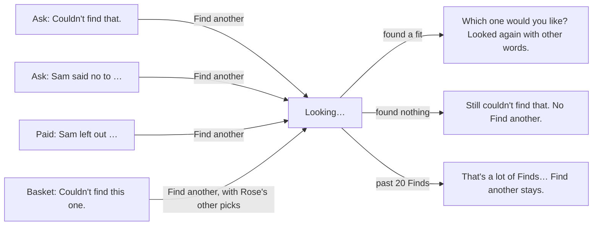
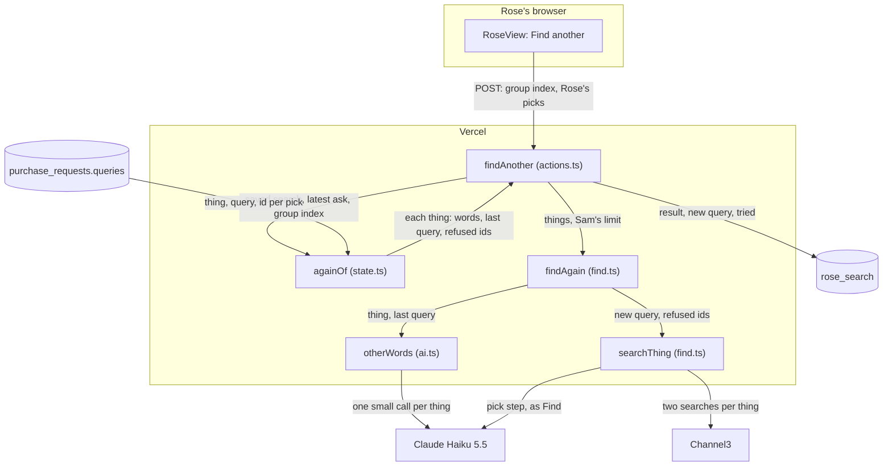
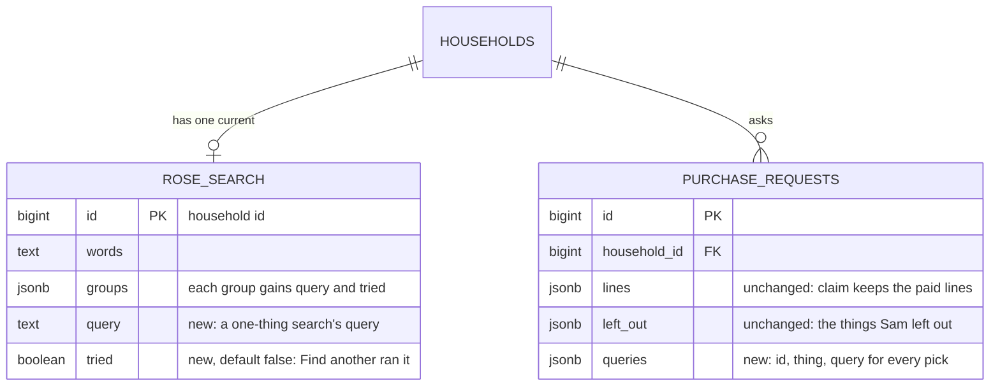

# Find another

**Version:** v1 · **Status:** Shipped · **Type:** Feature · **Project type:** Web UI, with an LLM path

**Shape doc:** docs/specs/after-review/shape.md
**Depends on:** picks-that-match
**Page:** none. Skipped: you read the `.md` directly.

When Find finds nothing, or Sam refuses a pick, Rose taps Find another, and the AI searches again with other words. It ships now because it is the AI's biggest new legwork, and it reuses the pick step that `picks-that-match` fixed.

## Problem

When Find finds nothing, Rose sees "Couldn't find that. Try different words." Rose must think of other words alone. When Sam says No, Rose's box is empty, and Rose types the thing again. The new search can show the same listing that Sam refused. When Sam leaves a thing out of a basket, "Ask for something else" puts its words back, and a new Find can show the same listing again.

The review of v1.2.0 on 2026-10-22 named this gap: Rose retypes after a No or an empty search. An older shopper may give up there. I don't have a count of empty Finds. The `find outcome=` log line has them, but `/status` doesn't count outcomes.

## Slice test

| Check                         | Result |
| ----------------------------- | ------ |
| Cuts every layer it needs     | yes: a Find another button on Rose's page, the server action, a new AI step in Find, and the stored search. Rose reaches it after an empty Find, a No or an untick |
| One e2e test walks it         | yes: Rose finds slippers, Sam says No, Rose taps Find another, sees new options without the refused one, and asks Sam again |
| Worth shipping alone          | yes: after a No or an empty Find, one tap gives Rose new options, and Rose doesn't retype |
| Fits (≤5 scenarios, ≤2 areas) | yes, after the split in O1: 5 scenarios, and two areas, Rose's page and Find |

**Path:** full. It adds a new AI step and a new control on Rose's page.

The shape's slice was too big (O1). It split into three:

| Slice | What ships |
| ----- | ---------- |
| `find-another` (this one) | Rose taps Find another after an empty Find, a No or an untick. The AI tries other words. |
| `allow-over-limit` | When other words still find nothing under Sam's limit, Rose sees the nearest listings over it, and Sam can allow one. |
| `sam-finds-another` | Sam taps Find another on Sam's own page. That slice decides who picks the new listing (O2). |

## User story

As Rose, I want KinCart to look again for me when it finds nothing or Sam says no, so that I don't have to think of other words myself.

## Flow



After an empty Find, a No or an untick, Rose taps Find another. Haiku writes other words, Channel3 searches them, and the pick step shows Rose up to 3 options without what Sam refused.

## States



A thing gets one Find another for each empty Find, No or untick (O3). A Find another that finds nothing doesn't offer a second one.

## Acceptance criteria

```gherkin
Scenario Outline: Rose's Find found nothing, and Find another finds it
  Given Sam's limit is <limit>
  And Rose's Find for "<words>" found nothing, and Rose sees "<message>"
  When Rose taps Find another
  Then KinCart searches again with other words than the first search used
  And Rose sees up to 3 options for "<words>", each at <limit> or less
  And Rose can pick one and tap Ask Sam, as today

  Examples:
    | limit | words                                          | message                                                                          |
    | $20   | a long grabber to pick things up off the floor | Couldn't find that. Try different words.                                         |
    | $10   | a sock aid with long handles and foam grips    | Nothing under $10 for that. Try different words, or ask Sam to raise the limit. |

Scenario Outline: Find another leaves out what Sam just refused
  Given Sam's limit is $50
  And <what Sam did>
  When Rose taps Find another under "<notice>"
  Then Rose sees up to 3 options for <things>, each at $50 or less
  And none of them is <refused>

  Examples:
    | what Sam did                                                                                                    | notice                                    | things                                     | refused                         |
    | Sam said No to "Dearfoams Women's Cozy Slippers", $24.99, found for "warm slippers that are easy to put on, size 8" | Sam said no to Dearfoams Women's Cozy Slippers. | "warm slippers that are easy to put on, size 8" | the Dearfoams listing           |
    | Sam said No to a basket of AA batteries, a night light and a phone charger                                      | Sam said no to your 3 things.             | each of the 3 things, in one basket        | a listing in the refused basket |
    | Sam paid for AA batteries and a phone charger, and left out "a night light"                                     | Sam left out a night light.               | "a night light"                            | the night light Sam left out    |

Scenario: Find another for one empty thing in a basket
  Given Rose's Find for "AA batteries, something to grip jar lids" shows 3 AA battery options
  And the "something to grip jar lids" group says "Couldn't find this one."
  And Rose picked "Energizer MAX AA Batteries, 8 Pack"
  When Rose taps Find another in the "something to grip jar lids" group
  Then only "something to grip jar lids" searches again
  And that group shows up to 3 options
  And the AA batteries group keeps its 3 options, with Energizer MAX still picked

Scenario: Find another finds nothing either
  Given Sam's limit is $20
  And Rose's Find for "a walking stick that stands up by itself" found nothing under $20
  When Rose taps Find another, and it finds nothing under $20 too
  Then Rose sees "Still nothing under $20 for that. Try different words, or ask Sam to raise the limit."
  And Find another doesn't show again for that search
  And "a walking stick that stands up by itself" stays in Rose's box

Scenario Outline: Find another counts as a Find
  Given this network address ran <finds> Finds in the last 24 hours
  When Rose taps Find another
  Then <result>

  Examples:
    | finds | result                                                                                                                                   |
    | 19    | it runs, and /status shows one more Find and its Channel3 searches                                                                       |
    | 20    | nothing reaches Claude or Channel3, Rose sees "That's a lot of Finds from here today. Try again in 3 hours.", and /status shows one more stopped Find |
```

## Scope

**In:**
- A Find another control for Rose after a Find that found nothing for one thing, or for one thing in a basket.
- A Find another control for Rose after Sam's No, to one thing or to a basket, and on Rose's receipt for each thing Sam left out.
- The AI writes other words for the thing than the first search used, and Find runs its search and pick step on them, as for a Find.
- After a No or an untick, the new options leave out the listing or listings that Sam refused (O5).
- After a No to a basket, one tap searches every thing again, and Rose picks again for each and asks Sam once (O6).
- One Find another for each empty Find, No or untick. A second No to a new pick offers a new one (O3).
- Each Find another counts as a Find: toward the address's 20 a day (D73), and on `/status` (D78) (O4).

**Out:**
- The nearest listings over Sam's limit, and Sam allowing one: `allow-over-limit`, next.
- Sam's own Find another tap, and who picks after it: `sam-finds-another`, after `allow-over-limit`.
- Find another on a screen that shows options, when none of them fits. "Try other words" stays there. No later slice.
- A second Find another after one that found nothing. Rose types different words (O3). No later slice.
- Leaving out listings that Sam refused in an earlier ask (O5). No later slice.
- Telling the AI why Sam said No. No later slice.
- Repeating a past ask: `ask-again` (slice 5).

## Interface

Rose's page gets one new control, Find another, on four screens. Sam's page doesn't change. Every piece comes from the design system: no new component, class or token.



Rose taps Find another on one of four screens. The search ends in new options, a "Still…" message with no second Find another, or the daily-limit message.

**Where it shows.** Find another is a secondary button under the notice that it answers, with a small hint under it.

| Screen | The notice above it | The hint under it |
| ------ | ------------------- | ----------------- |
| Ask, after an empty Find | "Couldn't find that. Try different words." or "Nothing under $20 for that. Try different words, or ask Sam to raise the limit." | "KinCart tries other words for you." |
| Ask, after Sam's No to one thing | "Sam said no to Dearfoams Women's Cozy Comfort Slippers." | "KinCart looks again with other words, without the one Sam said no to." |
| Ask, after Sam's No to a basket | "Sam said no to your 3 things. Nothing was taken." | "KinCart looks again for each thing, without the ones Sam said no to." |
| Paid, with a thing left out | "Sam left out a night light." | "KinCart looks again with other words, without the one Sam left out." It says "the ones" for several. "Ask for something else" stays under it. |
| Basket, a group that found nothing | "Couldn't find this one." or "Nothing under $50 for this one." | "KinCart tries other words for this one." |

**After the tap:**

- **Pressed.** The button says "Looking…" with the existing spinner. In a basket, the group's Find another sends the Ask Sam form, so Rose's picks in the other groups go with it, and `askSam()` hands it to `findAnother()` (O12). Ask Sam has its own name and value there, so only the pressed button spins.
- **Found.** The usual options or basket screen. Its line reads `For "something to grip jar lids". Looked again with other words.` When Find another searched one group of a basket, the line sits under that group's heading instead. Rose's other picks stay picked, and the searched group has no pick.
- **Found nothing.** "Still couldn't find that. Try different words." or "Still nothing under $20 for that. Try different words, or ask Sam to raise the limit." In a group, "Still couldn't find this one." or "Still nothing under $50 for this one." No Find another shows, and Rose's words stay in the box.
- **Stopped by the daily limit.** Today's "That's a lot of Finds from here today. Try again in 3 hours." The No notice and Find another stay, so Rose can tap it after the wait. On the basket and receipt screens, the same notice sits at the top, and Rose's picks stay. Pause 3 added these two, because only the ask screen had the notice.

**Motion tier:** 1, as before. Nothing new moves: the notices rise and fade like every notice, and "Looking…" turns the existing spinner. Under reduced motion, nothing moves.

**Components used:** `Notice`, `Button` (secondary, and named `another` in a basket group), `ListingPicker`, `ReceiptCard`, `.stack` and `.small`. The tokens come from `docs/design/design-system/` (D15).

**Preview:** `/preview/find-another` on `pnpm dev`, from `app/(shop)/preview/find-another/page.tsx`. It shows Rose's real page in 16 frames, one or more for each scenario.

## Technical plan

### Approach

A new server action, `findAnother`, works out what to search again from Neon only, never from the form (D23). After an empty Find, it uses the saved search's words and the query that found nothing. After a No or an untick, it uses the request's new `queries` column: each pick's thing, its query, and its listing id to leave out. For each thing, a new Haiku call writes other words than the last query. Then Find's own two searches and pick step run on them, with Sam's refused ids dropped before Haiku sees the listings. The result is saved as Rose's search, marked `tried`, so the page offers no second Find another. It counts as a Find, before and after it runs (D97).

Relies on: D10, D11, D12, D19, D22, D23, D24, D31, D36, D46, D57, D67, D73, D77, D78, D81, D84, D88, D91, D92, D97, D98, D99, D100, D101



`againOf` decides what to search, `otherWords` writes the new query, and Find's `searchThing` does the rest, without what Sam refused.

```mermaid
sequenceDiagram
    participant R as Rose's browser
    participant A as findAnother
    participant N as Neon
    participant F as findAgain
    participant H as Haiku 5.5
    participant C as Channel3
    R->>A: POST Find another, after Sam's No
    A->>N: getSearch, latest
    N-->>A: no newer search; declined ask, with each pick's id, thing and query
    A->>A: againOf: one thing, last query, refused [id]
    A->>N: takeUse find, 20 a day
    A->>F: findAgain(things, limit)
    F->>H: otherWords: "They want: …", "The last query: …"
    H-->>F: a new query
    F->>C: two searches with the new query, at once
    C-->>F: listings
    F->>F: drop the refused id, download photos
    F->>H: choose, as Find
    H-->>F: picks
    F-->>A: options, new query
    A->>N: saveSearch(words, result, tried), usage +1 Find and its searches
    A-->>R: redirect /r/<token>
```

A Find another sends the same three calls as a Find. The other-words call takes the place of reading Rose's words, so it stays within D91's times.

### Changes

| File | What changes | Why |
| ---- | ------------ | --- |
| `lib/shop/ai.ts:74` | A new `OTHER` prompt (below), an `OTHER_SCHEMA` of `{ query }`, and `otherWords(thing, lastQuery)`, which sends `They want: "…"` and `The last query: "…"` through `haiku()` with 2000 max tokens, as `readNeed()` has | 1 to 4 |
| `lib/shop/find.ts:12` | `Single`'s outcomes and `Group` carry `query`, set in `searchThings()` (`:92`) from the thing's query. A new `findAgain(words, things, limitCents, sent)` runs `otherWords()` and then `searchThing()` for each thing at once. One thing gives a `Single`, and several give a basket whose groups all have `tried`. A failed call blanks only its own thing, with its last query kept (D31). `searchThing()` (`:118`) takes `refused` ids and drops them from both searches before `withPhotos()`. `logged()` (`:71`) adds ` again=1` | 1 to 4 |
| `lib/shop/requests.ts:59` | `SavedSearch` gains `query` and `tried`. `getSearch()` (`:147`) reads them. `saveSearch()` (`:178`) writes the result's `query` and takes `tried = false` after `blank`. `PurchaseRequest` gains `queries`, `Row` and `toRequest()` (`:385`) read them, and `ask()` (`:125`) takes `queries` after `lines` | 1 to 4 |
| `app/(shop)/state.ts:22` | A new `againOf(saved, request, group?)` uses `roseState`'s rule for the current search. It returns what Find another searches, or null: a current empty search not yet `tried`, one empty group not yet `tried`, a declined ask's every pick, or a paid ask's picks that are missing from its lines. An ask from before this slice has no `queries`, so it falls back to each line's thing, or the item's name. `roseState` passes `tried` to ask, options and basket. It passes `waitMinutes` to basket and paid when stopped. It passes `?picked=` ids to a basket when they belong to their group, and an empty one becomes no pick | 1 to 5 |
| `app/(shop)/actions.ts:123` | A new `findAnother(token, formData)`: Rose's link only, and `searchOn()`. It calls `againOf()`, then `takeUse("find")`. A stopped one counts a stopped Find, saves nothing, and redirects with `?find=limit&until=` (D101). Otherwise it runs `findAgain()`, saves the search with `tried`, and adds one Find and its searches (D81). A group's search replaces only that group in the saved basket, keeps the search's photos and blank count, and redirects with Rose's other picks as `?picked=` (D36). `askSam()` (`:131`) writes `queries`: the saved search's words and query for one pick, and each group's for a basket. `basketPicks()` (`:227`) returns the query too | 1 to 5 |
| `app/(shop)/r/[token]/page.tsx:58` | Reads `?picked=`, and passes `findAnother` to `RoseView` | 2, 3 |
| `app/(shop)/RoseView.tsx`, `app/(shop)/preview/find-another/page.tsx` | Built at pauses 2 and 3. `/build` breaks each new line once, as the lesson says | 1 to 5 |
| `lib/shop/find.ts:10` | `Group` gained `tried` at pause 2 | 3, 4 |
| `db/migrations/0013_find_another.up.sql`, `.down.sql` | Add `rose_search.query text`, `rose_search.tried boolean NOT NULL DEFAULT false` and `purchase_requests.queries jsonb`, with `IF NOT EXISTS`, so a rerun of `db:up` passes | 1 to 4 |
| `scripts/migrate.test.ts:27` | The first test checks the three columns up, down and up. `downToHouseholds()` also runs `0012_usage_on_status.down.sql` by hand | migration |
| `e2e/find-another.spec.ts` | The slice's e2e | 2 |

Reusing: `searchThing()`, `withPhotos()` and `choose()` unchanged apart from `refused`, `haiku()`, `logged()` and the `Sent` tally, `takeUse()`, `countUse()` and `minutesUntil()` as `find` uses them, `roseState`'s current-search rule, `reset()` from `e2e/db.ts`, and the pause 2 view.

`OTHER`, a draft that `/build` measures (O10):

> You help an older person shop. Their last shop search for a product didn't give them one they could use: it found nothing that fits, or their helper said no to what it found. Write one new short shop search query for the same product in other words, such as another common name for it, or plainer and broader words. Never repeat the last query. Keep the sizes, colours, codes and other must-haves they gave.

### Data



**Migration:** expand only. `0013_find_another.up.sql` adds three columns with `IF NOT EXISTS`, so the rerun of every up file passes. There is no backfill. An old search has no query, so Find another uses its words as the last query. An old ask has no `queries`, so `againOf()` falls back to its lines' things, or the item's name. Old code ignores the columns. CI runs `db:up` on Neon after tests pass on main (D11), and Vercel promotes after that (D10). There is no contract step.

**Reverse:** promote the previous deploy on Vercel. Then, if wanted, `pnpm db:down` runs `0013_find_another.down.sql`, which drops the three columns. `scripts/migrate.test.ts` tests this path.

### Earn-it

| Added | Triggered by |
| ----- | ------------ |
| `otherWords()` and `OTHER` | Scenarios 1 and 2: "with other words than the first search used". `NEED` stays as its tests check it (D99) |
| `rose_search.query` and each group's `query` | Scenarios 1 and 3: the new call must know which words to avoid |
| `rose_search.tried` and each group's `tried` | Scenario 4: no second Find another, and the "Still…" words, through the 3 s redraw (D19) and a reopened link (D100) |
| `purchase_requests.queries` | Scenario 2: after a No or an untick, the words, the query and the id to leave out. `claim()` keeps only the paid lines (D100) |
| `refused` in `searchThing()` | Scenario 2: none of the new options is the refused listing |
| `againOf()` | Scenarios 1 to 3: one function decides the trigger by `roseState`'s rule, from Neon only (D23) |
| `?picked=` | Scenario 3: Rose's other picks stay after the redirect, as D36 does for over-limit picks |
| The limit notice on basket and receipt | Scenario 5 from those screens (D101) |

### Non-functionals

|                      |                                                                               |
| -------------------- | ----------------------------------------------------------------------------- |
| **Load**             | Judges and the video: a few Find anothers a day. Each sends what a Find sends: for each thing, one small Haiku call, two Channel3 searches and one pick call. At most one for each empty Find, No or untick, inside the address's 20 Finds a day (D73, D97) |
| **Breaks first**     | Channel3's 1,000 free searches a month, as for Find. The e2e adds 4 searches each CI run: one Find and one Find another. `/status` shows them (D78). The fix is the same as for Find (`docs/ROADMAP.md`) |
| **Security surface** | Rose's link only. The form gives only a group index, which `againOf()` checks against the saved groups, and pick ids, which only choose from the saved groups (D36). Words, queries and refused ids come from Neon (D23). Haiku's query goes to Channel3 only as a search, and Rose's words can steer it as they steer Find today. Sam still approves every charge (D83). Secrets: `ANTHROPIC_API_KEY`, `CHANNEL3_API_KEY` and `ADDRESS_KEY`, as Find. Stored: the AI's query words, and no new personal data |
| **Proof it works**   | `find outcome=options listings=3 searches=2 ms=9420 checked=8 unloaded=0 again=1` in Vercel's logs, and one more Find on `/status`. The numbers are whatever the run gave |
| **Rollout**          | No flag. CI migrates Neon, then Vercel promotes (D10, D11). Rollback: the two steps under Reverse |

### Test plan

| Scenario | Test | Command |
| -------- | ---- | ------- |
| 2 | `e2e/find-another.spec.ts`, real Haiku and Channel3 (D24) | `pnpm test:e2e e2e/find-another.spec.ts` |
| 1 to 4 | `lib/shop/ai.test.ts`: `otherWords()` sends `OTHER`, "They want:" and "The last query:", with `OTHER_SCHEMA` | `pnpm test lib/shop/ai.test.ts` |
| 1, 2, 4 | `lib/shop/find.test.ts`: `findAgain()` searches Channel3 with Haiku's new query and returns it; a refused id never reaches the pick call, under or above the limit; three things search at once, each `tried`; a failed other-words call blanks only its thing; nothing found keeps the last query; the log line has `again=1`, and the tally counts its searches. The existing results gain `query` | `pnpm test lib/shop/find.test.ts` |
| 1 to 5 | `app/(shop)/actions.test.ts`: after an empty Find, it saves `tried` and the new query; after a No, it searches every pick of the ask without its id; after an untick, only the left-out picks; a group's tap replaces only that group, and redirects with `?picked=`; a tap on a `tried` search calls nothing; past 20 Finds, it calls nothing, counts a stopped Find, saves nothing, and redirects with `?find=limit`; a run adds one Find and its searches; Sam's link can't call it; `askSam()` writes `queries` for one pick and for a basket | `pnpm test "app/(shop)/actions.test.ts"` |
| 1 to 5 | `app/(shop)/state.test.ts`: `againOf()` for each trigger, for a stale tab and for an ask from before this slice; `tried`, `?picked=` and `waitMinutes` reach the right screens | `pnpm test "app/(shop)/state.test.ts"` |
| 1 to 5 | `app/(shop)/RoseView.test.tsx`: Find another and its hint on each screen; none on a `tried` search; the "Still…" words; "Looked again with other words."; the limit notice on basket and receipt; Ask Sam's name in the basket form | `pnpm test "app/(shop)/RoseView.test.tsx"` |
| storage | `lib/shop/requests.test.ts`: `query`, `tried` and `queries` round trip; `scripts/migrate.test.ts`: 0013 up, down, up | `pnpm test lib/shop/requests.test.ts scripts/migrate.test.ts` |
| 1 | O10's measure: real empty asks through `findAgain()` with real Haiku and Channel3 | none kept |

**E2E:** `e2e/find-another.spec.ts`, one test: "Sam says no to Rose's slippers, and Find another finds others without them". It resets with the saved PayPal. Rose finds "warm slippers that are easy to put on, size 8", keeps the first option's name, and asks Sam. Sam taps No. Rose's page shows "Sam said no to <name>." and Find another. Rose taps it. Within 30 s, "Which one would you like?" shows with "Looked again with other words.", and 1 to 3 options at $50 or less. None has `<name>` as its exact name, as the lesson says. Rose picks one and asks Sam, and Sam's page shows "Rose would like this". Stop `pnpm dev` first, as the lesson says.

### Chunks

The two chunks share the local database in their tests, so they run one after the other, as the lesson says.

| Chunk | Scenarios | Files owned |
| ----- | --------- | ----------- |
| A | 1, 2, 4 (the search) | `db/migrations/0013_find_another.*`, `scripts/migrate.test.ts`, `lib/shop/ai.ts`, `lib/shop/ai.test.ts`, `lib/shop/find.ts`, `lib/shop/find.test.ts`, `lib/shop/requests.ts`, `lib/shop/requests.test.ts` |
| B | 1 to 5 (the action and pages) | `app/(shop)/actions.ts`, `app/(shop)/actions.test.ts`, `app/(shop)/state.ts`, `app/(shop)/state.test.ts`, `app/(shop)/RoseView.tsx`, `app/(shop)/RoseView.test.tsx`, `app/(shop)/r/[token]/page.tsx`, `app/(shop)/preview/find-another/page.tsx`, `e2e/find-another.spec.ts` |

Chunk A owns the shared types: `Group`, `Single` and `SavedSearch`.

### Risks

| Risk | Mitigation |
| ---- | ---------- |
| After an empty Find, other words rarely find a fit, because Channel3 answers reworded searches with about the same listings | Accepted (O10). `/build` measures it, and the No path still always differs |
| Haiku repeats the last query | `OTHER` says never to. O10's measure logs each new query beside the last one |
| Channel3 gives the refused listing another id in the new search, so it comes back | The e2e checks that the refused name is gone. If it fails, `refused` also matches names |
| The e2e's Find another finds nothing for slippers, so the test fails | Slippers at $50 have passed find-and-explain's e2e on every CI run. A failure here is the signal O10 asks for |
| A basket group's Find another sends the Ask Sam form, so a wrong action could ask Sam | `askSam()` hands any form with `another` to `findAnother()` before it reads a pick (O12). The action test checks that no request is made |

### Decisions to record

Recorded as D97, D98, D99, D100, D101.

## Review

2026-10-22 · 1 raw finding, 1 survived, 1 fixed.

- decisions · `app/(shop)/state.ts:144` · a basket whose every thing found nothing searches each thing in its own call, as D99 says · `2963348`

## Open items

| ID | What | Type | Raised at | Owner | Status | Answer |
| -- | ---- | ---- | --------- | ----- | ------ | ------ |
| O1 | `find-another` may pass five scenarios with the step over the limit (from shape O9) | flag | shape | spec | Resolved | Split. This slice tries other words on all three triggers. The nearest listings over Sam's limit, and Sam allowing one, move to `allow-over-limit`. 2026-10-22 |
| O2 | When Sam taps Find another, who picks the new listing: Sam, or Rose after Sam's tap (from shape O17) | question | shape | user | Resolved | Only Rose taps Find another in this slice. Sam's own tap moves to `sam-finds-another`, which decides who picks (shape O20). 2026-10-22 |
| O3 | How many times Rose can tap Find another for one thing | question | spec p1 | user | Resolved | Once for each empty Find, No or untick. If it finds nothing, Rose types different words (D97). 2026-10-22 |
| O4 | Does a Find another count as a Find? | question | spec p1 | user | Resolved | Yes: toward the address's 20 a day, and on `/status` (D97). 2026-10-22 |
| O5 | What Find another leaves out after a No or an untick | question | spec p1 | user | Resolved | The listing or listings in that No or untick. A listing that Sam refused in an earlier ask can come back (D98). 2026-10-22 |
| O6 | What one tap does after Sam's No to a basket | question | spec p1 | user | Resolved | It searches every thing again, each without its refused listing. Rose picks again and asks Sam once (D98). 2026-10-22 |
| O7 | Which motion tier | question | spec p2 | user | Resolved | Tier 1, as before. Nothing new moves. 2026-10-22 |
| O8 | The button's name after an empty Find, when nothing was found first | question | spec p2 | user | Resolved | "Find another" everywhere: one name for one control (D84). 2026-10-22 |
| O9 | What the new options say about the search | question | spec p2 | user | Resolved | A plain line, "Looked again with other words.", not the AI's search words. 2026-10-22 |
| O10 | After an empty Find, Haiku's other words find a fit under Sam's limit on real asks. Channel3 might answer reworded searches with about the same listings. The scenarios' examples are made up, and they may find things the first time | unproven | spec p3 | build | Accepted risk | No /poc. `/build` finds about 5 asks that come back empty today. It runs each through `findAgain()` 3 times with real Haiku and Channel3, and writes here how many find a fit, the time, and each new query beside the last. It swaps the scenarios' examples for real ones. If none finds a fit, the spec goes back to Draft with the numbers. The No and untick triggers still differ, because they drop the refused listing. 2026-10-22. **Measured by /build, 2026-10-22:** 4 real empty asks, 3 runs each. A pill box that beeps at $20 (nothing found): 0 of 3. A folding shower chair at $30 (over limit): 0 of 3. A walking stick that stands up by itself at $20 (over limit): 0 of 3. A sock aid with long handles and foam grips at $10 (over limit): 2 of 3, both a "Shoehorn Dressing Stick Aid" at $9.99, which isn't a sock aid. New queries beside the last: "medication reminder box with alarm" for "pill box with alarm beeper reminder"; "fold-up bath seat with backrest" for "folding shower chair"; "freestanding cane with tripod base" for "self standing walking stick"; "long handled sock pulling tool with foam grip" for "sock aid long handles foam grips". Haiku never repeated the last query. One thing took 6.6 to 11.0 s. Four more first Finds timed out with 10 at once, and showed "Couldn't find that."; Find another found 3 options for each, 12 of 12, in 9.9 to 15.4 s. The examples in scenarios 1 and 4 are now these real asks. One ask found a fit by the pick step, so the spec stays Built. Other words rarely help a real empty ask, and never fixed an over-limit one. |
| O11 | D57 kept a one-thing ask's extras in columns, not jsonb. How does each ask keep its picks' words and queries? | question | spec p3 | user | Resolved | One `queries` jsonb column on `purchase_requests`, for one-thing asks and baskets. `claim()` doesn't change, and D57 still holds for the note and photo (D100). 2026-10-22 |
| O12 | The interface said a basket group's Find another is a `Button` whose `formAction` is `findAnother`. React leaves such a button's name and value out of the form data (`react-dom-client`: `submitter = null`), so the group index never reached the action, and no button showed "Looking…" | flag | build | user | Decided alone | Chose: a plain submit named `another` in the Ask Sam form, and `askSam()` hands a form with `another` to `findAnother()` before it reads a pick. Other: keep `formAction`, bind the group into a second action, and make `Button` match `useFormStatus().action`. Undo: revert 2eb9ca1, then add the bound action and the `Button` change. 2026-10-22 |
| O13 | D101 says a stopped Find another keeps its screen and its Find another. Pause 2 drew this only for the No screen. On the empty-Find screen, the limit notice took the place of "Couldn't find that." and Find another | flag | build | user | Decided alone | Chose: the ask screen shows the limit notice whenever there's a wait, and a stopped Find another keeps the empty search's notice and Find another under it. Other: the limit notice alone, with Find another back when the wait ends. Undo: show `LimitNotice` only for `problem === "limit"` in `RoseView`, and drop `emptyOf` from `roseState`'s problem (2eb9ca1, a70da37). 2026-10-22 |
| O14 | An empty search with no saved query: a basket whose every group found nothing, a Find whose AI call failed, or one from before this slice. The plan didn't say what Find another searches for it | flag | build | user | Decided alone | Chose: its words as one thing, with the words as the last query. For a basket of several things, Haiku then writes one query for all of them. Other: keep each group's query on an all-empty basket, and search each thing again. Undo: return the groups with the "nothing found" outcome in `searchThings()`, and search each group in `againOf()`. 2026-10-22. Reversed at review for a basket: see O15. |
| O15 | Review found that O14's choice contradicts D99 (Find another writes other words in a Haiku call of its own for each thing). A basket whose every group found nothing was searched as one thing, with one other-words call | flag | review | user | Decided alone | Chose: such a search keeps its groups, each with its query, and Find another searches each thing in a call of its own. A Find whose AI call failed, or a search from before this slice, still searches its words as one thing. Other: keep O14, and supersede D99 through `/spec`. Undo: revert 2963348. 2026-10-22 |

_Never delete this section or its rows. See references/ledger.md._

## Glossary

- **Backfill** — filling a new column from the data already there, before the code reads it. This slice has none.
- **Channel3** — the hackathon sponsor whose API returns real product listings.
- **Haiku** — Claude Haiku, the small Claude model that reads Rose's words and picks listings.
- **Pick step** — the Haiku call that drops listings that aren't the thing, and picks up to 3.
- **Untick** — Sam clears a thing's box in a basket, so Sam's OK doesn't pay for it.
- **e2e** — end to end: an automated test that drives the app as a person would, start to finish.
- **jsonb** — a Postgres column type that holds a JSON value, such as a list of objects.
- **Neon** — the hosted Postgres database that KinCart uses.
- **Server action** — a Next.js function that runs on the server when a form is sent.
- **/poc** — zuko's timeboxed spike. It answers one risky question with throwaway code.
