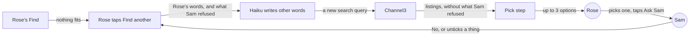
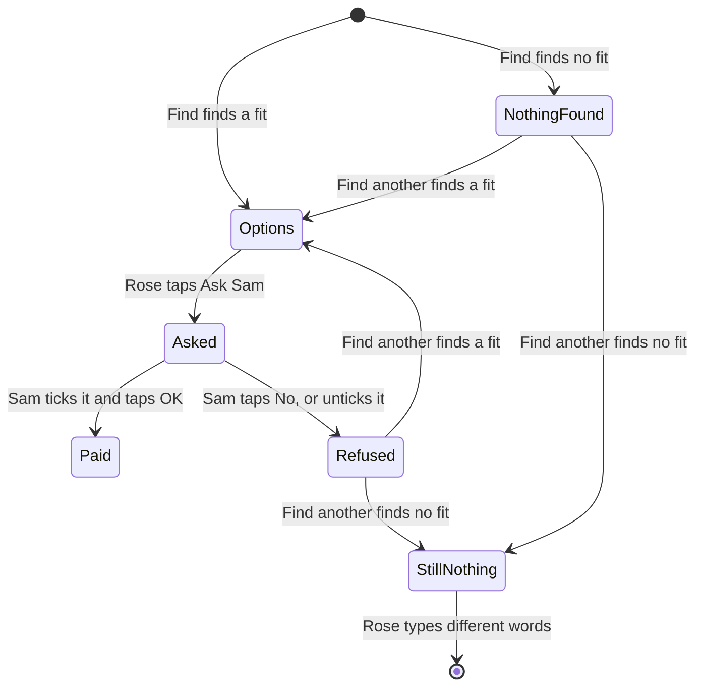
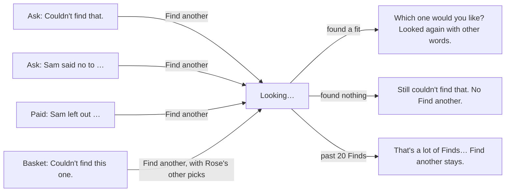

# Find another

**Version:** v1 · **Status:** Draft · **Type:** Feature · **Project type:** Web UI, with an LLM path

**Shape doc:** docs/specs/after-review/shape.md
**Depends on:** picks-that-match
**Page:** none. Skipped: you read the `.md` directly.

When Find finds nothing, or Sam refuses a pick, Rose taps Find another, and the AI searches again with other words. It ships now because it is the AI's biggest new legwork, and it reuses the pick step that `picks-that-match` fixed.

## Problem

When Find finds nothing, Rose sees "Couldn't find that. Try different words." Rose must think of other words alone. When Sam says No, Rose's box is empty, and Rose types the thing again. The new search can show the same listing that Sam refused. When Sam leaves a thing out of a basket, "Ask for something else" puts its words back, and a new Find can show the same listing again.

The review of v1.2.0 on 2026-10-22 named this gap: Rose retypes after a No or an empty search. An older shopper may give up there. I don't have a count of empty Finds. The `find outcome=` log line has them, but `/status` doesn't count outcomes.

## Slice test

| Check                         | Result |
| ----------------------------- | ------ |
| Cuts every layer it needs     | yes: a Find another button on Rose's page, the server action, a new AI step in Find, and the stored search. Rose reaches it after an empty Find, a No or an untick |
| One e2e test walks it         | yes: Rose finds slippers, Sam says No, Rose taps Find another, sees new options without the refused one, and asks Sam again |
| Worth shipping alone          | yes: after a No or an empty Find, one tap gives Rose new options, and Rose doesn't retype |
| Fits (≤5 scenarios, ≤2 areas) | yes, after the split in O1: 5 scenarios, and two areas, Rose's page and Find |

**Path:** full. It adds a new AI step and a new control on Rose's page.

The shape's slice was too big (O1). It split into three:

| Slice | What ships |
| ----- | ---------- |
| `find-another` (this one) | Rose taps Find another after an empty Find, a No or an untick. The AI tries other words. |
| `allow-over-limit` | When other words still find nothing under Sam's limit, Rose sees the nearest listings over it, and Sam can allow one. |
| `sam-finds-another` | Sam taps Find another on Sam's own page. That slice decides who picks the new listing (O2). |

## User story

As Rose, I want KinCart to look again for me when it finds nothing or Sam says no, so that I don't have to think of other words myself.

## Flow



After an empty Find, a No or an untick, Rose taps Find another. Haiku writes other words, Channel3 searches them, and the pick step shows Rose up to 3 options without what Sam refused.

## States



A thing gets one Find another for each empty Find, No or untick (O3). A Find another that finds nothing doesn't offer a second one.

## Acceptance criteria

```gherkin
Scenario Outline: Rose's Find found nothing, and Find another finds it
  Given Sam's limit is <limit>
  And Rose's Find for "<words>" found nothing, and Rose sees "<message>"
  When Rose taps Find another
  Then KinCart searches again with other words than the first search used
  And Rose sees up to 3 options for "<words>", each at <limit> or less
  And Rose can pick one and tap Ask Sam, as today

  Examples:
    | limit | words                      | message                                                                          |
    | $50   | something to grip jar lids | Couldn't find that. Try different words.                                         |
    | $20   | a lamp for reading in bed  | Nothing under $20 for that. Try different words, or ask Sam to raise the limit. |

Scenario Outline: Find another leaves out what Sam just refused
  Given Sam's limit is $50
  And <what Sam did>
  When Rose taps Find another under "<notice>"
  Then Rose sees up to 3 options for <things>, each at $50 or less
  And none of them is <refused>

  Examples:
    | what Sam did                                                                                                    | notice                                    | things                                     | refused                         |
    | Sam said No to "Dearfoams Women's Cozy Slippers", $24.99, found for "warm slippers that are easy to put on, size 8" | Sam said no to Dearfoams Women's Cozy Slippers. | "warm slippers that are easy to put on, size 8" | the Dearfoams listing           |
    | Sam said No to a basket of AA batteries, a night light and a phone charger                                      | Sam said no to your 3 things.             | each of the 3 things, in one basket        | a listing in the refused basket |
    | Sam paid for AA batteries and a phone charger, and left out "a night light"                                     | Sam left out a night light.               | "a night light"                            | the night light Sam left out    |

Scenario: Find another for one empty thing in a basket
  Given Rose's Find for "AA batteries, something to grip jar lids" shows 3 AA battery options
  And the "something to grip jar lids" group says "Couldn't find this one."
  And Rose picked "Energizer MAX AA Batteries, 8 Pack"
  When Rose taps Find another in the "something to grip jar lids" group
  Then only "something to grip jar lids" searches again
  And that group shows up to 3 options
  And the AA batteries group keeps its 3 options, with Energizer MAX still picked

Scenario: Find another finds nothing either
  Given Sam's limit is $20
  And Rose's Find for "a lamp for reading in bed" found nothing under $20
  When Rose taps Find another, and it finds nothing under $20 too
  Then Rose sees "Still nothing under $20 for that. Try different words, or ask Sam to raise the limit."
  And Find another doesn't show again for that search
  And "a lamp for reading in bed" stays in Rose's box

Scenario Outline: Find another counts as a Find
  Given this network address ran <finds> Finds in the last 24 hours
  When Rose taps Find another
  Then <result>

  Examples:
    | finds | result                                                                                                                                   |
    | 19    | it runs, and /status shows one more Find and its Channel3 searches                                                                       |
    | 20    | nothing reaches Claude or Channel3, Rose sees "That's a lot of Finds from here today. Try again in 3 hours.", and /status shows one more stopped Find |
```

## Scope

**In:**
- A Find another control for Rose after a Find that found nothing for one thing, or for one thing in a basket.
- A Find another control for Rose after Sam's No, to one thing or to a basket, and on Rose's receipt for each thing Sam left out.
- The AI writes other words for the thing than the first search used, and Find runs its search and pick step on them, as for a Find.
- After a No or an untick, the new options leave out the listing or listings that Sam refused (O5).
- After a No to a basket, one tap searches every thing again, and Rose picks again for each and asks Sam once (O6).
- One Find another for each empty Find, No or untick. A second No to a new pick offers a new one (O3).
- Each Find another counts as a Find: toward the address's 20 a day (D73), and on `/status` (D78) (O4).

**Out:**
- The nearest listings over Sam's limit, and Sam allowing one: `allow-over-limit`, next.
- Sam's own Find another tap, and who picks after it: `sam-finds-another`, after `allow-over-limit`.
- Find another on a screen that shows options, when none of them fits. "Try other words" stays there. No later slice.
- A second Find another after one that found nothing. Rose types different words (O3). No later slice.
- Leaving out listings that Sam refused in an earlier ask (O5). No later slice.
- Telling the AI why Sam said No. No later slice.
- Repeating a past ask: `ask-again` (slice 5).

## Interface

Rose's page gets one new control, Find another, on four screens. Sam's page doesn't change. Every piece comes from the design system: no new component, class or token.



Rose taps Find another on one of four screens. The search ends in new options, a "Still…" message with no second Find another, or the daily-limit message.

**Where it shows.** Find another is a secondary button under the notice that it answers, with a small hint under it.

| Screen | The notice above it | The hint under it |
| ------ | ------------------- | ----------------- |
| Ask, after an empty Find | "Couldn't find that. Try different words." or "Nothing under $20 for that. Try different words, or ask Sam to raise the limit." | "KinCart tries other words for you." |
| Ask, after Sam's No to one thing | "Sam said no to Dearfoams Women's Cozy Comfort Slippers." | "KinCart looks again with other words, without the one Sam said no to." |
| Ask, after Sam's No to a basket | "Sam said no to your 3 things. Nothing was taken." | "KinCart looks again for each thing, without the ones Sam said no to." |
| Paid, with a thing left out | "Sam left out a night light." | "KinCart looks again with other words, without the one Sam left out." It says "the ones" for several. "Ask for something else" stays under it. |
| Basket, a group that found nothing | "Couldn't find this one." or "Nothing under $50 for this one." | "KinCart tries other words for this one." |

**After the tap:**

- **Pressed.** The button says "Looking…" with the existing spinner. In a basket, the group's Find another sends the Ask Sam form, so Rose's picks in the other groups go with it. Ask Sam has its own name and value there, so only the pressed button spins.
- **Found.** The usual options or basket screen. Its line reads `For "something to grip jar lids". Looked again with other words.` When Find another searched one group of a basket, the line sits under that group's heading instead. Rose's other picks stay picked, and the searched group has no pick.
- **Found nothing.** "Still couldn't find that. Try different words." or "Still nothing under $20 for that. Try different words, or ask Sam to raise the limit." In a group, "Still couldn't find this one." or "Still nothing under $50 for this one." No Find another shows, and Rose's words stay in the box.
- **Stopped by the daily limit.** Today's "That's a lot of Finds from here today. Try again in 3 hours." The No notice and Find another stay, so Rose can tap it after the wait.

**Motion tier:** 1, as before. Nothing new moves: the notices rise and fade like every notice, and "Looking…" turns the existing spinner. Under reduced motion, nothing moves.

**Components used:** `Notice`, `Button` (secondary, and with `formAction` in a basket group), `ListingPicker`, `ReceiptCard`, `.stack` and `.small`. The tokens come from `docs/design/design-system/` (D15).

**Preview:** `/preview/find-another` on `pnpm dev`, from `app/(shop)/preview/find-another/page.tsx`. It shows Rose's real page in 14 frames, one or more for each scenario.

## Decisions to record

Drafted at pause 1. They move under the Technical plan at pause 3, and `/build` appends them to DECISIONS.md.

## D97 · 2026-10-22 · Rose gets one Find another for each empty Find, No or untick, and each one counts as a Find

Why: one try with other words gives Rose new options without a loop of empty searches. It sends the same Claude and Channel3 calls as a Find, so it counts toward the address's 20 a day (D73) and on `/status` (D78).
Rejected: taps until the daily limit, each with untried words (a loop of empty results, and KinCart must keep every tried query), a Find another that runs free (a script could tap it past the daily limit).
Source: docs/specs/find-another.md
Status: active

## D98 · 2026-10-22 · Find another leaves out only what Sam just refused, and after a basket No it searches every thing

Why: a No or an untick stores the refused listings with the ask. Rose's other options are cleared at Ask Sam. One tap for the whole basket keeps Rose's page to one new control.
Rejected: leave out every listing Sam ever refused for the thing (a history to store), also leave out the options Rose saw and didn't pick (KinCart must keep them after Ask Sam), Rose ticks which things to search after a basket No (one more control on Rose's page).
Source: docs/specs/find-another.md
Status: active

## Open items

| ID | What | Type | Raised at | Owner | Status | Answer |
| -- | ---- | ---- | --------- | ----- | ------ | ------ |
| O1 | `find-another` may pass five scenarios with the step over the limit (from shape O9) | flag | shape | spec | Resolved | Split. This slice tries other words on all three triggers. The nearest listings over Sam's limit, and Sam allowing one, move to `allow-over-limit`. 2026-10-22 |
| O2 | When Sam taps Find another, who picks the new listing: Sam, or Rose after Sam's tap (from shape O17) | question | shape | user | Resolved | Only Rose taps Find another in this slice. Sam's own tap moves to `sam-finds-another`, which decides who picks (shape O20). 2026-10-22 |
| O3 | How many times Rose can tap Find another for one thing | question | spec p1 | user | Resolved | Once for each empty Find, No or untick. If it finds nothing, Rose types different words (D97). 2026-10-22 |
| O4 | Does a Find another count as a Find? | question | spec p1 | user | Resolved | Yes: toward the address's 20 a day, and on `/status` (D97). 2026-10-22 |
| O5 | What Find another leaves out after a No or an untick | question | spec p1 | user | Resolved | The listing or listings in that No or untick. A listing that Sam refused in an earlier ask can come back (D98). 2026-10-22 |
| O6 | What one tap does after Sam's No to a basket | question | spec p1 | user | Resolved | It searches every thing again, each without its refused listing. Rose picks again and asks Sam once (D98). 2026-10-22 |
| O7 | Which motion tier | question | spec p2 | user | Resolved | Tier 1, as before. Nothing new moves. 2026-10-22 |
| O8 | The button's name after an empty Find, when nothing was found first | question | spec p2 | user | Resolved | "Find another" everywhere: one name for one control (D84). 2026-10-22 |
| O9 | What the new options say about the search | question | spec p2 | user | Resolved | A plain line, "Looked again with other words.", not the AI's search words. 2026-10-22 |

_Never delete this section or its rows. See references/ledger.md._

## Glossary

- **Channel3** — the hackathon sponsor whose API returns real product listings.
- **Haiku** — Claude Haiku, the small Claude model that reads Rose's words and picks listings.
- **Pick step** — the Haiku call that drops listings that aren't the thing, and picks up to 3.
- **Untick** — Sam clears a thing's box in a basket, so Sam's OK doesn't pay for it.
- **e2e** — end to end: an automated test that drives the app as a person would, start to finish.
