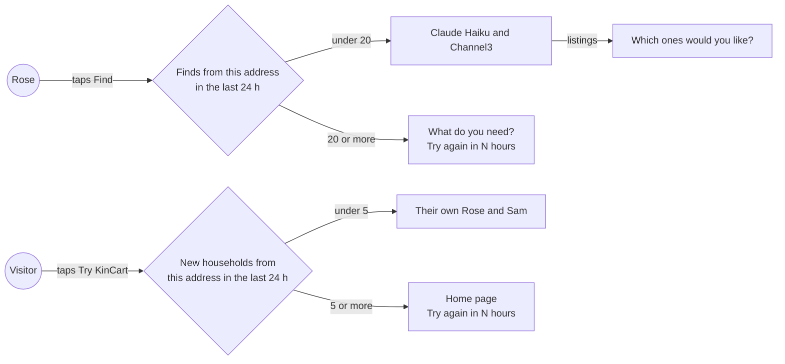
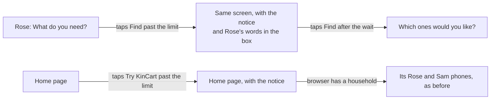
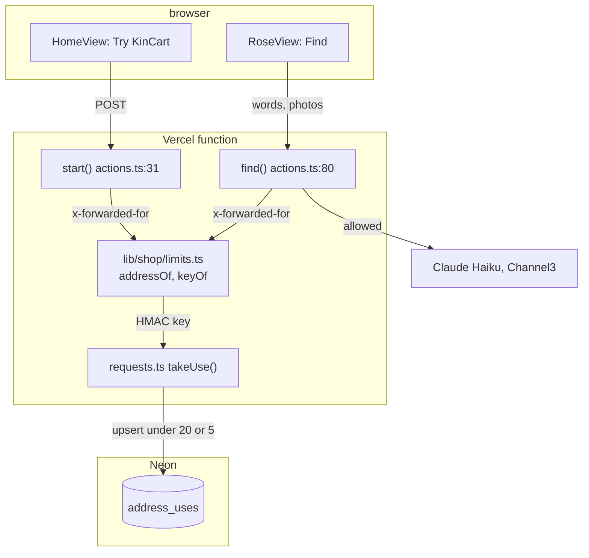
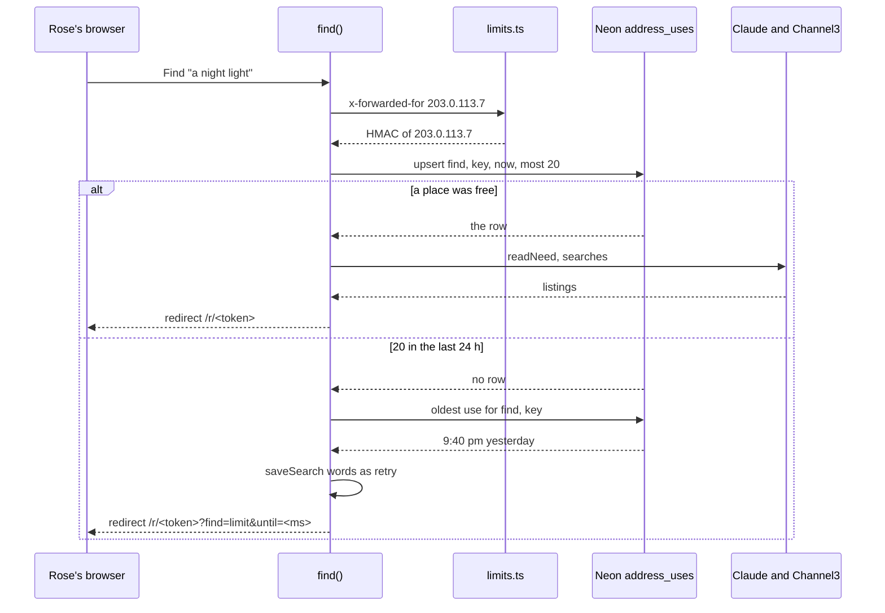
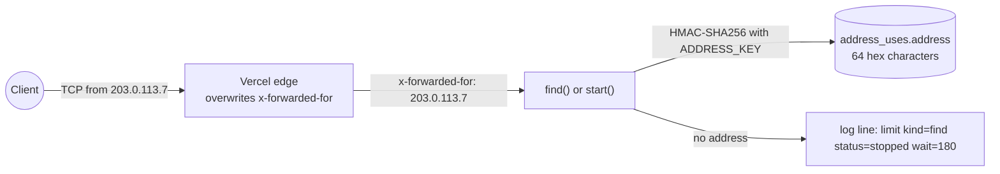
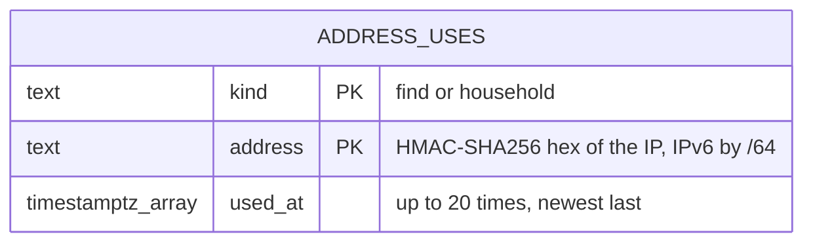

# Find limits

**Version:** v1 · **Status:** Shipped · **Type:** Feature · **Project type:** Web UI

**Shape doc:** docs/specs/security/shape.md
**Depends on:** None
**Page:** none. Skipped: you read the `.md` directly.

One network address can run only so many Finds, and start only so many households, in 24 hours. It comes first because a script can use up the Claude and Channel3 keys before judging, Dec 1 to 15.

## Problem

`find()` at `app/(shop)/actions.ts:80` calls Claude Haiku once or twice and Channel3 2 to 10 times for each Find, and nothing counts the calls. `start()` at `app/(shop)/actions.ts:31` starts a new household on every Try KinCart, so a per-household count alone stops nobody.

Channel3's free tier is about 1,000 searches a month (assumed, O6). One person can use that up in about 100 basket Finds, by hand or with a loop. Then every judge's Find says "Couldn't find that", and nothing tells you why.

## Slice test

| Check                         | Result |
| ----------------------------- | ------ |
| Cuts every layer it needs     | yes: a notice on Rose's page and on the home page, the `find()` and `start()` actions, and a table of counts |
| One e2e test walks it         | yes: an address with 20 Finds that day taps Find and sees the notice, and an address with fewer gets results |
| Worth shipping alone          | yes: a script from one address can't use up the month's searches or the Claude budget |
| Fits (≤5 scenarios, ≤2 areas) | yes: 4 scenarios, in the shop actions and the request storage in `lib/shop/` |

**Path:** full. It adds a table and two notices.

## User story

As the person who runs KinCart, I want one network address to get only a day's share of Finds, so that a script can't use up Channel3 and Claude before the judges try it.

## Flow



Each Find and each Try KinCart counts against the address it came from. Past the day's limit, the person sees when to try again, and nothing reaches Claude or Channel3.

## Acceptance criteria

```gherkin
Scenario: Judges on one office network still get results
  Given 12 Finds came from address 203.0.113.7 in the last 24 hours, from 2 households
  When Rose, in a third household at the same address, types "batteries for the clock and a night light" and taps Find
  Then Rose's page shows "Which ones would you like?" with two groups, as it does today

Scenario: An address that reaches 20 Finds is stopped until the oldest is 24 hours old
  Given 20 Finds came from 203.0.113.7 in the last 24 hours, and the oldest was at 9:40 pm yesterday
  When Rose at that address types "a night light" and taps Find at 6:40 pm
  Then Rose's page shows "That's a lot of Finds from here today. Try again in 3 hours."
  And the box still says "a night light"
  And no call goes to Claude or Channel3
  When Rose at address 198.51.100.24 taps Find at the same moment
  Then Rose's page shows that Rose's listings, as it does today
  When Rose at 203.0.113.7 taps Find again at 9:41 pm
  Then Rose's page shows the listings

Scenario: An address that starts 5 households is stopped
  Given 5 households started from 203.0.113.7 in the last 24 hours
  When someone at that address taps Try KinCart
  Then no household starts
  And the home page shows "That's a lot of new Roses and Sams from here today. Try again in 5 hours."
  And a browser at that address that already has a household still sees its own Rose and Sam

Scenario: A Find that never reaches the AI does not count
  Given 19 Finds came from 203.0.113.7 in the last 24 hours
  When Rose taps Find with an empty box
  Then Rose sees "Type what you need, or add a photo, first." as today, and the count stays at 19
  When Rose picks a PDF and taps Find
  Then Rose sees today's "not a photo" notice, and the count stays at 19
  When Rose types "a night light" and taps Find
  Then Rose's page shows the listings, and the count is 20
```

## Scope

**In:**

- A count of Finds for each address over the last 24 hours. A Find counts when it passes the input checks, just before the call to Claude, whether or not the search then succeeds.
- A count of new households for each address over the last 24 hours, from Try KinCart and from Start a new one.
- The two notices, with the hours or minutes until the oldest counted Find or household is 24 hours old.
- A log line for each stopped Find and each stopped household.

**Out:**

- Usage counts on `/status`. Slice `usage-on-status` picks this up.
- A limit for each household. It stops nothing that the address limit misses. A script on many addresses starts a new household on each one, so a per-household limit doesn't stop it either. Not planned.
- Limits on Sam's actions, Ask Sam, Skip or Link PayPal. None of them calls Claude or Channel3. Not planned.
- Keeping the results of repeated words, so judges who type the testing instructions' "batteries for the clock and a night light" use no new searches. That is not in the shape, and it would be a slice of its own.
- A bigger Channel3 quota. That is your call with Channel3, not code.
- A Vercel Firewall rule against floods, such as 5 Finds in 10 minutes for each IP. It is a dashboard setting, and Hobby allows one rule. You can add it at any time.

## Interface

Both notices are the system's `Notice` at the neutral tone, at the top of the screen, where today's notices sit. Tokens come from the repo's design system, `docs/design/design-system/` (D15, D50).



A stopped Find leaves Rose on the ask screen with their words, and a stopped Try KinCart leaves the visitor on the home page.

| Screen | Notice | State |
| ------ | ------ | ----- |
| Rose's ask screen | "That's a lot of Finds from here today. Try again in 3 hours." | `RoseState` ask with `problem: "limit"` and `waitMinutes` |
| Home page, no household | "That's a lot of new Roses and Sams from here today. Try again in 5 hours." | `HomeState` with `outcome: "limit"` and `waitMinutes` |
| Home page, with a household | The same, then "Your Rose and Sam still work." | The same, with `links` |

`waitFor()` in `app/(shop)/ui.tsx` writes the wait, rounded up so the notice never says to come back too early. Under an hour it says minutes ("25 minutes", "1 minute"). From an hour, it says whole hours ("1 hour", "3 hours").

**Motion tier:** 0. The notices arrive with the page, as today's notices do.

**Components used:** `Notice`, `PageHead`, `RoseView`, `HomeView`.

**Preview:** `/preview/find-limits` for Rose's two notices, `/preview/find-limits?home=new` and `/preview/find-limits?home=yours` for the home page. Production returns 404.

## Technical plan

### Approach

`find()` and `start()` ask Neon for permission before they do anything that costs. One table, `address_uses`, holds a row for each kind (`find` or `household`) and each address, with the times of that address's uses in the last 24 hours. A single `INSERT ... ON CONFLICT DO UPDATE ... WHERE` adds a time only while fewer than 20 (or 5) are left, so two Finds at once can't both take the last place. The address is the first `x-forwarded-for` value, which Vercel overwrites, and the table keeps an HMAC of it under `ADDRESS_KEY`, never the address itself.

Relies on: D11, D19, D23, D24, D46, D73, D74, D75, D76, D77



The two actions turn the client's address into a key, and the upsert either takes a place or returns nothing. Only an allowed Find reaches Claude and Channel3.



A stopped Find keeps Rose's words as a `retry` search, which the ask screen already shows in the box, and the page works out the wait from `until` on every redraw (D19).



The address crosses into the function only as a header that Vercel writes. It leaves the function only as an HMAC, and no log line carries it.

### Changes

| File | What changes | Why |
| ---- | ------------ | --- |
| `db/migrations/0011_find_limits.up.sql` | New: `CREATE TABLE IF NOT EXISTS address_uses (kind text NOT NULL CHECK (kind IN ('find', 'household')), address text NOT NULL, used_at timestamptz[] NOT NULL, PRIMARY KEY (kind, address))` | Scenarios 2 and 3 |
| `db/migrations/0011_find_limits.down.sql` | New: `DROP TABLE IF EXISTS address_uses` | Rollback |
| `scripts/migrate.test.ts:33` | `downToHouseholds()` also runs `0010_photo_ask_several.down.sql`. The test expects `address_uses` after up, and no `address_uses` after one down. `clear()` also empties `address_uses` | The newest down file is now 0011 |
| `lib/shop/limits.ts` | New. `FINDS_A_DAY = 20` and `HOUSEHOLDS_A_DAY = 5`. `addressOf(forwardedFor)`: the first value, an IPv4-mapped address as IPv4, and an IPv6 address as its first 64 bits (D75). `keyOf(address)`: HMAC-SHA256 under `ADDRESS_KEY`, hex | Scenarios 1 to 3. Pure functions, so `limits.test.ts` covers the address cases |
| `lib/shop/requests.ts:202` | New `takeUse(kind, key, most): Promise<Date \| null>`. One `DELETE` drops rows whose newest time is 24 hours old. Then one upsert adds this row's time while fewer than `most` remain. `null` means allowed. When it is stopped, a second query returns the time the oldest use turns 24 hours old | Scenarios 2 and 3, D76 |
| `lib/shop/find.ts:24` | `searchOn()` also needs `ADDRESS_KEY`. Without it, Rose picks from the fixed list, as with a missing Claude or Channel3 key | Find never runs without its limit (D74) |
| `app/(shop)/actions.ts:80` | `find()`: after the empty and not-a-photo checks (line 89), `takeUse("find", ...)`. If stopped: `saveSearch(household, words, { outcome: "retry" })`, log `limit kind=find status=stopped wait=<minutes>`, and redirect to `/r/<token>?find=limit&until=<ms>` | Scenarios 2 and 4 |
| `app/(shop)/actions.ts:31` | `start()`: before `startHousehold`, `takeUse("household", ...)`. If stopped: log `limit kind=household status=stopped wait=<minutes>` and redirect to `/?started=limit&until=<ms>`. With no `ADDRESS_KEY`: log `household status=failed reason=no ADDRESS_KEY` and redirect to `/?started=failed` | Scenario 3 |
| `app/(shop)/actions.ts:217` | New `address()` reads `x-forwarded-for` from `headers()`, beside `origin()` | Both actions |
| `app/(shop)/r/[token]/page.tsx:46` | Reads `find=limit` and `until` into a new `limitUntil` flag | Scenario 2 |
| `app/(shop)/state.ts:86` | `problem: "limit"` and `waitMinutes` while `limitUntil` is in the future. Once it has passed, no notice | Scenario 2: Find works again at 9:41 pm |
| `app/(shop)/page.tsx:16` | `outcome: "limit"` and `waitMinutes` from `until` while it is in the future | Scenario 3 |
| `.github/workflows/ci.yml:26` | `ADDRESS_KEY: ${{ github.run_id }}-${{ github.run_attempt }}`. It only keys CI's throwaway counts | CI runs Find |
| `.env.example:22`, `README.md:71` | `ADDRESS_KEY=`, and one line on making one with `openssl rand -hex 32` | Setup |
| `e2e/db.ts:15` | `reset()` also empties `address_uses`. New `seedUses(kind, address, times)` writes a row with `keyOf()` | Each spec starts with no counts |
| `e2e/find-limits.spec.ts` | New. Walks scenarios 1 to 3 (below) | The slice's e2e |
| `app/(shop)/RoseView.tsx`, `HomeView.tsx`, `ui.tsx` | Done at pause 2 (c176a33). `/build` adds their tests | Interface |
| `app/(shop)/preview/find-limits/page.tsx` | Done at pause 2 | Preview |

Reusing: `query()` in `lib/shop/requests.ts:330`, `saveSearch()` and its `retry` outcome (`requests.ts:175`, `state.ts:90`), `Notice`, the `origin()` pattern for headers (`actions.ts:215`), `createHmac` beside `hashOf()` in `lib/shop/people.ts:39`, and `reset()` in `e2e/db.ts`.

### Data



`address_uses` holds no household's data, so D46's split doesn't apply. A row is deleted once its newest time is 24 hours old.

**Migration:** expand only: one new table. Old code never reads it, so a rollback deploy keeps working. No backfill.

**Reverse:** `node scripts/migrate.mjs down` runs `0011_find_limits.down.sql` and drops `address_uses`. `scripts/migrate.test.ts` runs up, down and up again.

### Earn-it

| Added | Triggered by |
| ----- | ------------ |
| `address_uses` table | Scenarios 2 and 3: a count over 24 hours that lives across Vercel function instances |
| `lib/shop/limits.ts` | The address rules (first value, IPv4-mapped, IPv6 /64) and the HMAC are pure. They need unit tests, and a `"use server"` file can't export them |
| `ADDRESS_KEY` env | O7: the table must not hold visitors' addresses |
| `until` in the page address | The wait must count down across the 3 s redraws (D19) without a column in `rose_search` |

### Non-functionals

|                      |                                                                               |
| -------------------- | ----------------------------------------------------------------------------- |
| **Load**             | A few Finds and households a day now, and about 100 Finds over judging. Each one adds one upsert on its own connection, as every query in `requests.ts` does |
| **Breaks first**     | Nothing at 10 times the load. Rows equal the addresses seen in 24 hours, each with at most 20 times. A flood from millions of addresses would grow the table, and Vercel's DDoS protection sits in front of it |
| **Security surface** | Anyone can call `find()` with a Rose link, and `start()` with no link. It trusts `x-forwarded-for`, which Vercel overwrites (O9). It reads `ADDRESS_KEY`. It stores an HMAC of each address and up to 20 times for each kind, for 24 hours after the newest |
| **Proof it works**   | In Vercel's logs, `limit kind=find status=stopped wait=<minutes>` when a Find is stopped, and the usual `find outcome=` line when it goes through |
| **Rollout**          | No flag. First, `/ship` adds `ADDRESS_KEY` to Vercel production and preview, with your OK (O10). Then merge, CI migrates Neon after the tests (D11), and Vercel promotes. Rollback: revert the merge, and the old code ignores `address_uses`. Then `node scripts/migrate.mjs down` drops it. Before Dec 1: the Anthropic spend limit and Channel3's reset date (O5) |

### Test plan

| Scenario | Test | Command |
| -------- | ---- | ------- |
| 1 Judges on one network still get results | `e2e/find-limits.spec.ts`: 12 uses seeded for 203.0.113.7, then a Find with `x-forwarded-for: 203.0.113.7` gets real listings | `pnpm test:e2e e2e/find-limits.spec.ts` |
| 2 An address at 20 is stopped | `e2e/find-limits.spec.ts`: 20 uses seeded, the oldest 21 hours ago, show "Try again in 3 hours" with the words in the box. 198.51.100.24 then gets listings. `lib/shop/requests.test.ts`: 30 calls at once let exactly 20 through, and a use 24 hours old drops out. `app/(shop)/state.test.ts`: a past `until` shows no notice | `pnpm test:e2e e2e/find-limits.spec.ts`, `pnpm test` |
| 3 An address at 5 households is stopped | `e2e/find-limits.spec.ts`: 5 seeded, so Try KinCart shows the notice and adds no household. `app/(shop)/actions.test.ts`: no `ADDRESS_KEY` gives `?started=failed` | both |
| 4 Finds that never reach the AI don't count | `app/(shop)/actions.test.ts`: an empty box and a PDF leave the count at 19, and a typed Find makes it 20 | `pnpm test` |
| Address rules | `lib/shop/limits.test.ts`: two values, IPv4-mapped, two IPv6 addresses in one /64 give one key, and one in another /64 gives a different key | `pnpm test` |
| Wait wording | `app/(shop)/RoseView.test.tsx`, `HomeView.test.tsx`: 180 gives "3 hours", 25 gives "25 minutes", 61 gives "2 hours", and "Your Rose and Sam still work." shows only with links | `pnpm test` |
| Migration | `scripts/migrate.test.ts` | `pnpm test` |

**E2E:** `e2e/find-limits.spec.ts`. It sends `x-forwarded-for` with `page.setExtraHTTPHeaders`, which `next start` keeps (`node_modules/next/dist/server/base-server.js:567` only sets it when missing). The allowed Finds call Claude and Channel3 for real (D24).

### Chunks

Single chunk. Every test file shares the local database, so the work runs serially (learning: build chunks one after another when their tests share the local database).

### Risks

| Risk | Mitigation |
| ---- | ---------- |
| `ADDRESS_KEY` is missing on Vercel at deploy, so judges get the fixed list and Try KinCart fails | Rollout adds it first (O10). Check with `vercel env ls` before merging. Learnings say to check Vercel's env before calling a flag off, and to match env names that contain digits |
| A judging team on one network uses 20 Finds in a day | Sized at pause 1 (O1). Raise `FINDS_A_DAY` in `lib/shop/limits.ts` |
| Two Finds at once both take the last place | One statement. In 3 of 3 runs of 30 at once on Postgres 17, exactly 20 went through (O8). `requests.test.ts` keeps checking it |
| A script on many addresses | Accepted at pause 1 (O3). `usage-on-status` shows it |

### Decisions to record

Recorded as D73, D74, D75, D76, D77.

## Review

2026-10-19 · 3 raw findings, 1 survived, 1 fixed.

- correctness · `app/(shop)/page.tsx:23` · `minutesUntil` caps the wait a page address shows at 24 hours · `fea750d`

## Open items

| ID | What | Type | Raised at | Owner | Status | Answer |
| -- | ---- | ---- | --------- | ----- | ------ | ------ |
| O1 | Judges on one office network or VPN share one address. A per-address limit could stop them together (from shape O2) | flag | shape | user | Resolved | 20 Finds and 5 new households for each address in 24 hours. A judge uses 5 to 10 Finds, so 2 or 3 judges on one network fit, and a loop from one address uses at most 200 searches. 60 and 10 were turned down: a loop could use most of the month. 2026-10-19 |
| O2 | Where the counts live: a table in Neon, or Vercel Firewall rate-limit rules. Whether Vercel Hobby has rate-limit rules is not checked (from shape O3) | unproven | shape | poc | Resolved | A table in Neon. Spike: Hobby has rate-limit rules, and a rule can match the `find` action alone by its Server Action Name (Next.js 15.5 and later). But Hobby allows 1 rule, with a fixed window of 10 minutes at most, so 20 Finds in 24 hours can't be written. A blocked request also gets a bare 429 instead of Rose's notice. Sources: vercel.com/docs/vercel-firewall/vercel-waf/rate-limiting, vercel.com/changelog/manage-next-js-server-actions-in-the-vercel-firewall. Draft D73. 2026-10-19 |
| O3 | Limits per address don't stop a script that uses many addresses. A daily ceiling on all Finds keeps one burst from using a month of searches, but a script can then use up one day for everyone (from shape O4) | flag | shape | user | Resolved | No ceiling. At 20 Finds an address, a script needs 5 or more addresses to use the month, and usage-on-status shows it. A 300-search ceiling was turned down: one script could block every judge for a day. 2026-10-19 |
| O4 | CI's e2e makes real Channel3 searches and Claude calls on every push (D24). Whether CI uses the same keys as the live site is not known (from shape O5) | question | shape | user | Accepted risk | CI keeps its keys. Main freezes on Nov 5, so CI uses no quota in December, and Channel3 is assumed to reset on Dec 1 (O5). Separate CI keys were turned down. 2026-10-19 |
| O5 | The Anthropic spend limit is not confirmed set, and Channel3's monthly reset is assumed (from shape O6) | question | shape | user | Accepted risk | Neither is set or checked yet. Set the Anthropic spend limit and check Channel3's reset date during the pre-judging checks, before Dec 1. 2026-10-19 |
| O6 | Channel3's real monthly quota. The limits are sized for about 1,000 searches. At 20 Finds a day, one address can still use 40 to 200 searches a day | question | spec p1 | user | Accepted risk | Sized for 1,000 searches a month for now. If Channel3's dashboard shows more, raise the two numbers. 2026-10-19 |
| O7 | What the counts table keeps for each address | question | spec p3 | user | Resolved | An HMAC-SHA256 under a new `ADDRESS_KEY`, so a leaked table holds no addresses. Without the key, Find is off and Try KinCart fails. The raw address for a day, and no addresses with a ceiling for everyone, were turned down (D74). 2026-10-19 |
| O8 | One `INSERT ... ON CONFLICT DO UPDATE ... WHERE` lets exactly 20 of 30 simultaneous Finds through | unproven | spec p3 | build | Resolved | Checked on the local Postgres 17 in a throwaway database: 3 of 3 runs let exactly 20 of 30 through and stored 20 times. `requests.test.ts` keeps checking it. 2026-10-19 |
| O9 | Vercel's `x-forwarded-for` can't be set by the client | unproven | spec p3 | build | Resolved | Vercel's request-headers docs: "we currently overwrite the X-Forwarded-For header and do not forward external IPs. This restriction is in place to prevent IP spoofing." 2026-10-19 |
| O10 | `ADDRESS_KEY` must be on Vercel before the merge. Without it, judges get the fixed list and Try KinCart fails | flag | spec p3 | user | Resolved | `/ship` asks first, then pipes `openssl rand -hex 32` into `vercel env add ADDRESS_KEY` for production and preview. The value is never printed. `/ship` stops before the merge if `vercel env ls` doesn't list it. Adding it by hand was turned down. 2026-10-19 |
| O11 | The plan put the clean-up `DELETE` and the upsert in one statement. Two stale addresses that come back at the same moment could then lock each other's rows in turn and deadlock | flag | build | user | Decided alone | Chose: the `DELETE` runs as its own statement before the upsert, and the upsert alone still counts (D76). Other: one statement with a `DELETE` in a `WITH`. Undo: move the `DELETE` into a `WITH` on the upsert in `takeUse()`. 2026-10-19 |

## Glossary

- **e2e** — an end-to-end test: a script drives a real browser through the app, the way a person would.
- **Network address** — the IP address a request comes from. Everyone on one office network or VPN usually shares one.
- **Quota** — the number of calls a free tier allows each month. Channel3's is about 1,000 searches.
- **Rolling 24 hours** — the count covers the 24 hours before now, not a calendar day, so each Find drops out exactly a day after it ran.
- **Vercel Firewall** — Vercel's rules that can block or slow requests before they reach the app.
- **HMAC** — a hash mixed with a secret key. Without the key, nobody can work back from the stored value to the address, or check a guess.
- **`x-forwarded-for`** — the header that tells the app which address a request came from. Vercel writes it and drops any value the client sent.
- **IPv6 /64** — the first half of an IPv6 address. One home or office network usually gets a whole /64, which holds billions of addresses.
- **IPv4-mapped address** — an IPv4 address written as IPv6, such as `::ffff:203.0.113.7`.
- **Upsert** — one statement that inserts a row, or updates it if it is already there.
- **Advisory lock** — a lock on a name, not a row, that Postgres holds until the transaction ends.
- **Expand only** — a migration that only adds, so the old code still runs against the new schema.
- **DDoS protection** — Vercel's own blocking of floods of requests, before they reach the app.
- **Backfill** — filling a new column or table from the data already there, before the code switches to read it.
