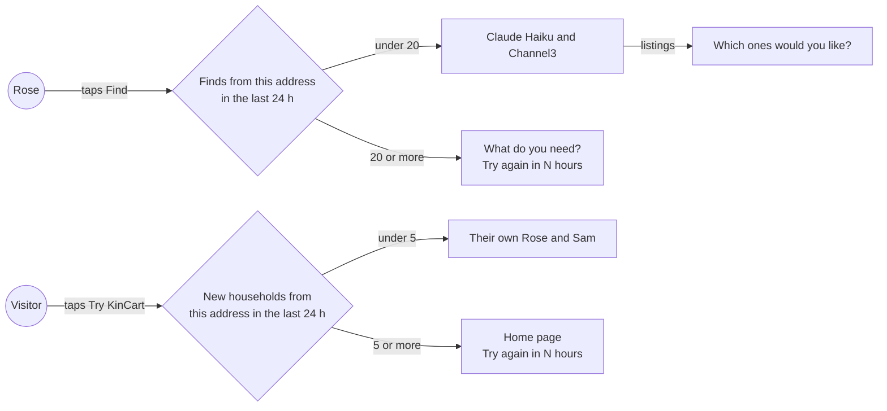
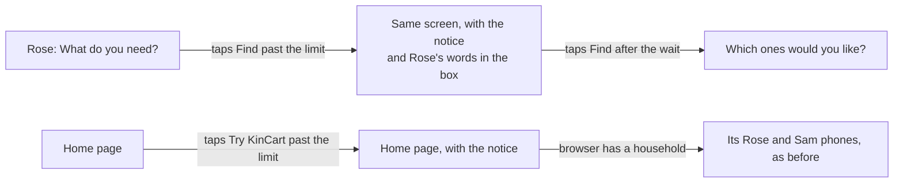

# Find limits

**Version:** v1 · **Status:** Draft · **Type:** Feature · **Project type:** Web UI

**Shape doc:** docs/specs/security/shape.md
**Depends on:** None

One network address can run only so many Finds, and start only so many households, in 24 hours. It comes first because a script can use up the Claude and Channel3 keys before judging, Dec 1 to 15.

## Problem

`find()` at `app/(shop)/actions.ts:80` calls Claude Haiku once or twice and Channel3 2 to 10 times for each Find, and nothing counts the calls. `start()` at `app/(shop)/actions.ts:31` starts a new household on every Try KinCart, so a per-household count alone stops nobody.

Channel3's free tier is about 1,000 searches a month (assumed, O6). One person can use that up in about 100 basket Finds, by hand or with a loop. Then every judge's Find says "Couldn't find that", and nothing tells you why.

## Slice test

| Check                         | Result |
| ----------------------------- | ------ |
| Cuts every layer it needs     | yes: a notice on Rose's page and on the home page, the `find()` and `start()` actions, and a table of counts |
| One e2e test walks it         | yes: an address with 20 Finds that day taps Find and sees the notice, and an address with fewer gets results |
| Worth shipping alone          | yes: a script from one address can't use up the month's searches or the Claude budget |
| Fits (≤5 scenarios, ≤2 areas) | yes: 4 scenarios, in the shop actions and the request storage in `lib/shop/` |

**Path:** full. It adds a table and two notices.

## User story

As the person who runs KinCart, I want one network address to get only a day's share of Finds, so that a script can't use up Channel3 and Claude before the judges try it.

## Flow



Each Find and each Try KinCart counts against the address it came from. Past the day's limit, the person sees when to try again, and nothing reaches Claude or Channel3.

## Acceptance criteria

```gherkin
Scenario: Judges on one office network still get results
  Given 12 Finds came from address 203.0.113.7 in the last 24 hours, from 2 households
  When Rose, in a third household at the same address, types "batteries for the clock and a night light" and taps Find
  Then Rose's page shows "Which ones would you like?" with two groups, as it does today

Scenario: An address that reaches 20 Finds is stopped until the oldest is 24 hours old
  Given 20 Finds came from 203.0.113.7 in the last 24 hours, and the oldest was at 9:40 pm yesterday
  When Rose at that address types "a night light" and taps Find at 6:40 pm
  Then Rose's page shows "That's a lot of Finds from here today. Try again in 3 hours."
  And the box still says "a night light"
  And no call goes to Claude or Channel3
  When Rose at address 198.51.100.24 taps Find at the same moment
  Then Rose's page shows that Rose's listings, as it does today
  When Rose at 203.0.113.7 taps Find again at 9:41 pm
  Then Rose's page shows the listings

Scenario: An address that starts 5 households is stopped
  Given 5 households started from 203.0.113.7 in the last 24 hours
  When someone at that address taps Try KinCart
  Then no household starts
  And the home page shows "That's a lot of new Roses and Sams from here today. Try again in 5 hours."
  And a browser at that address that already has a household still sees its own Rose and Sam

Scenario: A Find that never reaches the AI does not count
  Given 19 Finds came from 203.0.113.7 in the last 24 hours
  When Rose taps Find with an empty box
  Then Rose sees "Type what you need, or add a photo, first." as today, and the count stays at 19
  When Rose picks a PDF and taps Find
  Then Rose sees today's "not a photo" notice, and the count stays at 19
  When Rose types "a night light" and taps Find
  Then Rose's page shows the listings, and the count is 20
```

## Scope

**In:**

- A count of Finds for each address over the last 24 hours. A Find counts when it passes the input checks, just before the call to Claude, whether or not the search then succeeds.
- A count of new households for each address over the last 24 hours, from Try KinCart and from Start a new one.
- The two notices, with the hours or minutes until the oldest counted Find or household is 24 hours old.
- A log line for each stopped Find and each stopped household.

**Out:**

- Usage counts on `/status`. Slice `usage-on-status` picks this up.
- A limit for each household. It stops nothing that the address limit misses. A script on many addresses starts a new household on each one, so a per-household limit doesn't stop it either. Not planned.
- Limits on Sam's actions, Ask Sam, Skip or Link PayPal. None of them calls Claude or Channel3. Not planned.
- Keeping the results of repeated words, so judges who type the testing instructions' "batteries for the clock and a night light" use no new searches. That is not in the shape, and it would be a slice of its own.
- A bigger Channel3 quota. That is your call with Channel3, not code.
- A Vercel Firewall rule against floods, such as 5 Finds in 10 minutes for each IP. It is a dashboard setting, and Hobby allows one rule. You can add it at any time.

## Interface

Both notices are the system's `Notice` at the neutral tone, at the top of the screen, where today's notices sit. Tokens come from the repo's design system, `docs/design/design-system/` (D15, D50).



A stopped Find leaves Rose on the ask screen with their words, and a stopped Try KinCart leaves the visitor on the home page.

| Screen | Notice | State |
| ------ | ------ | ----- |
| Rose's ask screen | "That's a lot of Finds from here today. Try again in 3 hours." | `RoseState` ask with `problem: "limit"` and `waitMinutes` |
| Home page, no household | "That's a lot of new Roses and Sams from here today. Try again in 5 hours." | `HomeState` with `outcome: "limit"` and `waitMinutes` |
| Home page, with a household | The same, then "Your Rose and Sam still work." | The same, with `links` |

`waitFor()` in `app/(shop)/ui.tsx` writes the wait, rounded up so the notice never says to come back too early. Under an hour it says minutes ("25 minutes", "1 minute"). From an hour, it says whole hours ("1 hour", "3 hours").

**Motion tier:** 0. The notices arrive with the page, as today's notices do.

**Components used:** `Notice`, `PageHead`, `RoseView`, `HomeView`.

**Preview:** `/preview/find-limits` for Rose's two notices, `/preview/find-limits?home=new` and `/preview/find-limits?home=yours` for the home page. Production returns 404.

## Open items

| ID | What | Type | Raised at | Owner | Status | Answer |
| -- | ---- | ---- | --------- | ----- | ------ | ------ |
| O1 | Judges on one office network or VPN share one address. A per-address limit could stop them together (from shape O2) | flag | shape | user | Resolved | 20 Finds and 5 new households for each address in 24 hours. A judge uses 5 to 10 Finds, so 2 or 3 judges on one network fit, and a loop from one address uses at most 200 searches. 60 and 10 were turned down: a loop could use most of the month. 2026-10-19 |
| O2 | Where the counts live: a table in Neon, or Vercel Firewall rate-limit rules. Whether Vercel Hobby has rate-limit rules is not checked (from shape O3) | unproven | shape | poc | Resolved | A table in Neon. Spike: Hobby has rate-limit rules, and a rule can match the `find` action alone by its Server Action Name (Next.js 15.5 and later). But Hobby allows 1 rule, with a fixed window of 10 minutes at most, so 20 Finds in 24 hours can't be written. A blocked request also gets a bare 429 instead of Rose's notice. Sources: vercel.com/docs/vercel-firewall/vercel-waf/rate-limiting, vercel.com/changelog/manage-next-js-server-actions-in-the-vercel-firewall. Draft D73. 2026-10-19 |
| O3 | Limits per address don't stop a script that uses many addresses. A daily ceiling on all Finds keeps one burst from using a month of searches, but a script can then use up one day for everyone (from shape O4) | flag | shape | user | Resolved | No ceiling. At 20 Finds an address, a script needs 5 or more addresses to use the month, and usage-on-status shows it. A 300-search ceiling was turned down: one script could block every judge for a day. 2026-10-19 |
| O4 | CI's e2e makes real Channel3 searches and Claude calls on every push (D24). Whether CI uses the same keys as the live site is not known (from shape O5) | question | shape | user | Accepted risk | CI keeps its keys. Main freezes on Nov 5, so CI uses no quota in December, and Channel3 is assumed to reset on Dec 1 (O5). Separate CI keys were turned down. 2026-10-19 |
| O5 | The Anthropic spend limit is not confirmed set, and Channel3's monthly reset is assumed (from shape O6) | question | shape | user | Accepted risk | Neither is set or checked yet. Set the Anthropic spend limit and check Channel3's reset date during the pre-judging checks, before Dec 1. 2026-10-19 |
| O6 | Channel3's real monthly quota. The limits are sized for about 1,000 searches. At 20 Finds a day, one address can still use 40 to 200 searches a day | question | spec p1 | user | Accepted risk | Sized for 1,000 searches a month for now. If Channel3's dashboard shows more, raise the two numbers. 2026-10-19 |

## Glossary

- **e2e** — an end-to-end test: a script drives a real browser through the app, the way a person would.
- **Network address** — the IP address a request comes from. Everyone on one office network or VPN usually shares one.
- **Quota** — the number of calls a free tier allows each month. Channel3's is about 1,000 searches.
- **Rolling 24 hours** — the count covers the 24 hours before now, not a calendar day, so each Find drops out exactly a day after it ran.
- **Vercel Firewall** — Vercel's rules that can block or slow requests before they reach the app.
