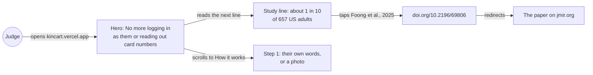
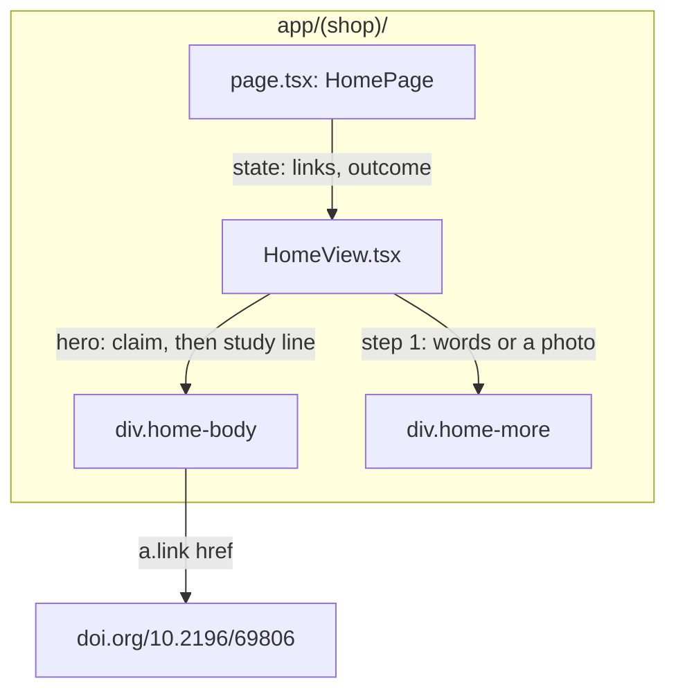
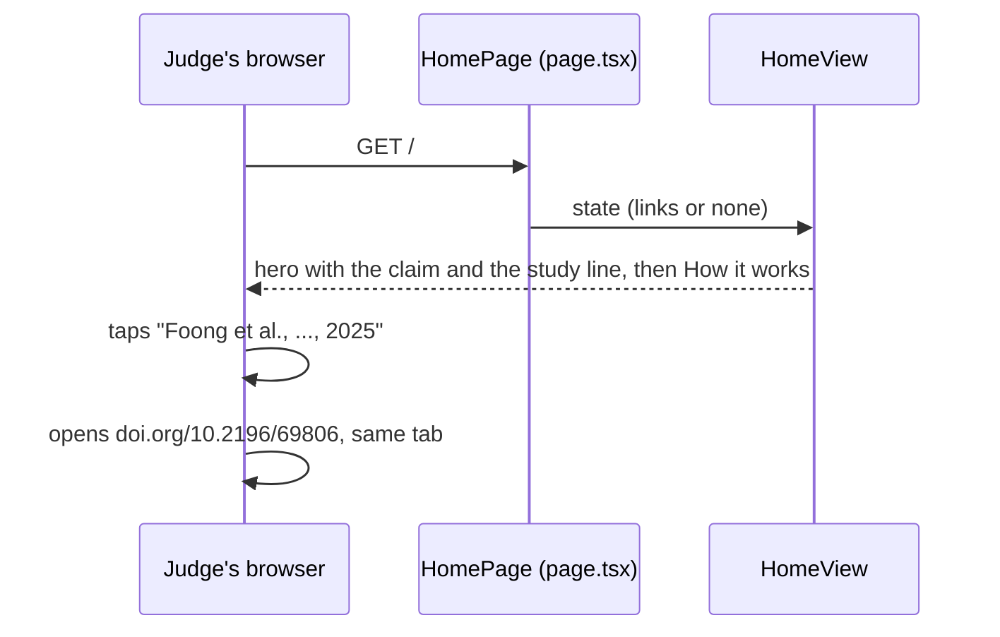

# Home page proof

**Version:** v1 · **Status:** Built · **Type:** Enhancement · **Project type:** Web UI

**Shape doc:** docs/specs/after-review/shape.md
**Depends on:** None
**Page:** none. Skipped: you read the `.md` directly.

The home page cites one checked US survey under the claim it backs, and step 1 of How it works says Rose can send a photo. It comes now because judges score a "credible, specific case", and the page has none.

## Problem

The judge's review on 2026-10-22 said nothing on the home page proves families need KinCart. The hero says "No more logging in as them or reading out card numbers." (`app/(shop)/HomeView.tsx:65-66`), with no source behind it.

How it works, step 1, says "In their own words, typed or spoken" (`app/(shop)/HomeView.tsx:135`). KinCart has no voice button, only the phone keyboard's mic. Step 1 doesn't say that Rose can send a photo, which `photo-ask` and `photo-ask-several` shipped.

## Slice test

| Check                         | Result |
| ----------------------------- | ------ |
| Cuts every layer it needs     | yes: the home page view is the only layer. No data or server change. |
| One e2e test walks it         | yes: `e2e/demo-home.spec.ts` reads the study line and its link on a laptop, and again on a phone after Try KinCart |
| Worth shipping alone          | yes: a judge sees a checked source under the home page's main claim |
| Fits (≤5 scenarios, ≤2 areas) | yes: 3 scenarios, in the home page only |

**Path:** light. It is a copy change in 3 files, with no new block, data or dependency. Pauses 1 and 3 merge, and pause 2 is skipped.

## User story

As a judge, I want the home page to show where its claim comes from, so that I can trust the problem is real.

## Flow



A judge reads the claim, then the survey result under it, and can open the paper. Further down, step 1 says Rose can send a photo.

## Acceptance criteria

```gherkin
Scenario: A judge on a laptop sees the study under the claim it backs
  Given a judge has not started a Rose and Sam in this browser
  When the judge opens kincart.vercel.app in a 1280 by 800 window
  Then the paragraph after "No more logging in as them or reading out card numbers." says "In a survey of 657 US adults, about 1 in 10 had signed in to someone else's money or medical account with that person's login."
  And the words "Foong et al., Journal of Medical Internet Research, 2025" link to https://doi.org/10.2196/69806

Scenario: The study stays on a phone after Try KinCart
  Given a judge opens kincart.vercel.app on a phone 390 px wide
  When the judge taps "Try KinCart"
  Then the page says "Your Rose and Sam are ready."
  And the study line and its link still show, above "Be Rose" and "Be Sam"

Scenario: How it works says Rose can send a photo
  Given a judge opens kincart.vercel.app
  When the judge reads step 1 of "How it works"
  Then it says "In their own words, or a photo of the thing or of a written list: batteries, a night light, a phone charger."
  And the home page doesn't say "spoken"
```

## Scope

**In:**

- One study line, with its source link, after the hero's first paragraph. It shows before and after Try KinCart, on a phone and on a laptop.
- The new step 1 of How it works.

**Out:**

- A quote from someone who tried KinCart. Dropped, not moved to a later slice (O1).
- The page's `<meta>` description and the Open Graph text. They keep their wording.
- The README and the Devpost draft. They can cite the same study at `/ship`, if you want.
- The shape's slice row still says the page quotes a real person. The shape stays as written, and this spec's O1 records the change.

## Technical plan

### Approach

The study line is one more `<p>` in the hero's `home-body`, styled by the hero's existing `p` and `.link` rules. Step 1 changes its words only. No CSS, data or server code changes.

Relies on: D50, D96





### Changes

| File | What changes | Why |
| ---- | ------------ | --- |
| `app/(shop)/HomeView.tsx:67` | After the first hero paragraph, add `<p>In a survey of 657 US adults, about 1 in 10 had signed in to someone else&apos;s money or medical account with that person&apos;s login.{" "}<a className="link" href="https://doi.org/10.2196/69806">Foong et al., Journal of Medical Internet Research, 2025.</a></p>` | Scenarios 1 and 2 |
| `app/(shop)/HomeView.tsx:135-136` | Step 1 says "In their own words, or a photo of the thing or of a written list: batteries, a night light, a phone charger." | Scenario 3 |
| `app/(shop)/HomeView.test.tsx:7-30` | Before a start: the study line, the link and its href, the new step 1, and no "spoken" | Scenarios 1 and 3 |
| `app/(shop)/HomeView.test.tsx:32-46` | After a start: the study line and link still show | Scenario 2 |
| `e2e/demo-home.spec.ts:18` | Laptop test: the study link shows, with its href | Scenario 1 |
| `e2e/demo-home.spec.ts:78` | Phone test: after Try KinCart, the study link shows | Scenario 2 |

Reusing: the `.link` class and the hero's `p` rules in `app/(shop)/shop.css`, as the ROADMAP link at `app/(shop)/HomeView.tsx:70` does. The link opens in the same tab, as that one does.

### Earn-it

Nothing new is added: no component, class, token or dependency.

### Non-functionals

|                      |  |
| -------------------- | - |
| **Load**             | No change. The home page renders the same server component, with one more paragraph. |
| **Breaks first**     | Nothing new at 10 times the visits. The line is static text. |
| **Security surface** | One plain outbound link to `doi.org`, in the same tab. No input, secret or stored data. |
| **Proof it works**   | `curl -s https://kincart.vercel.app/ \| grep -c "10.2196/69806"` prints 1 after the deploy. |
| **Rollout**          | No flag. It ships with the merge. Rollback: `git revert` of the feature commit. |

### Test plan

| Scenario | Test | Command |
| -------- | ---- | ------- |
| 1. A judge on a laptop sees the study | `app/(shop)/HomeView.test.tsx`, `e2e/demo-home.spec.ts` › "a judge plays Rose and Sam side by side" | `pnpm test`, `pnpm test:e2e e2e/demo-home.spec.ts` |
| 2. The study stays on a phone after Try KinCart | `app/(shop)/HomeView.test.tsx`, `e2e/demo-home.spec.ts` › "a phone gets a button for each" | `pnpm test`, `pnpm test:e2e e2e/demo-home.spec.ts` |
| 3. How it works says Rose can send a photo | `app/(shop)/HomeView.test.tsx` | `pnpm test` |

**E2E:** `e2e/demo-home.spec.ts`. Stop `pnpm dev` before you run it.

### Chunks

Single chunk.

### Risks

| Risk | Mitigation |
| ---- | ---------- |
| The survey counts money and medical accounts, not shopping. A judge may say it doesn't prove shopping help. | The line says only what the paper says. The hero's claim, "No more logging in as them", is about logins, which the survey measures. |
| The 1 in 10 is from the paper's abstract. I read the abstract at PubMed (PMID 40825207), not the full text. | The line quotes the abstract's own numbers: 657 US adults, "About 10% of the sample logged on by knowing the account owner's credentials". |

### Decisions to record

Recorded as D96.

## Open items

| ID | What | Type | Raised at | Owner | Status | Answer |
| -- | ---- | ---- | --------- | ----- | ------ | ------ |
| O1 | Assuming the user's contact agrees to try KinCart and be quoted, by name or by role (from shape O13) | assumption | shape | user | Resolved | Dropped. A hackathon build has no real users, so the page quotes nobody, and the study alone is the proof. This goes back on half of shape O12's "Both". 2026-10-22 |
| O2 | Which published study on password sharing or elder fraud, checked at its source (from shape O14) | question | shape | research | Resolved | Foong et al., "The Prevalence and Predictors of Digital Proxy Behavior in the United States", J Med Internet Res 2025;27:e69806, doi 10.2196/69806. Read at PubMed, PMID 40825207 (D96). 2026-10-22 |
| O3 | Step 1 of How it works says "typed or spoken", but KinCart has no voice button, only the phone keyboard's mic | question | spec p1 | user | Resolved | "In their own words, or a photo of the thing or of a written list." It drops "spoken". 2026-10-22 |

_Never delete this section or its rows. See references/ledger.md._

## Glossary

- **DOI** — a permanent ID for a published paper. `doi.org/<id>` always redirects to the paper's current page.
- **JMIR** — the Journal of Medical Internet Research, a peer-reviewed journal that is free to read.
- **PubMed** — the US National Library of Medicine's index of medical papers, with each paper's abstract.
- **Nationally representative** — a sample picked so that its mix of people matches the country's.
- **e2e** — end to end: an automated test that drives the app the way a person would, start to finish.
