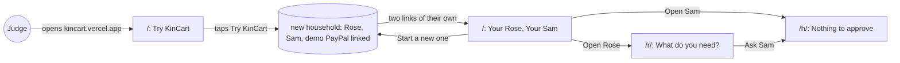
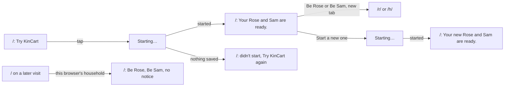
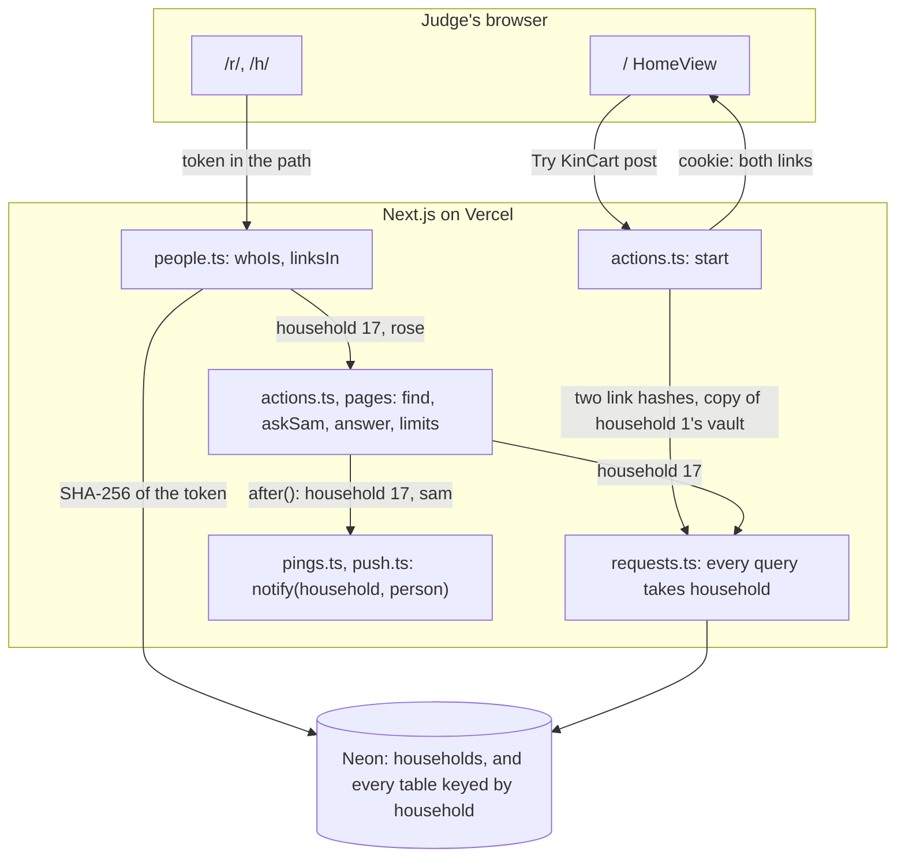
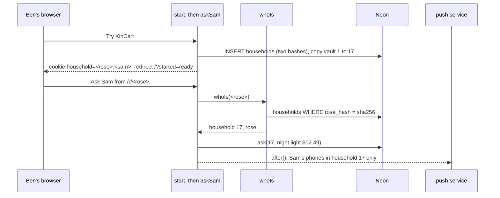
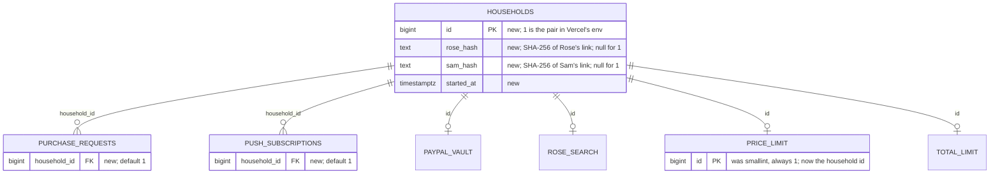

# Households

**Version:** v1 · **Status:** Shipped · **Type:** Feature · **Project type:** Web UI

**Shape doc:** docs/specs/shop-together/shape.md
**Depends on:** basket-cap

Each visitor to kincart.vercel.app starts their own Rose and Sam, with the demo PayPal already linked, and sees only their own asks, limits and phones. It comes before demo-home because judges share one Rose and Sam today, and in production every family is its own household (demo-home O8).

## Problem

Judges get one URL, and today it redirects to `/status` (`app/page.tsx`). Rose's and Sam's pages open only with two secret links, and there is one of each, set in Vercel's env (`lib/shop/people.ts:7`).

Every judge would share that one pair. One judge's waiting ask, $20 total limit or receipt is what the next judge sees. An old judge's phone buzzes for a new judge's ask. In production, every family has its own people, its own saved PayPal and its own phones, and never sees another family's.

## Slice test

| Check                         | Result |
| ----------------------------- | ------ |
| Cuts every layer it needs     | yes: a start button on `/`, a start action, every table split by household, deployed with a migration |
| One e2e test walks it         | yes: Ana starts a household and asks for AA batteries; Ben starts another, asks for a night light, and his Sam pays; Ana's ask is still waiting |
| Worth shipping alone          | yes: a judge with only the URL gets their own KinCart, and no judge spoils another's |
| Fits (≤5 scenarios, ≤2 areas) | yes: 4 scenarios; two areas, the storage and links in `lib/shop` and the pages in `app/(shop)`. Every query in `lib/shop/requests.ts` changes, so it is wide for two areas |

**Path:** full. It adds data and a screen.

## User story

As a hackathon judge with only the URL, I want my own Rose and Sam, so that I try KinCart from a clean start and nobody else's tries get in my way.

## Flow



A judge taps Try KinCart, gets a Rose and a Sam of their own, and plays both; coming back to `/` in the same browser shows that pair again.

## Acceptance criteria

```gherkin
Scenario: A judge starts their own KinCart
  Given a judge with only "kincart.vercel.app"
  When they tap "Try KinCart"
  Then they get a Rose page and a Sam page of their own
  And Rose's page shows "What do you need?" and "Sam's limit is $50 an item.", with no PayPal login
  And Sam's page shows "Nothing to approve"

Scenario: Two judges never see each other's
  Given Ana's household has an ask for AA batteries at $9.99 waiting, a $20 total limit, and Sam's phone with notifications on
  When Ben starts a household, and his Rose asks for a night light at $12.49
  Then within 5 seconds Ben's Sam page shows "Rose would like this" and "OK, pay $12.49"
  And Ana's Sam page still shows the AA batteries
  And Ana's phone gets no buzz
  When Ben's Sam taps "OK, pay $12.49"
  Then both of Ben's pages show the same receipt, and Ana's ask is still waiting

Scenario: A judge comes back to their own
  Given Ana started a household in this browser on Dec 3
  When she opens "kincart.vercel.app" again on Dec 4
  Then she sees her own Rose and Sam again, with the AA batteries still waiting
  When she taps "Start a new one"
  Then she gets a new Rose and Sam, and her old links still open the old ones

Scenario: The first Rose and Sam keep working
  Given the owner's phones hold the Rose and Sam links from before this change, with Rose's PayPal linked, a $30 price limit, a receipt and Sam's phone with notifications on
  When the owner opens either link
  Then it shows the same Rose or Sam, with the $30 limit and the receipt
  And Sam's phone still buzzes when that Rose asks
```

## Scope

**In:**
- A "Try KinCart" button on `/`, in place of the redirect to `/status`. It starts a household: a new Rose link, a new Sam link, and the demo sandbox PayPal already linked. `/status` stays one tap away (D9).
- Every ask, receipt, search, price limit, total limit and saved phone belongs to one household. A link opens only its own household's.
- `/` remembers the household started in this browser and offers "Start a new one" (O3).
- Every household's people are Rose and Sam (O2).
- The two links from before become the first household (O4).

**Out:**
- What KinCart is, in words, and Rose and Sam live side by side on a laptop. `demo-home` picks these up.
- Linking a different PayPal. Every household starts with the demo sandbox PayPal (D20's saved PayPal). No later slice.
- Names other than Rose and Sam (O2). No later slice.
- Sending Sam's link to a second phone (O5). No later slice.
- Ending old households. Judging adds a few hundred rows at most. No later slice.
- Sign-up and logins. The shape's "Not doing" stands.

## Interface

One page at `/`, the phone column on every width. A new visitor sees what KinCart is, the sandbox line and Try KinCart. Once this browser has a household, the same page shows Be Rose, Be Sam and Start a new one. `demo-home` later adds the longer words and the wide layout.



Try KinCart and Start a new one post the same start. The page comes back with a notice at the top that says what happened.

| State | What's on it |
| ----- | ------------ |
| new | the mark at 64px; "KinCart"; lead: "An older shopper buys online with a relative's OK, and no shared passwords."; "**Sandbox money only.** Nothing real is bought."; "You get your own Rose, who asks for things, and Sam, who says OK. Rose's sandbox PayPal is already linked."; Try KinCart (primary); "System status" link |
| starting | Try KinCart becomes "Starting…" with the spinner |
| failed | red notice at the top: "Your Rose and Sam didn't start. Nothing was saved. Try again in a moment."; the rest as before the tap |
| yours | the mark, "KinCart", the lead and the sandbox line; small: "Each opens in a new tab. Come back here to open them again."; Be Rose (primary) and Be Sam (secondary), links that open a new tab; small: "Want a clean start? A new Rose and Sam have nothing asked and no limits. Your old links keep working."; Start a new one (secondary); "System status" link |
| ready | grey notice at the top: "Your Rose and Sam are ready."; then yours |
| restarting | Start a new one becomes "Starting…" with the spinner |
| fresh | grey notice at the top: "Your new Rose and Sam are ready. Tabs you already have open still show the old ones."; then yours |

Checked: no sideways scroll at 320, 390 and 1280px, and light and dark both rendered. The keyboard order is Be Rose, Be Sam, Start a new one, System status. Buttons are 56px high and the link 48px. No new colours: the notices are the neutral and danger tones, and danger is a real failure here.

Craft checks: a one-line "landing page for a demo app" prompt gives a hero, feature cards and a "Get started" button. Here the page states the one thing a judge must know, sandbox money only, and offers one next step. Against Stripe's clarity: each state shows only its next step, and the button says what you get. Against Vercel's restraint: one accent, and hierarchy from type size alone.

**Motion tier:** 1. Nothing new moves: the notices rise and fade like every notice, and "Starting…" turns the spinner.

**Components used:** from the system, Button and Notice, and the `screen`, `heading`, `lead`, `small`, `stack`, `link` and `button` styles. Composed here: `HomeView`, and `.home-mark` in `shop.css` from `space-16`.

**Preview:** http://localhost:3000/preview/households with `pnpm dev`, and `?state=new`, `starting`, `failed`, `ready`, `yours`, `restarting` or `fresh`. It answers 404 in production.

## Technical plan

### Approach

A new `households` table holds one row per household. Household 1 is the pair whose links stay in Vercel's env (D45). Every other household stores only the SHA-256 hashes of its two links. `whoIs(token)` turns a link into a household id and a person. Every page, action and query then takes that household id, and never one from the form.

The four one-row tables keep their `id` column, which now holds the household id, so old code still writes household 1 (D46). `purchase_requests` and `push_subscriptions` gain a `household_id` that defaults to 1. "One open ask" becomes one open ask for each household.

Try KinCart and Start a new one call one server action, `start()`. It makes two random links and saves the household and a copy of household 1's saved PayPal in one statement (D48). It puts both links in an httpOnly cookie, so `/` shows them on the next visit (D44).

Relies on: D10, D11, D12, D16, D19, D20, D23, D28, D29, and the drafted D42 to D49.



A link's hash finds its household, and that household id rides every query and push. The cookie only brings the two links back to `/`.



Ana's household never enters Ben's path: every read and write carries 17, and Ana's phone is in household 16.

### Changes

| File | What changes | Why |
| ---- | ------------ | --- |
| `db/migrations/0002_purchase_requests.up.sql:16` | Remove `purchase_requests_one_open`. `db:up` reruns every file (`scripts/migrate.mjs:2`), so once two households have an open ask, recreating it fails: "could not create unique index" on the scratch run (D49) | 2 |
| `db/migrations/0007_households.up.sql`, `.down.sql` (new) | Up: `households` (`id` identity by default, `rose_hash` and `sam_hash` unique, `started_at`), household 1 inserted. `paypal_vault`, `rose_search`, `price_limit` and `total_limit` drop their `id = 1` check, widen `id` to bigint, and point it at `households`. `purchase_requests` and `push_subscriptions` add `household_id bigint NOT NULL DEFAULT 1`. The old open-ask index goes, and `purchase_requests_one_open_per_household` on `(household_id)` takes its place. Every step is safe to rerun. Down: below | 1 to 4 |
| `scripts/migrate.test.ts:28` | Expects `households` and household 1. Starts household 2, gives households 1 and 2 an open ask each, and reruns up. Down leaves household 1's rows only, and the `id = 1` check refuses a second limit row. Up again | reverse path |
| `lib/shop/people.ts:9` | `whoIs(token, links)` becomes async and gives `{ household, person }` or null. The env links give household 1, compared as now. Any other token is hashed and looked up with `findHousehold`. New `newLink()`: 16 random bytes in base64url. New `hashOf(token)`: SHA-256 hex. New `linksIn(cookie)`: the cookie's two links, only when they open Rose and Sam of one household | 1, 3, 4 |
| `lib/shop/people.test.ts` | Env links give household 1. A started household's links give its id and person. Unknown, cut-off and empty links give null. `linksIn` refuses a cookie with a made-up link, or with links of two households | 1, 3, 4 |
| `lib/shop/requests.ts:61` to `:250` | Every function takes `household` first: `getVault`, `saveVault`, `latest`, `ask`, `getSearch`, `saveSearch`, `clearSearch`, `getLimit`, `setLimit`, `getTotal`, `setTotal`, `decline`, `claim`, `stuck`, `saveSubscription`, `subscriptionsFor`. One-row tables read `WHERE id = $1` and write `VALUES ($1, …)`. `decline` and `claim` also need `household_id` to match, so Sam of one household cannot answer another's ask. `PurchaseRequest` gains `household`. New `startHousehold(roseHash, samHash)`: one statement that inserts the household and copies household 1's `paypal_vault` row. New `findHousehold(hash)` | 1, 2 |
| `lib/shop/requests.test.ts:44` | The reset also deletes households other than 1, after their rows. Every call passes household 1. New tests: two households keep apart their asks, searches, limits, totals, vaults and phones; an open ask in one does not stop an ask in the other; `claim` and `decline` from the wrong household give null; a new household has household 1's vault, or none when household 1 has none | 1, 2 |
| `lib/shop/pay.ts:21` | `settleStuck(household)` settles that household's stuck charge only | 2 |
| `lib/shop/push.ts:32` | `notify(household, person, ping)` reads `subscriptionsFor(household, person)`. Logs `push household=17 to=sam phones=1 sent=1 gone=0 failed=0` | 2 |
| `app/(shop)/pings.ts:58` | `sendPing(household, kind, subject)`. `sendPayment(result, request)` takes the household from the request | 2 |
| `app/(shop)/actions.ts` | Each action awaits `whoIs(token)` and passes `who.household` on. New `start()`: notes whether the cookie was there, makes two links, calls `startHousehold`, sets the `household` cookie (httpOnly, secure, SameSite Lax, path `/`, 90 days), logs `household id=17 status=started`, and redirects to `/?started=ready`, or `fresh` when a cookie was there. A database error logs `household status=failed reason=…` and redirects to `/?started=failed` | 1, 2, 3 |
| `app/(shop)/actions.test.ts:46` | The reset also deletes other households. New tests below | 1, 2, 3 |
| `app/(shop)/r/[token]/page.tsx:29`, `h/[token]/page.tsx:25`, `r/[token]/linked/route.ts:9`, `manifest/[token]/route.ts:6` | Await `whoIs`, and pass the household to every read, to `settleStuck` and to `saveVault` | 1, 2, 4 |
| `app/page.tsx` | Deleted, with its redirect to `/status` | 1: `app/(shop)/page.tsx` is `/` too |
| `app/(shop)/page.tsx` (new) | The home page, titled "KinCart". Reads the `household` cookie through `linksIn`, and `?started=`. Renders `HomeView` with the links, or with none, and `start` | 1, 3 |
| `app/(shop)/HomeView.tsx`, `preview/households/page.tsx`, `.home-mark` in `shop.css` | As built at pause 2 | 1, 3 |
| `e2e/db.ts:14` | `reset()` also deletes households other than 1, after their rows | 1 to 4 |
| `e2e/households.spec.ts` (new) | The e2e below | 1, 2, 3 |

Also changed for the new signatures: `app/(shop)/state.test.ts`, `app/(shop)/r/[token]/linked/route.test.ts` and `lib/shop/pay.test.ts`.

No change: `public/sw.js` (a push still opens its own scope's link), `NotifyControl.tsx`, `state.ts`, `RoseView.tsx`, `SamView.tsx`, `find.ts`, `paypal.ts`, `.github/workflows/ci.yml` (CI's env links are household 1), `package.json`.

Reusing: `query()`, `matches()` in `people.ts`, `settleStuck()`, the `startLink` cookie options, `Button`, `Notice`, `reset()` and `sql()` in `e2e/db.ts`, and Node's `crypto` (`randomBytes`, `createHash`, `timingSafeEqual`).

### Data



Each household has many asks and phones, and at most one vault, search, price limit and total limit. `paypal_vault`, `rose_search` and `total_limit` change like `price_limit`.

**Migration:** expand, then switch. The expand needs no backfill: the `DEFAULT 1` columns fill every existing row with household 1, and the one-row tables' rows already have `id` 1. Old code keeps working on the expanded schema. On the scratch run, its upsert on `id` and its insert with no household both landed in household 1. CI runs it on Neon after tests pass on main (D11), and before Vercel promotes the new code (D10). Contract, in a later slice if ever: drop the two `DEFAULT 1`s and rename the one-row tables' `id` to `household_id`.

**Reverse:** `0007_households.down.sql` deletes every row of every household but 1, then household 2 onward. It puts back the `id = 1` checks, the smallint `id`s and the single open-ask index. It drops `household_id` and `households`. Every household but the first is lost (O7). The order matters, because `db:down` runs the highest-numbered down file:

1. Promote the previous deploy on Vercel.
2. Run `pnpm db:down` against Neon while `0007_households.down.sql` is still on main.
3. Revert the merge on main.

`scripts/migrate.test.ts` checks up, rerun, down and up.

### Earn-it

| Added | Triggered by |
| ----- | ------------ |
| `households` table, `startHousehold`, `findHousehold` | Scenarios 1 and 2 (D42) |
| A household on every query, and `household_id` on two tables | Scenario 2 |
| The per-household open-ask index, and 0002 losing the global one | Scenario 2: Ana and Ben each have an ask waiting, and `db:up` must still rerun (D49) |
| Hashed links (`hashOf`) | O6: a leaked table must not hand out links (D47) |
| The `household` cookie and `linksIn` | Scenario 3 (D44) |
| Copying household 1's vault | Scenario 1: no PayPal login (D48) |
| `household_id` in `claim` and `decline` | Security: a request id bound into a server action reaches the browser, so a changed id must not answer another household's ask |
| `household id=… status=started` and `push household=…` log lines | Proof it works in prod |

Cut: a flag (old code works on the new schema, and the feature is the home page), names other than Rose and Sam (D43), ending old households (out of scope), and a per-household index on `purchase_requests` beyond the open-ask one (a few hundred rows).

### Non-functionals

|                      |                                                                               |
| -------------------- | ----------------------------------------------------------------------------- |
| **Load**             | Judging runs Dec 1 to 15, so tens of households, a few hundred at most. Each page render of a started household adds one lookup on a unique index. Household 1 skips it |
| **Breaks first**     | Channel3's 1,000 searches a month, shared by every household (O1). Then Neon connections, as every query opens its own client (`requests.ts:252`). Not measured |
| **Security surface** | Anyone can post `start()` from `/`. Each household opens only with its links, 128 random bits each, and the database keeps only their SHA-256 hashes. The cookie is httpOnly, secure and SameSite Lax. The household always comes from the link, never the form, and `claim` and `decline` check it too. No new secrets: household 1's links stay in Vercel's env. New stored data: two hashes and a start time a household, plus each household's asks, searches, limits and phones as now. Link tokens never go in a log line |
| **Proof it works**   | In Vercel's log: `household id=17 status=started`, then `push household=17 to=sam phones=1 sent=1 gone=0 failed=0` on that household's ask |
| **Rollout**          | No flag. CI migrates Neon after tests on main (D11), and Vercel promotes after that (D10). Before judging, check that household 1's Rose page does not say "Link your PayPal to start", because every new household copies it. Rollback: the three steps under Reverse |

### Test plan

| Scenario | Test | Command |
| -------- | ---- | ------- |
| 1 A judge starts their own | `actions.test.ts`: `start()` saves a household with two hashes and household 1's vault, sets the cookie with both links, and redirects to `/?started=ready`. With the cookie there already, it redirects to `/?started=fresh`. With the database down, it redirects to `/?started=failed` and saves nothing. `people.test.ts`: a started household's links give its id. `requests.test.ts`: the vault copy, with and without household 1's vault. The e2e below | `pnpm test`, `pnpm test:e2e` |
| 2 Never see each other's | `requests.test.ts`: the two-household tests. `actions.test.ts`: Ben's Ask Sam calls `notify(ben, "sam", …)` only. Ben's Sam answering Ana's request id leaves it waiting. `push.test.ts`: `notify` for Ben's household never sends to Ana's endpoint. The e2e below | `pnpm test`, `pnpm test:e2e` |
| 3 Comes back | `people.test.ts`: `linksIn` refusals. The e2e below | `pnpm test`, `pnpm test:e2e` |
| 4 The first pair keeps working | `scripts/migrate.test.ts`: rows from before 0007 are household 1's. `people.test.ts`: env links give household 1. Every existing e2e file passes unchanged on CI's env links: `approve-and-pay`, `find-and-explain`, `ping-helper` (Sam's phone still buzzes), `basket` and `basket-cap` | `pnpm test`, `pnpm test:e2e` |

**E2E:** `e2e/households.spec.ts`, test "two judges each get their own KinCart", at 390 by 844 with two browser contexts.

1. `reset()` saves household 1's PayPal.
2. Ana opens `/`, taps Try KinCart and sees "Your Rose and Sam are ready.".
3. `sql()` gives Ana's newest household a search with AA batteries at $9.99. Ana's Rose picks it and taps Ask Sam, and sees "Waiting for Sam".
4. Ben, in a new context, opens `/` and sees Try KinCart, not Ana's pair. He starts his own, and `sql()` gives it a night light at $12.49.
5. Ben's Rose asks. Within 5 s, Ben's Sam shows "Rose would like this" and "OK, pay $12.49". Ben taps it.
6. Ben's Sam shows "Paid from Rose's PayPal", and Ben's Rose shows "Sam said OK. It's paid." with the same PayPal transaction. Ana's Sam still shows "Rose would like this" and the AA batteries.
7. Ana opens `/` again in her context and sees the same Be Rose link. She taps Start a new one and sees "Your new Rose and Sam are ready. Tabs you already have open still show the old ones.". The new links differ, and her old Rose link still shows "Waiting for Sam".

It makes one real sandbox charge (D20), and no Channel3 or Claude call. Stop `pnpm dev` before running it, and run `next typegen` after adding `app/(shop)/page.tsx`.

### Chunks

Single chunk. The household argument runs through every file, and every test shares the local database.

### Risks

| Risk | Mitigation |
| ---- | ---------- |
| A query reads or writes without its household, and lands in household 1 | Every function takes the household as a required first argument, so `tsc` fails on a missed call. The two-household tests and the e2e check every table |
| A later `db:up` fails on a global open-ask index | 0002 loses it (D49). `migrate.test.ts` reruns up with two open asks |
| Rolling back deletes every household but the first | O7 |
| Household 1 has no saved PayPal on the live site | New households then start at "Link your PayPal to start". Each household's link flow still saves to its own vault. Check before judging |
| Two households charge the one sandbox buyer at the same moment | Each charge has its own PayPal-Request-Id from its purchase id. Not tried at the same moment |
| A judge loses the cookie, by clearing it or by changing browser | Their links go with it, and they start a new one. Nothing else is lost for anyone |
| Find from every household shares Channel3's quota | O1, accepted |

### Decisions to record

Recorded as D42, D43, D44, D45, D46, D47, D48 and D49.

## Review

2026-10-15 · 1 raw finding, 0 survived. Clean.

## Open items

| ID | What | Type | Raised at | Owner | Status | Answer |
| -- | ---- | ---- | --------- | ----- | ------ | ------ |
| O1 | Any visitor can start a household and run Find. Each Find calls Channel3 and Claude Haiku. Channel3's free tier is 1,000 searches a month, and a 5-thing basket uses up to 10. A stranger in a loop spends on both keys and can use up the quota during judging (from shape O11) | flag | spec p1 | user | Accepted risk | Abuse needs someone scripting form posts. Before Dec 1, set a spend limit on the Anthropic workspace and check Channel3's quota. A cap on Finds was turned down. Agreed 2026-10-15 |
| O2 | Every household's two people are called Rose and Sam, as in the video and every message. In production the family would type its own names | question | spec p1 | user | Resolved | Always Rose and Sam. Typed names were turned down: one more form before a judge can try it (D43). 2026-10-15 |
| O3 | Whether `/` remembers the household started in this browser, so a judge who closes the tabs gets back to their own Rose and Sam | question | spec p1 | user | Resolved | Yes. This browser remembers its household, and `/` shows Your Rose, Your Sam and Start a new one (D44). 2026-10-15 |
| O4 | What happens to the two links from before: the owner's phones, their Home Screen icons, Rose's PayPal, the receipts and Sam's saved phone | question | spec p1 | user | Resolved | They become household 1 and keep working with all their data, and CI's fixed links do too (D45). 2026-10-15 |
| O5 | Sending Sam's link to a second phone. Approving from your own phone is the product's point, but a judge on a laptop gets both links in one browser | question | spec p1 | user | Resolved | Not in this slice. A judge plays both in one browser, demo-home shows them side by side, and the video shows two real phones. 2026-10-15 |
| O6 | Whether the database keeps each household's links in plain text, or only their SHA-256 hashes. Hashes mean a leaked table hands out no links, at a cost of about three lines. The cookie still brings the links back to `/` | question | spec p3 | user | Resolved | Hashes only. Plain text was turned down: a leaked table would give every judge's links (D47). 2026-10-15 |
| O7 | Rolling back this slice deletes every household but the first, with their asks, receipts, limits and phones. Judges then start again | flag | spec p3 | user | Accepted risk | Rollback is for a broken deploy, the data is sandbox only, and a judge starts again with one tap. Keeping it in a side table was turned down. Agreed 2026-10-15 |

_Never delete this section or its rows. See references/ledger.md._

## Glossary

- **Household**: one Rose and one Sam with their own links, PayPal, asks, limits and phones. In production, one family.
- **Sandbox**: PayPal's test environment. Fake accounts, fake money, real API.
- **Vault**: PayPal's store for a saved payment method. Rose approves once, and the app charges later with no login.
- **e2e**: end-to-end, one test that walks the whole slice as a user would.
- **SHA-256 hash**: a fixed-length fingerprint of a value. The database can check a link against it, but cannot turn it back into the link.
- **httpOnly cookie**: a cookie the browser sends with each request, but the page's JavaScript cannot read.
- **Expand, then switch**: change a schema by first adding what new code needs, while old code still works, then moving the code over. Removing the old parts ("contract") comes later.
- **Backfill**: filling a new column from data already there, before the code reads it.
