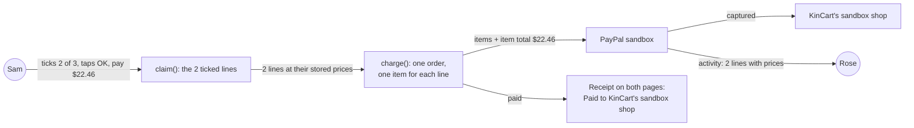
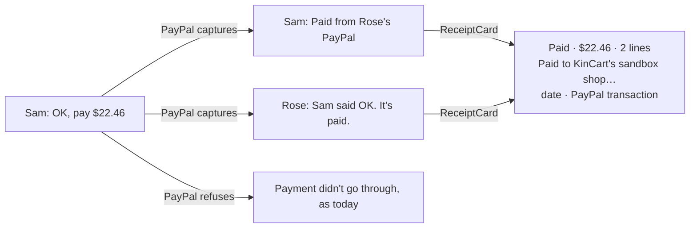

# Itemized receipt

**Version:** v1 · **Status:** Draft · **Type:** Enhancement · **Project type:** Web UI

**Shape doc:** docs/specs/after-review/shape.md
**Depends on:** None
**Page:** none. Skipped: you read the `.md` directly.

Rose's PayPal activity lists each thing Sam paid for, with its price, and KinCart's receipt says who got the money. It comes first because it is the smallest change, and PayPal judges see it in the sandbox.

## Problem

A basket charge reaches PayPal as one line. `charge()` at `lib/shop/paypal.ts:69` sends one purchase unit with `description: item.name`, and for a basket `claim()` sets that name to "2 things" (`lib/shop/requests.ts:318`). So Rose's PayPal activity says "2 things, $22.46", and a judge who opens it can't see what was bought. D33 chose this, because no scenario then needed line items.

KinCart's own receipt lists every line, but it doesn't say who got the money. In sandbox it is KinCart's sandbox business account, and the shop never sees an order. A judge can read the receipt as "walmart.com was paid".

## Slice test

| Check                         | Result |
| ----------------------------- | ------ |
| Cuts every layer it needs     | yes: the PayPal order that `charge()` sends, and the receipt card on Rose's and Sam's pages |
| One e2e test walks it         | yes: the basket e2e pays two things, reads the order back from PayPal, and checks both receipts |
| Worth shipping alone          | yes: Rose's PayPal activity shows what was bought, and the receipt says plainly who was paid |
| Fits (≤5 scenarios, ≤2 areas) | yes: 4 scenarios, in the PayPal call in `lib/shop/` and the receipt card in `app/(shop)/` |

**Path:** full. It changes the PayPal order every payment sends, and the receipt that both pages show.

## User story

As Sam, I want Rose's PayPal activity to list each thing I paid for, so that either of us can check a charge against what was bought.

## Flow



Sam's OK sends one PayPal order with one item for each ticked line, so Rose's PayPal activity lists them, and both receipts say the money went to KinCart's sandbox shop.

## Acceptance criteria

```gherkin
Scenario: Sam pays two of three things, and PayPal lists the two
  Given Rose asked for "AA batteries, a night light and a phone charger"
  And Rose picked "Energizer MAX AA Batteries, 8 Pack" at $9.47 from walmart.com
  And Rose picked "LED Plug-in Night Light, Dusk to Dawn Sensor, 2 Pack" at $12.99 from amazon.com
  And Rose picked "Anker 20W USB-C Wall Charger" at $14.99 from target.com
  When Sam unticks the charger and taps "OK, pay $22.46"
  Then PayPal's order has 2 items: the batteries at $9.47 and the night light at $12.99, each quantity 1
  And the order's item total and amount are both $22.46
  And Rose's PayPal activity for the payment lists both things with their prices
  And Rose's and Sam's receipts say "Paid to KinCart's sandbox shop. In this demo, no order reaches the shops."

Scenario: A one-thing ask lists its one thing
  Given Rose asked for "a magnifying glass" and picked "Fancii 3X Large Magnifying Glass with Light" at $16.99 from amazon.com
  When Sam taps "OK, pay $16.99"
  Then PayPal's order has 1 item: the magnifying glass at $16.99, quantity 1
  And the receipt says "Paid to KinCart's sandbox shop. In this demo, no order reaches the shops."

Scenario: A long listing name is cut to fit PayPal
  Given Rose picked a listing whose name is 160 characters long, at $8.99
  When Sam taps "OK, pay $8.99"
  Then the payment goes through
  And PayPal's item name is the listing's first 126 characters followed by "…"
  And KinCart's receipt still shows the full name

Scenario: PayPal refuses the order
  Given Rose's saved PayPal can't pay, and PayPal refuses the order with its items
  When Sam taps "OK, pay $22.46"
  Then Sam sees "Payment didn't go through" and "Nothing was taken from Rose's PayPal for the 2 things", as today
  And Rose sees "Payment didn't go through. Nothing was taken."
  And KinCart sends no second order without the items
```

## Scope

**In:**

- Every charge sends its things to PayPal as items: a basket's ticked lines, a one-thing ask, and the three fixed items.
- Each item has the listing's name, its price, and quantity 1. The order carries an item total equal to the amount.
- The receipt card on Rose's and Sam's pages says who got the money. It shows on receipts from before this ships too, because the same account got that money.

**Out:**

- Each shop paid from its own PayPal, and each shop's name on its PayPal lines. `pay-the-shop` picks these up.
- A link from KinCart's receipt to Rose's PayPal activity. No later slice.
- Tax and shipping lines. No later slice. KinCart charges the listed price only.

## Interface

The receipt card gains one line under the things and their prices: "Paid to KinCart's sandbox shop. In this demo, no order reaches the shops." `ReceiptCard` is shared, so Rose's paid screen and Sam's paid screen both show it. Nothing else on either page changes, and Sam's OK screen stays as it is (O4).



Both paid screens draw the same receipt card with the new line, and a refused payment shows today's screens unchanged.

The PayPal side has no screen in KinCart. Its contract is the order that `charge()` sends: one item for each thing, each with the listing's name, its price and quantity 1, and an item total equal to the amount.

**Motion tier:** 0. The line adds no motion. The receipt keeps its existing `enter` animation.

**Components used:** `ReceiptCard`, `LineItems` and the `receipt-detail` text style, from `app/(shop)/ui.tsx` and `app/(shop)/shop.css` on the tokens in `docs/design/design-system/`.

**Preview:** `/preview/itemized-receipt` under `pnpm dev` (`app/(shop)/preview/itemized-receipt/page.tsx`). It shows Rose's and Sam's paid screens for scenarios 1 to 3, and the refused payment for scenario 4. The line is built into `ReceiptCard` at `app/(shop)/ui.tsx:74`.

## Open items

| ID | What | Type | Raised at | Owner | Status | Answer |
| -- | ---- | ---- | --------- | ----- | ------ | ------ |
| O1 | Line items reverse D33, which rejected them. PayPal refuses an order when the item amounts don't add up to the total (from shape O11) | flag | shape | user | Resolved | Supersede D33. The item total is built from the same stored cents as the items, so they add up. A refusal shows as today's failed payment, with no retry. 2026-10-22 |
| O2 | What each PayPal line says: the listing's name, Rose's own word for it, or the name and its shop | question | spec p1 | user | Resolved | The listing's name, cut to fit PayPal's limit. The shop is left out, so nobody reads it as the shop got paid. 2026-10-22 |
| O3 | What KinCart's receipt says about who got the money | question | spec p1 | user | Resolved | "Paid to KinCart's sandbox shop. In this demo, no order reaches the shops." It is true until `pay-the-shop` ships, and that slice swaps it for each shop's name (D82). 2026-10-22 |
| O4 | Whether Sam also sees who gets the money before tapping OK, or only on the receipt | question | spec p1 | user | Resolved | The receipt only. Sam's OK screen stays as it is. 2026-10-22 |
| O5 | PayPal's sandbox activity page shows the item lines for a saved-PayPal charge, and the name it shows as the payee is unknown | unproven | spec p1 | build | Accepted risk | `/build` makes the first itemized charge and checks the demo buyer's activity page by hand. If PayPal doesn't show the lines, scenario 1 drops that step. The e2e reads the items back from PayPal's API either way. 2026-10-22 |

_Never delete this section or its rows. See references/ledger.md._

## Glossary

- **Line items** — the `items` list in a PayPal order, with a name, price and quantity for each thing. PayPal shows them on the payer's activity.
- **Item total** — the `breakdown.item_total` in a PayPal order. PayPal refuses the order when it isn't the sum of the items.
- **Purchase unit** — one payment inside a PayPal order, with its amount and payee. KinCart sends one for each charge.
- **Payee** — the PayPal account that receives the money.
- **Sandbox** — PayPal's test system. Its accounts and money aren't real.
- **/poc** — zuko's timeboxed spike. It answers one risky question with throwaway code.
- **e2e** — end to end: an automated test that drives the app the way a person would, start to finish.
