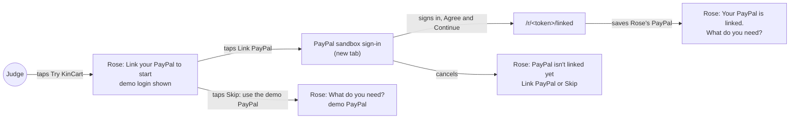
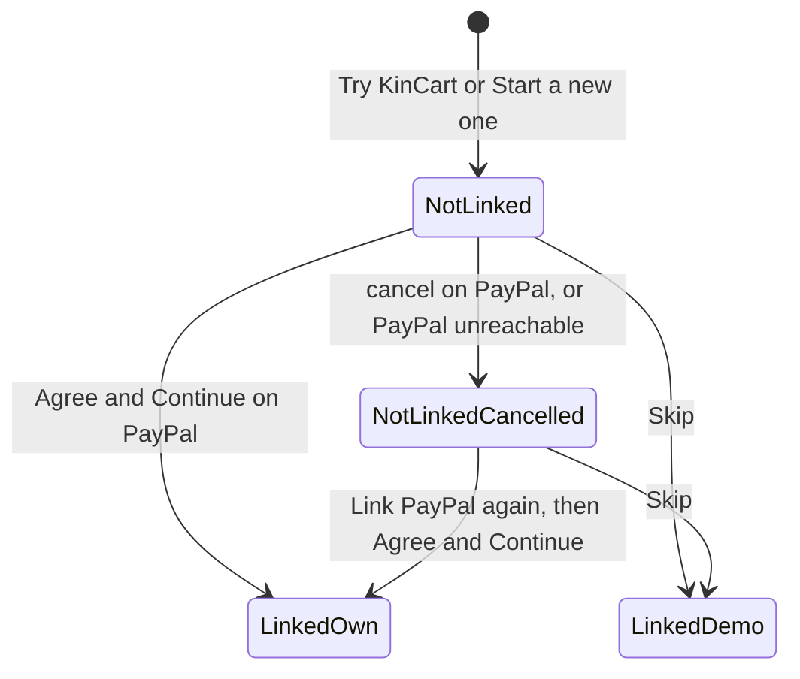
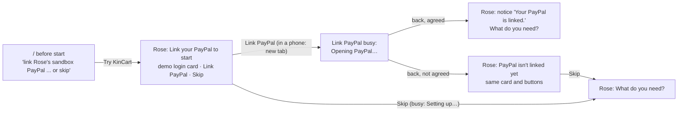
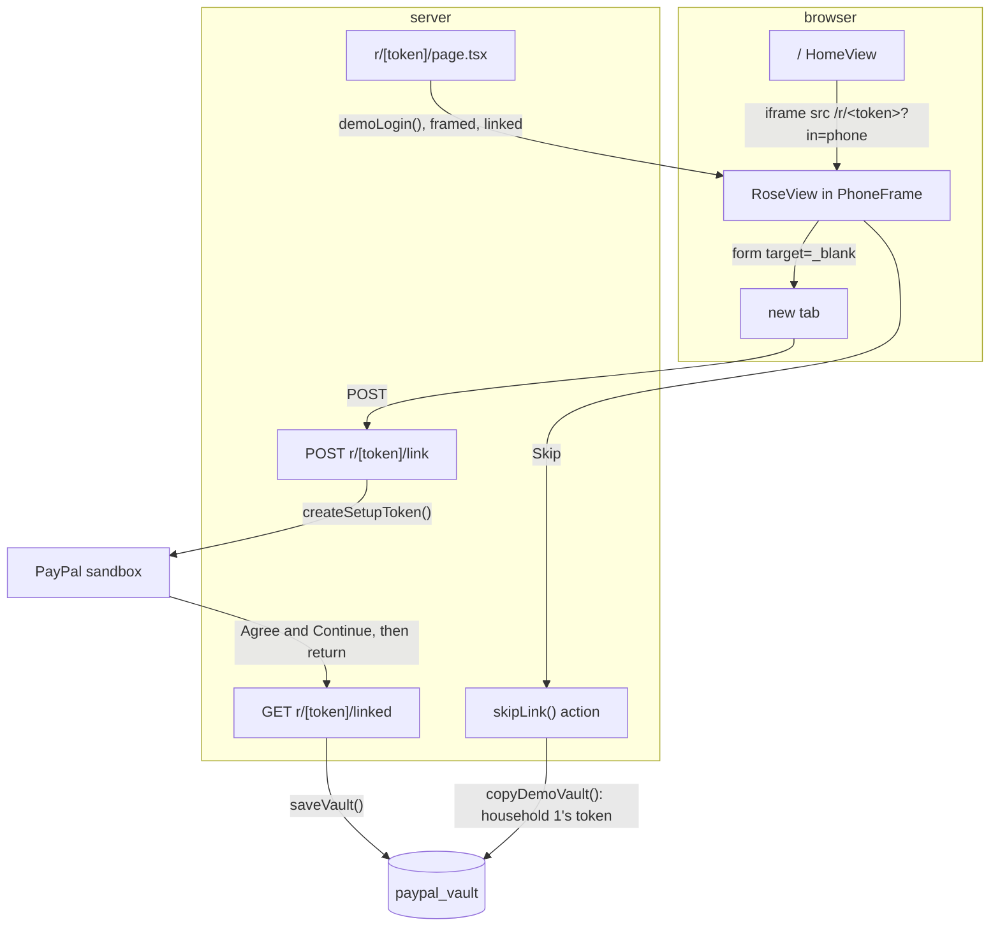
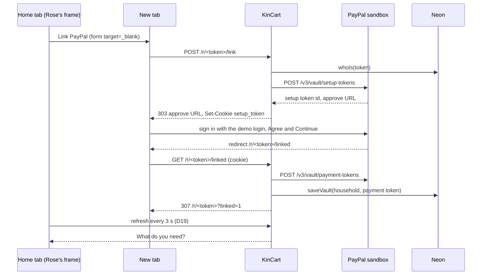

# Link PayPal onboarding

**Version:** v1 · **Status:** Draft · **Type:** Feature · **Project type:** Web UI

**Shape doc:** docs/specs/shop-together/shape.md
**Depends on:** households

A judge's new Rose starts at Link PayPal, with a demo sandbox login on screen and a Skip button under it. It comes now because a friend who tried v1.1.0 on 2026-10-15 could not see where PayPal comes in, and this is a PayPal hackathon.

## Problem

Judges never see PayPal. Since households, each new household starts with a copy of household 1's saved PayPal (D48). The home page says "Rose's sandbox PayPal is already linked." (`app/(shop)/HomeView.tsx:95`). The only PayPal a judge sees is a transaction id on the receipt.

The Link PayPal flow is built: `startLink()` (`app/(shop)/actions.ts:52`) sends Rose to PayPal's approval page, and `app/(shop)/r/[token]/linked/route.ts` saves the PayPal on return. No judge reaches it, because every new household is already linked.

It would also fail on a laptop today. Rose's page on `/` sits in a frame (`app/(shop)/ui.tsx:199`), and PayPal's sign-in page refuses to load in a frame (`x-frame-options: SAMEORIGIN`, checked 2026-10-15).

## Slice test

| Check                         | Result |
| ----------------------------- | ------ |
| Cuts every layer it needs     | yes: the home page words, Rose's link screen, the start and skip actions, and the saved PayPal row |
| One e2e test walks it         | yes, up to PayPal's sign-in page: Try KinCart, the link screen with the login, Link PayPal opens PayPal in a new tab, then Skip and an ask. Signing in on PayPal's page stays out of CI (D20). A route test with PayPal stubbed and one run on the live site cover that part |
| Worth shipping alone          | yes: a judge sees PayPal's own approval page and links a PayPal in under a minute |
| Fits (≤5 scenarios, ≤2 areas) | yes: 5 scenarios, in the home page and Rose's page |

**Path:** full. It adds new UI (the login box and Skip) and changes how a household starts.

## User story

As a judge trying KinCart, I want to link Rose's PayPal myself on PayPal's own page, so that I can see how KinCart uses PayPal.

## Flow



The judge starts at Link PayPal, signs in on PayPal's page in a new tab and comes back linked, or skips and pays from the demo PayPal as today.

## States



## Acceptance criteria

```gherkin
Scenario: A judge's new Rose starts at Link PayPal
  Given a judge opens kincart.vercel.app on a 1440px-wide laptop, with no household in this browser
  When the judge taps Try KinCart
  Then Rose's phone shows "Link your PayPal to start"
  And it shows the demo sandbox login, such as "sb-rose-demo@personal.example.com", and its password
  And it shows a "Link PayPal" button and a "Skip: use the demo PayPal" button
  And Sam's phone shows "Nothing to approve"

Scenario: The judge links Rose's PayPal on PayPal's own page
  Given Rose's phone on the home page shows "Link your PayPal to start"
  When the judge taps Link PayPal
  Then PayPal's sandbox sign-in page opens in a new tab
  When the judge signs in with the demo login and taps "Agree and Continue"
  Then that tab shows Rose's page with "Your PayPal is linked." above "What do you need?"
  And within 3 seconds Rose's phone on the home page shows "What do you need?"
  And Sam's OK on Rose's $8.79 ask for AA batteries charges the PayPal that the judge linked

Scenario: The judge skips linking
  Given Rose's phone shows "Link your PayPal to start"
  When the judge taps "Skip: use the demo PayPal"
  Then Rose's phone shows "What do you need?"
  And Sam's OK on Rose's $8.79 ask for AA batteries charges the demo PayPal, as it does today

Scenario: The judge leaves PayPal without agreeing, or PayPal can't be reached
  Given the judge tapped Link PayPal
  When the judge cancels on PayPal's page, or KinCart can't start the link with PayPal
  Then Rose's page shows "PayPal isn't linked yet" and "Nothing was saved."
  And it still shows the demo login, "Link PayPal" and "Skip: use the demo PayPal"

Scenario: Households started before this change keep their PayPal
  Given household 1, and a household that a judge started on 2026-10-15, each have a saved PayPal
  When Rose opens Rose's page in either one
  Then Rose's page shows "What do you need?" with no link step, as it does today
```

## Scope

**In:**

- New households, from Try KinCart and Start a new one, start with no saved PayPal.
- Rose's link screen shows the demo sandbox login and a Skip button. The "isn't linked yet" screen shows them too.
- Skip saves a copy of household 1's PayPal for this household, as a new household gets today.
- From the home page's phone, PayPal opens outside the frame.
- A one-time "Your PayPal is linked." after Rose comes back from PayPal.
- The home page words that say Rose's PayPal is already linked.

**Out:**

- Showing which PayPal account is linked, or unlinking it. Not planned.
- Asking with a photo. Later slice `photo-ask`.
- Delivery tracking after payment. On the roadmap (`docs/ROADMAP.md`), after a real order exists.
- A new video scene for the link step. Separate work on `feat/demo-video` (O4).
- Signing in on PayPal's page in the e2e. D20 rejects it.
- The roadmap's "One demo PayPal, copied" row. `/ship` updates it.

## Interface



Rose's first screen holds the demo login card above Link PayPal. PayPal either sends Rose back linked, with a notice above "What do you need?", or not linked, to the same screen under a new heading.

Screens, all in `app/(shop)/RoseView.tsx` unless named:

- **Link screen.** The heading and lead stay as today. Under them is a card titled "Sign in on PayPal with this demo login", with the email and the password as a list. One click selects a whole value, ready to copy. A line says "It's a PayPal sandbox account. No real money moves." Then Link PayPal (primary) and "Skip: use the demo PayPal" (secondary). With no login in the env, the card is left out.
- **Inside a home page phone.** The same screen, with "PayPal opens in a new tab. Come back here when you're done." under Link PayPal.
- **Busy.** Link PayPal shows "Opening PayPal…" with the spinner, as today. Skip shows "Setting up…".
- **Not linked yet.** The heading is "PayPal isn't linked yet", and the lead is "Nothing was saved. Link it when you're ready. You only do this once." The card and both buttons stay.
- **Linked.** A neutral notice "Your PayPal is linked. You won't need to do this again." above "What do you need?", once, on the return from PayPal.
- **Home page** (`app/(shop)/HomeView.tsx`). Before a start: "First, link Rose's sandbox PayPal on PayPal's own page, or skip to a demo one." After a start: "Link Rose's PayPal or skip it. Then ask for something as Rose, and say OK as Sam."

The demo login's email may wrap only before its `@`. The part before `@` and the part from `@` on each stay on one line. PayPal makes sandbox emails as `sb-<random>@personal.example.com`. In the preview, a hyphen let the browser put "sb-rose-" on a line by itself, and that looked like the whole email. (Changed at pause 3. Pause 2 asked the owner for a short email with no hyphen, and PayPal may not allow that choice.)

**Motion tier:** 1. Nothing new moves. The notice uses the existing enter animation, and the buttons use the existing spinner.

**Components used:** `Button` (primary, secondary), `Notice` (neutral), `PageHead`, `PhoneFrame`, the `summary` surface with `summary-title`, and `heading`, `lead`, `small`, `stack`. One new class, `login`, lays the summary surface out as a list of label and value. It uses only existing tokens.

**Design system:** `docs/design/design-system/` (D15). This slice adds no token.

**Preview:** `/preview/link-paypal-onboarding` on `pnpm dev`, built from the real components (`app/(shop)/preview/link-paypal-onboarding/page.tsx`). The home page words show at `/`.

## Technical plan

### Approach

A new household starts with no saved PayPal. Rose's page reads the demo login from the env and shows it on the link screen. Skip is a new server action that copies household 1's saved PayPal into the household, as `startHousehold()` does today. Inside a home page phone, the frame's address carries `?in=phone`. Link PayPal there is a plain form that posts to a new route, `POST /r/<token>/link`, with `target="_blank"`. The route makes the PayPal setup token, sets the cookie, and sends the new tab to PayPal with a 303. The return route already saves the PayPal. It now adds `?linked=1`, so Rose's page shows the one-time notice.

Relies on: D16, D17, D19, D20, D42, D44, D47, D52, D53, D58, D59, D60, D61, D62



The frame posts Link PayPal into a new tab, which goes to PayPal and back to the return route, and that saves the vault. Skip copies household 1's vault row instead.



The new tab does the PayPal round trip, and the home tab picks up the saved PayPal on its next 3 s refresh.

### Changes

| File | What changes | Why |
| ---- | ------------ | --- |
| `lib/shop/requests.ts:67` | `startHousehold()` drops the `vault` step and inserts only the household. A new `copyDemoVault(household)` after `saveVault()` (`:96`) runs `INSERT … SELECT … FROM paypal_vault WHERE id = 1 ON CONFLICT (id) DO NOTHING`, and returns whether it copied a row | Scenarios 1, 3 (D58). `DO NOTHING` keeps a PayPal the judge already linked in another tab |
| `lib/shop/paypal.ts` | `demoLogin()` reads `PAYPAL_DEMO_EMAIL` and `PAYPAL_DEMO_PASSWORD`, and returns nothing if either is empty. `DemoLogin` moves here from `RoseView.tsx` | Scenario 1 (D62), in the style of `searchOn()` and `pushOn()` |
| `app/(shop)/paypalLink.ts` (new) | `beginLink(token)` holds `startLink()`'s body from `app/(shop)/actions.ts:52`: the Rose check, `createSetupToken()`, the `setup_token` cookie and the log line. It returns the address to send Rose to: PayPal's, `?cancelled=1`, or none for a link that isn't Rose's. It is not a `"use server"` file, so it is not callable from the browser | Scenarios 2, 4. One copy of the cookie settings for both ways in |
| `app/(shop)/actions.ts:52` | `startLink()` becomes `redirect(await beginLink(token))`. A new `skipLink(token)` checks for Rose, calls `copyDemoVault()`, logs `paypal skip household=<n> status=copied` or `status=failed`, and redirects to `/r/<token>` | Scenario 3 |
| `app/(shop)/r/[token]/link/route.ts` (new) | `POST` calls `beginLink()`. It answers 404 for no address and `NextResponse.redirect(address, 303)` otherwise. 303, so the new tab goes to PayPal with a GET | Scenario 2: a server action's redirect stays inside the frame (D61) |
| `app/(shop)/r/[token]/linked/route.ts:12` | The success redirect adds `?linked=1` | Scenario 2's notice |
| `app/(shop)/state.ts:18` | `RoseParams` gets `linked`. The `ask` state carries `linked: true` when it is set | Scenario 2 |
| `app/(shop)/r/[token]/page.tsx:33` | Reads `in` and `linked` from the query. Passes `skip`, `login={demoLogin()}`, and `framedLink="/r/<token>/link"` when `in=phone` | Scenarios 1, 2 |
| `app/(shop)/RoseView.tsx:76` | `framed` becomes `framedLink?: string`. With it, Link PayPal is `<form method="post" action={framedLink} target="_blank">` with the hint. Without it, the server action form stays as it is, with its busy state. The email renders as two `white-space: nowrap` parts with a `<wbr>` before `@` | Scenarios 1, 2, and the Interface's email rule |
| `app/(shop)/shop.css` | One `nowrap` rule for the email parts | The Interface's email rule |
| `app/(shop)/ui.tsx:199` | `PhoneFrame`'s iframe `src` gets `?in=phone`. The "Open … page" link keeps the bare address | Scenario 2 (D61) |
| `app/(shop)/preview/link-paypal-onboarding/page.tsx` | `framed` becomes `framedLink`, and the sample email becomes a PayPal-style `sb-` address | The preview matches the code |
| `.env.example` | `PAYPAL_DEMO_EMAIL=` and `PAYPAL_DEMO_PASSWORD=`, with one comment line | D62 |
| `.github/workflows/ci.yml:34` | Fake values for the two settings, beside `ROSE_LINK_TOKEN`. CI never signs in on PayPal (D20) | The e2e checks the card |

Reusing: `whoIs()`, `createSetupToken()`, `createPaymentToken()`, `saveVault()`, `getVault()`, `Button`, `Notice`, the `?cancelled=1` pattern for `?linked=1`, the `notFound()`-style Rose check, and `reset()` and `sql()` from `e2e/db.ts`.

No schema change. `paypal_vault` keeps its rows. Households started before this ship keep their copy (scenario 5).

### Earn-it

| Added | Triggered by |
| ----- | ------------ |
| `POST /r/<token>/link` | Scenario 2. PayPal refuses frames, and a server action's redirect runs inside the frame |
| `beginLink()` in its own file | The route and `startLink()` both set the same cookie. A `"use server"` file would expose an exported helper to the browser |
| `?in=phone` on the frame's address | Scenario 2. The page must know at render that it is in a frame, and the 3 s refresh keeps the address |
| `skipLink()` and `copyDemoVault()` | Scenario 3 |
| `demoLogin()` and two env settings | Scenario 1, and D59: the password stays out of the repo |
| `?linked=1` | Scenario 2's notice |

### Non-functionals

|                      |                                                                               |
| -------------------- | ----------------------------------------------------------------------------- |
| **Load**             | A few judges a day from Dec 1 to 15. Each Link PayPal is two PayPal calls (token and setup token). Each Skip is one insert |
| **Breaks first**     | Nothing at 10×. The first thing a stranger can break is the demo login's password (D59). Then the owner resets it in PayPal's dashboard and in Vercel's env |
| **Security surface** | `POST /r/<token>/link` answers only for a Rose link (`whoIs()`), trusts nothing else, and sets the same httpOnly cookie as today. It has no origin check, as `linked` has none. A forged post still needs Rose's secret link, and it only sends Rose to PayPal. `skipLink()` is Rose-only, and copies only household 1's token id into the caller's own row. The token id never reaches the browser. The demo password goes into every Rose page's HTML, by design (D59). Secrets touched: the PayPal client keys, as today |
| **Proof it works**   | Vercel logs show `paypal link status=linked` after a judge links, and `paypal skip household=<n> status=copied` after a Skip. No `paypal skip … status=failed` lines |
| **Rollout**          | No flag. Before merge, the owner creates the sandbox account and sets `PAYPAL_DEMO_EMAIL` and `PAYPAL_DEMO_PASSWORD` in Vercel's Production and Preview env. With none set, the card is left out and the rest works. Rollback is Vercel's instant rollback to v1.1.0 (O6) |

### Test plan

| Scenario | Test | Command |
| -------- | ---- | ------- |
| 1. A new Rose starts at Link PayPal | `lib/shop/requests.test.ts:317`, rewritten: a new household has no PayPal. `app/(shop)/RoseView.test.tsx`: the card with the login, Link PayPal and Skip; no card without a login. `lib/shop/paypal.test.ts`: `demoLogin()` | `pnpm test lib/shop/requests.test.ts "app/(shop)/RoseView.test.tsx" lib/shop/paypal.test.ts` |
| 2. Link on PayPal's page | `app/(shop)/r/[token]/link/route.test.ts`: 303 to PayPal with the cookie, `?cancelled=1` when PayPal refuses, 404 for Sam. `linked/route.test.ts`: `?linked=1`. `state.test.ts`: the `linked` ask. `RoseView.test.tsx`: in a frame, the form posts to the route in a new tab. `HomeView.test.tsx:33`: the frame's `src` has `?in=phone` | `pnpm test "app/(shop)"` |
| 3. Skip | `lib/shop/requests.test.ts`: `copyDemoVault()` copies household 1's token, keeps a linked one, and copies nothing when household 1 has none. `app/(shop)/actions.test.ts`: `skipLink()` is Rose-only | `pnpm test lib/shop/requests.test.ts "app/(shop)/actions.test.ts"` |
| 4. Cancelled or unreachable | `link/route.test.ts` (PayPal refuses), `e2e/approve-and-pay.spec.ts:109` (the cancelled screen shows the login and Skip) | `pnpm test:e2e e2e/approve-and-pay.spec.ts` |
| 5. Older households keep their PayPal | `state.test.ts`: a vault means no link screen. `e2e/approve-and-pay.spec.ts`: household 1 asks and pays as today | `pnpm test "app/(shop)/state.test.ts"` |

**E2E:** `e2e/link-paypal-onboarding.spec.ts`, at 1280 × 800. It taps Try KinCart, and checks the card and the hint in Rose's frame. It taps Link PayPal and waits for the new tab to reach `www.sandbox.paypal.com`, then closes it. It opens Rose's `?cancelled=1` page, then taps Skip in the frame and sees "What do you need?". Last, it checks that the new household's vault row equals household 1's. `e2e/demo-home.spec.ts` and `e2e/households.spec.ts` gain a Skip step, so they still walk ask, OK and charge, which is scenario 3's charge. Command: `pnpm test:e2e`, with `pnpm dev` stopped first.

**Live check, before release:** on kincart.vercel.app, in a private window, Try KinCart, Link PayPal, sign in with the demo login, Agree and Continue, then ask and OK. This covers the half of scenario 2 that D20 keeps out of CI.

Run `pnpm exec next typegen` after adding the route, before `tsc`.

### Chunks

Single chunk. `RoseView.tsx`, the page and the e2e specs each serve several scenarios, and the tests share the local database.

### Risks

| Risk | Mitigation |
| ---- | ---------- |
| A stranger changes the demo login's password | Skip still works. The owner resets the password in PayPal's dashboard and in Vercel's env |
| PayPal asks the shared login for a security check (O5) | The live check before release. Skip covers a judge who gets stuck |
| Judges' charges run the demo account's sandbox balance down | Give the account a large sandbox balance when making it. Sandbox money is free |
| A rollback strands households started since (O6) | Start a new one gives a linked household under v1.1.0 |

### Decisions to record

```
## D58 · 2026-10-15 · A new household starts with no saved PayPal, and Skip copies household 1's

Why: while every household started linked, no judge saw PayPal's own approval page (a friend's feedback on v1.1.0, 2026-10-15). Skip keeps today's one-tap path, paying from household 1's PayPal, which the owner keeps linked.
Rejected: start linked and add a second home page button for linking (fewer judges would see PayPal), keep D48 as it is (PayPal stays out of sight).
Supersedes: D48
Source: docs/specs/link-paypal-onboarding.md
Status: active

## D59 · 2026-10-15 · Rose's link screen shows a sandbox login of its own, not household 1's

Why: anyone can sign in with a login on a public page. On its own account, a stranger can only spoil linking. Household 1's account backs the payments of every household that skipped.
Rejected: household 1's sandbox login (one cancel of its saved permissions stops payment for every household that skipped).
Source: docs/specs/link-paypal-onboarding.md
Status: active

## D60 · 2026-10-15 · From the home page's phone, PayPal opens in a new tab

Why: PayPal's sign-in page refuses frames (x-frame-options: SAMEORIGIN). A new tab keeps both phones on screen, and Rose's phone updates by itself within 3 s (D19).
Rejected: the whole window (the judge leaves the home page and has to come back to /).
Source: docs/specs/link-paypal-onboarding.md
Status: active

## D61 · 2026-10-15 · In a home page phone, Link PayPal posts a plain form to POST /r/<token>/link, found by ?in=phone

Why: React runs a server action and its redirect inside the frame, whatever the form's target. The page must know at render that it is in a frame, and the 3 s refresh keeps ?in=phone in the address.
Rejected: a server action form with target="_blank" (React ignores the target), a window.top check in the browser as NotifyControl does (the first paint shows the wrong form), the Sec-Fetch-Dest header (the 3 s refresh sends "empty", not "iframe").
Source: docs/specs/link-paypal-onboarding.md
Status: active

## D62 · 2026-10-15 · The demo login lives in the env as PAYPAL_DEMO_EMAIL and PAYPAL_DEMO_PASSWORD

Why: the password stays out of the repo. With no value set, the card is left out, so local runs need nothing.
Rejected: a constant in the code (a password in a tracked file), a row in the database (a migration to hold one pair of values).
Source: docs/specs/link-paypal-onboarding.md
Status: active
```

## Open items

| ID  | What | Type     | Raised at | Owner | Status | Answer |
| --- | ---- | -------- | --------- | ----- | ------ | ------ |
| O1  | Every new household starts with Rose's PayPal not linked, so Link PayPal is Rose's first screen and Skip sits under it. The other way keeps "already linked" and adds a second home page button for judges who want to link | question | spec p1 | user | Resolved | Not linked, with Skip under it. Every judge sees the PayPal step first, and one tap on Skip gives today's path. 2026-10-15 |
| O2  | The demo login is on a public page, so anyone can sign in to that sandbox account. They can change its password, which spoils linking for later judges. They can also cancel the permissions saved under it. If it is household 1's account, a cancel stops payment for every household that skipped | flag | spec p1 | user | Resolved | A new sandbox personal account, only for the page. A stranger can spoil linking but not payment. The owner makes it and puts its email and password in Vercel's env and `.env.local` before `/build`. 2026-10-15 |
| O3  | PayPal's sign-in page refuses to load in a frame. From the home page's phone, PayPal must open in a new tab or take over the whole window | question | spec p1 | user | Resolved | A new tab. The home page stays open, and Rose's phone updates by itself within 3 s. 2026-10-15 |
| O4  | The video shows the home page and Rose's page from before this change, with no link step. A judge who watches first doesn't see PayPal's page | flag | spec p1 | user | Resolved | Re-render after this ships: a short link scene on `feat/demo-video`, with new footage. About 35 min to render and 4 min to mix. 2026-10-15 |
| O5  | PayPal may stop a sign-in to the shared sandbox account with a security check, such as a code sent to its email. Nobody has signed in to a new sandbox account from a judge's browser yet | unproven | spec p3 | poc | Open | — |
| O6  | A rollback to v1.1.0 strands the households started since. The old link screen has no login and no Skip, so their Rose can't go on | flag | spec p3 | user | Accepted risk | Rollback is for a broken deploy. Start a new one gives a linked household under v1.1.0, and the data is sandbox only. 2026-10-15 |

_Never delete this section or its rows. See references/ledger.md._

## Glossary

- **Sandbox**: PayPal's test environment. Fake accounts, fake money, real API.
- **Sandbox login**: the email and password of a fake PayPal buyer account. The judge signs in with it on PayPal's sandbox page.
- **Vault**: PayPal's store for a saved payment method. Rose approves once, and KinCart charges later with no login.
- **Frame**: a page shown inside another page. The home page's two phones are frames.
- **e2e**: end to end: one test that walks the whole slice as a person would.
