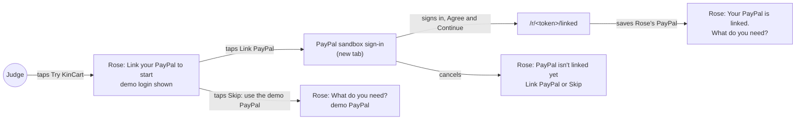
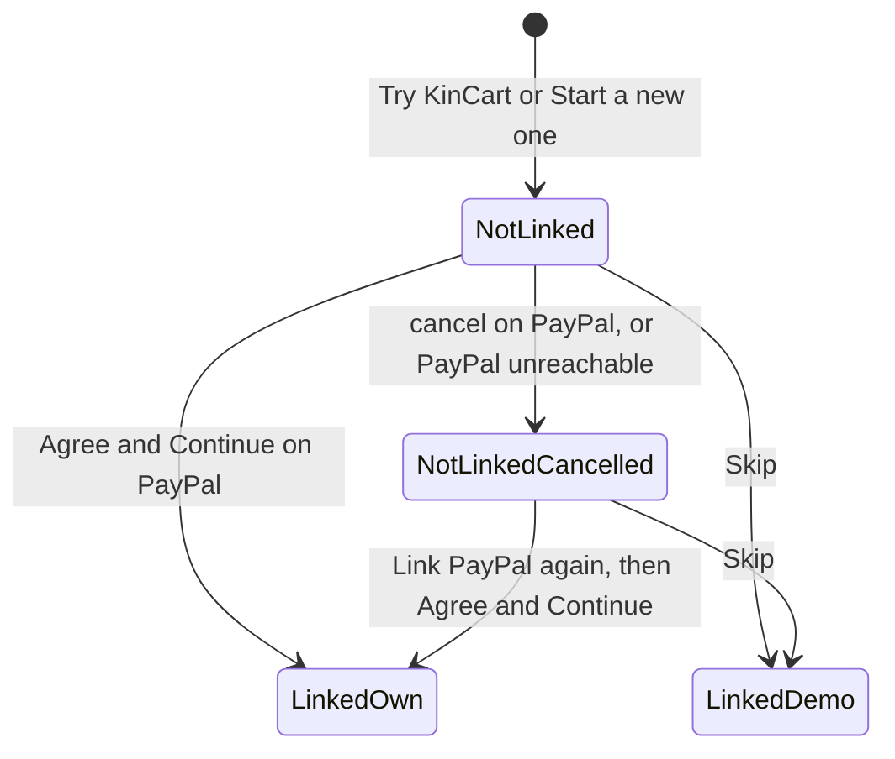

# Link PayPal onboarding

**Version:** v1 · **Status:** Draft · **Type:** Feature · **Project type:** Web UI

**Shape doc:** docs/specs/shop-together/shape.md
**Depends on:** households

A judge's new Rose starts at Link PayPal, with a demo sandbox login on screen and a Skip button under it. It comes now because a friend who tried v1.1.0 on 2026-10-15 could not see where PayPal comes in, and this is a PayPal hackathon.

## Problem

Judges never see PayPal. Since households, each new household starts with a copy of household 1's saved PayPal (D48). The home page says "Rose's sandbox PayPal is already linked." (`app/(shop)/HomeView.tsx:95`). The only PayPal a judge sees is a transaction id on the receipt.

The Link PayPal flow is built: `startLink()` (`app/(shop)/actions.ts:52`) sends Rose to PayPal's approval page, and `app/(shop)/r/[token]/linked/route.ts` saves the PayPal on return. No judge reaches it, because every new household is already linked.

It would also fail on a laptop today. Rose's page on `/` sits in a frame (`app/(shop)/ui.tsx:199`), and PayPal's sign-in page refuses to load in a frame (`x-frame-options: SAMEORIGIN`, checked 2026-10-15).

## Slice test

| Check                         | Result |
| ----------------------------- | ------ |
| Cuts every layer it needs     | yes: the home page words, Rose's link screen, the start and skip actions, and the saved PayPal row |
| One e2e test walks it         | yes, up to PayPal's sign-in page: Try KinCart, the link screen with the login, Link PayPal opens PayPal in a new tab, then Skip and an ask. Signing in on PayPal's page stays out of CI (D20). A route test with PayPal stubbed and one run on the live site cover that part |
| Worth shipping alone          | yes: a judge sees PayPal's own approval page and links a PayPal in under a minute |
| Fits (≤5 scenarios, ≤2 areas) | yes: 5 scenarios, in the home page and Rose's page |

**Path:** full. It adds new UI (the login box and Skip) and changes how a household starts.

## User story

As a judge trying KinCart, I want to link Rose's PayPal myself on PayPal's own page, so that I can see how KinCart uses PayPal.

## Flow



The judge starts at Link PayPal, signs in on PayPal's page in a new tab and comes back linked, or skips and pays from the demo PayPal as today.

## States



## Acceptance criteria

```gherkin
Scenario: A judge's new Rose starts at Link PayPal
  Given a judge opens kincart.vercel.app on a 1440px-wide laptop, with no household in this browser
  When the judge taps Try KinCart
  Then Rose's phone shows "Link your PayPal to start"
  And it shows the demo sandbox login, such as "sb-rose-demo@personal.example.com", and its password
  And it shows a "Link PayPal" button and a "Skip: use the demo PayPal" button
  And Sam's phone shows "Nothing to approve"

Scenario: The judge links Rose's PayPal on PayPal's own page
  Given Rose's phone on the home page shows "Link your PayPal to start"
  When the judge taps Link PayPal
  Then PayPal's sandbox sign-in page opens in a new tab
  When the judge signs in with the demo login and taps "Agree and Continue"
  Then that tab shows Rose's page with "Your PayPal is linked." above "What do you need?"
  And within 3 seconds Rose's phone on the home page shows "What do you need?"
  And Sam's OK on Rose's $8.79 ask for AA batteries charges the PayPal that the judge linked

Scenario: The judge skips linking
  Given Rose's phone shows "Link your PayPal to start"
  When the judge taps "Skip: use the demo PayPal"
  Then Rose's phone shows "What do you need?"
  And Sam's OK on Rose's $8.79 ask for AA batteries charges the demo PayPal, as it does today

Scenario: The judge leaves PayPal without agreeing, or PayPal can't be reached
  Given the judge tapped Link PayPal
  When the judge cancels on PayPal's page, or KinCart can't start the link with PayPal
  Then Rose's page shows "PayPal isn't linked yet" and "Nothing was saved."
  And it still shows the demo login, "Link PayPal" and "Skip: use the demo PayPal"

Scenario: Households started before this change keep their PayPal
  Given household 1, and a household that a judge started on 2026-10-15, each have a saved PayPal
  When Rose opens Rose's page in either one
  Then Rose's page shows "What do you need?" with no link step, as it does today
```

## Scope

**In:**

- New households, from Try KinCart and Start a new one, start with no saved PayPal.
- Rose's link screen shows the demo sandbox login and a Skip button. The "isn't linked yet" screen shows them too.
- Skip saves a copy of household 1's PayPal for this household, as a new household gets today.
- From the home page's phone, PayPal opens outside the frame.
- A one-time "Your PayPal is linked." after Rose comes back from PayPal.
- The home page words that say Rose's PayPal is already linked.

**Out:**

- Showing which PayPal account is linked, or unlinking it. Not planned.
- Asking with a photo. Later slice `photo-ask`.
- Delivery tracking after payment. On the roadmap (`docs/ROADMAP.md`), after a real order exists.
- A new video scene for the link step. Separate work on `feat/demo-video` (O4).
- Signing in on PayPal's page in the e2e. D20 rejects it.
- The roadmap's "One demo PayPal, copied" row. `/ship` updates it.

## Open items

| ID  | What | Type     | Raised at | Owner | Status | Answer |
| --- | ---- | -------- | --------- | ----- | ------ | ------ |
| O1  | Every new household starts with Rose's PayPal not linked, so Link PayPal is Rose's first screen and Skip sits under it. The other way keeps "already linked" and adds a second home page button for judges who want to link | question | spec p1 | user | Resolved | Not linked, with Skip under it. Every judge sees the PayPal step first, and one tap on Skip gives today's path. 2026-10-15 |
| O2  | The demo login is on a public page, so anyone can sign in to that sandbox account. They can change its password, which spoils linking for later judges. They can also cancel the permissions saved under it. If it is household 1's account, a cancel stops payment for every household that skipped | flag | spec p1 | user | Resolved | A new sandbox personal account, only for the page. A stranger can spoil linking but not payment. The owner makes it and puts its email and password in Vercel's env and `.env.local` before `/build`. 2026-10-15 |
| O3  | PayPal's sign-in page refuses to load in a frame. From the home page's phone, PayPal must open in a new tab or take over the whole window | question | spec p1 | user | Resolved | A new tab. The home page stays open, and Rose's phone updates by itself within 3 s. 2026-10-15 |
| O4  | The video shows the home page and Rose's page from before this change, with no link step. A judge who watches first doesn't see PayPal's page | flag | spec p1 | user | Resolved | Re-render after this ships: a short link scene on `feat/demo-video`, with new footage. About 35 min to render and 4 min to mix. 2026-10-15 |

_Never delete this section or its rows. See references/ledger.md._

## Glossary

- **Sandbox**: PayPal's test environment. Fake accounts, fake money, real API.
- **Sandbox login**: the email and password of a fake PayPal buyer account. The judge signs in with it on PayPal's sandbox page.
- **Vault**: PayPal's store for a saved payment method. Rose approves once, and KinCart charges later with no login.
- **Frame**: a page shown inside another page. The home page's two phones are frames.
- **e2e**: end to end: one test that walks the whole slice as a person would.
