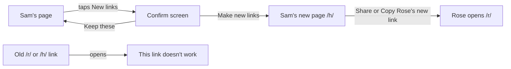
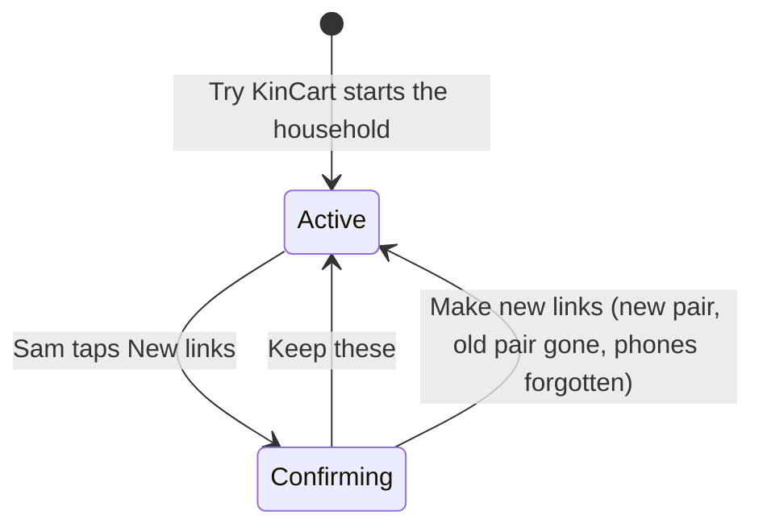

# New links

**Version:** v1 · **Status:** Draft · **Type:** Feature · **Project type:** Web UI

**Shape doc:** docs/specs/security/shape.md
**Depends on:** households
**Page:** none. Skipped: you read the `.md` directly.

Sam taps New links to replace both of the household's secret links when one leaks, and the old ones stop working at once. It ships now because a leaked Sam link approves charges forever, and today the only way out is Start a new one, which loses the PayPal link and every receipt.

## Problem

Each household has two secret links, one for Rose and one for Sam (D42). Whoever holds Sam's link can approve Rose's asks and charge Rose's saved PayPal. A link leaks easily: a forwarded message, a shared screen, a screenshot in a group chat. Today nothing ends a leaked link. Sam can start a new household, but that one has no saved PayPal, no Bought before and no receipts, and the old links still work.

## Slice test

| Check                         | Result                                                                             |
| ----------------------------- | ---------------------------------------------------------------------------------- |
| Cuts every layer it needs     | yes: Sam's page, a server action, the households and phones tables                 |
| One e2e test walks it         | yes: Sam replaces the links, the old ones fail, Rose's new one shows her household |
| Worth shipping alone          | yes: a leaked link stops working without losing PayPal or receipts                 |
| Fits (≤5 scenarios, ≤2 areas) | yes: 5 scenarios, Sam's page and the links                                         |

**Path:** full. A feature with a new screen state, a new action and a data change.

## User story

As Sam, I want to replace our two links when one has leaked, so that whoever has the old link can't approve anything, and Rose keeps her saved PayPal and her past buys.

## Flow



Sam confirms, lands on the new Sam page with Rose's new link ready to send, and both old links now show the page any wrong link shows.

## States



## Acceptance criteria

```gherkin
Scenario: Sam replaces both links
  Given a household started from Try KinCart on 2026-10-26, with Rose's demo PayPal linked
  And Sam opens their own page, not inside the home page's phones
  When Sam taps New links, reads the confirm screen and taps Make new links
  Then Sam is on a new Sam page, which says to save this link and shows Rose's new link with Share and Copy
  And Rose's old link and Sam's old link each show "This link doesn't work"
  And in this browser, the home page's phones open the new links

Scenario: The household keeps everything but its links
  Given Sam set a $40 price limit, paid for "AA batteries" last week, and Rose has an ask for slippers waiting
  When Sam makes new links
  Then Rose's new link shows the saved PayPal, the $40 limit, the AA batteries under Bought before, and Waiting for Sam
  And Sam's new page shows the slippers ask with OK and No

Scenario: Saved phones are forgotten
  Given Rose's and Sam's phones each had notifications on
  When Sam makes new links
  Then neither phone gets a push for the household's next ask or answer
  And Rose's and Sam's new pages offer to turn notifications on again

Scenario: Sam keeps the links
  Given Sam taps New links
  When Sam taps Keep these on the confirm screen
  Then Sam is back on the same Sam page, and both links still work

Scenario: No New links where it can't or shouldn't run
  Given household 1, whose links live in Vercel's env
  Or Sam's page inside the home page's phones
  When Sam's page shows
  Then it has no New links button
```

## Scope

**In:** New links on Sam's own page for households started from Try KinCart, the confirm screen, Share and Copy for Rose's new link, the old pair ending at once, saved phones forgotten, and this browser's home page following the new links.

**Out:**
- New links for household 1. Its links stay a manual change in Vercel's env (D45, D47). No later slice.
- New links from Rose's page. A leaked Rose link can ask but never pay, and Sam replaces both. No later slice.
- A second check before New links, so a leaked Sam link can't take the household over. `confirm-ok` (slice 5).
- A page that says an old link was replaced. Old links show the same page as any wrong link. No later slice.
- New links inside the home page's phones (D52's reasoning). No later slice.

## Open items

| ID | What | Type | Raised at | Owner | Status | Answer |
| -- | ---- | ---- | --------- | ----- | ------ | ------ |
| O1 | Household 1's links live in Vercel's env (D47), so a button can't replace them (from shape O8) | question | shape | user | Resolved | Household 1 gets no New links button. Replacing its links stays a manual env change. 2026-10-26 |
| O2 | After new links, Rose's old Home Screen icon and push taps open the old link, which no longer works (from shape O9) | flag | shape | user | Resolved | New links forgets the household's saved phones. Rose and Sam turn notifications on again from the new links, and the old Home Screen icon shows "This link doesn't work". 2026-10-26 |
| O3 | What someone who opens an old link sees | question | spec p1 | user | Resolved | The page any wrong link shows, "This link doesn't work". No record of old links is kept. 2026-10-26 |
| O4 | Whether Sam's page inside the home page's phones shows New links | question | spec p1 | user | Resolved | No, as with Notifications (D52). Sam uses their own page. 2026-10-26 |
| O5 | Whether New links acts on one tap or asks first | question | spec p1 | user | Resolved | A confirm screen with Make new links and Keep these, which says the old links stop, Rose needs the new one, and notifications turn off. 2026-10-26 |
| O6 | How Sam gets Rose's new link to Rose | question | spec p1 | user | Resolved | Share, through the phone's share sheet, and Copy. Sam's own page says to save the new link. 2026-10-26 |
| O7 | Whoever holds a leaked Sam link can tap New links first and lock the real Rose and Sam out. A new household then has no saved PayPal and no receipts | flag | spec p1 | user | Accepted risk | A leaked Sam link can already approve charges, and this adds a lockout, not money. `confirm-ok` (slice 5) is the guard. 2026-10-26 |

_Never delete this section or its rows. See references/ledger.md._

## Glossary

- **Secret link** — the page address that is the only key to Rose's or Sam's page, such as `/h/<token>`.
- **Household** — one Rose and one Sam, with their own asks, limits, phones and saved PayPal (D42).
- **Share sheet** — the phone's own menu for sending something to another app, such as Messages or WhatsApp.
- **e2e** — end to end: an automated test that drives the app the way a person would, start to finish.
