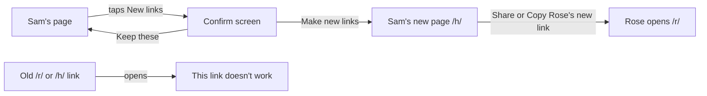
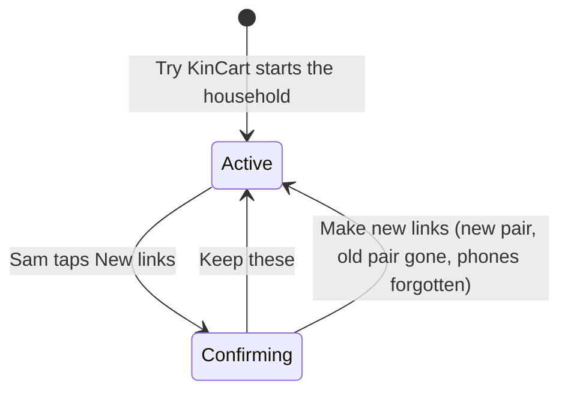
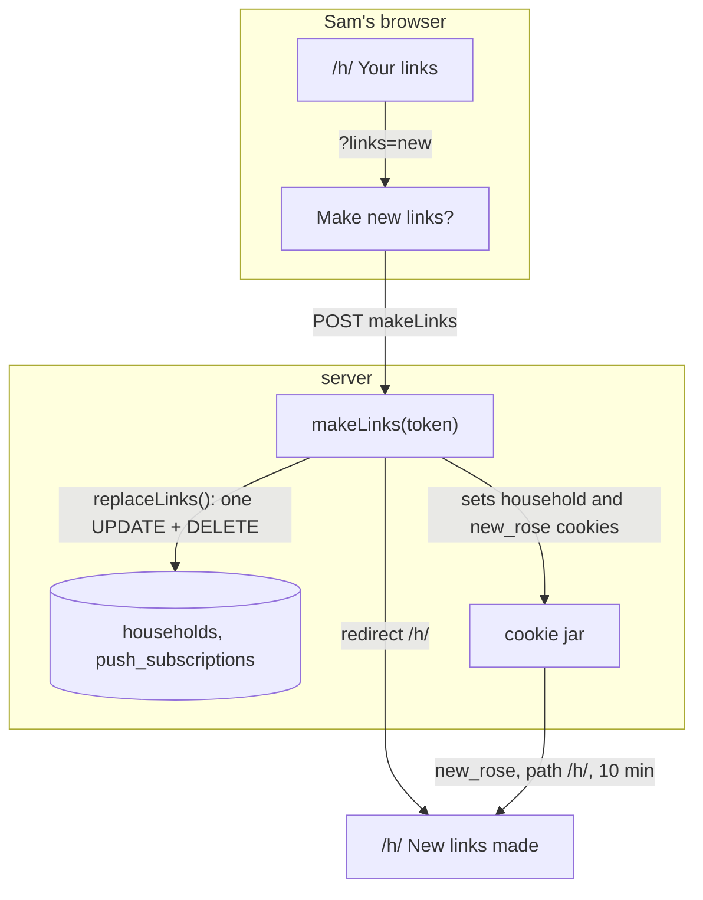
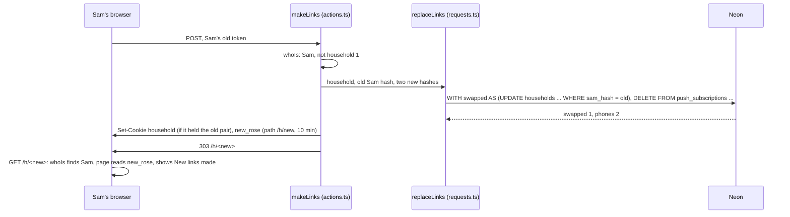

# New links

**Version:** v1 · **Status:** Built · **Type:** Feature · **Project type:** Web UI

**Shape doc:** docs/specs/security/shape.md
**Depends on:** households
**Page:** none. Skipped: you read the `.md` directly.

Sam taps New links to replace both of the household's secret links when one leaks, and the old ones stop working at once. It ships now because a leaked Sam link approves charges forever, and today the only way out is Start a new one, which loses the PayPal link and every receipt.

## Problem

Each household has two secret links, one for Rose and one for Sam (D42). Whoever holds Sam's link can approve Rose's asks and charge Rose's saved PayPal. A link leaks easily: a forwarded message, a shared screen, a screenshot in a group chat. Today nothing ends a leaked link. Sam can start a new household, but that one has no saved PayPal, no Bought before and no receipts, and the old links still work.

## Slice test

| Check                         | Result                                                                             |
| ----------------------------- | ---------------------------------------------------------------------------------- |
| Cuts every layer it needs     | yes: Sam's page, a server action, the households and phones tables                 |
| One e2e test walks it         | yes: Sam replaces the links, the old ones fail, Rose's new one shows her household |
| Worth shipping alone          | yes: a leaked link stops working without losing PayPal or receipts                 |
| Fits (≤5 scenarios, ≤2 areas) | yes: 5 scenarios, Sam's page and the links                                         |

**Path:** full. A feature with a new screen state, a new action and a data change.

## User story

As Sam, I want to replace our two links when one has leaked, so that whoever has the old link can't approve anything, and Rose keeps her saved PayPal and her past buys.

## Flow



Sam confirms, lands on the new Sam page with Rose's new link ready to send, and both old links now show the page any wrong link shows.

## States



## Acceptance criteria

```gherkin
Scenario: Sam replaces both links
  Given a household started from Try KinCart on 2026-10-26, with Rose's demo PayPal linked
  And Sam opens their own page, not inside the home page's phones
  When Sam taps New links, reads the confirm screen and taps Make new links
  Then Sam is on a new Sam page, which says to save this link and shows Rose's new link with Share and Copy
  And Rose's old link and Sam's old link each show "This link doesn't work"
  And in this browser, the home page's phones open the new links

Scenario: The household keeps everything but its links
  Given Sam set a $40 price limit and paid for "AA batteries" on 2026-10-19, and no ask is waiting
  When Sam makes new links
  Then Rose's new link shows the saved PayPal, the $40 limit and the AA batteries under Bought before
  And Sam's new page shows the AA batteries receipt and the $40 limit

Scenario: Saved phones are forgotten
  Given Rose's and Sam's phones each had notifications on
  When Sam makes new links
  Then neither phone gets a push for the household's next ask or answer
  And Rose's and Sam's new pages offer to turn notifications on again

Scenario: Sam keeps the links
  Given Sam taps New links
  When Sam taps Keep these on the confirm screen
  Then Sam is back on the same Sam page, and both links still work

Scenario: No New links where it can't or shouldn't run
  Given household 1, whose links live in Vercel's env
  Or Sam's page inside the home page's phones
  Or an ask from Rose waiting for Sam's OK or No
  When Sam's page shows
  Then it has no New links button
```

## Scope

**In:** New links on Sam's own page for households started from Try KinCart, when no ask waits for Sam, the confirm screen, Share and Copy for Rose's new link, the old pair ending at once, saved phones forgotten, and this browser's home page following the new links.

**Out:**
- New links for household 1. Its links stay a manual change in Vercel's env (D45, D47). No later slice.
- New links from Rose's page. A leaked Rose link can ask but never pay, and Sam replaces both. No later slice.
- A second check before New links, so a leaked Sam link can't take the household over. `confirm-ok` (slice 5).
- A page that says an old link was replaced. Old links show the same page as any wrong link. No later slice.
- New links inside the home page's phones (D52's reasoning). No later slice.

## Interface

Three states on Sam's page, built in the repo behind `/preview/new-links`, and shown in light and dark.

- **Your links**, under the limits on Sam's page when there's no ask to answer: one line on when to use it, and a secondary Make new links button. It's a plain form that opens `?links=new`.
- **Make new links?**, a screen of its own: what changes, in a `summary` card, then a primary Make new links button and a secondary Keep these. Make new links says "Making new links…" with the spinner while it works.
- **New links made**, on Sam's new page: a neutral notice to save the page, then a `summary` card, "Send Rose this new link", with the link broken after `/r/`, and Share and Copy. Share shows only where the browser has a share sheet, and Copy is then secondary. "Copied." appears under the buttons.

**Motion tier:** 1. The button press and spinner the pages already have. "Copied." appears as text, with no animation.

**Components used:** `Button`, `Notice`, the `summary`, `heading`, `field-label`, `small` and `lead` styles, and a new `ShareLink` built from two `Button`s. `shop.css` adds `.links` to the divider rule of `.limit, .notify`, and `.changes` to the spacing rule of `.login`. No new token or value.

**Preview:** `app/(shop)/preview/new-links/page.tsx`, at `/preview/new-links` on `pnpm dev`. Not served in production.

## Technical plan

### Approach

New links swaps the two hashes on the household's own `households` row, so every table keyed by the household id keeps its rows (D46). One SQL statement swaps them only while Sam's old hash is still there, and deletes the household's saved phones. The action then points this browser's household cookie at the new pair, if it held the old one, and hands Rose's new link to Sam's new page in a one-time cookie.

Relies on: D42, D44, D46, D47, D52, D117, D120 and D121 (drafted here)





### Changes

| File | What changes | Why |
| ---- | ------------ | --- |
| `lib/shop/requests.ts:94` | New `replaceLinks(household, oldSamHash, roseHash, samHash)`: one statement, `WITH swapped AS (UPDATE households SET rose_hash = $3, sam_hash = $4 WHERE id = $1 AND sam_hash = $2 RETURNING id), gone AS (DELETE FROM push_subscriptions WHERE household_id IN (SELECT id FROM swapped) RETURNING 1)`, returning how many rows swapped and how many phones went, or `null` when none swapped | 1, 2, 3 |
| `app/(shop)/actions.ts:44` | New `makeLinks(token)`, beside `start()`. It returns unless `whoIs` gives Sam of a household other than 1. It makes two links with `newLink()`, calls `replaceLinks` with `hashOf()`, and logs `links household=<id> status=replaced phones=<n>`. When the household cookie's second part is this token, it sets the cookie to the new pair with `start()`'s options. It sets `new_rose` to Rose's new token: httpOnly, secure, sameSite lax, path `/h/<new>`, 10 minutes. Then it redirects to `/h/<new>`. When nothing swapped, it redirects to the old page, which no longer works | 1, 2, 3, 5 |
| `app/(shop)/h/[token]/page.tsx:63` | Passes `links` and `makeLinks` to `SamView` only for a household other than 1, without `?in=phone`, and when no ask waits. `?links=new` gives `confirm`, a `new_rose` cookie gives `made` with `/r/<token>` on the request's origin, otherwise `offer` | 1, 4, 5 |
| `app/(shop)/SamView.tsx`, `app/(shop)/ShareLink.tsx`, `app/(shop)/shop.css`, `app/(shop)/preview/new-links/page.tsx` | Built at pause 2. `/build` breaks each new line once, as the lesson says | 1, 4, 5 |
| `lib/shop/requests.test.ts` | `replaceLinks` swaps both hashes, deletes only this household's phones, leaves another household alone, and returns `null` for an old hash that no longer matches | 1, 3 |
| `app/(shop)/actions.test.ts` | `makeLinks` does nothing for Rose's link or household 1, and for Sam it swaps the links, sets both cookies, keeps another browser's household cookie, and redirects to `/h/<new>` | 1, 5 |
| `app/(shop)/SamView.test.tsx` | Each `links` state: Your links with its button, the confirm screen with Make new links and Keep these, the made notice with Rose's link and Copy. No Your links without `links` | 1, 4, 5 |
| `e2e/new-links.spec.ts` (new) | Walks scenarios 1 to 4 on a household from Try KinCart | 1, 2, 3, 4 |

Reusing: `newLink()`, `hashOf()` and `whoIs()` from `lib/shop/people.ts`, `start()`'s cookie options, `findHousehold()`'s query style, `origin()` in `actions.ts:338`, `startOwn()` and `skipsLinking()` from `e2e/households.spec.ts`, and the `?in=phone` flag from `PhoneFrame` (`app/(shop)/ui.tsx:226`).

### Earn-it

| Added | Triggered by |
| ----- | ------------ |
| `new_rose` cookie | Scenario 1: Sam's new page shows Rose's new link, and only hashes are kept (D47). D121 |
| `ShareLink` | Scenario 1: Share and Copy (O6) |

### Non-functionals

|                      |                                                                                                                                                                                     |
| -------------------- | ----------------------------------------------------------------------------------------------------------------------------------------------------------------------------------- |
| **Load**             | A few taps a day at most. Each is one SQL statement and two cookies, with no Claude, Channel3 or PayPal call                                                                        |
| **Breaks first**     | Nothing at 10×. Two taps from Sam's old page at once: the second finds Sam's old hash gone, and lands on "This link doesn't work"                                                   |
| **Security surface** | Callable by whoever holds a Sam link of a household other than 1 (O7). Trusts only the token, through `whoIs`. Writes new hashes, never the links themselves. `new_rose` holds Rose's link for 10 minutes, httpOnly, sent only to `/h/<new>` |
| **Proof it works**   | `links household=<id> status=replaced phones=<n>` in Vercel's logs, and the old Sam link answering 404 right after                                                                 |
| **Rollout**          | No flag. Vercel promotes after main's CI (D10). Rollback: promote the previous deploy. Swapped households keep working, since no schema changes                                     |

### Test plan

| Scenario | Test | Command |
| -------- | ---- | ------- |
| 1, 3 | `lib/shop/requests.test.ts`: `replaceLinks` | `pnpm test lib/shop/requests.test.ts` |
| 1, 5 | `app/(shop)/actions.test.ts`: `makeLinks` | `pnpm test "app/(shop)/actions.test.ts"` |
| 1, 4, 5 | `app/(shop)/SamView.test.tsx`: each `links` state | `pnpm test "app/(shop)/SamView.test.tsx"` |
| 1 to 4 | `e2e/new-links.spec.ts`: Try KinCart, Skip, a $40 limit, Keep these, Make new links, Copy, the old links' "This link doesn't work", Rose's new link with the receipt, the $40 limit and Bought before, and the home page on the new pair. Scenario 3's forgotten phones are proven by `replaceLinks`' test, not the e2e | `pnpm test:e2e e2e/new-links.spec.ts --workers=1` |

### Chunks

Single chunk.

### Risks

| Risk | Mitigation |
| ---- | ---------- |
| Whoever holds a leaked Sam link makes new links first and locks the family out (O7) | Accepted. `confirm-ok` (slice 5) guards it |
| Rose's old Home Screen icon opens a link that no longer works (O2) | Accepted. Rose opens the new link and adds it again. The confirm screen says to |
| A browser with the household cookie of the old pair, other than Sam's, opens the home page | `linksIn()` finds no household for the old pair, and the home page offers Try KinCart, as for any lost cookie |
| Rose is on PayPal's page, linking from her old link, when Sam makes new links | PayPal returns to the old link, which no longer works. Rose taps Link PayPal again from the new link |

### Decisions to record

Recorded as D120, D121.

## Review

2026-10-26 · 2 raw findings, 0 survived. Clean.

## Open items

| ID | What | Type | Raised at | Owner | Status | Answer |
| -- | ---- | ---- | --------- | ----- | ------ | ------ |
| O1 | Household 1's links live in Vercel's env (D47), so a button can't replace them (from shape O8) | question | shape | user | Resolved | Household 1 gets no New links button. Replacing its links stays a manual env change. 2026-10-26 |
| O2 | After new links, Rose's old Home Screen icon and push taps open the old link, which no longer works (from shape O9) | flag | shape | user | Resolved | New links forgets the household's saved phones. Rose and Sam turn notifications on again from the new links, and the old Home Screen icon shows "This link doesn't work". 2026-10-26 |
| O3 | What someone who opens an old link sees | question | spec p1 | user | Resolved | The page any wrong link shows, "This link doesn't work". No record of old links is kept. 2026-10-26 |
| O4 | Whether Sam's page inside the home page's phones shows New links | question | spec p1 | user | Resolved | No, as with Notifications (D52). Sam uses their own page. 2026-10-26 |
| O5 | Whether New links acts on one tap or asks first | question | spec p1 | user | Resolved | A confirm screen with Make new links and Keep these, which says the old links stop, Rose needs the new one, and notifications turn off. 2026-10-26 |
| O6 | How Sam gets Rose's new link to Rose | question | spec p1 | user | Resolved | Share, through the phone's share sheet, and Copy. Sam's own page says to save the new link. 2026-10-26 |
| O7 | Whoever holds a leaked Sam link can tap New links first and lock the real Rose and Sam out. A new household then has no saved PayPal and no receipts | flag | spec p1 | user | Accepted risk | A leaked Sam link can already approve charges, and this adds a lockout, not money. `confirm-ok` (slice 5) is the guard. 2026-10-26 |
| O8 | Sam's page shows only OK and No while an ask waits (`app/(shop)/SamView.tsx:61`), so Your links isn't there. Scenario 2 says Sam makes new links while Rose's slippers ask waits | question | spec p2 | user | Resolved | Sam answers first. Your links shows only when no ask waits, so the OK and No screen stays as it is. Scenario 2 no longer has a waiting ask. 2026-10-26 |
| O9 | How Rose's new link reaches Sam's new page, when only hashes are kept (D47) | question | spec p3 | user | Resolved | A one-time cookie, httpOnly, sent only to Sam's new link, for 10 minutes (D121). 2026-10-26 |
| O10 | The plan reused `origin()` from `app/(shop)/actions.ts:338` for Sam's page. That file is `"use server"`, so an exported helper there becomes a server action anyone can call | flag | build | user | Decided alone | Chose: move `origin()` to `app/(shop)/origin.ts`, which `actions.ts` and Sam's page both import. Other: put Rose's whole link, origin and all, in the `new_rose` cookie, and keep `origin()` private. Undo: `git revert 069a3d6`, then build the link in `makeLinks`. 2026-10-26 |

_Never delete this section or its rows. See references/ledger.md._

## Glossary

- **Secret link** — the page address that is the only key to Rose's or Sam's page, such as `/h/<token>`.
- **Household** — one Rose and one Sam, with their own asks, limits, phones and saved PayPal (D42).
- **Share sheet** — the phone's own menu for sending something to another app, such as Messages or WhatsApp.
- **e2e** — end to end: an automated test that drives the app the way a person would, start to finish.
- **Hash** — a fixed scramble of a link. KinCart can check a link against it, but can't turn it back into the link (D47).
- **httpOnly cookie** — a cookie the browser sends to the server but the page's own scripts can't read.
