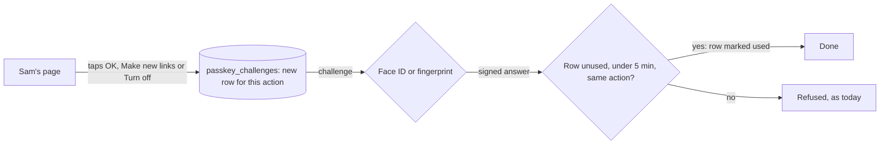
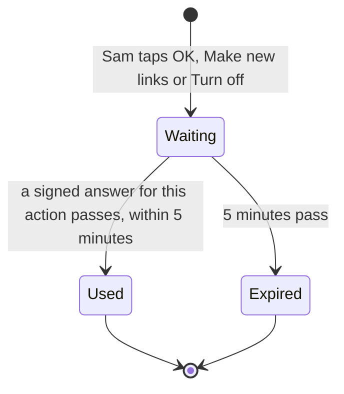
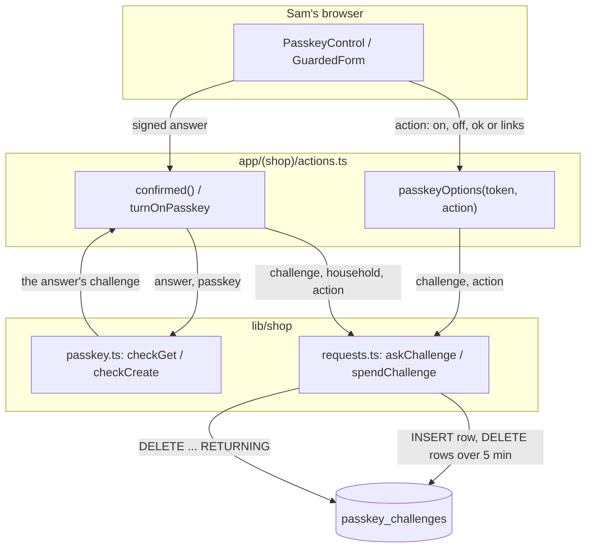
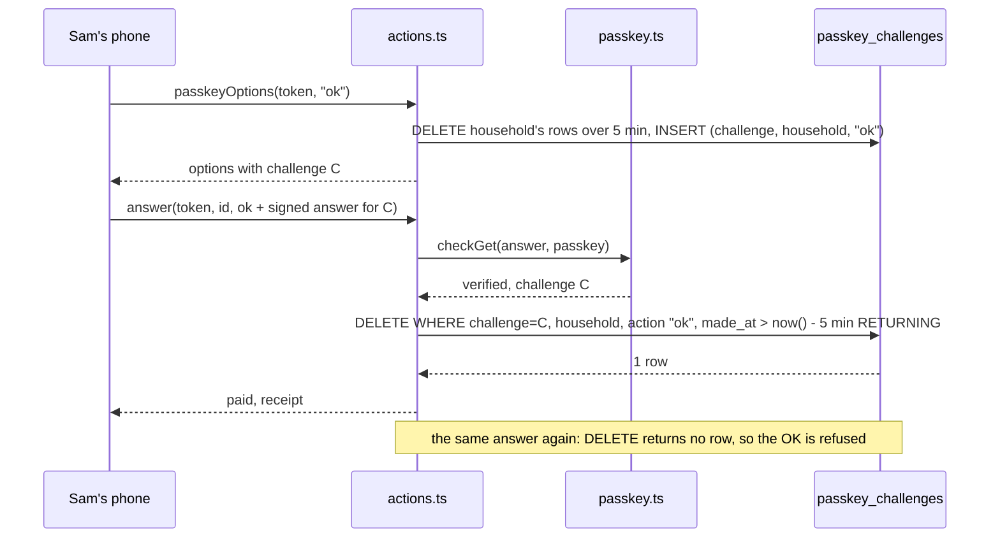
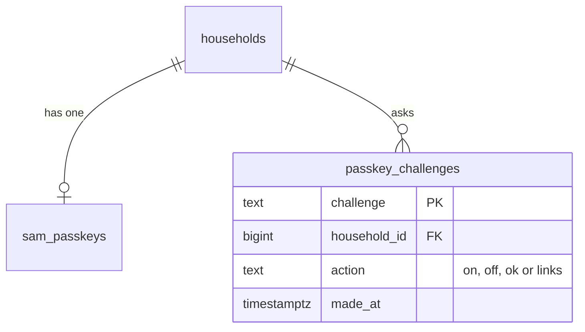

# Passkey one-time challenge

**Version:** v1 · **Status:** Shipped · **Type:** Bug · **Project type:** Web UI

**Shape doc:** docs/specs/security/shape.md
**Depends on:** confirm-ok
**Page:** none. Skipped: you read the `.md` directly.

Each passkey answer from Sam's phone works once, for the one action it was asked for, and only for 5 minutes. It ships before the Nov 5 freeze because the v1.3.0 pentest proved a used answer works again (confirm-ok O13).

## Problem

KinCart checks Sam's signed answer against whatever challenge the request brings in its `passkey_challenge` cookie. The server keeps no record of the challenges it gave out. On 2026-11-02 the pentest turned Sam's passkey off with an answer that had already turned it off once. Someone with Sam's link and one captured answer can do it again at any time, and use it for an OK or Make new links as well. D124 assumed "a replay needs Sam's own browser". That is false.

## Slice test

| Check                         | Result                                                                                     |
| ----------------------------- | ------------------------------------------------------------------------------------------ |
| Cuts every layer it needs     | yes: the passkey actions behind Sam's page, and a new table of challenges. No screen changes |
| One e2e test walks it         | yes: Sam turns the passkey on, a replayed Turn off and a Turn off answer sent to OK are refused, then Sam's own OK pays |
| Worth shipping alone          | yes: a captured answer no longer pays, makes new links or turns the passkey off            |
| Fits (≤5 scenarios, ≤2 areas) | yes: 4 scenarios, the passkey actions and the database                                     |

**Path:** full. A bug fix, but it adds a table and replaces D124. Pause 2 is skipped: no screen, message or control changes.

## Flow



Each tap asks the server for a fresh challenge for that one action. The server lets the signed answer through only once, within 5 minutes, and only for that action.

## States



## Acceptance criteria

```gherkin
Scenario: A used answer can't be used again
  Given a household started from Try KinCart on 2026-11-02, with Sam's passkey on
  And Sam tapped Turn off, Face ID matched, and the passkey went off
  And Sam then turned the passkey on again
  When someone sends that same Turn off answer again, with its challenge
  Then the passkey stays on
  And the log says "passkey household=<id> status=refused for=off"

Scenario: An answer for one action can't do another
  Given Sam's passkey is on, and Rose asks for "AA batteries" at $12.99
  And Sam's phone signed an answer for Turn off
  When someone sends that answer with "OK, pay $12.99"
  Then nothing is paid, the page says "Not paid. This OK needs your face or fingerprint, on the phone that turned it on.", and the ask still waits
  When Sam taps "OK, pay $12.99" on Sam's own phone, and Face ID matches
  Then Sam and Rose each see the receipt for $12.99

Scenario: A challenge older than 5 minutes is refused
  Given Sam's passkey is on, and Rose asks for "AA batteries" at $12.99
  When Sam taps "OK, pay $12.99", leaves the Face ID prompt for 6 minutes, and then Face ID matches
  Then nothing is paid, the page shows the same "Not paid" message, and the ask still waits
  When Sam taps "OK, pay $12.99" again, and Face ID matches
  Then Sam and Rose each see the receipt for $12.99

Scenario: Sam's own taps work as before
  Given Sam's passkey is on, with Sam's page open on two tabs of the same phone
  When Sam taps Make new links on one tab and Turn off on the other, and Face ID matches each time
  Then both go through, as confirm-ok's scenarios say
```

## Scope

**In:** a server record of each challenge, with its household, its action and its time; one use for each challenge; the 5-minute limit on the server; Turn on's challenge, which gets the same one-time check.

**Out:**
- Tying an OK's answer to one ask or one total. Not planned: an OK's answer works only for the next OK, once, within 5 minutes.
- The passkey's signature counter, pinned at 0 (`lib/shop/passkey.ts:55`). Synced passkeys always send 0, so a counter stops nothing (see Risks).
- Any new screen or message. A refused answer shows today's refused messages.

## Technical plan

### Approach

`passkeyOptions` takes the action the tap is for, and writes the new challenge to a `passkey_challenges` row instead of a cookie. The same statement deletes that household's rows older than 5 minutes. After the library has checked the signature, `confirmed()` and `turnOnPasskey` delete the row by its challenge, household and action, with a `made_at` under 5 minutes. They pass only when that delete returns a row. The delete is the one-time step, so two copies of one answer sent at once can't both pass.

Relies on: D122, D123, D46, D12, and D131 and D132 drafted below



The browser asks for a challenge for one action, and the server keeps it as a row. The server checks the signature, then deletes the row, and the tap passes only if the delete found it.



### Changes

| File | What changes | Why |
| ---- | ------------ | --- |
| `db/migrations/0017_passkey_challenges.up.sql` (new) | `CREATE TABLE passkey_challenges (challenge text PRIMARY KEY, household_id bigint NOT NULL REFERENCES households (id) ON DELETE CASCADE, action text NOT NULL CHECK (action IN ('on', 'off', 'ok', 'links')), made_at timestamptz NOT NULL DEFAULT now())` | All scenarios: the server's record of each challenge |
| `db/migrations/0017_passkey_challenges.down.sql` (new) | `DROP TABLE IF EXISTS passkey_challenges` | The reverse path |
| `lib/shop/requests.ts:139` | Add `askChallenge(household, action, challenge)`: one statement that deletes the household's rows over 5 minutes and inserts the new one. Add `spendChallenge(household, action, challenge)`: `DELETE ... RETURNING`, true when a row came back | Scenarios 1 and 3: one use, 5 minutes |
| `lib/shop/passkey.ts:32` and `:48` | `checkCreate` and `checkGet` take no challenge. They pass a function as `expectedChallenge` that keeps the answer's challenge and returns true. They return the challenge with the result, so the caller deletes the row only after the signature has passed | All scenarios; the library takes a function (`verifyAuthenticationResponse.d.ts:24`, `verifyRegistrationResponse.d.ts:25` in 14.0.3) |
| `app/(shop)/actions.ts:107` | `passkeyOptions(token, action)`: same who checks, then `askChallenge` in place of the cookie. Drop `CHALLENGE`, `challengeCookie` and `takeChallenge` (`:143`–`:154`) | Scenario 2 needs the action; the cookie goes (O6) |
| `app/(shop)/actions.ts:125`, `:134`, `:157` | `turnOnPasskey` uses action `on`; `confirmed(household, action, answer)` replaces the token argument with the action. `makeLinks` (`:90`) passes `links`, `answer` (`:376`) passes `ok`, `turnOffPasskey` passes `off` | Scenarios 1 to 3 |
| `app/(shop)/PasskeyControl.tsx:21`, `:39`, `:65` | `phoneAnswer(token, action)`. `toggle` asks for `on` or `off`. `GuardedForm` takes a `for` prop, `ok` or `links`, and asks for that action | Scenario 2 |
| `app/(shop)/SamView.tsx:135`, `:248`, `app/(shop)/BasketAnswer.tsx:40` | Pass `for="ok"` or `for="links"` to `GuardedForm` | Scenario 2 |
| `app/(shop)/actions.test.ts:1586`–`1690` | `passkeyOn` and `signedBy` pass the action. The cookie test becomes a row test. New tests for scenarios 1 to 4 | Proves scenarios 1 to 4 |
| `lib/shop/passkey.test.ts` | Follow the new `checkGet` / `checkCreate` signatures | Keeps the library tests |
| `scripts/migrate.test.ts:33`, `:76`, `:96` | Expect `passkey_challenges` after up, and gone after one down, before `sam_passkeys` goes | The reverse path, tested |
| `e2e/passkey-one-time-challenge.spec.ts` (new) | The one e2e test below | Walks the slice |

Reusing: `whoIs` (`lib/shop/people.ts`), `query` (`lib/shop/requests.ts`), `getPasskey`, the virtual authenticator `passkeyDevice` from `e2e/confirm-ok.spec.ts:10`, the test phone in `lib/shop/passkeyPhone.ts`, and `redirectOf`, `form` and the cookie jar mock in `actions.test.ts`.

### Data



**Migration:** expand only. A new table, and nothing reads the old cookie after the switch. A challenge asked for before the deploy, with a cookie and no row, is refused once. Sam taps again.
**Reverse:** `0017_passkey_challenges.down.sql` drops the table. `scripts/migrate.test.ts` runs it, then checks that `sam_passkeys` is still there. Code from before this slice works on a database that still has the table, so a Vercel rollback needs no down migration.

### Earn-it

| Added | Triggered by |
| ----- | ------------ |
| `passkey_challenges` table | O1: only a server record stops a replay. Scenarios 1 and 3 |
| `action` column | O2 and scenario 2 |
| `askChallenge` / `spendChallenge` | the two statements; `requests.ts` holds every other SQL statement |
| `for` prop on `GuardedForm` | scenario 2: the form must say which action it asks for |

### Non-functionals

|                      |                                                                               |
| -------------------- | ----------------------------------------------------------------------------- |
| **Load**             | One insert for each passkey tap and one delete for each answer. Under 100 a day during judging |
| **Breaks first**     | Nothing at 10×. The table holds at most a few rows for each household, because each ask deletes the old ones |
| **Security surface** | Only Sam's link of a household other than 1 reaches `passkeyOptions` (`whoIs`). It trusts nothing from the browser but the action name, checked against four values by the code and by the CHECK. It stores random challenges with no personal data. No new secret |
| **Proof it works**   | `passkey household=<id> status=refused for=<action>` on a replay, and `status=on`, `status=off` or a paid OK on Sam's own tap, in Vercel's logs |
| **Rollout**          | No flag. The passkey is off by default (D122), so only households that turned it on are touched. Rollback: redeploy the last build; the table can stay |

### Test plan

| Scenario | Test | Command |
| -------- | ---- | ------- |
| A used answer can't be used again | `app/(shop)/actions.test.ts`: Turn off, on again, the same Turn off answer refused, the passkey stays on, the log line | `pnpm test app/(shop)/actions.test.ts` |
| An answer for one action can't do another | `actions.test.ts`: an `off` answer to `answer(ok)` and to `makeLinks` is refused; an `ok` answer pays | `pnpm test app/(shop)/actions.test.ts` |
| A challenge older than 5 minutes is refused | `actions.test.ts`: the row's `made_at` set 6 minutes back by SQL, the OK refused, a new ask pays | `pnpm test app/(shop)/actions.test.ts` |
| Sam's own taps work as before | `actions.test.ts`: two asks, one for `links` and one for `off`, both pass in either order; the confirm-ok e2e still passes | `pnpm test` and `pnpm test:e2e e2e/confirm-ok.spec.ts` |
| The reverse path | `scripts/migrate.test.ts` | `pnpm test scripts/migrate.test.ts` |

**E2E:** `e2e/passkey-one-time-challenge.spec.ts`. Sam turns the passkey on with the virtual authenticator and makes new links. The test sends that same signed answer again to Sam's new link, with its challenge as the cookie, and the new link still opens. Rose then asks for "AA batteries" at $12.99, and Sam's own OK pays. Run it with `pnpm test:e2e e2e/passkey-one-time-challenge.spec.ts`, with `pnpm dev` stopped.

### Chunks

Single chunk. The migration, the two statements, the actions and the forms change one call chain, and the tests share the local database.

### Risks

| Risk | Mitigation |
| ---- | ---------- |
| A replayed server action call in the e2e is shaped wrong for Next 16.4.1, so the test passes for the wrong reason | The e2e was run against the code before the fix: there the replay made new links again, and the test failed with a 404 |
| The signature counter stays pinned at 0 (`lib/shop/passkey.ts:55`) | No change. Synced passkeys from Apple and Google always send 0, so a counter can't stop a copy. The one-time row stops the replay |
| A Sam with a Face ID prompt open during the deploy is refused once | Accepted: Sam taps again, and the refused message already says what to do |
| `confirm-ok.spec.ts` and the other passkey tests rely on the cookie | They change in this chunk. `pnpm test` and the confirm-ok e2e run before `/review` |

### Decisions to record

Recorded as D131, D132.

## Review

2026-11-02 · 0 raw findings, 0 survived. Clean.

## Open items

| ID | What | Type | Raised at | Owner | Status | Answer |
| -- | ---- | ---- | --------- | ----- | ------ | ------ |
| O1 | D124 is wrong: a replay does not need Sam's own browser. The server checks a signed answer against whatever `passkey_challenge` cookie the caller sends (`app/(shop)/actions.ts:151`), and keeps no record of the challenges it issued or used (from confirm-ok O13) | flag | release v1.3.0 | spec | Resolved | This slice: each challenge lives in a server row, works once, and expires after 5 minutes. 2026-11-02 |
| O2 | Should an answer be tied to the one action it was asked for: OK, Make new links or Turn off? | question | spec p1 | user | Resolved | Yes. A challenge names its action, and an answer for another action is refused. 2026-11-02 |
| O3 | How long a challenge stays good on the server | question | spec p1 | user | Resolved | 5 minutes, as the cookie is today (D124). 2026-11-02 |
| O4 | Main freezes on Nov 5 (security O7), and this is a low finding | flag | spec p1 | user | Resolved | Ship it before the freeze. 2026-11-02 |
| O5 | D124 rejected a Neon table of one-time challenges. Supersede it? | question | spec p3 | user | Resolved | Yes. D131 supersedes D124. 2026-11-02 |
| O6 | Keep the `passkey_challenge` cookie as a second check once the server keeps the row? | question | spec p3 | user | Resolved | No. The cookie goes; the caller can set any cookie. 2026-11-02 |
| O7 | How old challenge rows go away | question | spec p3 | user | Resolved | The next ask deletes that household's rows over 5 minutes, in the same statement (D132). 2026-11-02 |
| O8 | The E2E line said: the test records Turn off's request, turns the passkey on again, sends the recording, and also sends the recorded answer with the OK. A second Turn on makes a new passkey, so the old answer failed for the wrong key and the test also passed on the old code. An OK answer can't be moved into the OK's form without rewriting it | flag | build | user | Decided alone | Chose: replay Make new links, which keeps the same passkey; an answer for another action is proved by `actions.test.ts` only. Other: give the virtual authenticator a fixed passkey with CDP's WebAuthn.addCredential, and replay Turn off and the OK in the browser. Undo: rewrite the e2e that way. 2026-11-02 |

_Never delete this section or its rows. See references/ledger.md._

## Glossary

- **Passkey** — a sign-in key kept on the phone and unlocked with Sam's face or fingerprint.
- **Challenge** — a random value the server asks the passkey to sign, so each signature is meant for one use.
- **Signed answer** — what Sam's phone sends back: the challenge, signed with the passkey.
- **Pentest** — a test that attacks the app the way an outsider would, to find holes before release.
- **Replay** — sending a captured, already-used signed answer again.
- **Signature counter** — a number a passkey can add to each answer, so a server can spot a copied key.
- **Server action** — a function in `actions.ts` that the page calls over HTTP, as Next.js sends it.
- **CHECK** — a Postgres rule on a column that refuses any value outside the list.
- **RETURNING** — a Postgres clause that hands back the rows a statement changed, so a delete says whether it found the row.
- **Virtual authenticator** — a fake passkey device that Chrome's DevTools give a test page.
- **e2e** — end to end: an automated test that drives the app the way a person would, start to finish.
