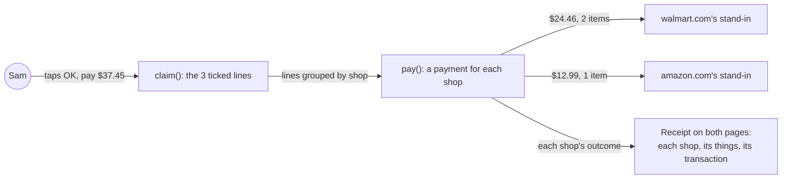
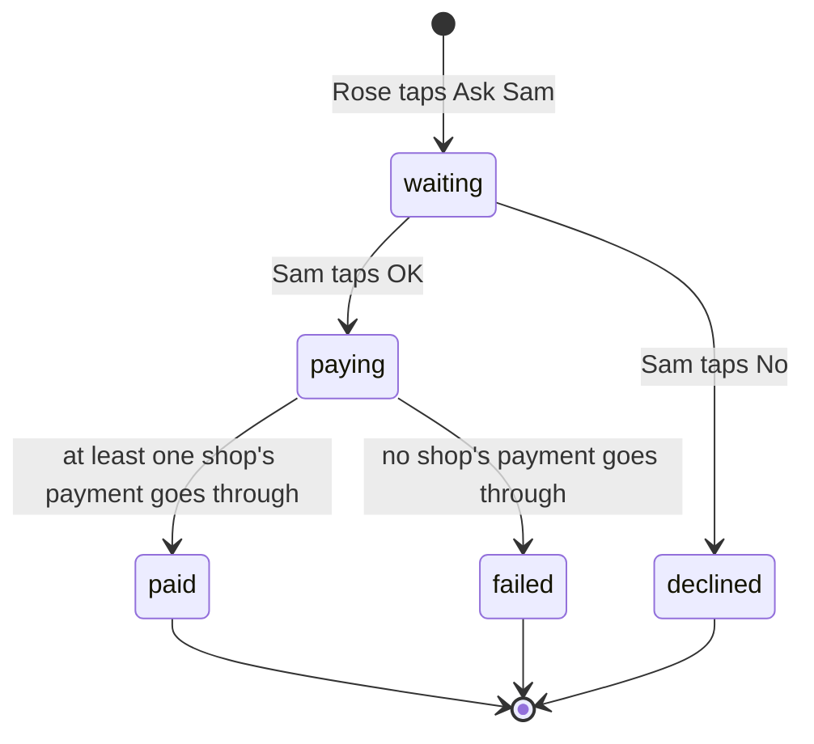

# Pay the shop

**Version:** v1 · **Status:** Draft · **Type:** Feature · **Project type:** Web UI

**Shape doc:** docs/specs/after-review/shape.md
**Depends on:** itemized-receipt
**Page:** added at pause 3.

Sam's OK pays each shop's own PayPal from Rose's saved PayPal, and the receipt names the shop. In sandbox, a stand-in business account plays each shop. It comes last in the after-review shape because it rests on two unproven PayPal claims (O1, O2).

## Problem

Every charge lands in KinCart's own sandbox business account. `charge()` at `lib/shop/paypal.ts:71` sends one purchase unit with no `payee`, so PayPal pays the app's owner. Rose's PayPal activity names the payee "Test Store" (itemized-receipt O7), and KinCart's receipt says "Paid to KinCart's sandbox shop" (`app/(shop)/ui.tsx:75`).

So KinCart looks like a reseller that holds Rose's money. A judge asks who the merchant is, and a real product would own the refunds, returns and fraud (D82).

## Slice test

| Check                         | Result |
| ----------------------------- | ------ |
| Cuts every layer it needs     | yes: the PayPal payments that `pay()` sends, the purchase row that records them, and the receipt card on Rose's and Sam's pages |
| One e2e test walks it         | yes: Sam pays a basket from two shops, the test reads each payment back from PayPal and checks its payee, and both receipts name the two shops |
| Worth shipping alone          | yes: no charge for a found listing reaches KinCart's account, and a judge sees a payee for each shop in PayPal |
| Fits (≤5 scenarios, ≤2 areas) | yes, at the edge: 5 scenarios, in the payments in `lib/shop/` and the receipt card in `app/(shop)/` |

**Path:** full. It changes where every payment goes, how a basket is paid, and the receipt that both pages show.

## User story

As Sam, I want my OK to pay each shop straight from Rose's PayPal, so that KinCart never holds Rose's money.

## Flow



Sam's OK groups the ticked things by shop, Rose's saved PayPal pays each shop's stand-in for its own things, and both receipts list each shop with its payment.

## States



A basket is paid when at least one shop's payment goes through. A shop whose payment fails gives its things back to Rose (O5).

## Acceptance criteria

```gherkin
Scenario: Sam pays a basket from two shops, and each shop gets its own payment
  Given Rose asked for "AA batteries, a night light and a phone charger"
  And Rose picked "Energizer MAX AA Batteries, 8 Pack" at $9.47 from walmart.com
  And Rose picked "LED Plug-in Night Light, Dusk to Dawn Sensor, 2 Pack" at $12.99 from amazon.com
  And Rose picked "Anker 20W USB-C Wall Charger" at $14.99 from walmart.com
  When Sam taps "OK, pay $37.45"
  Then Rose's saved PayPal pays $24.46 to walmart.com's stand-in, with the batteries and the charger as its 2 items
  And Rose's saved PayPal pays $12.99 to amazon.com's stand-in, with the night light as its 1 item
  And KinCart's own sandbox account gets nothing
  And Rose's and Sam's receipts list walmart.com and amazon.com, each with its things, its amount and its PayPal transaction
  And the receipts say "Paid to each shop's sandbox stand-in. In this demo, no order reaches the shops."

Scenario: A one-thing ask pays its shop
  Given Rose asked for "a magnifying glass" and picked "Fancii 3X Large Magnifying Glass with Light" at $16.99 from amazon.com
  When Sam taps "OK, pay $16.99"
  Then Rose's saved PayPal pays $16.99 to amazon.com's stand-in, with the magnifying glass as its 1 item
  And the receipt says "Paid to amazon.com's sandbox stand-in. In this demo, no order reaches the shops."

Scenario: One shop's payment fails, and the other shop's goes through
  Given Rose picked the batteries and the charger from walmart.com, and the night light from amazon.com, as in the first scenario
  And PayPal refuses the payment to amazon.com's stand-in
  When Sam taps "OK, pay $37.45"
  Then Rose's saved PayPal pays $24.46 to walmart.com's stand-in
  And nothing is taken for the night light
  And both receipts show $24.46 paid to walmart.com, and say "amazon.com's payment didn't go through. Nothing was taken for the night light."
  And the night light goes back to Rose as a thing Sam left out, with one Find another

Scenario: No shop's payment goes through
  Given Rose picked the same three things, and Rose's saved PayPal can't pay
  When Sam taps "OK, pay $37.45"
  Then Sam sees "Payment didn't go through" and "Nothing was taken from Rose's PayPal for the 3 things", as today
  And Rose sees "Payment didn't go through. Nothing was taken."

Scenario: A thing with no shop pays KinCart's sandbox shop, as today
  Given Find is off, and Rose picked "Reading glasses, +2.00" at $18.99 from the three fixed things
  When Sam taps "OK, pay $18.99"
  Then Rose's saved PayPal pays $18.99 to KinCart's own sandbox account, as today
  And the receipt says "Paid to KinCart's sandbox shop. In this demo, no order reaches the shops."
```

## Scope

**In:**

- Every payment for a found listing goes to the stand-in for that listing's shop. KinCart's own account gets none of it.
- A pool of 5 stand-ins, which are sandbox business accounts made by hand. In each charge, the first shop pays stand-in 1, the next shop pays stand-in 2, and so on. No two shops in a basket share a stand-in (O4).
- A basket pays each shop for its own ticked things. Each shop's payment lists its things as PayPal items, with an item total equal to its amount (D86).
- The receipt card on Rose's and Sam's pages lists each shop with its things, its amount and its PayPal transaction, and says the shops are sandbox stand-ins.
- A shop whose payment fails: the shops that were paid stay paid. The failed shop's things go back to Rose as left out, with one Find another (D97). Both receipts name the shop whose payment didn't go through (O5).
- Receipts paid before this ships keep "Paid to KinCart's sandbox shop", because that account got the money. The three fixed things have no shop, so they still pay KinCart's account (scenario 5).

**Out:**

- Real shops' PayPal accounts, and a real order at the shop. A shop has to take orders by API first (ROADMAP path B). No later slice.
- Sam's OK screen naming who gets paid. Each line already says "at walmart.com", and itemized-receipt O4 chose the receipt only. No later slice.
- Refunds and returns. No later slice.
- Live PayPal's 127-character cut on item names stays as itemized-receipt O6 left it. KinCart runs only in sandbox.
- Allowing a listing over the limit, and Sam's own Find another. `allow-over-limit` and `sam-finds-another` pick these up.

## Open items

| ID | What | Type | Raised at | Owner | Status | Answer |
| -- | ---- | ---- | --------- | ----- | ------ | ------ |
| O1 | A charge from Rose's saved PayPal (`vault_id`) can name another merchant as payee in sandbox, with no partner onboarding (from shape O3) | unproven | shape | poc | Open | — |
| O2 | A basket from several shops can be one PayPal order with one payee for each shop, or it needs one order for each shop (from shape O4). PayPal's docs put several payees in one order under multi-merchant payments, a limited release that needs seller onboarding, where some payees can fail while others pass | unproven | shape | poc | Open | — |
| O3 | In sandbox, a stand-in business account plays each shop. Nothing ships, and the listing's real shop never sees the order (from shape O5) | flag | shape | user | Resolved | Accept it. The receipt names each shop and says "Paid to each shop's sandbox stand-in. In this demo, no order reaches the shops." A one-thing receipt says "Paid to amazon.com's sandbox stand-in." 2026-10-23 |
| O4 | Which stand-in account a listing's shop pays. The recorded set has 39 shops in 116 listings, and a basket holds up to 5 things (`MOST_THINGS`, `lib/shop/find.ts:43`) | question | spec p1 | user | Resolved | A pool of 5 sandbox business accounts, made by hand. In each charge, the first shop pays stand-in 1, the next shop pays stand-in 2, and so on. No two shops in a basket share one. 2026-10-23 |
| O5 | What happens when one shop's payment fails and another shop's goes through | question | spec p1 | user | Resolved | Keep what paid. The failed shop's things go back to Rose as left out, with one Find another (D97). Both receipts name the shop whose payment didn't go through. 2026-10-23 |

_Never delete this section or its rows. See references/ledger.md._

## Glossary

- **Payee** — the PayPal account that receives the money in a payment.
- **Stand-in** — a sandbox business account that plays a shop such as walmart.com.
- **Sandbox** — PayPal's test system. Its accounts and money aren't real.
- **Purchase unit** — one payment inside a PayPal order, with its amount, items and payee.
- **Multi-merchant payments** — PayPal's limited-release feature for one order that pays several sellers, one purchase unit each.
- **Partner onboarding** — PayPal's process that connects a seller's account to a platform's app, so the platform can take payments for it.
- **Vault** — PayPal's store for Rose's saved PayPal. KinCart charges it with no buyer present (D16).
- **/poc** — zuko's timeboxed spike. It answers one risky question with throwaway code.
- **e2e** — end to end: an automated test that drives the app the way a person would, start to finish.
