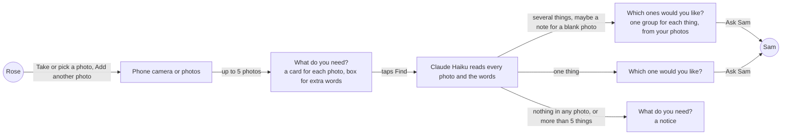
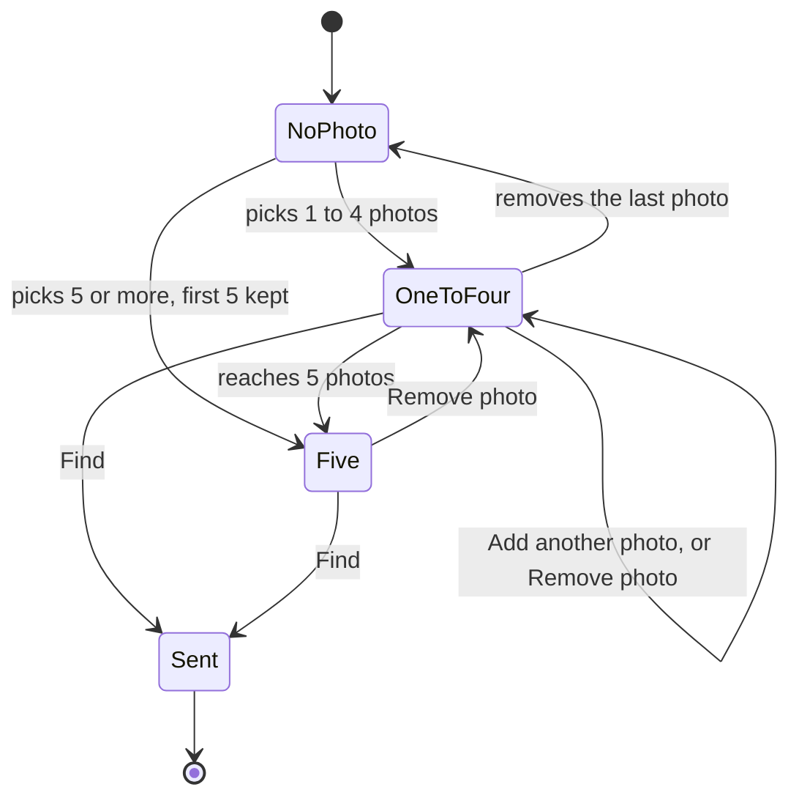
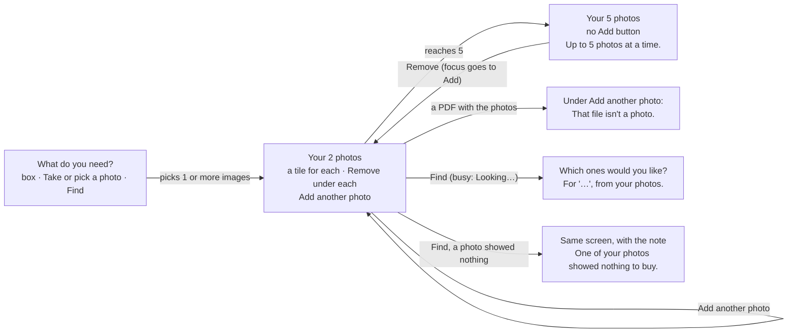

# Photo ask, several

**Version:** v1 · **Status:** Draft · **Type:** Feature · **Project type:** Web UI

**Shape doc:** docs/specs/shop-together/shape.md
**Depends on:** photo-ask, shipped
**Page:** none. Skipped: you read the `.md` directly.

Rose sends up to 5 photos in one Find, one for each thing they need, and AI turns them into one basket. It was split from photo-ask at its pause 3 (O9), and comes now because time is left.

## Problem

Rose can send one photo in each Find. `PhotoPicker` puts one file in the form (`app/(shop)/PhotoPicker.tsx:50`), and `find()` reads one (`app/(shop)/actions.ts:85`).

To ask for a car-key battery and slippers by photo, Rose makes two asks. Rose waits for Sam's answer to the first before the page lets them ask again (`app/(shop)/state.ts:29`), and Sam pays twice. A photo of a written list works in one Find, but only when Rose knows the names of the things.

## Slice test

| Check                         | Result |
| ----------------------------- | ------ |
| Cuts every layer it needs     | yes: the photo cards on Rose's ask screen, the Find action, and the AI step that reads the photos |
| One e2e test walks it         | yes: Playwright gives Rose's page the CR2032 photo and the list photo, taps Find, sees four groups and asks Sam. CI calls Claude and Channel3 for real (D24) |
| Worth shipping alone          | yes: Rose can ask for several things by photo in one ask, and Sam pays once |
| Fits (≤5 scenarios, ≤2 areas) | yes: 5 scenarios, in Rose's page and the AI step in `lib/shop/` |

**Path:** full. It changes Rose's photo control and what the AI step reads.

## User story

As Rose, I want to show KinCart a photo of each thing I need in one go, so that Sam gets one ask and pays once.

## Flow



Every photo and Rose's words go to the AI in one Find, and the things it finds become one ask for Sam.

## States



At 5 photos, "Add another photo" goes away until Rose removes one. After Find, the photos are gone (D64).

## Acceptance criteria

```gherkin
Scenario: Rose finds four things from two photos
  Given Rose's PayPal is linked and Sam's limit is $25 an item
  When Rose taps "Take or pick a photo" and takes a photo of the old battery from Rose's car key
  And Rose taps "Add another photo" and picks a photo of Rose's handwritten list: "AA batteries, night light, phone charger"
  And Rose taps Find without typing anything
  Then Rose's page shows "Which ones would you like?"
  And it shows four groups, in this order: a CR2032 coin battery, AA batteries, a night light and a phone charger
  And the line under the heading ends ", from your photos"
  And one Ask Sam sends Rose's picks to Sam as one ask
  And KinCart keeps the AI's words for this search, and none of the photos

Scenario: Rose's words go on the thing they fit
  Given Rose's PayPal is linked and Sam's limit is $25 an item
  When Rose adds a photo of the old CR2032 battery and a photo of worn grey slippers
  And Rose types "size 8 and a phone charger" in the box and taps Find
  Then Rose's page shows two groups
  And the slippers' words include "size 8", and the battery's words do not
  And no group is for a phone charger, because the words add details and not things

Scenario Outline: Find reads what the photos show
  Given Rose's PayPal is linked and Sam's limit is $25 an item
  When Rose adds <photos> and taps Find
  Then Rose's page shows "<heading>"
  And it shows <result>

  Examples:
    | photos                                                     | heading                    | result                                                                                                        |
    | the CR2032 battery, Rose's garden and the grey slippers   | Which ones would you like? | two groups, and the note "One of your photos showed nothing to buy."                                          |
    | Rose's garden and the sky over it                          | What do you need?          | the notice "Couldn't tell what to buy from those photos. Try other photos, or type what you need.", and no photo is picked |
    | the front and the back of one CR2032 pack                  | Which one would you like?  | CR2032 listings for one thing, not two groups                                                                 |
    | a written list of 5 things and the CR2032 battery          | What do you need?          | the notice "Up to 5 things at a time. Which 5 do you need most?", the AI's words for all 6 things in the box, and no photo is picked |

Scenario: Rose picks more than 5 photos
  Given Rose's page shows three photo cards
  When Rose taps "Add another photo" and ticks four photos in the phone's photos
  Then Rose's page shows five photo cards: the three from before and the first two of the four
  And it shows "Up to 5 photos. The first 5 are kept."
  And "Add another photo" is gone
  When Rose taps "Remove photo" on the second card
  Then four cards are left, and "Add another photo" is back

Scenario: One of Rose's files isn't a photo
  Given Rose's page shows one photo card
  When Rose taps "Add another photo" and picks a photo of the slippers and a PDF together
  Then Rose's page shows two photo cards
  And it shows "That file isn't a photo. Pick a photo, or type what you need." under "Add another photo"
```

## Scope

**In:**

- Up to 5 photos in one Find, each on its own card with its own "Remove photo".
- "Add another photo" under the cards, until there are 5. It opens the camera or the photos, as the first button does.
- Ticking several photos at once in the phone's photos. The first 5 in all are kept, and a line says so.
- One Find sends every photo and Rose's words to the AI together. A product photo is one thing, and a list photo is its things, as in photo-ask.
- The things from all the photos, in the order Rose added them, as one basket of up to 5. More than 5 gets today's "Up to 5 things at a time" notice.
- Two photos of one product make one thing.
- Rose's words add details to the thing they fit, as with one photo today. They add no things of their own.
- A photo that shows nothing to buy does not stop the others. A note on the results says so. When no photo shows anything, the photo-ask notice says "those photos".
- ", from your photos" on the results, when Rose sent more than one photo.
- A file that isn't a photo is dropped, and the other picked photos stay.
- After a Find that ends at a notice, no photo is picked, as in photo-ask. After "Up to 5 things", the box holds the AI's words for all the things (O8).

**Out:**

- Keeping the photos, or showing them to Sam. Not planned (D64).
- Words that add a thing of their own beside the photos, such as "and a phone charger". Not planned (O4).
- Saying which photo showed nothing. The photos are gone after Find (D64), so the note gives only the count. Not planned.
- Putting the photos in a different order. Not planned.
- A photo scene in the demo video. Separate work on `feat/demo-video`.

## Interface



The first pick turns the photo button into a panel of tiles. Find takes every tile's photo and the box's words together.

Screens, all in `app/(shop)/RoseView.tsx` unless named:

- **Ask.** It is the same as in photo-ask: "Take or pick a photo", the line "A photo of the thing, or of your written list.", then Find. The input now takes several files, so the phone's photos let Rose tick more than one.
- **Photos panel** (`app/(shop)/PhotoPicker.tsx`). This is a `sunken` panel with "Your photo", or "Your 3 photos", and the hint "Add words above if you need to, such as a size." Under the hint, the photos sit in 128px tiles, two to a row on a phone. Each tile has its own Remove button under it. The visible label is "Remove", because a 128px tile can't fit "Remove photo". The accessible name is "Remove photo 2".
- **Add another photo** (secondary) sits under the panel while there are fewer than 5 photos. After Remove, focus goes to it.
- **Five photos.** The Add button goes. In its place: "Up to 5 photos at a time.", or "Up to 5 photos. The first 5 are kept." when the last pick had more than would fit.
- **Not a photo.** A file that isn't an image is dropped, and the other photos in the same pick stay. The error "That file isn't a photo. Pick a photo, or type what you need." shows under the Add button, which points to it with `aria-describedby`. At 5 photos, the error takes the place of the five-photo line.
- **Busy.** Find shows "Looking…" with the spinner. The tiles stay, and every Remove button and the Add button go.
- **Results.** The line under the heading says ", from your photos" when Find read more than one photo, and ", from your photo" for one.
- **A photo showed nothing.** A neutral notice at the top of the results: "One of your photos showed nothing to buy.", or "2 of your photos showed nothing to buy."
- **Nothing in any photo.** The photo-ask notice, made plural for several photos: "Couldn't tell what to buy from those photos. Try other photos, or type what you need."
- **More than 5 things.** The notice "Up to 5 things at a time. Which 5 do you need most?" shows, as for typed words. The box holds the AI's words for all the things.

**Motion tier:** 1. Each new tile enters with the existing enter animation (`opacity` and `transform`). Remove is instant. Under reduced motion, nothing moves.

**Components used:** `Button` (primary), the `button button-secondary` classes on the plain Remove and Add buttons, `Notice` (neutral), `field-error`, `field-label`, `listing-photo`, `heading`, `small`, `stack`, `PageHead` and `PhoneFrame`. The `photo-pick` class changes from a side-by-side card to a panel. Two new classes, `photo-tiles` and `photo-tile`, lay out the tiles with `--photo-size` and `--space-4`. This slice adds no token.

**Design system:** `docs/design/design-system/` (D15). The reference is Stripe's forms: each message sits under the control it is about. The five-photo line and the error take the place of the Add button.

**Preview:** `/preview/photo-ask-several` on `pnpm dev`, built from the real components (`app/(shop)/preview/photo-ask-several/page.tsx`). In the first frame, the picker works for real: pick several, add more, go past 5, and pick a PDF.

## Technical plan

### Decisions to record

```
## D68 · 2026-10-16 · Find takes up to 5 photos, and reads them together as one ask

Why: a basket holds up to 5 things, so one photo for each thing fills it. Rose's words add details, two photos of one thing make one thing, and more than 5 things get today's notice.
Rejected: up to 3 photos (a 4- or 5-thing ask needs a written list), one thing for each photo (the front and back of one pack become two groups), words that add things of their own (one photo and several would follow different rules), refusing photos past the fifth (Rose picks them all again).
Source: docs/specs/photo-ask-several.md
Status: active

## D69 · 2026-10-16 · A photo that shows nothing doesn't stop the others, and the results say so

Why: one blurry photo out of 3 would otherwise throw away the 2 things found. The photos are gone after Find (D64), so the note is Rose's only sign that one was missed.
Rejected: the whole Find stops (Rose adds all 3 photos again), the blank photo is dropped with no note (Rose may not see that a thing is missing).
Source: docs/specs/photo-ask-several.md
Status: active
```

## Open items

| ID | What | Type | Raised at | Owner | Status | Answer |
| -- | ---- | ---- | --------- | ----- | ------ | ------ |
| O1 | How many photos can Rose send in one Find? | question | spec p1 | user | Resolved | Up to 5, the same as the 5 things a basket holds. 2026-10-16 |
| O2 | How does Rose add the second and later photos? | question | spec p1 | user | Resolved | "Add another photo" after the first card opens the camera or photos again. The phone's photos also let Rose tick several at once. 2026-10-16 |
| O3 | Rose sends 3 photos and one shows nothing to buy. What happens? | question | spec p1 | user | Resolved | The other things show as usual, with a neutral note that one photo showed nothing to buy. 2026-10-16 |
| O4 | With several photos, Rose types "size 8 and a phone charger". What do the words do? | question | spec p1 | user | Resolved | They add details to the thing they fit, as with one photo today. A thing named only in the words is not added. 2026-10-16 |
| O5 | Rose has 3 photos and ticks 4 more. What happens? | question | spec p1 | user | Resolved | The first 5 in all are kept, and a line says "Up to 5 photos. The first 5 are kept." 2026-10-16 |
| O6 | The photos hold more than 5 things in all, such as a 5-thing list and a battery. What happens? | question | spec p1 | user | Resolved | Today's notice for typed words: "Up to 5 things at a time. Which 5 do you need most?" Nothing is searched. The question said the photos stay, which O8 corrects. 2026-10-16 |
| O7 | Rose takes two photos of one thing, such as the front and back of a pack. What does Find show? | question | spec p1 | user | Resolved | One thing. The AI lists a product once when two photos show it. 2026-10-16 |
| O8 | After a Find that ends at a notice (more than 5 things, or nothing in any photo), do the photos stay on screen? The O6 question said they stay, but photo-ask's scenario 4 says no photo is picked after Find | question | spec p1 | user | Resolved | No, as with one photo today. After "Up to 5 things", the box holds the AI's words for all the things, so Rose deletes one and taps Find. After nothing in any photo, the box keeps Rose's own words. 2026-10-16 |
| O9 | Rose ticks a photo and a PDF together. What happens? | question | spec p1 | user | Resolved | The photo gets its card, the PDF is dropped, and "That file isn't a photo" shows under "Add another photo". 2026-10-16 |

_Never delete this section or its rows. See references/ledger.md._

## Glossary

- **Basket**: an ask for several things at once, with one pick for each, paid as one charge.
- **Channel3**: a hackathon sponsor whose API returns real product listings.
- **Claude Haiku**: the small Claude model that reads Rose's ask and explains each listing.
- **e2e**: end-to-end: one test that walks the whole slice as a person would.
