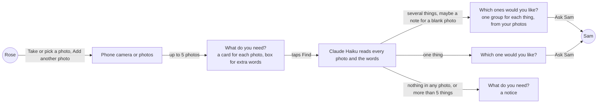
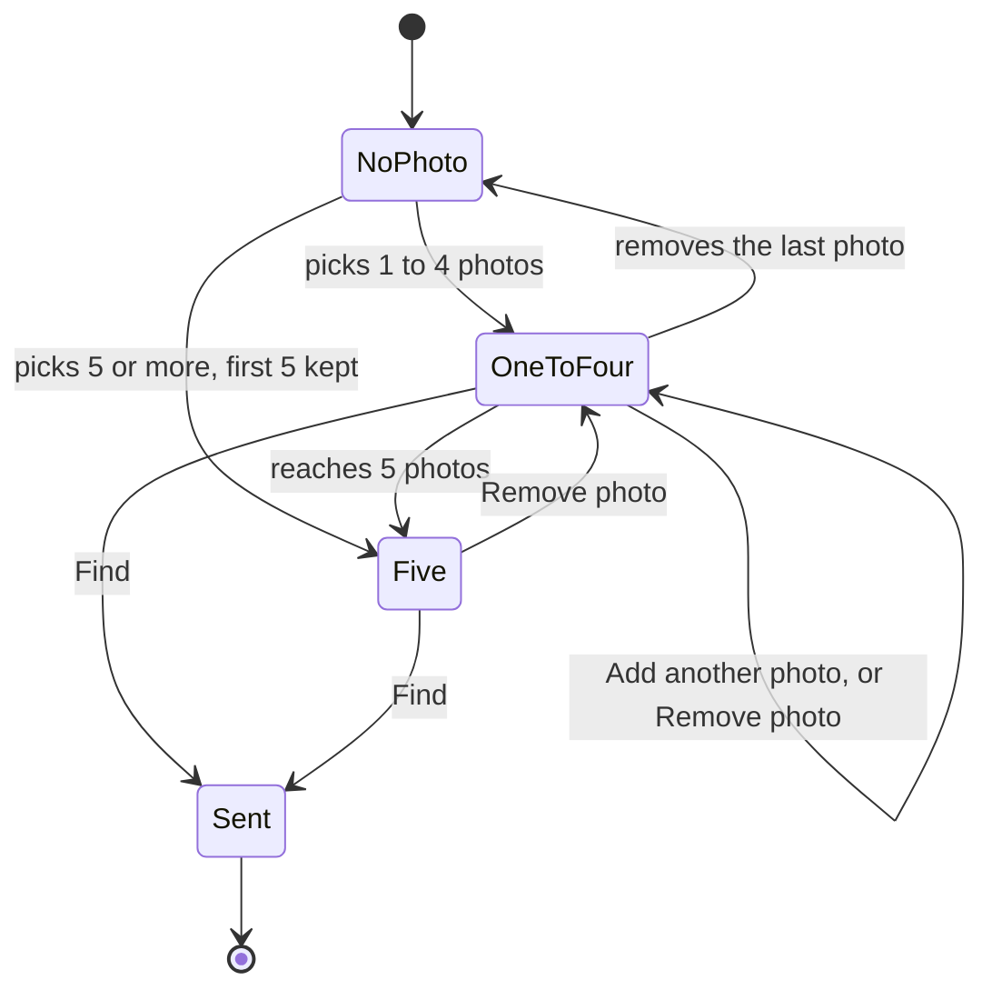
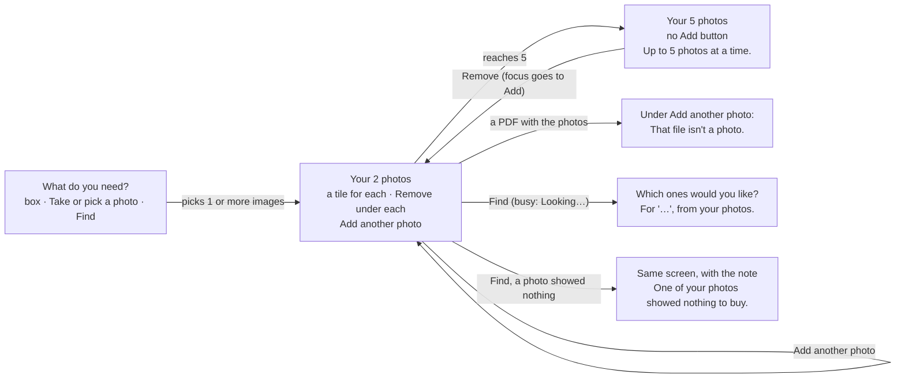
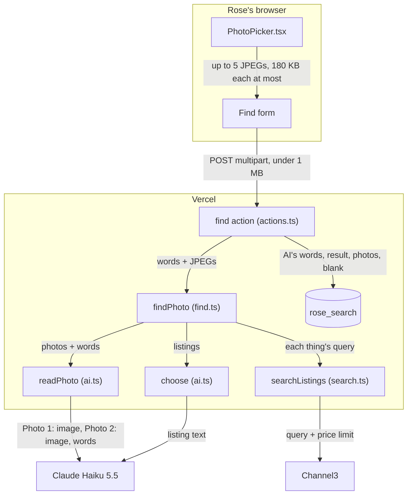
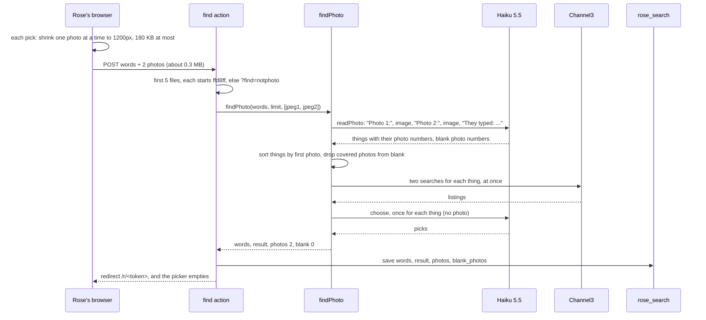
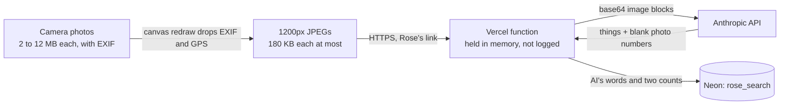
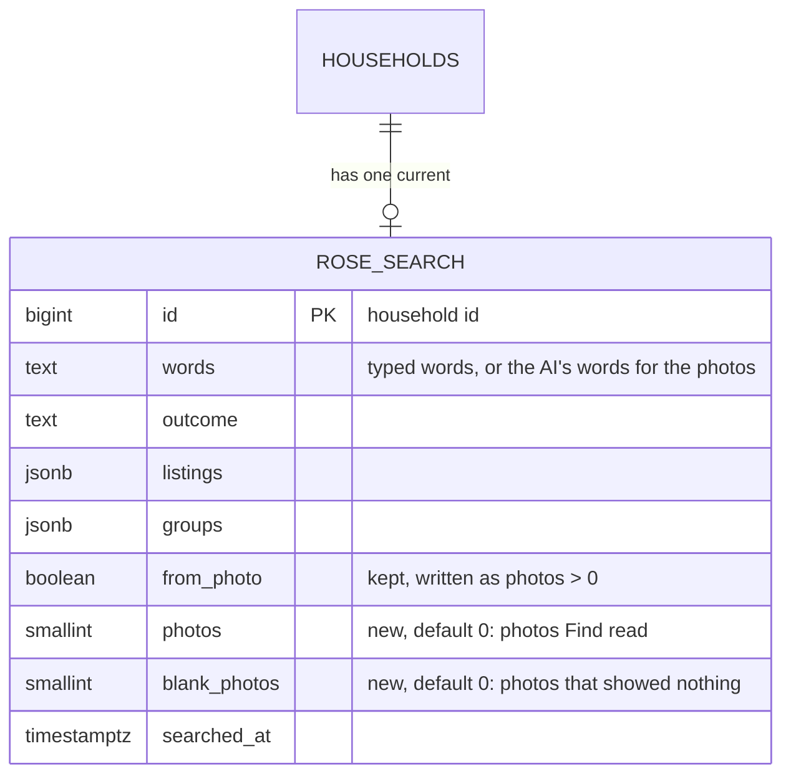

# Photo ask, several

**Version:** v1 · **Status:** Shipped · **Type:** Feature · **Project type:** Web UI

**Shape doc:** docs/specs/shop-together/shape.md
**Depends on:** photo-ask, shipped
**Page:** none. Skipped: you read the `.md` directly.

Rose sends up to 5 photos in one Find, one for each thing they need, and AI turns them into one basket. It was split from photo-ask at its pause 3 (O9), and comes now because time is left.

## Problem

Rose can send one photo in each Find. `PhotoPicker` puts one file in the form (`app/(shop)/PhotoPicker.tsx:50`), and `find()` reads one (`app/(shop)/actions.ts:85`).

To ask for a car-key battery and slippers by photo, Rose makes two asks. Rose waits for Sam's answer to the first before the page lets them ask again (`app/(shop)/state.ts:29`), and Sam pays twice. A photo of a written list works in one Find, but only when Rose knows the names of the things.

## Slice test

| Check                         | Result |
| ----------------------------- | ------ |
| Cuts every layer it needs     | yes: the photo cards on Rose's ask screen, the Find action, and the AI step that reads the photos |
| One e2e test walks it         | yes: Playwright gives Rose's page the CR2032 photo and the list photo, taps Find, sees four groups and asks Sam. CI calls Claude and Channel3 for real (D24) |
| Worth shipping alone          | yes: Rose can ask for several things by photo in one ask, and Sam pays once |
| Fits (≤5 scenarios, ≤2 areas) | yes: 5 scenarios, in Rose's page and the AI step in `lib/shop/` |

**Path:** full. It changes Rose's photo control and what the AI step reads.

## User story

As Rose, I want to show KinCart a photo of each thing I need in one go, so that Sam gets one ask and pays once.

## Flow



Every photo and Rose's words go to the AI in one Find, and the things it finds become one ask for Sam.

## States



At 5 photos, "Add another photo" goes away until Rose removes one. After Find, the photos are gone (D64).

## Acceptance criteria

```gherkin
Scenario: Rose finds four things from two photos
  Given Rose's PayPal is linked and Sam's limit is $25 an item
  When Rose taps "Take or pick a photo" and takes a photo of the old battery from Rose's car key
  And Rose taps "Add another photo" and picks a photo of Rose's handwritten list: "AA batteries, night light, phone charger"
  And Rose taps Find without typing anything
  Then Rose's page shows "Which ones would you like?"
  And it shows four groups, in this order: a CR2032 coin battery, AA batteries, a night light and a phone charger
  And the line under the heading ends ", from your photos"
  And one Ask Sam sends Rose's picks to Sam as one ask
  And KinCart keeps the AI's words for this search, and none of the photos

Scenario: Rose's words go on the thing they fit
  Given Rose's PayPal is linked and Sam's limit is $25 an item
  When Rose adds a photo of the old CR2032 battery and a photo of worn grey slippers
  And Rose types "size 8 and a phone charger" in the box and taps Find
  Then Rose's page shows two groups
  And the slippers' words include "size 8", and the battery's words do not
  And no group is for a phone charger, because the words add details and not things

Scenario Outline: Find reads what the photos show
  Given Rose's PayPal is linked and Sam's limit is $25 an item
  When Rose adds <photos> and taps Find
  Then Rose's page shows "<heading>"
  And it shows <result>

  Examples:
    | photos                                                     | heading                    | result                                                                                                        |
    | the CR2032 battery, Rose's garden and the grey slippers   | Which ones would you like? | two groups, and the note "One of your photos showed nothing to buy."                                          |
    | Rose's garden and the sky over it                          | What do you need?          | the notice "Couldn't tell what to buy from those photos. Try other photos, or type what you need.", and no photo is picked |
    | the front and the back of one CR2032 pack                  | Which one would you like?  | CR2032 listings for one thing, not two groups                                                                 |
    | a written list of 5 things and the CR2032 battery          | What do you need?          | the notice "Up to 5 things at a time. Which 5 do you need most?", the AI's words for all 6 things in the box, and no photo is picked |

Scenario: Rose picks more than 5 photos
  Given Rose's page shows three photo cards
  When Rose taps "Add another photo" and ticks four photos in the phone's photos
  Then Rose's page shows five photo cards: the three from before and the first two of the four
  And it shows "Up to 5 photos. The first 5 are kept."
  And "Add another photo" is gone
  When Rose taps "Remove photo" on the second card
  Then four cards are left, and "Add another photo" is back

Scenario: One of Rose's files isn't a photo
  Given Rose's page shows one photo card
  When Rose taps "Add another photo" and picks a photo of the slippers and a PDF together
  Then Rose's page shows two photo cards
  And it shows "That file isn't a photo. Pick a photo, or type what you need." under "Add another photo"
```

## Scope

**In:**

- Up to 5 photos in one Find, each on its own card with its own "Remove photo".
- "Add another photo" under the cards, until there are 5. It opens the camera or the photos, as the first button does.
- Ticking several photos at once in the phone's photos. The first 5 in all are kept, and a line says so.
- One Find sends every photo and Rose's words to the AI together. A product photo is one thing, and a list photo is its things, as in photo-ask.
- The things from all the photos, in the order Rose added them, as one basket of up to 5. More than 5 gets today's "Up to 5 things at a time" notice.
- Two photos of one product make one thing.
- Rose's words add details to the thing they fit, as with one photo today. They add no things of their own.
- A photo that shows nothing to buy does not stop the others. A note on the results says so. When no photo shows anything, the photo-ask notice says "those photos".
- ", from your photos" on the results, when Rose sent more than one photo.
- A file that isn't a photo is dropped, and the other picked photos stay.
- After a Find that ends at a notice, no photo is picked, as in photo-ask. After "Up to 5 things", the box holds the AI's words for all the things (O8).

**Out:**

- Keeping the photos, or showing them to Sam. Not planned (D64).
- Words that add a thing of their own beside the photos, such as "and a phone charger". Not planned (O4).
- Saying which photo showed nothing. The photos are gone after Find (D64), so the note gives only the count. Not planned.
- Putting the photos in a different order. Not planned.
- A photo scene in the demo video. Separate work on `feat/demo-video`.

## Interface



The first pick turns the photo button into a panel of tiles. Find takes every tile's photo and the box's words together.

Screens, all in `app/(shop)/RoseView.tsx` unless named:

- **Ask.** It is the same as in photo-ask: "Take or pick a photo", the line "A photo of the thing, or of your written list.", then Find. The input now takes several files, so the phone's photos let Rose tick more than one.
- **Photos panel** (`app/(shop)/PhotoPicker.tsx`). This is a `sunken` panel with "Your photo", or "Your 3 photos", and the hint "Add words above if you need to, such as a size." Under the hint, the photos sit in 128px tiles, two to a row on a phone. Each tile has its own Remove button under it. The visible label is "Remove", because a 128px tile can't fit "Remove photo". The accessible name is "Remove photo 2".
- **Add another photo** (secondary) sits under the panel while there are fewer than 5 photos. After Remove, focus goes to it.
- **Five photos.** The Add button goes. In its place: "Up to 5 photos at a time.", or "Up to 5 photos. The first 5 are kept." when a pick since the last Remove had more than would fit. Focus goes to that line, or to the error when it shows (O18).
- **Not a photo.** A file that isn't an image is dropped, and the other photos in the same pick stay. The error "That file isn't a photo. Pick a photo, or type what you need." shows under the Add button, which points to it with `aria-describedby`. At 5 photos, the error takes the place of the five-photo line.
- **Busy.** Find shows "Looking…" with the spinner. The tiles stay, and every Remove button and the Add button go.
- **Results.** The line under the heading says ", from your photos" when Find read more than one photo, and ", from your photo" for one.
- **A photo showed nothing.** A neutral notice at the top of the results: "One of your photos showed nothing to buy.", or "2 of your photos showed nothing to buy."
- **Nothing in any photo.** The photo-ask notice, made plural for several photos: "Couldn't tell what to buy from those photos. Try other photos, or type what you need."
- **More than 5 things.** The notice "Up to 5 things at a time. Which 5 do you need most?" shows, as for typed words. The box holds the AI's words for all the things.

**Motion tier:** 1. Each new tile enters with the existing enter animation (`opacity` and `transform`). Remove is instant. Under reduced motion, nothing moves.

**Components used:** `Button` (primary), the `button button-secondary` classes on the plain Remove and Add buttons, `Notice` (neutral), `field-error`, `field-label`, `listing-photo`, `heading`, `small`, `stack`, `PageHead` and `PhoneFrame`. The `photo-pick` class changes from a side-by-side card to a panel. Two new classes, `photo-tiles` and `photo-tile`, lay out the tiles with `--photo-size` and `--space-4`. This slice adds no token.

**Design system:** `docs/design/design-system/` (D15). The reference is Stripe's forms: each message sits under the control it is about. The five-photo line and the error take the place of the Add button.

**Preview:** `/preview/photo-ask-several` on `pnpm dev`, built from the real components (`app/(shop)/preview/photo-ask-several/page.tsx`). In the first frame, the picker works for real: pick several, add more, go past 5, and pick a PDF.

## Technical plan

### Approach

Each photo shrinks in the browser to a JPEG of at most 180 KB, so 5 photos and Rose's words stay under Next's 1 MB limit (O10). The shrink runs one photo at a time. Find's server action reads up to 5 files, checks each is a JPEG, and calls `findPhoto()` with all of them. One Haiku call reads every photo, each with its own "Photo 1:" label, and Rose's words. It returns the things, each with the numbers of the photos it is in, and the numbers of the photos that showed nothing. The code sorts the things by photo, and a photo that a thing covers is never counted as blank (O11). From there the search runs as a typed basket does (D31). `rose_search` stores how many photos Find read and how many showed nothing. The photos are dropped (D64).

Relies on: D10, D11, D12, D19, D22, D23, D24, D31, D63, D64, D66, D67, D68, D69, D70, D71, D72



The only new path is in the browser and the first Haiku call. Every step after it is the typed basket's.



A Find with 5 photos costs one Haiku call with 5 images, then a typed basket's calls.



The photos leave Rose's phone without location data. Only the AI's words and two counts are stored.

### Changes

| File | What changes | Why |
| ---- | ------------ | --- |
| `app/(shop)/PhotoPicker.tsx:11` | `LONG_EDGE` gives way to `STEPS`, and `MOST_BYTES` goes from 900 KB to 180 KB. `shrink()` (`:143`) tries 1200px at 0.85, 0.7 and 0.55, then 1000px and 800px at 0.55, and stops at the first JPEG under 180 KB. `picked()` (`:58`) shrinks one photo at a time, not with `Promise.all`. A count holds the photos kept or still shrinking, so a second pick during the first has the right room, and a pick that fills the 5 moves focus to the line in Add's place (O18). After Find, Next mounts the form again, so the picker starts empty with no code of its own (O8, O14) | 1, 3, 4, 5 (O10) |
| `app/(shop)/actions.ts:80` | `find()` reads `formData.getAll("photo")`, keeps the non-empty files, and takes the first 5. Any file that doesn't start `ffd8ff` redirects to `?find=notphoto`. It calls `findPhoto()` with all of them, and saves `photos` and `blank` | 1 to 3 |
| `lib/shop/ai.ts:12` | `NEED_PHOTO` is rewritten for 1 to 5 photos (below). `readPhoto(words, jpegs)` (`:56`) sends "Photo n:" before each image, then the words. A new `NEED_PHOTO_SCHEMA` gives each thing `photos`, the numbers of the photos it is in, and adds `blank`, a list of photo numbers. `readNeed()` and `NEED` stay as they are (D66) | 1 to 3 |
| `lib/shop/find.ts:34` | `findPhoto(words, limitCents, jpegs)` returns `{ words, result, photos, blank }`. The things are sorted by their smallest photo number, and a list keeps its own order inside one photo. `blank` counts the different photo numbers in range that no thing's `photos` names, and is 0 when there are no things. The log line's ` photo=yes` becomes ` photos=2 blank=0` | 1 to 3 |
| `lib/shop/requests.ts:56` | `SavedSearch` gains `photos` and `blankPhotos`. `saveSearch()` (`:165`) takes `photos = 0` and `blank = 0` in place of `fromPhoto`, and writes `from_photo` as `photos > 0`, so the old code still reads it. `getSearch()` (`:142`) reads both columns | 1, 3 |
| `app/(shop)/state.ts:49` | Options, basket and ask pass `photos` and `blankPhotos` from the saved search. `fromPhoto` stays | 1, 3 |
| `app/(shop)/RoseView.tsx` | Built at pause 2. `/build` breaks each new line once, as the lesson says | 1, 3 |
| `db/migrations/0010_photo_ask_several.up.sql`, `.down.sql` | Add `photos` and `blank_photos`, `smallint NOT NULL DEFAULT 0`, with `IF NOT EXISTS`, so a rerun of `db:up` passes | 1, 3 |
| `scripts/migrate.test.ts:27` | The first test checks both columns up, down and up. `downToHouseholds()` also runs `0009_photo_ask.down.sql` by hand | migration |
| `e2e/photo-ask-several.spec.ts`, `e2e/photos/blank.jpg` | The slice's e2e, and a generated photo of a blank wall | 1, 3, 4, 5 |
| `app/(shop)/shop.css`, `app/(shop)/preview/photo-ask-several/page.tsx`, `app/(shop)/preview/photo-ask/page.tsx` | Built at pause 2: the `photo-tiles` and `photo-tile` classes, this slice's preview, and photo-ask's preview passing `previews` in place of `photo` | 1, 4, 5 |

Reusing: `searchThings()`, `searchListings()` and `choose()` unchanged, `haiku()` with content blocks, `reasonOf()` for the log, `reset()` from `e2e/db.ts`, and the pause 2 picker and notices.

`NEED_PHOTO`, as O11 tested it:

> You read photos that an older person took to show what they want to buy, labelled Photo 1, Photo 2 and so on, and any words they typed with them. A photo of a product shows one product. A photo of a written shopping list shows every product on it, in order. List the products in photo order, and list a product once when two photos show it. For each, list the numbers of the photos it is in, and write a short plain name for it, such as "CR2032 coin battery", with anything their words add to it, such as a size or a count. Their words only add details to products in the photos, so never list a product that only their words name. Then write a short shop search query that keeps the sizes, colours, codes and other must-haves from the photos and their words. In blank, list the number of each photo that shows nothing they could buy.

### Data



**Migration:** expand only. `0010_photo_ask_several.up.sql` adds the two columns with `IF NOT EXISTS`. `db:up` reruns every up file, and this one is rerun-safe. There is no backfill: an old photo row has `photos` 0, and it still reads ", from your photo", which is right for one photo. Old code ignores the columns, and it reads `from_photo` as before. CI runs `db:up` on Neon after tests pass on main (D11), and Vercel promotes after that (D10). There is no contract step.

**Reverse:** promote the previous deploy on Vercel. Then, if wanted, `pnpm db:down` runs `0010_photo_ask_several.down.sql`, which drops both columns. `scripts/migrate.test.ts` tests this path.

### Earn-it

| Added | Triggered by |
| ----- | ------------ |
| The 1200px, 180 KB shrink and its steps | Scenario 1 with 5 photos. Five photos at today's 900 KB each would be 4.5 MB, and Next refuses a body over 1 MB (O10) |
| One photo at a time in `picked()` | Scenario 4's multi-pick on an iPhone. Five 12 MP photos decoded at once hold about 240 MB of pixels |
| "Photo n:" labels and `blank` in the schema | Scenario 3's note needs the photo count that showed nothing. The vision docs say to label each image when a request has several |
| `photos` on each thing, the sort, and dropping covered photos from `blank` | O11: without them, 1 of 3 five-photo runs put photo 5's thing before photo 4's. With `blank` alone, the close-up of a battery merged into photo 1 came back as blank in 3 of 3 runs |
| `photos` and `blank_photos` | Scenario 1's ", from your photos" and scenario 3's note must survive the 3 s redraw (D19) and a reopened link (D67) |
| The first 5 files only, in `find()` | A crafted request could send more images than the picker allows, and each one costs Haiku tokens |

### Non-functionals

|                      |                                                                               |
| -------------------- | ----------------------------------------------------------------------------- |
| **Load**             | Judges and the video: tens of photo Finds a day. A 1200×900 photo is about 1,419 image tokens, so 5 photos and the prompt are about 7,400 input tokens: $0.00074 at $0.10 per million. Then a typed basket's calls |
| **Breaks first**     | Channel3's 1,000 free searches a month, as for a typed basket. Five photos with one thing each cost 10 searches. Each CI run adds 8 searches for this slice's e2e. The fix is the same as for typed Finds (`docs/ROADMAP.md`) |
| **Security surface** | Anyone with Rose's link can send up to 1 MB. The server reads at most 5 files, trusts only bytes that start like a JPEG, and sends that media type itself. `blank` numbers from Haiku are counted only when they are in range. The photos stay in memory, never in Neon or a log. Text in a photo can steer Haiku as typed words can. The schema fixes the answer's shape, listings come from Channel3 by ID, and Sam approves every charge. Secrets: `ANTHROPIC_API_KEY` and `CHANNEL3_API_KEY`, as today. Stored: the AI's words and two counts |
| **Proof it works**   | `find outcome=basket things=4 shown=4 listings=9 ms=6120 photos=2 blank=0` in Vercel's logs. The numbers are whatever the run gave. `blank=1` says the note showed |
| **Rollout**          | No flag. CI migrates Neon, then Vercel promotes (D10, D11). Rollback: the two steps under Reverse |

### Test plan

| Scenario | Test | Command |
| -------- | ---- | ------- |
| 1, 4, 5 | `e2e/photo-ask-several.spec.ts`, real Haiku and Channel3 (D24) | `pnpm test:e2e e2e/photo-ask-several.spec.ts` |
| 1, 2 | `lib/shop/ai.test.ts`: `readPhoto()` sends "Photo 1:", the first image, "Photo 2:", the second, then "They typed: size 8", with `NEED_PHOTO` and `NEED_PHOTO_SCHEMA` | `pnpm test lib/shop/ai.test.ts` |
| 1, 3 | `lib/shop/find.test.ts`: two photos give a basket under the AI's words; things come back sorted by photo, and a list keeps its order; a blank photo gives `blank` 1; a blank number that a thing's `photos` covers, is out of range or is repeated counts once or not at all; six things give `too many`; no things give `nothing in photo` with `blank` 0; the log line has `photos=2 blank=0` | `pnpm test lib/shop/find.test.ts` |
| 1, 3 | `app/(shop)/actions.test.ts`: two JPEGs reach `findPhoto()` in order and are saved with `photos` 2; a PDF among them redirects to `?find=notphoto` and calls nothing; six files pass only five on | `pnpm test "app/(shop)/actions.test.ts"` |
| 1, 3 | `app/(shop)/state.test.ts` and `app/(shop)/RoseView.test.tsx`: `photos` and `blankPhotos` reach options, basket and ask; ", from your photos", the note, and "those photos" | `pnpm test "app/(shop)/state.test.ts" "app/(shop)/RoseView.test.tsx"` |
| storage | `lib/shop/requests.test.ts`: `photos` and `blankPhotos` round trip; `scripts/migrate.test.ts`: 0010 up, down, up | `pnpm test lib/shop/requests.test.ts scripts/migrate.test.ts` |
| 2, 3 | The slippers, the two battery photos and the garden through real Haiku: done by the O11 spike, 3 runs each | none kept |

**E2E:** `e2e/photo-ask-several.spec.ts`, four tests:

1. Rose picks `e2e/photos/cr2032.jpg` with "Take or pick a photo", then `e2e/photos/list.jpg` with "Add another photo". The form holds two JPEGs of 180 KB or less. Both tiles outlast a 4 s redraw. Find shows "Which ones would you like?" within 30 s, with ", from your photos" and four groups, the first matching `/2032/`. Rose picks the first listing in each group that has one, at least 2, and Ask Sam shows "Rose would like n things" on Sam's page, for that count (O15).
2. Rose ticks six photos at once. Five tiles show, with "Up to 5 photos. The first 5 are kept." and no Add button, and focus is on that line. Remove photo 2 leaves four, and focus is on "Add another photo". A PDF ticked with a photo gives five tiles and the not-a-photo error, with focus on the error. No request goes out.
3. Rose sends `e2e/photos/blank.jpg` twice. The page shows "Couldn't tell what to buy from those photos", and no tile is left (O8).
4. Rose picks four photos, then two more before the first four show. Five tiles show, with "Up to 5 photos. The first 5 are kept."

### Chunks

| Chunk | Scenarios | Files owned |
| ----- | --------- | ----------- |
| A | 1 to 3, server side | `db/migrations/0010_photo_ask_several.*`, `scripts/migrate.test.ts`, `lib/shop/ai.ts`, `lib/shop/find.ts`, `lib/shop/requests.ts` and their tests, `app/(shop)/actions.ts`, `app/(shop)/state.ts` and their tests, `app/(shop)/RoseView.tsx`, `app/(shop)/RoseView.test.tsx` |
| B | 1, 4, 5, browser and e2e | `app/(shop)/PhotoPicker.tsx`, `e2e/photo-ask-several.spec.ts`, `e2e/photos/blank.jpg` |

Build A, then B, one after the other. B's e2e needs A, and both chunks' tests use the local database.

### Risks

| Risk | Mitigation |
| ---- | ---------- |
| Haiku reads a 1200px photo worse than a 1600px one, and misses a code such as "CR2032" | O11 read CR2032 at 1200px in 6 of 6 runs, and "6LP3146" on a 9V battery. Rose sees the AI's words, Try other words puts them in the box, and Sam approves every charge |
| The photo's own label size goes into the search beside Rose's, such as "size 8 EU 43" for slippers labelled 43 | Seen in 2 of 3 O11 runs. Rose's "size 8" was always there, and Rose sees the AI's words. A prompt line that puts Rose's size first is untested, so it is not in this plan |
| A real phone photo doesn't reach 180 KB, and 5 of them pass 1 MB | O12: five real camera photos all reached 180 KB by the fourth step at most. The last step, 800px at 0.55, is about half the pixels of 1200px |
| Haiku with 5 images passes the 10 s timeout | O11's 5-photo calls took 2.3 to 5.7 s. If one passes 10 s, Find says nothing found and logs `reason=`, as a failed typed Find does. The page's `maxDuration` is 30 s |
| Chrome on Android hides the camera when the input takes several files | O13 |
| The tiles stay after a Find that ends at a notice | Next mounts the form again after Find's redirect, so they go (O14). E2E test 3 fails if that changes. The fix is a `key` on the picker, from the saved search's time |

### Decisions to record

Recorded as D68, D69, D70, D71, D72.

## Review

2026-10-16 · 4 raw findings, 2 survived, 2 fixed.

- correctness · `app/(shop)/PhotoPicker.tsx:74` · a pick during another pick's shrink counts the photos still shrinking, and only Remove clears the first-5 line · `468bb14`
- correctness · `app/(shop)/PhotoPicker.tsx:134` · focus goes to the line in Add's place when a pick fills the 5 · `7ae14a9`

## Open items

| ID | What | Type | Raised at | Owner | Status | Answer |
| -- | ---- | ---- | --------- | ----- | ------ | ------ |
| O1 | How many photos can Rose send in one Find? | question | spec p1 | user | Resolved | Up to 5, the same as the 5 things a basket holds. 2026-10-16 |
| O2 | How does Rose add the second and later photos? | question | spec p1 | user | Resolved | "Add another photo" after the first card opens the camera or photos again. The phone's photos also let Rose tick several at once. 2026-10-16 |
| O3 | Rose sends 3 photos and one shows nothing to buy. What happens? | question | spec p1 | user | Resolved | The other things show as usual, with a neutral note that one photo showed nothing to buy. 2026-10-16 |
| O4 | With several photos, Rose types "size 8 and a phone charger". What do the words do? | question | spec p1 | user | Resolved | They add details to the thing they fit, as with one photo today. A thing named only in the words is not added. 2026-10-16 |
| O5 | Rose has 3 photos and ticks 4 more. What happens? | question | spec p1 | user | Resolved | The first 5 in all are kept, and a line says "Up to 5 photos. The first 5 are kept." 2026-10-16 |
| O6 | The photos hold more than 5 things in all, such as a 5-thing list and a battery. What happens? | question | spec p1 | user | Resolved | Today's notice for typed words: "Up to 5 things at a time. Which 5 do you need most?" Nothing is searched. The question said the photos stay, which O8 corrects. 2026-10-16 |
| O7 | Rose takes two photos of one thing, such as the front and back of a pack. What does Find show? | question | spec p1 | user | Resolved | One thing. The AI lists a product once when two photos show it. 2026-10-16 |
| O8 | After a Find that ends at a notice (more than 5 things, or nothing in any photo), do the photos stay on screen? The O6 question said they stay, but photo-ask's scenario 4 says no photo is picked after Find | question | spec p1 | user | Resolved | No, as with one photo today. After "Up to 5 things", the box holds the AI's words for all the things, so Rose deletes one and taps Find. After nothing in any photo, the box keeps Rose's own words. 2026-10-16 |
| O9 | Rose ticks a photo and a PDF together. What happens? | question | spec p1 | user | Resolved | The photo gets its card, the PDF is dropped, and "That file isn't a photo" shows under "Add another photo". 2026-10-16 |
| O10 | Five photos at today's 1600px and up to 900 KB each are 4.5 MB, and Next refuses a body over 1 MB. How do they fit? | question | spec p3 | user | Resolved | Each photo shrinks to a 1200px JPEG of 180 KB or less, one photo too, and the 1 MB limit stays. D70 supersedes D65. Raising the limit to 4 MB was rejected. 2026-10-16 |
| O11 | Haiku 5.5 at low effort reads up to 5 photos at 1200px in one call within the 10 s timeout. It lists the things in photo order, lists a pack once when two photos show it, names a blank photo in `blank`, and puts "size 8" on the slippers only. It still reads photo-ask's CR2032 photo at 1200px | unproven | spec p3 | poc | Resolved | Yes, with one schema change. The photos were the e2e's CR2032 and list photos, plus real camera photos from Wikimedia Commons: slippers labelled 43, a garden, a 9V battery and a close crop of it, and a drink carton. All were shrunk as planned. With the planned schema, order was wrong in 1 of 3 five-photo runs, and the battery close-up came back blank in 3 of 3. Each thing now lists its `photos`, the code sorts by them, and a covered photo is never blank. Then 3 of 3 passed in every case: CR2032 alone (1.3 to 1.7 s, 2,043 tokens), CR2032 and the list (4 things in order), the two battery photos (1 thing, no blank), CR2032, garden and slippers (`blank` 2), and 5 photos in mixed order (4 things in photo order, `blank` 4, 3.0 to 3.9 s, 6,989 tokens). With "size 8 and a phone charger", size 8 went on the slippers only, and no charger was listed. In 2 of 3 runs the query also had the label's "EU 43" (Risks). Front and back photos of a real pack were not tried. Spike, 2026-10-16 |
| O12 | A real phone photo shrinks to 180 KB or less at 1200px, and its print stays readable. The generated e2e photos are cleaner: 138 KB and 198 KB at 1600px. The owner's iPhone photo in photo-ask's O8 was 739 KB at 1600px and 0.85 | unproven | spec p3 | poc | Resolved | Yes, for five real camera photos from Wikimedia Commons, 2.6 to 10 MB each, shrunk with the planned steps in Chromium. Slippers (5097×3272): 1200px at 0.85, 116 KB. 9V battery (5184×3888): 1200px at 0.85, 104 KB. Drink carton label (2448×3264): 1200px at 0.7, 173 KB. Supermarket shelf (7296×5472): 1200px at 0.7, 180 KB. Garden full of leaves (3500×2333): 1000px at 0.55, 174 KB. Each took 106 to 293 ms. Five together were 652 KB. Haiku read "6LP3146", "Little Hug, 8 fl oz, 40 per pack" and the slippers' size 43. The owner did not supply photos, so none came from the owner's phone. Spike, 2026-10-16 |
| O13 | Chrome on Android still offers the camera when the photo input takes several files (`multiple`) | unproven | spec p3 | user | Accepted risk | Not checked: no spike on Android. The video uses the owner's iPhone. If Android hides the camera, Rose can still pick saved photos, and a later fix adds a camera-only button. Agreed 2026-10-16 |
| O14 | The plan's `PhotoPicker.tsx` row said the picker empties itself when `useFormStatus().pending` goes from true to false (O8). E2E test 3 passed without it. After Find's redirect, Next mounts Rose's form again, and the box and the photo input come back as new nodes | flag | build | user | Decided alone | Chose: no reset code. The remount empties the picker, and e2e test 3 guards it. Other: the plan's `pending` effect. Undo: add the effect in `PhotoPicker.tsx`. 2026-10-16 |
| O15 | The plan's e2e test 1 said Ask Sam shows "Rose would like 4 things". Channel3 and Haiku vary (D24), and a group can come back with no listing under $25 | flag | build | user | Decided alone | Chose: Rose picks from each group that has a listing, at least 2, and Sam's heading names that count. Four groups, the first for `/2032/`, are still required. Other: require 4 picks. Undo: `expect(picked).toBe(4)` in `e2e/photo-ask-several.spec.ts`. 2026-10-16 |
| O16 | The feat commits on this branch add no CHANGELOG line | flag | build | user | Decided alone | Chose: leave the lines to /ship, as for every earlier slice. Other: add them in each commit. Undo: add them in a docs commit. 2026-10-16 |
| O17 | E2E test 1 can't run to the end locally. `.env.local` has no `CHANNEL3_API_KEY` or `PAYPAL_E2E_VAULT_ID`. With a placeholder key and the spike's vault id, it passed up to Find: two JPEGs of 180 KB or less outlast a redraw, and real Haiku read 4 things (`photos=2 blank=0`). Then Channel3 answered 403. Tests 2 and 3 passed. CI has both secrets (D24), and the branch is not pushed. How does test 1 run to the end? | question | build | user | Resolved | Locally, with nothing to add. `.env.local` had both keys all along: the build's check matched names with `^[A-Z_]*=`, which skips a name with a digit. With the real keys, all 3 tests passed in 42.8 s, and test 1 logged `find outcome=basket things=4 shown=4 listings=12 ms=12667 photos=2 blank=0`. 2026-10-16 |
| O18 | /review found that a pick that fills the 5 takes the focused Add button away, and focus fell to the page. The spec said only where focus goes after Remove | flag | review | user | Decided alone | Chose: focus goes to the line that takes Add's place, the five-photo line or the not-a-photo error, so a screen reader says why Add went. Other: focus the last tile's Remove button. Undo: drop `focusLine` and the `line` ref on the two lines in `PhotoPicker.tsx`. 2026-10-16 |

_Never delete this section or its rows. See references/ledger.md._

## Glossary

- **Backfill**: filling a new column from the data already there, before the code reads it. This slice needs none.
- **Basket**: an ask for several things at once, with one pick for each, paid as one charge.
- **Channel3**: a hackathon sponsor whose API returns real product listings.
- **Claude Haiku**: the small Claude model that reads Rose's ask and explains each listing.
- **e2e**: end-to-end: one test that walks the whole slice as a person would.
- **EXIF**: data that a camera writes inside a photo file, such as the time, the phone's model and the place it was taken.
- **Image tokens**: how Claude counts a photo's size for cost and speed. A 1200×900 photo is about 1,419 tokens.
- **Server action**: a Next.js function that runs on the server when a form is sent. Next limits what one request can carry to 1 MB by default.
