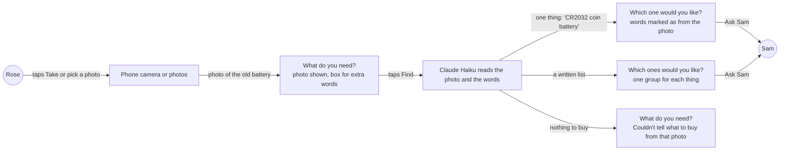
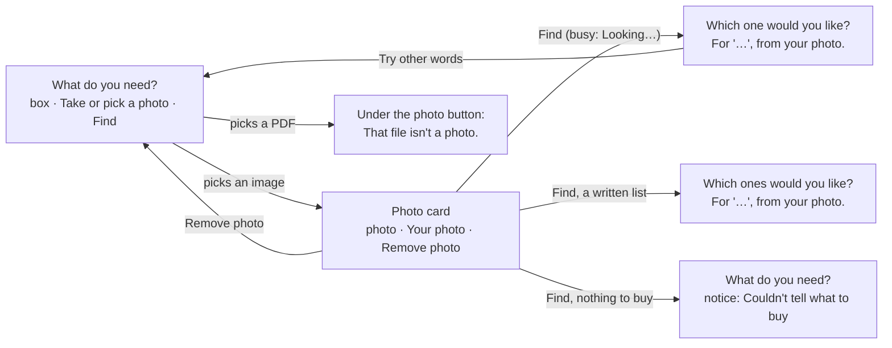
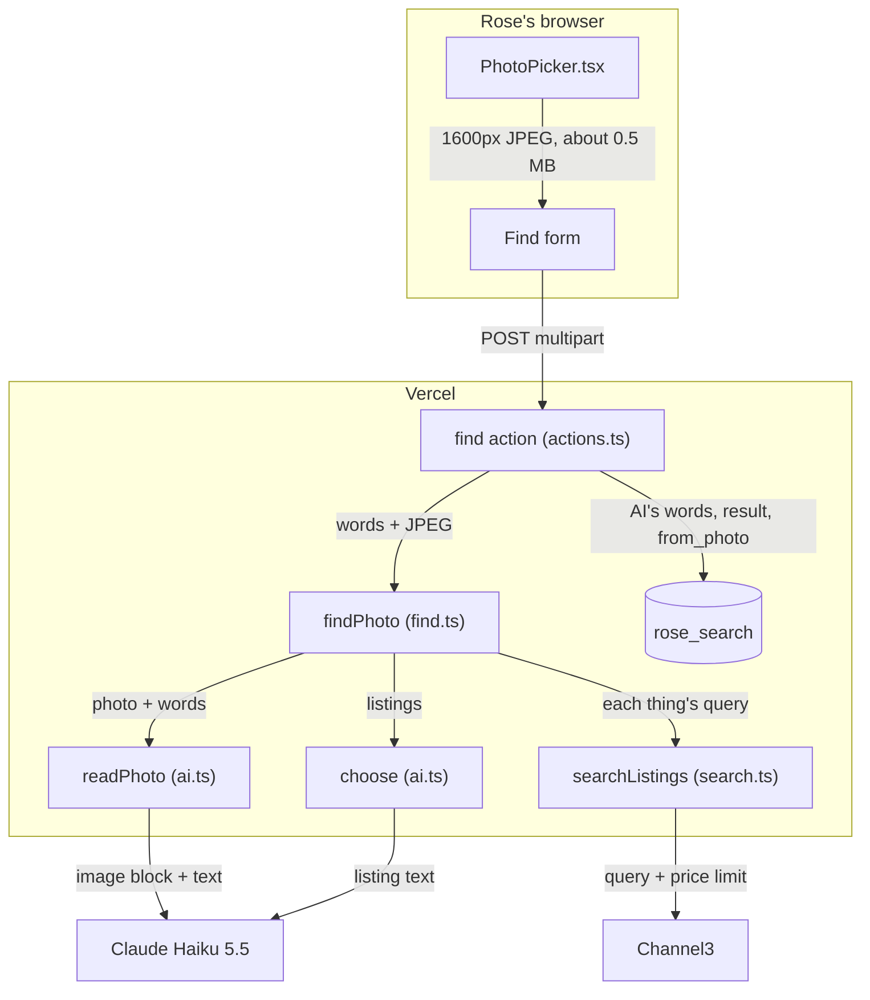
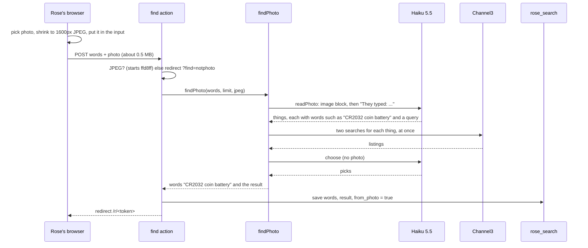
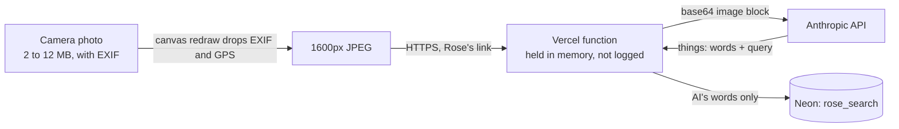
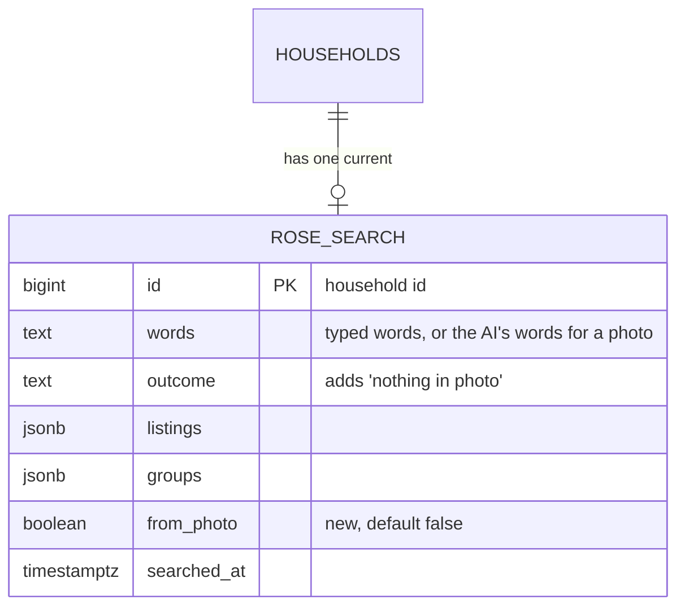

# Photo ask

**Version:** v1 · **Status:** Shipped · **Type:** Feature · **Project type:** Web UI

**Shape doc:** docs/specs/shop-together/shape.md
**Depends on:** find-and-explain and basket, both shipped
**Page:** none. Skipped: you read the `.md` directly.

Rose takes or picks a photo of the thing they need, and AI turns it into a search. It comes now because a friend's feedback on v1.1.0, on 2026-10-15, said that older people find a photo easier than words.

## Problem

Rose can only ask in typed words. The "What do you need?" screen has one text box (`app/(shop)/RoseView.tsx:181`). The Find action reads only that box, cut at 200 characters (`app/(shop)/actions.ts:83`), and the AI step reads only text (`lib/shop/ai.ts:48`).

Words are hard when Rose doesn't know the name of the thing. The battery in a car key is a "CR2032", but only the battery says so. The phone keyboard's mic key helps Rose say a name, not find it.

## Slice test

| Check                         | Result |
| ----------------------------- | ------ |
| Cuts every layer it needs     | yes: the photo control on Rose's ask screen, the Find action, and the AI step that reads the photo. No table changes, because the photo is not kept (O3) |
| One e2e test walks it         | yes: Playwright gives Rose's page a photo of a CR2032 battery, taps Find, sees CR2032 listings and asks Sam. CI calls Claude and Channel3 for real (D24) |
| Worth shipping alone          | yes: Rose can ask for a thing without knowing its name |
| Fits (≤5 scenarios, ≤2 areas) | yes: 5 scenarios, in Rose's page and the AI step in `lib/shop/` |

**Path:** full. It adds a new control to Rose's screen and a new input to the AI step.

## User story

As Rose, I want to show KinCart a photo of the thing I need, so that I don't have to know its name or type it.

## Flow



Rose's photo and any words go to the AI once, and the AI's words for the photo run the same Find as typed words do.

## Acceptance criteria

```gherkin
Scenario: Rose finds a battery from a photo of the old one
  Given Rose's PayPal is linked and Sam's limit is $25 an item
  And Rose doesn't know the name of the battery in Rose's car key
  When Rose taps "Take or pick a photo" and takes a photo of the old battery with the phone's camera
  And the photo is about 4 MB, and shows "CR2032" on the battery
  And Rose taps Find without typing anything
  Then Rose's page shows "Which one would you like?"
  And it shows the AI's words for the photo, such as "CR2032 coin battery", marked as from the photo
  And it shows up to three CR2032 listings at $25 or less, each with its photo and "Good to know"
  And Ask Sam sends Rose's pick to Sam, as a typed ask does
  And KinCart keeps the AI's words for this search, and not the photo

Scenario: Rose adds words to a photo
  Given Rose's PayPal is linked and Sam's limit is $25 an item
  When Rose picks a photo of worn grey slippers from the phone's photos
  And Rose types "size 8" in the box and taps Find
  Then Rose's page shows slipper listings at $25 or less
  And the AI's words for the search include "size 8"

Scenario: Rose takes a photo of a handwritten list
  Given Rose wrote "AA batteries, night light, phone charger" on a piece of paper
  When Rose takes a photo of the paper and taps Find
  Then Rose's page shows "Which ones would you like?"
  And it shows three groups: AA batteries, a night light and a phone charger
  And one Ask Sam sends Rose's picks to Sam as one ask, as a typed list does

Scenario Outline: KinCart can't use what Rose picked
  Given Rose's page shows "What do you need?"
  When Rose <does>
  Then Rose's page shows "<message>"
  And no photo is picked, and the box keeps any words that Rose typed

  Examples:
    | does                                                               | message                                                                              |
    | picks a photo of Rose's garden, with nothing to buy, and taps Find | Couldn't tell what to buy from that photo. Try another photo, or type what you need. |
    | picks a PDF on a laptop                                            | That file isn't a photo. Pick a photo, or type what you need.                        |

Scenario: Rose changes the AI's words after a photo
  Given Rose's page shows CR2032 listings for the AI's words "CR2032 coin battery"
  When Rose taps "Try other words"
  Then the box holds "CR2032 coin battery", ready to change
  And no photo is picked
```

## Scope

**In:**

- A "Take or pick a photo" control on Rose's "What do you need?" screen. It shows on Rose's page and inside the home page's phones. A phone offers its camera and its photos. A laptop opens its file picker.
- Find with a photo, words, or both. One photo for each Find.
- A photo of a product is one thing. A photo of a written list is a basket of up to 5 things, the same as typed words. More than 5 gets today's "Up to 5 things at a time" notice.
- The AI's words for the photo, shown above the results and marked as from the photo. Try other words puts them in the box.
- The two messages in the outline above.
- Full-size photos from a phone camera, with no size error for Rose.

**Out:**

- Keeping Rose's photo, or showing it to Sam. Not planned (O3).
- Sample photos for a judge on a laptop. Not planned (O4).
- More than one photo in one Find. Later slice `photo-ask-several` (O9).
- A photo on the fixed-item screen, which shows only when search is off. Not planned.
- A photo scene in the demo video. Separate work on `feat/demo-video`.

## Interface



The photo button sits under Rose's text box. A picked photo turns it into a card, and Find takes the card's photo and the box's words together.

Screens, all in `app/(shop)/RoseView.tsx` unless named:

- **Ask.** The heading, hint and box stay as today. Under the box is "Take or pick a photo" (secondary), then the line "A photo of the thing, or of your written list.", then Find. On a phone, the button opens the phone's own choice of camera or photos. On a laptop, it opens the file picker.
- **Photo card** (`app/(shop)/PhotoPicker.tsx`). The picked photo at 128px, beside "Your photo" and "Add words above if you need to, such as a size." "Remove photo" (secondary) runs under both. The card enters with the existing enter animation.
- **Busy.** Find shows "Looking…" with the spinner, as today. The photo stays, and its buttons go while Find runs, as Try other words does.
- **Not a photo.** A file that isn't an image is dropped at once. The error "That file isn't a photo. Pick a photo, or type what you need." shows under the photo button, and the button points to it with `aria-describedby`.
- **Nothing in the photo.** A neutral notice at the top: "Couldn't tell what to buy from that photo. Try another photo, or type what you need." Neutral, because nothing is broken.
- **Neither words nor a photo.** The box's error changes from "Type what you need first." to "Type what you need, or add a photo, first."
- **Results.** The line under "Which one would you like?" and "Which ones would you like?" adds ", from your photo" after the AI's words, such as: For "CR2032 coin battery", from your photo.
- **Try other words.** The box holds the AI's words, and no photo is picked.

**Motion tier:** 1. Only the photo card moves, with the existing enter animation (`opacity` and `transform`), and under reduced motion it does not.

**Components used:** `Button` (primary), the `button button-secondary` classes on two plain buttons, `Notice` (neutral), `field-error`, `field-label`, `listing-photo`, `heading`, `small`, `stack`, `PageHead` and `PhoneFrame`. The two photo buttons are plain `<button>`s. `Button` shows its busy label on every unnamed button in a pending form. One new class, `photo-pick`, lays out the card on the `sunken` surface. It uses only existing tokens.

**Design system:** `docs/design/design-system/` (D15). This slice adds no token. The reference is Stripe's forms: each error sits under the control it is about, and the card shows up only after a pick.

**Preview:** `/preview/photo-ask` on `pnpm dev`, built from the real components (`app/(shop)/preview/photo-ask/page.tsx`). In the first frame, Take or pick a photo works for real.

## Technical plan

### Approach

The photo never travels at full size. When Rose picks it, `PhotoPicker` draws it onto a canvas at 1600px on the long edge and saves it as a JPEG of about 0.5 MB. The JPEG goes back into the form's file input. Find's server action checks that it really is a JPEG, then calls a new `findPhoto()`. Its first step, `readPhoto()`, sends Haiku the photo and Rose's words with a prompt of its own. From there the search runs exactly as a typed Find does (D22, D31). The AI's words and a `from_photo` flag are saved in `rose_search`, and the photo is dropped (D64).

Relies on: D10, D11, D12, D19, D22, D23, D24, D31, D63, D64, D65, D66, D67



The browser shrinks the photo, and the server turns it into things with one Haiku call. Each thing then runs the same Channel3 search and Haiku pick as a typed ask.



A photo Find costs one Haiku call with the image, then the calls of a typed Find.



The photo leaves Rose's phone without its location data, and only the AI's words are stored.

### Changes

| File | What changes | Why |
| ---- | ------------ | --- |
| `app/(shop)/PhotoPicker.tsx:24` | `picked()` empties the input at once, then shrinks: `createImageBitmap(file, { imageOrientation: "from-image" })`, a canvas at 1600px on the long edge, `toBlob("image/jpeg", 0.85)`. Over 900 KB, it encodes again at 0.7. The JPEG goes back into the input with `DataTransfer`, and the card shows it. A file that won't decode gets the not-a-photo error | 1, 2, 3, 4 (O6) |
| `app/(shop)/actions.ts:80` | `find()` reads `photo`. A non-empty file that doesn't start `ffd8ff` redirects to `?find=notphoto`. Empty words with no photo still redirect to `?find=empty`. With a photo it calls `findPhoto()` and saves its words with `fromPhoto` true | 1 to 4 |
| `lib/shop/ai.ts:48` | New `readPhoto(words, jpeg)` with a new `NEED_PHOTO` prompt and the existing `NEED_SCHEMA`. `haiku()` (`:64`) takes a string or content blocks. `readNeed()` and its prompt stay as they are (D66) | 1, 2, 3, 4 |
| `lib/shop/find.ts:34` | `search()` splits into `readNeed()` and a shared `searchThings()`. New `findPhoto(words, limitCents, jpeg)` returns `{ words, result }`: the things' words joined by ", ", and a `Search`. No things gives the new outcome `"nothing in photo"`. It logs the same `find` line with ` photo=yes` | 1 to 4 |
| `lib/shop/requests.ts:56` | `SavedSearch` gains `fromPhoto`. `saveSearch()` (`:155`) takes `fromPhoto = false`. `getSearch()` (`:141`) reads `from_photo` | 1, 3, 4, 5 |
| `app/(shop)/state.ts:41` | Options and basket pass `fromPhoto`. The ask state turns `"nothing in photo"` into its problem, and `notPhoto` into `"not a photo"`. Try other words saves `retry` with `fromPhoto` false, so the box holds the AI's words | 1, 3, 4, 5 |
| `app/(shop)/r/[token]/page.tsx:54` | `notPhoto: query.find === "notphoto"` | 4 |
| `db/migrations/0009_photo_ask.up.sql`, `.down.sql` | Add `from_photo`, and add `'nothing in photo'` to the outcome check | 1, 4 |
| `db/migrations/0005_basket.up.sql` | Its outcome check is added `NOT VALID`, so a rerun of `db:up` passes over `'nothing in photo'` rows (O10) | 4 |
| `scripts/migrate.test.ts:29` | `downToHouseholds()` also runs `0008_clearer_pages.down.sql` by hand. The first test checks `from_photo` up, down and up | migration |
| `e2e/photo-ask.spec.ts`, `e2e/photos/cr2032.jpg`, `e2e/photos/list.jpg` | The slice's e2e, and the owner's two photos | 1, 4 |

Reusing: `searchListings()` and `choose()` unchanged, `reasonOf()` for the log, `reset()` from `e2e/db.ts`, the `Notice`, `field-error` and `photo-pick` pieces built at pause 2.

`NEED_PHOTO`, the prompt that O5 tests:

> You read a photo that an older person took to show what they want to buy, and any words they typed with it. If the photo shows a product, list that one product. If it shows a written shopping list, list every product on it, in order. For each, write a short plain name for it, such as "CR2032 coin battery", with anything their words add, such as a size or a count. Then write a short shop search query that keeps the sizes, colours, codes and other must-haves from the photo and their words. If the photo shows nothing they could buy, return an empty list.

### Data



**Migration:** expand only. `0009_photo_ask.up.sql` adds `from_photo boolean NOT NULL DEFAULT false` and replaces `rose_search_outcome_check` with the same list plus `'nothing in photo'`. `db:up` reruns every up file, so `0005_basket.up.sql` now adds its narrower check `NOT VALID` (O10). Old code ignores the column. Old code that reads a `'nothing in photo'` row shows the plain ask screen, because the outcome matches none of its branches. CI runs `db:up` on Neon after tests pass on main (D11), and Vercel promotes after that (D10). There is no contract step.

**Reverse:** promote the previous deploy on Vercel. Then, if wanted, `pnpm db:down` runs `0009_photo_ask.down.sql`: it sets `'nothing in photo'` rows to `'nothing found'`, puts back the old check, and drops `from_photo`. `scripts/migrate.test.ts` tests this path.

### Earn-it

| Added | Triggered by |
| ----- | ------------ |
| The shrink in `PhotoPicker` | Scenario 1's 4 MB photo. Next refuses bodies over 1 MB (O6: `POST 500`, "Body exceeded 1 MB limit") |
| The 0.7 second try over 900 KB | A real iPhone photo came out at 739 KB at 0.85 (O8), 72% of the limit, so a busier photo could pass 1 MB |
| `readPhoto()` and `NEED_PHOTO` | Scenarios 1 to 4. A separate prompt keeps the typed path's prompt as tested (D66) |
| `findPhoto()` | The action needs the AI's words to save and show. `find()` keeps its signature and its tests |
| `from_photo` and `'nothing in photo'` | Scenario 1's "from your photo" and scenario 4's message. Both must survive the 3 s redraw (D19) and a reopened link (D67) |
| The JPEG check in `find()` | Scenario 4. A crafted request could send any bytes, and Haiku rejects a media type that doesn't match them |

### Non-functionals

|                      |                                                                               |
| -------------------- | ----------------------------------------------------------------------------- |
| **Load**             | Judges and the video: tens of photo Finds a day. Each is one Haiku image call of about 2,950 input tokens (about $0.0003 at $0.10 per million, O5), then a typed Find's calls |
| **Breaks first**     | Channel3's 1,000 free searches a month, as for a typed Find, because each thing costs two searches. A 5-item list photo costs 10. The fix is the same as for typed Finds (`docs/ROADMAP.md`) |
| **Security surface** | Anyone with Rose's link can send a photo, up to Next's 1 MB. The server trusts only bytes that start like a JPEG, and sends that media type itself. The photo stays in memory, never in Neon or a log. Text in a photo can steer Haiku as typed words can, but the schema fixes the answer's shape, listings come from Channel3 by ID, and Sam approves every charge. Secrets: `ANTHROPIC_API_KEY` and `CHANNEL3_API_KEY`, as today. Stored: the AI's words and `from_photo` |
| **Proof it works**   | `find outcome=options listings=3 ms=4210 photo=yes` in Vercel's logs, the number being whatever the run took. `photo=yes` with `outcome=nothing-in-photo` says Haiku saw nothing to buy |
| **Rollout**          | No flag. CI migrates Neon, then Vercel promotes (D10, D11). Rollback: the two steps under Reverse |

### Test plan

| Scenario | Test | Command |
| -------- | ---- | ------- |
| 1 | `e2e/photo-ask.spec.ts`: the owner's full-size CR2032 photo, real Haiku and Channel3 (D24) | `pnpm test:e2e e2e/photo-ask.spec.ts` |
| 1, 2 | `lib/shop/ai.test.ts`: `readPhoto()` sends the image block first, then "They typed: size 8", with `NEED_PHOTO` and `NEED_SCHEMA` | `pnpm test lib/shop/ai.test.ts` |
| 1, 3, 4 | `lib/shop/find.test.ts`: one thing gives options under the AI's words; a list gives a basket with words joined by ", "; six things give `too many`; none gives `nothing in photo`; the log line has `photo=yes` | `pnpm test lib/shop/find.test.ts` |
| 1, 4 | `app/(shop)/actions.test.ts`: a JPEG is passed on and saved with `fromPhoto`; a PDF redirects to `?find=notphoto` and calls nothing; a photo with an empty box searches | `pnpm test "app/(shop)/actions.test.ts"` |
| 1, 4, 5 | `app/(shop)/state.test.ts`: `fromPhoto` reaches options and basket; `nothing in photo` and `notPhoto` become problems; a retry after a photo holds the AI's words | `pnpm test "app/(shop)/state.test.ts"` |
| 1, 4 | `app/(shop)/RoseView.test.tsx`: ", from your photo", the nothing-in-photo notice, the photo button and the new empty-box error | `pnpm test "app/(shop)/RoseView.test.tsx"` |
| storage | `lib/shop/requests.test.ts`: `fromPhoto` round trip; `scripts/migrate.test.ts`: 0009 up, down, up | `pnpm test lib/shop/requests.test.ts scripts/migrate.test.ts` |
| 3 | The list photo through real Haiku, once by hand at /build, as O5 did | O5's script |

**E2E:** `e2e/photo-ask.spec.ts`. Rose's page gets `e2e/photos/cr2032.jpg` at full size, so it passes only if the shrink ran. It waits 4 s for a redraw and checks that the card and the file are still there. Find shows "Which one would you like?" within 25 s, with ", from your photo" and at least one listing name matching `/2032/` at or under the limit. Ask Sam reaches Sam's page. A PDF picked next shows the not-a-photo error, with no network call.

### Chunks

| Chunk | Scenarios | Files owned |
| ----- | --------- | ----------- |
| A | 1 to 5, server side | `db/migrations/0009_photo_ask.*`, `scripts/migrate.test.ts`, `lib/shop/ai.ts`, `lib/shop/find.ts`, `lib/shop/requests.ts` and their tests, `app/(shop)/actions.ts`, `app/(shop)/state.ts` and their tests, `app/(shop)/r/[token]/page.tsx`, `app/(shop)/RoseView.test.tsx` |
| B | 1, 4, browser and e2e | `app/(shop)/PhotoPicker.tsx`, `e2e/photo-ask.spec.ts`, `e2e/photos/` |

Build A, then B, one after the other. B's e2e needs A, and both chunks' tests use the local database.

### Risks

| Risk | Mitigation |
| ---- | ---------- |
| Haiku misreads a blurry or tilted photo, and the search is for the wrong thing | Rose sees the AI's words marked as from the photo, and Try other words puts them in the box. Sam approves every charge |
| Rose taps Find in the 150 to 200 ms before the shrink ends | `picked()` empties the input first, so Find sends no photo and gets "Type what you need, or add a photo, first." The 5 MB original never goes |
| A real phone photo comes out over 1 MB at 0.85 | The owner's iPhone photo was 739 KB (O8). Over 900 KB, `picked()` encodes again at 0.7. The e2e's photo passes only if the shrink ran |
| Haiku is slower with an image, and a 5-thing list hits Find's limit | O5's image calls took 1.3 to 1.9 s against the 10 s timeout. The searches then run at once (D31), and the page's `maxDuration` is 30 s |

### Decisions to record

Recorded as D63, D64, D65, D66, D67.

## Review

2026-10-16 · 1 raw finding, 0 survived. Clean.

## Open items

| ID | What | Type | Raised at | Owner | Status | Answer |
| -- | ---- | ---- | --------- | ----- | ------ | ------ |
| O1 | Can Rose add words to a photo, such as "size 8"? | question | spec p1 | user | Resolved | Yes. The photo and the box go to Find together, and either one alone also works. 2026-10-16 |
| O2 | What happens with a photo of a handwritten shopping list? | question | spec p1 | user | Resolved | Each item on the list becomes a thing in a basket, up to 5, as typed words do. A photo of a product is one thing. 2026-10-16 |
| O3 | Is Rose's photo kept after Find, and does Sam see it? | question | spec p1 | user | Resolved | No. The photo goes to Claude once. Rose and Sam see the AI's words for it. 2026-10-16 |
| O4 | A judge on a laptop may have no product photo. Add sample photos? | question | spec p1 | user | Resolved | No. Any image file works from the laptop's file picker, and the video shows a real phone camera. 2026-10-16 |
| O5 | Haiku 5.5 at low effort reads a phone photo of a CR2032 battery as a CR2032 coin battery, and a photo of a 3-item handwritten list as 3 things, within the 10 s timeout | unproven | spec p3 | poc | Resolved | Yes, with the two generated photos shrunk as the browser will (1600px JPEG at 0.85: 138 KB and 198 KB). Three runs each, all right. The battery gave one thing, "CR2032 3V lithium coin battery", in 1.4 to 1.9 s. The list gave "AA batteries", "night light" and "phone charger" in 1.3 to 1.7 s. With "2 of them" typed, it gave "CR2032 3V lithium coin battery, pack of 2". Each call used about 2,950 input tokens and 50 to 64 output tokens. The photos' print is cleaner than a real camera's (O7, O8). Spike, 2026-10-16 |
| O6 | The browser shrinks a full-size camera photo to a JPEG under Next's 1 MB server action limit on real phones, including an iPhone's HEIC photos, and puts it back in the form | unproven | spec p3 | poc | Resolved | Yes in Chromium and Firefox. A generated 12 MP, 5.2 MB JPEG shrank to 1600×1200 at 519 KB in 136 ms (Chromium) and 546 KB in 194 ms (Firefox). It went back into the form with `DataTransfer`, and the server action got `image/jpeg` starting `ffd8ff`. The same file unshrunk failed: `POST 500`, "Body exceeded 1 MB limit", and "This page couldn't load". WebKit didn't launch on this machine (missing system libraries), so Safari moves to O8. Spike, 2026-10-16 |
| O7 | Where do the e2e's photos come from? | question | spec p3 | user | Resolved | Generated, on the owner's request: `e2e/photos/cr2032.jpg` (4032×3024, 1.8 MB, a coin cell printed CR2032) and `e2e/photos/list.jpg` (3024×4032, 2.2 MB, the list in a handwriting font on lined paper). Both are drawn in Chromium, so they have no EXIF. Their print is cleaner than a real photo's, so the real-camera check is O8. Changed from "the owner takes two phone photos", 2026-10-16 |
| O8 | A real iPhone in Safari shrinks a camera photo, HEIC included, and sends it (split from O6) | unproven | spec p3 | user | Resolved | Yes. On the owner's iPhone (iOS 18.4.1, Safari), a camera photo arrived as `image.jpg`, `image/jpeg`, 3,341,859 bytes, so Safari never had to read HEIC. It shrank from 3024×4032 to 1200×1600 at 738,732 bytes in 382 ms, went back into the input, and the server got `image/jpeg` starting `ffd8ff`. Spike on a Vercel preview of a throwaway branch, deleted after, 2026-10-16 |
| O9 | Can Rose send several photos in one Find, one for each thing? | question | spec p3 | user | Resolved | Not in this slice. Two shrunk photos (519 to 546 KB each in O6) pass Next's 1 MB limit together, and the screens need a card for each. Later slice `photo-ask-several`, only if time is left. 2026-10-16 |
| O10 | The plan changed only 0009. `db:up` reruns every up file, and `0005_basket.up.sql` re-adds the outcome check without `'nothing in photo'`. Once such a row exists, the next `db:up` fails at 0005: "check constraint "rose_search_outcome_check" of relation "rose_search" is violated by some row" | flag | build | user | Decided alone | Chose: 0005 adds its check `NOT VALID`, so only 0009's wider check validates rows, as D49 changed 0002 for an index. `scripts/migrate.test.ts` reruns `db:up` over a `'nothing in photo'` row. Other: a migrations table, so each file runs once (a new runner). Undo: revert `07cb0ae`'s change to `0005_basket.up.sql`, and drop the rerun test. 2026-10-16 |
| O11 | The feat commits on this branch add no CHANGELOG line | flag | build | user | Decided alone | Chose: leave the lines to /ship, as for every earlier slice. Other: add them in each commit. Undo: add them in a docs commit. 2026-10-16 |

_Never delete this section or its rows. See references/ledger.md._

## Glossary

- **Basket**: an ask for several things at once, with one pick for each, paid as one charge.
- **Channel3**: a hackathon sponsor whose API returns real product listings.
- **Claude Haiku**: the small Claude model that reads Rose's ask and explains each listing.
- **DataTransfer**: a browser object that holds files. A page can use it to put a new file into a file input.
- **e2e**: end-to-end: one test that walks the whole slice as a person would.
- **EXIF**: data that a camera writes inside a photo file, such as the time, the phone's model and the place it was taken.
- **HEIC**: the photo format that iPhones save by default. Not every browser can open it.
- **Server action**: a Next.js function that runs on the server when a form is sent. Next limits what one request can carry to 1 MB by default.
