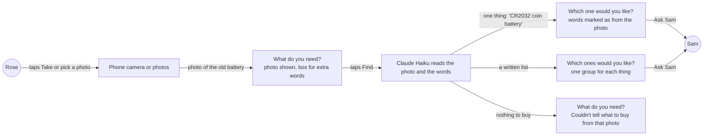

# Photo ask

**Version:** v1 · **Status:** Draft · **Type:** Feature · **Project type:** Web UI

**Shape doc:** docs/specs/shop-together/shape.md
**Depends on:** find-and-explain and basket, both shipped

Rose takes or picks a photo of the thing they need, and AI turns it into a search. It comes now because a friend's feedback on v1.1.0, on 2026-10-15, said that older people find a photo easier than words.

## Problem

Rose can only ask in typed words. The "What do you need?" screen has one text box (`app/(shop)/RoseView.tsx:181`). The Find action reads only that box, cut at 200 characters (`app/(shop)/actions.ts:83`), and the AI step reads only text (`lib/shop/ai.ts:48`).

Words are hard when Rose doesn't know the name of the thing. The battery in a car key is a "CR2032", but only the battery says so. The phone keyboard's mic key helps Rose say a name, not find it.

## Slice test

| Check                         | Result |
| ----------------------------- | ------ |
| Cuts every layer it needs     | yes: the photo control on Rose's ask screen, the Find action, and the AI step that reads the photo. No table changes, because the photo is not kept (O3) |
| One e2e test walks it         | yes: Playwright gives Rose's page a photo of a CR2032 battery, taps Find, sees CR2032 listings and asks Sam. CI calls Claude and Channel3 for real (D24) |
| Worth shipping alone          | yes: Rose can ask for a thing without knowing its name |
| Fits (≤5 scenarios, ≤2 areas) | yes: 5 scenarios, in Rose's page and the AI step in `lib/shop/` |

**Path:** full. It adds a new control to Rose's screen and a new input to the AI step.

## User story

As Rose, I want to show KinCart a photo of the thing I need, so that I don't have to know its name or type it.

## Flow



Rose's photo and any words go to the AI once, and the AI's words for the photo run the same Find as typed words do.

## Acceptance criteria

```gherkin
Scenario: Rose finds a battery from a photo of the old one
  Given Rose's PayPal is linked and Sam's limit is $25 an item
  And Rose doesn't know the name of the battery in Rose's car key
  When Rose taps "Take or pick a photo" and takes a photo of the old battery with the phone's camera
  And the photo is about 4 MB, and shows "CR2032" on the battery
  And Rose taps Find without typing anything
  Then Rose's page shows "Which one would you like?"
  And it shows the AI's words for the photo, such as "CR2032 coin battery", marked as from the photo
  And it shows up to three CR2032 listings at $25 or less, each with its photo and "Good to know"
  And Ask Sam sends Rose's pick to Sam, as a typed ask does
  And KinCart keeps the AI's words for this search, and not the photo

Scenario: Rose adds words to a photo
  Given Rose's PayPal is linked and Sam's limit is $25 an item
  When Rose picks a photo of worn grey slippers from the phone's photos
  And Rose types "size 8" in the box and taps Find
  Then Rose's page shows slipper listings at $25 or less
  And the AI's words for the search include "size 8"

Scenario: Rose takes a photo of a handwritten list
  Given Rose wrote "AA batteries, night light, phone charger" on a piece of paper
  When Rose takes a photo of the paper and taps Find
  Then Rose's page shows "Which ones would you like?"
  And it shows three groups: AA batteries, a night light and a phone charger
  And one Ask Sam sends Rose's picks to Sam as one ask, as a typed list does

Scenario Outline: KinCart can't search from what Rose picked
  Given Rose's page shows "What do you need?"
  When Rose picks <file> and taps Find
  Then Rose's page shows "<message>"
  And no photo is picked, and the box keeps any words that Rose typed

  Examples:
    | file                                          | message                                                                            |
    | a photo of Rose's garden, with nothing to buy | Couldn't tell what to buy from that photo. Try another photo, or type what you need. |
    | a PDF, picked on a laptop                     | That file isn't a photo. Pick a photo, or type what you need.                      |

Scenario: Rose changes the AI's words after a photo
  Given Rose's page shows CR2032 listings for the AI's words "CR2032 coin battery"
  When Rose taps "Try other words"
  Then the box holds "CR2032 coin battery", ready to change
  And no photo is picked
```

## Scope

**In:**

- A "Take or pick a photo" control on Rose's "What do you need?" screen. It shows on Rose's page and inside the home page's phones. A phone offers its camera and its photos. A laptop opens its file picker.
- Find with a photo, words, or both. One photo for each Find.
- A photo of a product is one thing. A photo of a written list is a basket of up to 5 things, the same as typed words. More than 5 gets today's "Up to 5 things at a time" notice.
- The AI's words for the photo, shown above the results and marked as from the photo. Try other words puts them in the box.
- The two messages in the outline above.
- Full-size photos from a phone camera, with no size error for Rose.

**Out:**

- Keeping Rose's photo, or showing it to Sam. Not planned (O3).
- Sample photos for a judge on a laptop. Not planned (O4).
- More than one photo in one Find. Not planned.
- A photo on the fixed-item screen, which shows only when search is off. Not planned.
- A photo scene in the demo video. Separate work on `feat/demo-video`.

## Decisions to record

Drafted at pause 1. Pause 3 moves them under the technical plan, and `/build` appends them.

```
## D63 · 2026-10-16 · Find reads a photo the way it reads typed words: with any words, and a written list is a basket

Why: a photo alone can't say a size or a count, such as "size 8", and an older person's paper shopping list is the same ask as a typed list of up to 5 things.
Rejected: a photo replaces the typed words (Rose can't add a size or a count), one thing for each photo (a photo of a paper list finds one thing or nothing).
Source: docs/specs/photo-ask.md
Status: active

## D64 · 2026-10-16 · Rose's photo goes to Claude once and is not kept

Why: Rose's and Sam's pages show the AI's words for the photo, so nothing needs the photo after Find, and a photo taken at home can show more than the thing.
Rejected: keep the photo and show it to Sam beside the listing (needs photo storage and a rule for deleting it, so a slice of its own).
Source: docs/specs/photo-ask.md
Status: active
```

## Open items

| ID | What | Type | Raised at | Owner | Status | Answer |
| -- | ---- | ---- | --------- | ----- | ------ | ------ |
| O1 | Can Rose add words to a photo, such as "size 8"? | question | spec p1 | user | Resolved | Yes. The photo and the box go to Find together, and either one alone also works. 2026-10-16 |
| O2 | What happens with a photo of a handwritten shopping list? | question | spec p1 | user | Resolved | Each item on the list becomes a thing in a basket, up to 5, as typed words do. A photo of a product is one thing. 2026-10-16 |
| O3 | Is Rose's photo kept after Find, and does Sam see it? | question | spec p1 | user | Resolved | No. The photo goes to Claude once. Rose and Sam see the AI's words for it. 2026-10-16 |
| O4 | A judge on a laptop may have no product photo. Add sample photos? | question | spec p1 | user | Resolved | No. Any image file works from the laptop's file picker, and the video shows a real phone camera. 2026-10-16 |

_Never delete this section or its rows. See references/ledger.md._

## Glossary

- **Basket**: an ask for several things at once, with one pick for each, paid as one charge.
- **Channel3**: a hackathon sponsor whose API returns real product listings.
- **Claude Haiku**: the small Claude model that reads Rose's ask and explains each listing.
- **e2e**: end-to-end: one test that walks the whole slice as a person would.
