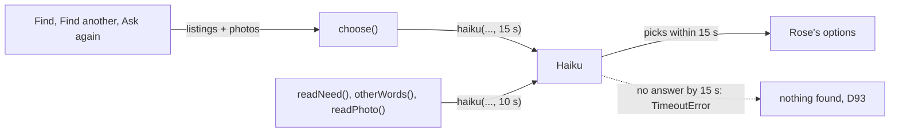
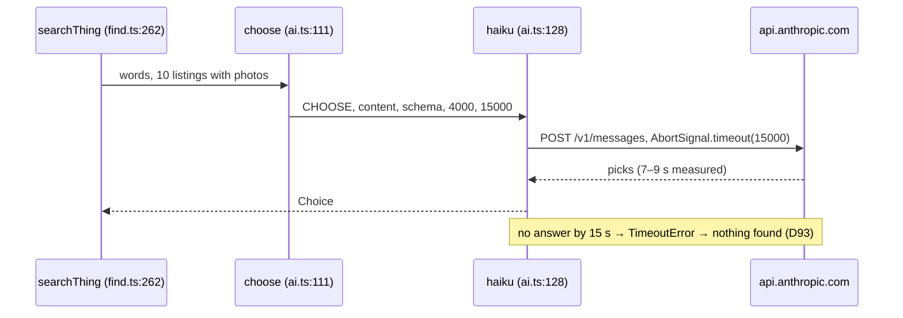

# Picks that match

**Version:** v2 · **Status:** Refined · **Type:** Bug · **Project type:** Data/LLM

**Supersedes:** archive/picks-that-match-v1.md
**Shape doc:** docs/specs/after-review/shape.md
**Depends on:** None
**Page:** none. Skipped: you read the `.md` directly.

The pick call gets 15 s before it gives up, where every Haiku call had 10 s. It ships now because v1's photos made the pick call take 7 to 9 s, and a slow one turns a good Find into "nothing found", which failed main's CI twice on 2026-10-26.

## Problem

v1 added up to 10 listing photos to the pick call (D92). Six real pick calls for "warm slippers that are easy to put on, size 8" took 7.3, 7.9, 8.1, 8.8, 8.8 and 9.1 s on 2026-10-26. `haiku()` stops every call at 10 s (`lib/shop/ai.ts:144`), a limit set on 2026-10-13 when the call sent only text. A pick call slower than that throws `TimeoutError`, and by D93 the Find shows nothing found. Rose sees "Couldn't find that" for slippers that exist, and a judge sees it on a first try. It failed `e2e/sam-finds-another.spec.ts` on main twice (run 40273470921), and hit a Find on `feat/home-page-proof` on 2026-10-22.

## Slice test

| Check                         | Result                                                                    |
| ----------------------------- | ------------------------------------------------------------------------- |
| Cuts every layer it needs     | yes: one constant in the Haiku call, nothing else changes                 |
| One e2e test walks it         | yes: every real-Find e2e, and `e2e/sam-finds-another.spec.ts` on main CI  |
| Worth shipping alone          | yes: a slow pick call shows Rose listings instead of nothing found        |
| Fits (≤5 scenarios, ≤2 areas) | yes: 3 scenarios, one area (the Haiku call)                               |

**Path:** light. A bug fix in 2 files, with no new interface, data or dependency. Pauses 1 and 3 are one pause, and pause 2 is skipped.

## Flow



Only the pick call waits 15 s. The calls that read Rose's words or photos and write other words keep 10 s.

## Acceptance criteria

```gherkin
Scenario: a slow pick call still gives Rose options
  Given Rose asks for "warm slippers that are easy to put on, size 8" under a $50 limit
  And Channel3 returns 10 listings, each with a photo
  When the pick call answers after 11 seconds
  Then Rose sees up to 3 slippers, not "Couldn't find that"

Scenario: a pick call that never answers still ends the Find
  Given the same ask
  When the pick call has not answered after 15 seconds
  Then KinCart stops waiting, and Find shows nothing found, as D93 says
  And the find log line says reason=TimeoutError

Scenario: the other Haiku calls keep their 10 second limit
  Given Rose types "AA batteries" or sends a photo, or taps Find another
  When the call that reads the words, reads the photo or writes other words runs
  Then it still stops at 10 seconds
```

## Scope

**In:** the pick call's limit, for the first pick call and the second one over the limit (D112), both in `choose()`.

**Out:** smaller or fewer photos (no later slice; a /poc first if 15 s proves too slow), a retry on timeout (D93 stays), the 10 s limit on `readPhoto()`, which sends up to 5 of Rose's photos (no failure seen; add a row if one shows).

## Technical plan

### Approach

`haiku()` takes the timeout as its last argument, 10 s by default, and `choose()` passes 15 s. Nothing else changes: the prompt, the photos, the schema and D93's nothing-found path stay as they are.

Relies on: D22, D92, D93, D112, D119 (drafted here)



### Changes

| File                     | What changes                                                                                                                                    | Why            |
| ------------------------ | ----------------------------------------------------------------------------------------------------------------------------------------------- | -------------- |
| `lib/shop/ai.ts:128`     | `haiku()` gains `timeoutMs = 10000`, used at `:144` as `AbortSignal.timeout(timeoutMs)`. `choose()` at `:123` passes `15000`. One comment line on `choose()` says why the pick call waits longer | scenarios 1, 2 |
| `lib/shop/ai.test.ts`    | One test spies on `AbortSignal.timeout`: `choose()` asks for 15000, and `readNeed()`, `otherWords()` and `readPhoto()` ask for 10000            | scenarios 1–3  |

Reusing: `stubHaiku()` and `reply()` in `ai.test.ts`. Node's `AbortSignal.timeout` ignores vitest's fake timers, so the test checks the number each call asks for, not a wait.

### Non-functionals

|                      |                                                                                                                                                               |
| -------------------- | ------------------------------------------------------------------------------------------------------------------------------------------------------------- |
| **Load**             | Unchanged: one pick call for each thing in a Find, plus one more when D112 runs                                                                               |
| **Breaks first**     | A Haiku slowdown past 15 s: Finds show nothing found again. `reason=TimeoutError` in the find log shows it                                                    |
| **Security surface** | Unchanged: no new input, secret or stored data                                                                                                                |
| **Proof it works**   | Main's CI green, `e2e/sam-finds-another.spec.ts` among the 32. In Vercel's logs, no `find` line with `checked=` above 0 and `reason=TimeoutError` over a day of Finds |
| **Rollout**          | No flag. Vercel promotes after main's CI (D10). Rollback: `git revert` the fix commit                                                                        |

### Test plan

| Scenario        | Test                                                                                       | Command                                  |
| --------------- | ------------------------------------------------------------------------------------------ | ---------------------------------------- |
| 1, 2, 3         | `lib/shop/ai.test.ts`: each call's `AbortSignal.timeout` argument                          | `pnpm test lib/shop/ai.test.ts`          |
| 1, end to end   | `e2e/sam-finds-another.spec.ts`, and every real-Find e2e, on main's CI                     | `pnpm test:e2e --workers=1`              |

### Chunks

Single chunk.

### Risks

| Risk                                                                                                         | Mitigation                                                                                                                                  |
| ------------------------------------------------------------------------------------------------------------ | ------------------------------------------------------------------------------------------------------------------------------------------- |
| A slow pick call now makes a Find slower than D91's 15 s: up to about 20 s for one thing                     | D119 accepts it: a slow Find with listings beats a fast "nothing found". Typical Finds stay at 10 to 13 s                                   |
| When the first pick finds nothing under the limit, D112's second pick call runs too, so the worst case is about 35 s | It runs only then, with at most 5 photos, measured at 2.8 to 3.6 s. The e2e waits 30 s for it                                     |
| `e2e/find-and-explain.spec.ts` waits 20 s for Rose's options, so a 15 s pick plus the search can pass it     | That test already fails on such a call today, with nothing found. If it flakes, its wait goes to 30 s, as `sam-finds-another`'s does       |

### Decisions to record

## D119 · 2026-10-26 · The pick call waits 15 s for Haiku, and the other Haiku calls keep 10 s

Why: with up to 10 photos (D92), the pick call took 7.3 to 9.1 s, and a slower one turned a Find with real listings into nothing found (D93). A Find still shows one thing in 10 to 13 s and five within 20 s most of the time. A slow pick call can take one thing to about 20 s, which beats nothing found.
Rejected: smaller or fewer photos at 10 s (unproven faster, and D90's recorded set would have to prove the picks again), a retry on timeout (up to 25 s, and twice the Haiku cost on slow calls), 15 s for every Haiku call (the other calls take 1 to 2.4 s, and a hung one would hold Rose 5 s longer).
Supersedes: D91
Source: docs/specs/picks-that-match.md
Status: active

## Open items

| ID | What | Type | Raised at | Owner | Status | Answer |
| -- | ---- | ---- | --------- | ----- | ------ | ------ |
| O1 | The review's wrong pick ("Batteries", $2.99 at containerstore.com, a photo of an empty bin, a note about Energizer AA) came from Channel3's listing text, not from Haiku (from shape O10) | unproven | shape | poc | Resolved | Yes, proven by a spike on 2026-10-22, inside its 30-minute box. Channel3 gives five containerstore.com products the title "AA Batteries", brand Energizer and its batteries category: `qYGxLFs` $6.74 (photo: white basket; words: "a pack of Energizer AA batteries"), `6h21ajG` $3.99 (trash can; "a 4-pack of Energizer AA batteries"), `dwSkyf8` $64.99 (pin board), `1aF2iFr` $2.39 (gift labels; words about an OXO soap brush) and `zZmNCMH` $23.10 (a battery case). With `choose()`'s own prompt, Haiku skipped them in 9 of 9 runs when real AA packs were in the set. With only these as AA listings, it picked `zZmNCMH`, `6h21ajG` and `qYGxLFs` in 3 of 3 runs, and its notes repeated the words. It skipped the soap-brush one. So the words can't show the mismatch: only the photo can. 2026-10-22 |
| O2 | Is a /poc the way to settle O1? | question | spec p1 | user | Resolved | Yes, as the shape planned. It runs after the pause 1 draft. 2026-10-22 |
| O3 | What counts as "not the thing Rose asked for" | question | spec p1 | user | Resolved | Not the product itself: a case, holder, charger or part for it, or another size or type than Rose said (AAA for AA). Any brand or pack size of the real thing counts. 2026-10-22 |
| O4 | A listing whose photo and name disagree, such as "Batteries" with a photo of an empty bin | question | spec p1 | user | Resolved | Never show it. 2026-10-22 |
| O5 | A listing with no photo | question | spec p1 | user | Resolved | Show it, judged on its name and words alone, as today. 2026-10-22 |
| O6 | What proves a wrong pick never reaches Rose, when the AI's answers change from run to run | question | spec p1 | user | Resolved | A recorded set of about 10 real wrong listings, each dropped in 3 of 3 runs against real Haiku, with the right listings beside them still shown. 2026-10-22 |
| O7 | Can Find take longer to catch wrong picks? | question | spec p1 | user | Resolved | No. One thing within 15 s and five within 20 s, as today. 2026-10-22 |
| O8 | How the pick step sees the photos: in the pick call, or in a check call after it | question | spec p2 | user | Resolved | In the pick call, with each listing's photo after its words. Still two fixed steps (D22). 2026-10-22 |
| O9 | A listing whose photo KinCart can't download: dead link, too slow, or a format Claude can't read | question | spec p2 | user | Resolved | Drop it. 2026-10-22 |
| O10 | The pick call fails or times out | question | spec p2 | user | Resolved | Nothing found, as today. No retry without photos. 2026-10-22 |
| O11 | Listings above the limit go to Haiku as names only, so a misfit named like the thing can turn "Couldn't find that." into "Nothing under $50 for that…" | flag | spec p2 | user | Accepted risk | A wrong message, not a wrong pick, and only when nothing under the limit fits. `find-another` reworks the over-limit step. 2026-10-22 |
| O12 | With up to 10 downloaded photos in the pick call, Haiku drops the containerstore.com misfits and keeps real AA packs in 3 of 3 runs, and a Find still shows one thing within 15 s and five within 20 s | unproven | spec p3 | build | Accepted risk | `/build` measures it: `picks.test.ts` for the picks, and `ms=` over 3 live Finds of one thing and of five things. If either fails, the spec goes back to Draft with the numbers. 2026-10-22. Measured at `/build`, 2026-10-22, by calling `find()` with real Channel3, photos and Haiku, not through `pnpm dev`. With full-size photos it failed: one thing took 8.7 to 12.5 s, one Find timed out at 15.3 s, and each of 3 five-thing Finds (13.1 to 14.1 s) lost 1 to 3 groups to the pick call's 10 s timeout. With photos shrunk to 512 px (O16) it passes: one thing 9.7 to 10.1 s over 6 Finds, five things 10.9 to 12.0 s over 3, no timeouts. In one Find, the need call took 0.9 to 1.4 s, the two searches 1.5 to 1.8 s, and the pick call 6.4 to 7.0 s. `picks.test.ts` passed 105 of 105 runs (5 passes of 7 asks, 3 runs each). Through the built app in `pnpm test:e2e`: one thing 9.6 to 13.4 s over 5 Finds, two to four things 10.9 to 12.2 s over 3, all 27 tests passing. |
| O13 | Where the recorded set's photos live | question | spec p3 | user | Resolved | Committed to the repo, about 2 MB (D94). 2026-10-22 |
| O14 | When the recorded-set test runs | question | spec p3 | user | Resolved | In `pnpm test`, on every push (D94). An estimated 3 to 5 cents a run, and about a minute with the asks run one after another. 2026-10-22 |
| O15 | Which hosts the server may download listing photos from | question | spec p3 | user | Resolved | `cdn.trychannel3.com` only, with redirects refused (D95). 2026-10-22 |
| O16 | The plan sent each photo to Haiku as Channel3 sent it. Channel3's photos run up to 2048 px, and with 10 of them the pick call often ran past its 10 s timeout (O12) | flag | build | user | Decided alone | Chose: shrink each photo to a WebP of at most 512 px with `sharp` before the pick call, and add `sharp` as a direct dependency at 0.35.5, the version Next already installs. 384 px saved under 1 s more. Other: send full-size photos and let a Find take up to 15 s, with basket groups lost to timeouts; turn thinking off for the pick call (one thing 6.8 to 11.6 s, but misfits got through in 4 of 7 asks); or raise the pick call's timeout past 10 s. Undo: `git revert 0850f7f`, then fix `find.test.ts`'s photo stub. 2026-10-22 |
| O17 | The plan said the recorded set had about 10 asks, built from Channel3's answers for each ask | flag | build | user | Decided alone | Chose: 7 asks with 27 real wrong listings, each beside 2 right ones, composed from 20 real searches and 2 product lookups. Wrong listings outnumber right ones, so Haiku can't fill three picks without a misfit. Other: 10 asks with Channel3's own 10-listing answers (5 to 7 MB of photos, and right listings outnumber wrong ones, so Haiku skips misfits without the photo, as O1 found). Undo: add asks to `lib/shop/picks/asks.json` and their photos. 2026-10-22 |
| O18 | The pick call carries up to 10 photos (D92), and `haiku()` stops every call at 10 s (`lib/shop/ai.ts:144`). Measured 2026-10-26: 6 real picks took 7.3 to 9.1 s. A slower one throws `TimeoutError`, and Find shows nothing found (D93). It failed `e2e/sam-finds-another.spec.ts` on main twice (run 40273470921). Give the pick call more time, or send fewer or smaller photos | question | debug | user | Resolved | The pick call gets 15 s, and the other Haiku calls keep 10 s (D119). 2026-10-26 |
| O19 | A real Haiku call can't be made slow on purpose, so what test proves the fix | question | spec p1 | user | Resolved | A unit test in `lib/shop/ai.test.ts` checks the limit each call asks `AbortSignal.timeout` for. The real-Find e2e on main's CI is the end-to-end walk. 2026-10-26 |

_Never delete this section or its rows. See references/ledger.md._

## Glossary

- **Pick call:** the Haiku call that checks each listing's words and photo, and keeps only the ones that match what Rose asked for.
- **TimeoutError:** the error `fetch` throws when `AbortSignal.timeout` stops a call.
- **Light path:** zuko's short route for a small bug fix: one pause, no design pass, one reviewer.
