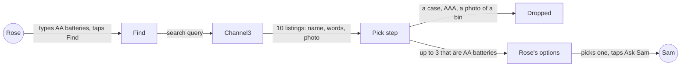
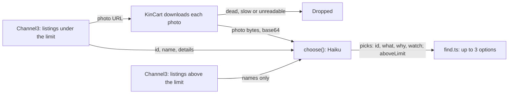

# Picks that match

**Version:** v1 · **Status:** Draft · **Type:** Bug · **Project type:** Data/LLM

**Shape doc:** docs/specs/after-review/shape.md
**Depends on:** None

A listing that isn't the thing Rose asked for, such as a storage bin sold as "Batteries", never reaches Rose. It ships now because a judge's first Find can show a wrong pick, and `find-another` and `ask-again` reuse this pick step.

## Problem

In the review of v1.2.0 on 2026-10-22, Rose asked for batteries. The second pick was "Batteries", $2.99 at containerstore.com, with a photo of an empty bin and a note about Energizer AA batteries. An older shopper may pick it, and Sam sees a bin. Channel3 also returns near things for a search, such as tablet cases for "a tablet for video calls".

The spike for O1 found the cause in Channel3's data. Channel3 lists five containerstore.com products as "AA Batteries", brand Energizer, in its batteries category. Their words say "a pack of Energizer AA batteries", but the photos show a white basket, gift labels, a pin board, a trash can and a battery case. Haiku reads only the words, so it picks them when no better AA pack is in the search.

## Slice test

| Check                         | Result |
| ----------------------------- | ------ |
| Cuts every layer it needs     | yes: Channel3's listings, Find's pick step, and Rose's options and notices. Rose reaches it with Find |
| One e2e test walks it         | yes: the recorded set runs from Rose's words to the options Rose would see, with real Haiku |
| Worth shipping alone          | yes: a judge's first Find no longer shows a bin as batteries |
| Fits (≤5 scenarios, ≤2 areas) | yes: 5 scenarios, one area (Find's pick step) and its tests |

**Path:** full. The fix changes what Haiku is sent and asked: the words can't show the mismatch, so the photo must (O1).

## User story

As Rose, I want every option I see to be the thing I asked for, so that I don't pick a bin when I need batteries.

## Flow



Rose's words go to Channel3, the pick step drops every listing that isn't the thing, and Rose sees only the ones that are.

## Acceptance criteria

```gherkin
Scenario: The review's wrong pick never reaches Rose
  Given Sam's limit is $50
  And Channel3 answers "AA batteries" with "AA Batteries", $6.74 at containerstore.com, whose words say "a pack of Energizer AA batteries" and whose photo shows an empty white basket
  When Rose types "AA batteries" and taps Find
  Then Rose doesn't see the containerstore.com listing
  And every listing Rose sees is a pack of AA batteries

Scenario Outline: A listing for something near the thing never reaches Rose
  Given Sam's limit is $50
  When Rose asks for <thing> and Channel3 answers with <near thing> among real ones
  Then Rose doesn't see <near thing>
  And a pack of <thing> from any brand, in any pack size, can still show

  Examples:
    | thing                | near thing                    |
    | AA batteries         | a battery storage case        |
    | AA batteries         | a pack of AAA batteries       |
    | a phone charger      | a charging cable on its own   |
    | reading glasses +2.0 | a glasses case                |

Scenario: A listing with no photo is judged on its words
  Given Channel3 answers "AA batteries" with "Duracell Coppertop AA Batteries, 8 Pack", which has no photo
  When Rose types "AA batteries" and taps Find
  Then that listing can show, with no photo, as today

Scenario Outline: Fewer fit, or none
  Given Sam's limit is <limit>
  When Rose asks for <thing> and <what fits>
  Then Rose sees "<message>" <where>

  Examples:
    | limit | thing                       | what fits                                    | message                                                                          | where                                          |
    | $50   | AA batteries                | 1 of Haiku's 3 picks                         | Only 1 found at $50 or less.                                                     | under "Which one would you like?"              |
    | $30   | a tablet for video calls    | only cases under $30, and tablets above it   | Nothing under $30 for that. Try different words, or ask Sam to raise the limit. | above "What do you need?"                      |
    | $50   | AA batteries                | nothing                                      | Couldn't find that. Try different words.                                         | above "What do you need?"                      |
    | $50   | AA batteries, a night light | nothing for AA batteries, 3 night lights     | Couldn't find this one.                                                          | in the AA batteries group only                 |

Scenario: The recorded set proves it, and Find takes no longer
  Given about 10 real wrong listings saved from Channel3, each beside right listings for the same ask
  When each ask runs through Find's pick step 3 times, with real Haiku
  Then every wrong listing is dropped in 3 of 3 runs
  And each ask still shows at least one right listing in every run
  And one thing still shows within 15 seconds, and five things within 20 seconds
```

## Scope

**In:**
- Find's pick step drops a listing that isn't the product Rose asked for: a case, holder, charger or part for it, or another size or type than Rose said.
- It drops a listing whose photo shows something other than its name says.
- A listing with no photo is judged on its name and words, as today.
- The same rules for each thing in a basket, and for a Find from photos.
- Today's messages when fewer than three fit, or none.
- A recorded set of about 10 real wrong listings, with right ones beside them, run 3 times against real Haiku.

**Out:**
- Find another, when nothing fits: `find-another` (slice 4).
- Repeating a past ask: `ask-again` (slice 5).
- Only the brand Rose names, when Rose names one. Any brand counts (O3). No later slice.
- A way for Rose or Sam to report a wrong pick. No later slice.
- Fixing Channel3's listing data. That is Channel3's to fix.

## Interface

This slice's interface is the pick step's contract with Haiku. Rose's and Sam's screens don't change: Rose sees fewer options, or today's messages.



KinCart downloads each listing's photo and sends it to Haiku with the listing's words, and Haiku picks only listings whose photo and words both fit.

**Input to `choose(words, under, above)`:**

- `words`: Rose's words for the thing, as today.
- Under the limit: for each listing, a text block `Listing <id>:` with its name and details as JSON, as today. When the listing has a photo, a base64 image block follows the text block.
- Above the limit: names only, as today (O11).

KinCart downloads the photos itself. The API refuses Channel3's photo URLs with "This URL is disallowed by the website's robots.txt file.", because `cdn.trychannel3.com/robots.txt` disallows every crawler. Sent as base64, the basket photo from O1 cost 507 input tokens, and Haiku called it "White plastic storage bin with handles." in 1.1 s (checked 2026-10-22).

**Prompt:** today's `CHOOSE`, with these sentences added. `/build` tunes the words against the recorded set.

> Each listing under their limit comes with its photo, if it has one. Pick a listing only when it is the product they asked for. A case, holder, charger or part for it is not, and neither is another size or type than they said. Any brand or pack size of the product counts. Never pick a listing whose photo shows something other than its name and words say, even when the words fit. Judge a listing with no photo by its name and words alone.

**Output:** unchanged, `{ picks: [{ id, what, why, watch }], aboveLimit }`. `find.ts` still keeps only picks whose id is under the limit, at most 3.

**Failure modes:**

| Case | What happens | What Rose sees |
| ---- | ------------ | -------------- |
| A listing has no photo | Haiku judges it on its name and words | it can show, with no photo, as today |
| KinCart can't download a listing's photo: an error, too slow, or not WebP, JPEG, PNG or GIF | the listing is dropped before Haiku (O9) | fewer options, or today's messages |
| A photo shows something other than the words say | Haiku doesn't pick it | fewer options, or today's messages |
| Nothing under the limit fits, and the real thing is above it | `aboveLimit` is true | "Nothing under $50 for that. Try different words, or ask Sam to raise the limit." |
| Nothing under the limit fits, and a misfit above it is named like the thing, such as the $64.99 pin board | `aboveLimit` can be true from the name alone (O11) | "Nothing under $50 for that…" where "Couldn't find that." is true |
| The pick call fails or times out | the error is caught, as today (O10) | "Couldn't find that. Try different words.", or "Couldn't find this one." in a basket group |

## Decisions to record

Drafted at pauses 1 and 2. `/build` appends them to `DECISIONS.md`.

## D88 · 2026-10-22 · A pick must be the product Rose asked for, in any brand or pack size

Why: an older shopper may pick a battery case for "AA batteries" and not see the mistake until it arrives. Any brand or pack size of the real thing does the job.
Rejected: drop only listings that are a different product (a battery case or a pack of AAA still reaches Rose as "AA batteries"), only the brand Rose names (fewer results, when any brand of AA works).
Source: docs/specs/picks-that-match.md
Status: active

## D89 · 2026-10-22 · A listing whose photo shows something other than its name never reaches Rose, and a listing with no photo is judged on its words

Why: Channel3 lists a white basket, a trash can and a pin board from containerstore.com as "AA Batteries", with words about Energizer AA (O1). Rose and Sam judge by the photo (D54).
Rejected: show a mismatch with a "Good to know" note (Rose may still pick it, and Sam sees a basket), drop every listing with no photo (fewer results, and they show today).
Source: docs/specs/picks-that-match.md
Status: active

## D90 · 2026-10-22 · A recorded set of real wrong listings proves the pick step, run 3 times against real Haiku

Why: Channel3's results change, so a live e2e may never meet a wrong listing. The containerstore.com listings in O1 are real, and a test can run them again and again. The live e2e still calls Channel3 and Claude, as D24 says.
Rejected: a live e2e check alone (it passes on a day with no wrong listing in the results).
Source: docs/specs/picks-that-match.md
Status: active

## D91 · 2026-10-22 · Checking picks adds no time to Find: one thing within 15 s, five within 20 s

Why: these are find-and-explain's and the basket's limits (D31). A slower Find makes a worse first look for a judge.
Rejected: 5 s more for each (one thing within 20 s, five within 25 s).
Source: docs/specs/picks-that-match.md
Status: active

## D92 · 2026-10-22 · The pick call sees each listing's photo, downloaded by KinCart, and listings above the limit stay names only

Why: Channel3's words can say "AA batteries" over a photo of a basket, so only the photo shows the mismatch (O1). One call keeps D22's two fixed steps, and Haiku can pick another listing in place of a misfit. The API refuses Channel3's photo URLs because the CDN's robots.txt disallows crawlers, so KinCart sends the bytes.
Rejected: a third call that checks the 3 picks' photos (one more call in a row against the 15 s limit, and Rose may see 1 option when others fit), photo URLs in the request (the API refuses them), photos for listings above the limit too (up to 10 more photos a call, for a wrong message, not a wrong pick).
Source: docs/specs/picks-that-match.md
Status: active

## D93 · 2026-10-22 · A photo KinCart can't download drops its listing, and a failed pick call finds nothing, as today

Why: a listing whose photo can't be checked could be O1's basket, and Rose's and Sam's pages would likely show a broken photo too. A wrong pick must never get through (D88, D89).
Rejected: judge such a listing on its words (a basket like O1's gets through when its photo fails), retry a failed pick call without photos (the basket could reach Rose again).
Source: docs/specs/picks-that-match.md
Status: active

## Open items

| ID | What | Type | Raised at | Owner | Status | Answer |
| -- | ---- | ---- | --------- | ----- | ------ | ------ |
| O1 | The review's wrong pick ("Batteries", $2.99 at containerstore.com, a photo of an empty bin, a note about Energizer AA) came from Channel3's listing text, not from Haiku (from shape O10) | unproven | shape | poc | Resolved | Yes, proven by a spike on 2026-10-22, inside its 30-minute box. Channel3 gives five containerstore.com products the title "AA Batteries", brand Energizer and its batteries category: `qYGxLFs` $6.74 (photo: white basket; words: "a pack of Energizer AA batteries"), `6h21ajG` $3.99 (trash can; "a 4-pack of Energizer AA batteries"), `dwSkyf8` $64.99 (pin board), `1aF2iFr` $2.39 (gift labels; words about an OXO soap brush) and `zZmNCMH` $23.10 (a battery case). With `choose()`'s own prompt, Haiku skipped them in 9 of 9 runs when real AA packs were in the set. With only these as AA listings, it picked `zZmNCMH`, `6h21ajG` and `qYGxLFs` in 3 of 3 runs, and its notes repeated the words. It skipped the soap-brush one. So the words can't show the mismatch: only the photo can. 2026-10-22 |
| O2 | Is a /poc the way to settle O1? | question | spec p1 | user | Resolved | Yes, as the shape planned. It runs after the pause 1 draft. 2026-10-22 |
| O3 | What counts as "not the thing Rose asked for" | question | spec p1 | user | Resolved | Not the product itself: a case, holder, charger or part for it, or another size or type than Rose said (AAA for AA). Any brand or pack size of the real thing counts. 2026-10-22 |
| O4 | A listing whose photo and name disagree, such as "Batteries" with a photo of an empty bin | question | spec p1 | user | Resolved | Never show it. 2026-10-22 |
| O5 | A listing with no photo | question | spec p1 | user | Resolved | Show it, judged on its name and words alone, as today. 2026-10-22 |
| O6 | What proves a wrong pick never reaches Rose, when the AI's answers change from run to run | question | spec p1 | user | Resolved | A recorded set of about 10 real wrong listings, each dropped in 3 of 3 runs against real Haiku, with the right listings beside them still shown. 2026-10-22 |
| O7 | Can Find take longer to catch wrong picks? | question | spec p1 | user | Resolved | No. One thing within 15 s and five within 20 s, as today. 2026-10-22 |
| O8 | How the pick step sees the photos: in the pick call, or in a check call after it | question | spec p2 | user | Resolved | In the pick call, with each listing's photo after its words. Still two fixed steps (D22). 2026-10-22 |
| O9 | A listing whose photo KinCart can't download: dead link, too slow, or a format Claude can't read | question | spec p2 | user | Resolved | Drop it. 2026-10-22 |
| O10 | The pick call fails or times out | question | spec p2 | user | Resolved | Nothing found, as today. No retry without photos. 2026-10-22 |
| O11 | Listings above the limit go to Haiku as names only, so a misfit named like the thing can turn "Couldn't find that." into "Nothing under $50 for that…" | flag | spec p2 | user | Accepted risk | A wrong message, not a wrong pick, and only when nothing under the limit fits. `find-another` reworks the over-limit step. 2026-10-22 |

_Never delete this section or its rows. See references/ledger.md._

## Glossary

- **Channel3** — the hackathon sponsor whose API returns real product listings.
- **Haiku** — Claude Haiku 5.5, the AI that reads Rose's words and picks from the listings (D22).
- **Pick step** — Find's second Haiku call, `choose()` in `lib/shop/ai.ts`, which picks up to three listings and writes what, why and one catch for each.
- **Recorded set** — real Channel3 listings saved once to a file, so a test can run the same ones again and again.
- **/poc** — zuko's timeboxed spike. It answers one risky question with throwaway code.
- **e2e** — end to end: a test that runs the whole path, the way a person would use it.
- **base64** — a way to write a file's bytes as plain text, so a photo can go inside a JSON request.
- **robots.txt** — a file where a website says which automated fetchers may read it. Channel3's photo server says none may.
