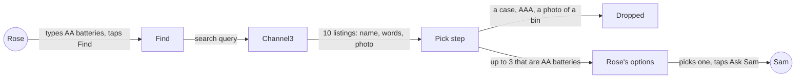
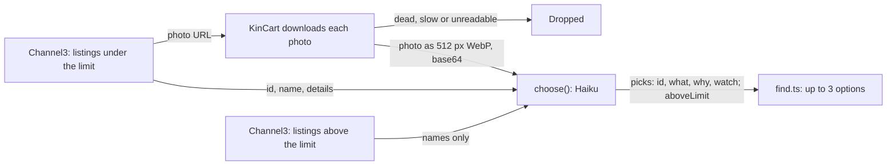
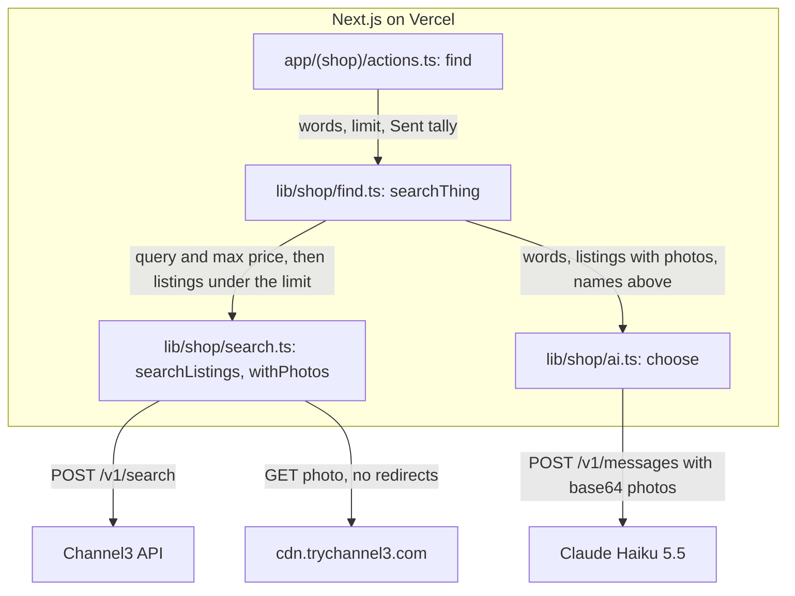
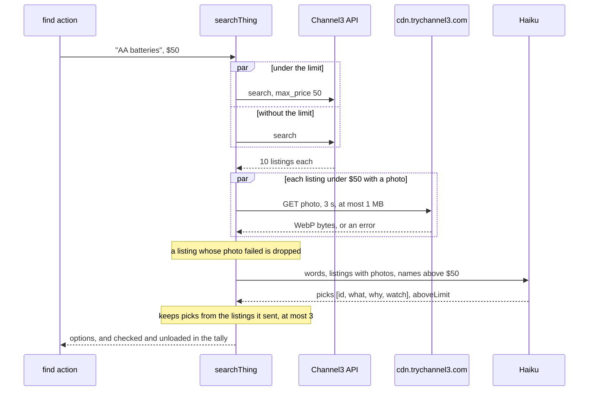
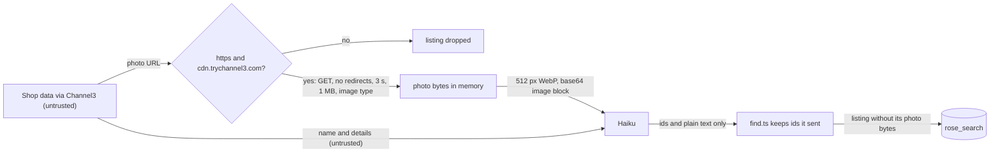

# Picks that match

**Version:** v1 · **Status:** Shipped · **Type:** Bug · **Project type:** Data/LLM

**Shape doc:** docs/specs/after-review/shape.md
**Depends on:** None
**Page:** none. Skipped: you read the `.md` directly.

A listing that isn't the thing Rose asked for, such as a storage bin sold as "Batteries", never reaches Rose. It ships now because a judge's first Find can show a wrong pick, and `find-another` and `ask-again` reuse this pick step.

## Problem

In the review of v1.2.0 on 2026-10-22, Rose asked for batteries. The second pick was "Batteries", $2.99 at containerstore.com, with a photo of an empty bin and a note about Energizer AA batteries. An older shopper may pick it, and Sam sees a bin. Channel3 also returns near things for a search, such as tablet cases for "a tablet for video calls".

The spike for O1 found the cause in Channel3's data. Channel3 lists five containerstore.com products as "AA Batteries", brand Energizer, in its batteries category. Their words say "a pack of Energizer AA batteries", but the photos show a white basket, gift labels, a pin board, a trash can and a battery case. Haiku reads only the words, so it picks them when no better AA pack is in the search.

## Slice test

| Check                         | Result |
| ----------------------------- | ------ |
| Cuts every layer it needs     | yes: Channel3's listings, Find's pick step, and Rose's options and notices. Rose reaches it with Find |
| One e2e test walks it         | yes: the recorded set runs from Rose's words to the options Rose would see, with real Haiku |
| Worth shipping alone          | yes: a judge's first Find no longer shows a bin as batteries |
| Fits (≤5 scenarios, ≤2 areas) | yes: 5 scenarios, one area (Find's pick step) and its tests |

**Path:** full. The fix changes what Haiku is sent and asked: the words can't show the mismatch, so the photo must (O1).

## User story

As Rose, I want every option I see to be the thing I asked for, so that I don't pick a bin when I need batteries.

## Flow



Rose's words go to Channel3, the pick step drops every listing that isn't the thing, and Rose sees only the ones that are.

## Acceptance criteria

```gherkin
Scenario: The review's wrong pick never reaches Rose
  Given Sam's limit is $50
  And Channel3 answers "AA batteries" with "AA Batteries", $6.74 at containerstore.com, whose words say "a pack of Energizer AA batteries" and whose photo shows an empty white basket
  When Rose types "AA batteries" and taps Find
  Then Rose doesn't see the containerstore.com listing
  And every listing Rose sees is a pack of AA batteries

Scenario Outline: A listing for something near the thing never reaches Rose
  Given Sam's limit is $50
  When Rose asks for <thing> and Channel3 answers with <near thing> among real ones
  Then Rose doesn't see <near thing>
  And a pack of <thing> from any brand, in any pack size, can still show

  Examples:
    | thing                | near thing                    |
    | AA batteries         | a battery storage case        |
    | AA batteries         | a pack of AAA batteries       |
    | a phone charger      | a charging cable on its own   |
    | reading glasses +2.0 | a glasses case                |

Scenario: A listing with no photo is judged on its words
  Given Channel3 answers "AA batteries" with "Duracell Coppertop AA Batteries, 8 Pack", which has no photo
  When Rose types "AA batteries" and taps Find
  Then that listing can show, with no photo, as today

Scenario Outline: Fewer fit, or none
  Given Sam's limit is <limit>
  When Rose asks for <thing> and <what fits>
  Then Rose sees "<message>" <where>

  Examples:
    | limit | thing                       | what fits                                    | message                                                                          | where                                          |
    | $50   | AA batteries                | 1 of Haiku's 3 picks                         | Only 1 found at $50 or less.                                                     | under "Which one would you like?"              |
    | $30   | a tablet for video calls    | only cases under $30, and tablets above it   | Nothing under $30 for that. Try different words, or ask Sam to raise the limit. | above "What do you need?"                      |
    | $50   | AA batteries                | nothing                                      | Couldn't find that. Try different words.                                         | above "What do you need?"                      |
    | $50   | AA batteries, a night light | nothing for AA batteries, 3 night lights     | Couldn't find this one.                                                          | in the AA batteries group only                 |

Scenario: The recorded set proves it, and Find takes no longer
  Given about 10 real wrong listings saved from Channel3, each beside right listings for the same ask
  When each ask runs through Find's pick step 3 times, with real Haiku
  Then every wrong listing is dropped in 3 of 3 runs
  And each ask still shows at least one right listing in every run
  And one thing still shows within 15 seconds, and five things within 20 seconds
```

## Scope

**In:**
- Find's pick step drops a listing that isn't the product Rose asked for: a case, holder, charger or part for it, or another size or type than Rose said.
- It drops a listing whose photo shows something other than its name says.
- A listing with no photo is judged on its name and words, as today.
- The same rules for each thing in a basket, and for a Find from photos.
- Today's messages when fewer than three fit, or none.
- A recorded set of about 10 real wrong listings, with right ones beside them, run 3 times against real Haiku.

**Out:**
- Find another, when nothing fits: `find-another` (slice 4).
- Repeating a past ask: `ask-again` (slice 5).
- Only the brand Rose names, when Rose names one. Any brand counts (O3). No later slice.
- A way for Rose or Sam to report a wrong pick. No later slice.
- Fixing Channel3's listing data. That is Channel3's to fix.

## Interface

This slice's interface is the pick step's contract with Haiku. Rose's and Sam's screens don't change: Rose sees fewer options, or today's messages.



KinCart downloads each listing's photo, shrinks it to 512 px, and sends it to Haiku with the listing's words. Haiku picks only listings whose photo and words both fit.

**Input to `choose(words, under, above)`:**

- `words`: Rose's words for the thing, as today.
- Under the limit: for each listing, a text block `Listing <id>:` with its name and details as JSON, as today. When the listing has a photo, a base64 image block follows the text block. The photo is a WebP of at most 512 px on its long side (O16).
- Above the limit: names only, as today (O11).

KinCart downloads the photos itself. The API refuses Channel3's photo URLs with "This URL is disallowed by the website's robots.txt file.", because `cdn.trychannel3.com/robots.txt` disallows every crawler. Sent as base64, the basket photo from O1 cost 507 input tokens, and Haiku called it "White plastic storage bin with handles." in 1.1 s (checked 2026-10-22).

**Prompt:** today's `CHOOSE`, with its first sentence replaced by these. `/build` tuned the words against the recorded set: with the five planned sentences, Haiku still filled a third pick with a cable or a battery case in 3 of 7 asks.

> Each listing under their price limit comes with its photo, if it has one. A listing sells the main thing in its photo, whatever its words say. First leave out every listing that is not the product they asked for: a case, holder, organizer, charger, cable or other part for it, even when its photo shows the product inside it, since the product's own printed retail pack is the only packaging that counts as the product; another size or type than they said; and any listing whose photo shows something other than its name and words say, even when the words fit. Judge a listing with no photo by its name and words alone. Any brand or pack size of the product counts. From the listings left, pick up to three that fit what they asked, best first. Fewer than three is fine, and none if none is left. Never pick a listing that you would describe as only a part, or whose photo shows something else.

**Output:** unchanged, `{ picks: [{ id, what, why, watch }], aboveLimit }`. `find.ts` still keeps only picks whose id is under the limit, at most 3.

**Failure modes:**

| Case | What happens | What Rose sees |
| ---- | ------------ | -------------- |
| A listing has no photo | Haiku judges it on its name and words | it can show, with no photo, as today |
| KinCart can't download a listing's photo: an error, too slow, or not WebP, JPEG, PNG or GIF | the listing is dropped before Haiku (O9) | fewer options, or today's messages |
| A photo shows something other than the words say | Haiku doesn't pick it | fewer options, or today's messages |
| Nothing under the limit fits, and the real thing is above it | `aboveLimit` is true | "Nothing under $50 for that. Try different words, or ask Sam to raise the limit." |
| Nothing under the limit fits, and a misfit above it is named like the thing, such as the $64.99 pin board | `aboveLimit` can be true from the name alone (O11) | "Nothing under $50 for that…" where "Couldn't find that." is true |
| The pick call fails or times out | the error is caught, as today (O10) | "Couldn't find that. Try different words.", or "Couldn't find this one." in a basket group |

## Technical plan

### Approach

After the two Channel3 searches, `searchThing()` in `lib/shop/find.ts` calls a new `withPhotos()` in `lib/shop/search.ts`. It downloads the photos of the listings under the limit all at once, only from `cdn.trychannel3.com`, shrinks each to 512 px with `sharp` (O16), and drops a listing whose photo fails (D93, D95). `choose()` in `lib/shop/ai.ts` then sends each listing's words and photo as content blocks, with the new rules in `CHOOSE`. Its answer and everything after it stay as today.

A recorded set of real Channel3 listings and photos, committed to the repo, runs through `find()` against real Haiku in `pnpm test` (D90, D94).

Relies on: D17, D21, D22, D24, D31, D54, D81, and the drafted D88 to D95.



`searchThing` gets listings from Channel3, has `withPhotos` download their photos from the CDN, and hands the listings with photos to `choose`, which asks Haiku.



The photo downloads sit between the searches and the pick call. They run all at once, so they add the slowest photo's time, at most 3 s.



The server fetches only one host, Haiku can only answer with ids that `find.ts` checks, and no photo bytes are stored.

### Changes

| File | What changes | Why |
| ---- | ------------ | --- |
| `lib/shop/search.ts:5` | `Found` gains `photo?: { mediaType: string; data: string }`, the photo in base64. New `withPhotos(listings)` downloads each listing's `imageUrl` all at once with `fetch`, `redirect: "error"` and `AbortSignal.timeout(3000)`, the pattern of `searchListings` at `search.ts:23`. It keeps a photo only from `https://cdn.trychannel3.com`, with status 200, type `image/webp`, `image/jpeg`, `image/png` or `image/gif`, and at most 1 MB. A listing with no `imageUrl` passes with no photo. It shrinks each kept photo to a WebP of at most 512 px with `sharp` (O16). Any other failure, also a photo `sharp` can't read, drops the listing. It sends no API key to the CDN | 1, 3, 4; D93, D95 |
| `lib/shop/ai.ts:54` | `CHOOSE` gains the sentences from Interface | 1, 2 |
| `package.json`, `pnpm-lock.yaml` | `sharp` becomes a direct dependency, at 0.35.5, the version Next already installs (O16) | 5 |
| `lib/shop/ai.ts:91` | `choose()` sends content blocks: the asked line, then for each listing under the limit a `Listing <id>:` text block with its name and details, and its photo as a base64 image block when it has one, then the names above the limit. It builds blocks the way `readPhoto()` does at `ai.ts:80`. `haiku()` at `ai.ts:103` already takes blocks | 1 to 3 |
| `lib/shop/find.ts:23` | `Sent` gains `checked`, the listings sent to Haiku with a photo, and `unloaded`, the listings dropped for their photo. Its comment says these two are for the log | proof |
| `lib/shop/find.ts:117` | `searchThing()` runs `withPhotos(affordable)`, adds to `sent.checked` and `sent.unloaded`, and gives `choose()` the kept listings. It looks picks up in the kept listings | 1 to 4 |
| `lib/shop/find.ts:85` | the `find` log line adds `checked=<n> unloaded=<n>` | proof |
| `app/(shop)/actions.ts:111` | `{ searches: 0, checked: 0, unloaded: 0 }` | the `Sent` type |
| `lib/shop/search.test.ts` | `withPhotos()` keeps a photo with status 200, shrunk to 512 px, and keeps a small one at its own size. It drops a 404, a timeout, a redirect, another host, `text/html`, a broken photo and a photo over 1 MB, and passes a listing with no `imageUrl` | 4 |
| `lib/shop/ai.test.ts:128` | `choose()` sends an image block after each listing with a photo and none for a listing without, and names above the limit stay names | 1 to 3 |
| `lib/shop/find.test.ts:10`, `:48` | the stub answers `cdn.trychannel3.com` with a small WebP, and `searches()` counts `api.trychannel3.com` only. New tests: a listing whose photo fails never reaches Haiku, a listing with no photo can show, and all listings dropped gives "nothing found" or "over limit". Log lines gain `checked=` and `unloaded=` | 3, 4 |
| `lib/shop/picks/asks.json`, `lib/shop/picks/photos/<id>.webp` (new) | the recorded set: 7 asks with 27 wrong listings (O17). Each has Rose's words, Sam's limit, Channel3's products under and above the limit as Channel3 sent them, and the wrong and right ids. `/build` saves them with a scratch script that is not committed, and labels each photo by looking at it. It starts from the O1 listings, then finds a battery case, a pack of AAA, a cable sold alone, a glasses case and tablet sleeves | 1, 2, 5 |
| `lib/shop/picks.test.ts` (new) | for each ask, runs `find(words, limit)` 3 times at once with real Haiku, one ask after another. The stubbed `fetch` answers `api.trychannel3.com` with the saved products and `cdn.trychannel3.com` with the saved photos, and passes `api.anthropic.com` to the real `fetch`. It fails when a wrong id shows in any run, or a run shows no right id. It checks for `ANTHROPIC_API_KEY` first, as the e2e's `beforeAll` does, and has a 60 s timeout for each ask | 1, 2, 5 |
| `DECISIONS.md` | `/build` appends D88 to D95 | — |

Reusing: the fetch and timeout pattern of `searchListings()`, the content blocks of `readPhoto()`, `haiku()`, the `Sent` tally and `logged()` (D81), and the stub shape of `find.test.ts`.

### Earn-it

| Added | Triggered by |
| ----- | ------------ |
| `withPhotos()` | scenarios 1 and 4: only the photo shows the mismatch (O1), and the API refuses Channel3's photo URLs (D92) |
| one host, no redirects, 3 s, 1 MB | the security surface, because shop data names the URL (D95). D93: one bad photo drops one listing, not the whole pick call |
| `checked` and `unloaded` in `Sent` and the log | proof it works in prod, and the risk that Channel3 moves its CDN |
| `lib/shop/picks/` and `picks.test.ts` | scenario 5, D90 |
| about 2 MB of committed photos | D94: Channel3 can drop a listing or photo at any time |
| `sharp`, and the 512 px shrink | scenario 5 and D91: at full size, the pick call ran past its 10 s timeout (O16) |

### Non-functionals

|                      |                                                                               |
| -------------------- | ----------------------------------------------------------------------------- |
| **Load**             | Finds stay capped at 20 a day for each address (find-limits). Each thing adds up to 10 photo downloads (3 to 260 KB, median 77 KB in the spike), shrunk to 512 px. A pick call with 10 photos sent 5,800 to 7,000 input tokens and 1,050 to 1,280 output tokens, most of it thinking (measured 2026-10-22). That is under $0.001 at Haiku 5.5's $0.10 and $0.50 for each million tokens |
| **Breaks first**     | Anthropic's limit on input tokens each minute. A 5-thing basket sends up to 50 photos in 5 calls at once. A 429 blanks that thing's group with "Couldn't find this one.", as a failed call does today. If `reason=anthropic 429` shows in the logs, send fewer photos for each call |
| **Security surface** | Callers: anyone with a Rose link, inside find-limits, as today. Trusted input: nothing new from Rose. Photo URLs come from shop data, so the server fetches only `https://cdn.trychannel3.com`, with no redirects, 3 s, 1 MB and four image types, and sends it no key. Text inside a photo can try to steer Haiku, but Haiku still answers only with ids, and `find.ts` keeps only ids it sent, as today. Secrets: `ANTHROPIC_API_KEY`, unchanged. Stored: nothing new, and photo bytes are never stored |
| **Proof it works**   | In Vercel's logs, `find outcome=options listings=3 searches=2 ms=<n> checked=<n> unloaded=<n>`. A `checked` above 0 shows that photos reach Haiku. An `unloaded` that climbs shows that downloads fail, for example after a CDN move |
| **Rollout**          | No flag, no migration, no new env value. Merge, CI tests, and Vercel promotes (D10). Rollback: revert the merge |

### Test plan

| Scenario | Test | Command |
| -------- | ---- | ------- |
| 1. The review's wrong pick | `lib/shop/picks.test.ts`: the "AA batteries" ask with the five containerstore.com listings, 3 runs, real Haiku | `pnpm test lib/shop/picks.test.ts` |
| 2. Near things | `lib/shop/picks.test.ts`: the battery case, AAA, cable, glasses case and tablet sleeve asks | `pnpm test lib/shop/picks.test.ts` |
| 3. No photo | `lib/shop/find.test.ts` and `lib/shop/ai.test.ts`: a listing with no `imageUrl` goes to Haiku with no image block, and can show | `pnpm test lib/shop/find.test.ts lib/shop/ai.test.ts` |
| 4. Fewer fit, or none | `lib/shop/search.test.ts`: each way a download fails. `lib/shop/find.test.ts`: a dropped listing never reaches Haiku, and all dropped gives "nothing found", "over limit", or one blank basket group. Rose's messages keep their tests in `app/(shop)/RoseView.test.tsx` | `pnpm test lib/shop` |
| 5. The recorded set, and Find's time | `lib/shop/picks.test.ts`, 3 of 3 runs. Time: `/build` reads `ms=` from the `find` log line over live Finds of one thing and of five things, and writes the numbers into O12 | `pnpm test lib/shop/picks.test.ts` |

**E2E:** `lib/shop/picks.test.ts` walks the slice, from Rose's words through `find()` to the options Rose would see, with real Haiku. The live `e2e/find-and-explain.spec.ts`, `e2e/basket.spec.ts` and `e2e/photo-ask-several.spec.ts` must still pass with real photo downloads (`pnpm test:e2e`, with `pnpm dev` stopped).

### Chunks

| Chunk | Scenarios | Files owned |
| ----- | --------- | ----------- |
| A | 3, 4 | `lib/shop/search.ts`, `lib/shop/search.test.ts`, `lib/shop/ai.ts`, `lib/shop/ai.test.ts`, `lib/shop/find.ts`, `lib/shop/find.test.ts`, `app/(shop)/actions.ts`, `DECISIONS.md` |
| B | 1, 2, 5 | `lib/shop/picks.test.ts`, `lib/shop/picks/` |

B runs after A, because its test needs A's photo step. Chunk A owns `DECISIONS.md`.

### Risks

| Risk | Mitigation |
| ---- | ---------- |
| With photos, Haiku still picks a misfit, or keeps too few right listings (O12) | `picks.test.ts` shows it at `/build`. `/build` tunes the five sentences against the set. If it can't pass 3 of 3, the spec goes back to Draft |
| Photos make a pick call slower than its 10 s timeout, or a Find slower than 15 s (O12) | `/build` measures `ms=` live. If a Find is too slow, the spec goes back to Draft with the numbers |
| The 3 s timeout drops listings on a slow day: the 60 spike photos took 0.7 to 3.5 s fetched all at once | at most 10 download at once for each thing. `unloaded=` in the log shows it |
| Channel3 moves its photos off `cdn.trychannel3.com`, so every listing is dropped and every Find says "Couldn't find that." | `unloaded=` climbs in the logs. The fix is the one host name in `withPhotos()` |
| A rare Haiku miss turns CI red | it is a real wrong pick, so it is the signal D94 wants. Fix the prompt, not the test |
| A photo the API can't take, such as one over 8,000 px wide, fails the whole pick call | the 1 MB cap and the 512 px shrink rule it out. A photo `sharp` can't read drops only its listing (D93) |

### Decisions to record

Recorded as D88, D89, D90, D91, D92, D93, D94, D95.

## Review

2026-10-22 · 3 raw findings, 2 survived, 2 fixed.

- correctness · `lib/shop/search.test.ts:167` · the "huge" case sends a real noise PNG over 1 MB, so only the size check drops it · `89868ed`
- coverage · `lib/shop/search.ts:54` · a test that each photo download gets `AbortSignal.timeout(3000)` · `8d2c838`

## Open items

| ID | What | Type | Raised at | Owner | Status | Answer |
| -- | ---- | ---- | --------- | ----- | ------ | ------ |
| O1 | The review's wrong pick ("Batteries", $2.99 at containerstore.com, a photo of an empty bin, a note about Energizer AA) came from Channel3's listing text, not from Haiku (from shape O10) | unproven | shape | poc | Resolved | Yes, proven by a spike on 2026-10-22, inside its 30-minute box. Channel3 gives five containerstore.com products the title "AA Batteries", brand Energizer and its batteries category: `qYGxLFs` $6.74 (photo: white basket; words: "a pack of Energizer AA batteries"), `6h21ajG` $3.99 (trash can; "a 4-pack of Energizer AA batteries"), `dwSkyf8` $64.99 (pin board), `1aF2iFr` $2.39 (gift labels; words about an OXO soap brush) and `zZmNCMH` $23.10 (a battery case). With `choose()`'s own prompt, Haiku skipped them in 9 of 9 runs when real AA packs were in the set. With only these as AA listings, it picked `zZmNCMH`, `6h21ajG` and `qYGxLFs` in 3 of 3 runs, and its notes repeated the words. It skipped the soap-brush one. So the words can't show the mismatch: only the photo can. 2026-10-22 |
| O2 | Is a /poc the way to settle O1? | question | spec p1 | user | Resolved | Yes, as the shape planned. It runs after the pause 1 draft. 2026-10-22 |
| O3 | What counts as "not the thing Rose asked for" | question | spec p1 | user | Resolved | Not the product itself: a case, holder, charger or part for it, or another size or type than Rose said (AAA for AA). Any brand or pack size of the real thing counts. 2026-10-22 |
| O4 | A listing whose photo and name disagree, such as "Batteries" with a photo of an empty bin | question | spec p1 | user | Resolved | Never show it. 2026-10-22 |
| O5 | A listing with no photo | question | spec p1 | user | Resolved | Show it, judged on its name and words alone, as today. 2026-10-22 |
| O6 | What proves a wrong pick never reaches Rose, when the AI's answers change from run to run | question | spec p1 | user | Resolved | A recorded set of about 10 real wrong listings, each dropped in 3 of 3 runs against real Haiku, with the right listings beside them still shown. 2026-10-22 |
| O7 | Can Find take longer to catch wrong picks? | question | spec p1 | user | Resolved | No. One thing within 15 s and five within 20 s, as today. 2026-10-22 |
| O8 | How the pick step sees the photos: in the pick call, or in a check call after it | question | spec p2 | user | Resolved | In the pick call, with each listing's photo after its words. Still two fixed steps (D22). 2026-10-22 |
| O9 | A listing whose photo KinCart can't download: dead link, too slow, or a format Claude can't read | question | spec p2 | user | Resolved | Drop it. 2026-10-22 |
| O10 | The pick call fails or times out | question | spec p2 | user | Resolved | Nothing found, as today. No retry without photos. 2026-10-22 |
| O11 | Listings above the limit go to Haiku as names only, so a misfit named like the thing can turn "Couldn't find that." into "Nothing under $50 for that…" | flag | spec p2 | user | Accepted risk | A wrong message, not a wrong pick, and only when nothing under the limit fits. `find-another` reworks the over-limit step. 2026-10-22 |
| O12 | With up to 10 downloaded photos in the pick call, Haiku drops the containerstore.com misfits and keeps real AA packs in 3 of 3 runs, and a Find still shows one thing within 15 s and five within 20 s | unproven | spec p3 | build | Accepted risk | `/build` measures it: `picks.test.ts` for the picks, and `ms=` over 3 live Finds of one thing and of five things. If either fails, the spec goes back to Draft with the numbers. 2026-10-22. Measured at `/build`, 2026-10-22, by calling `find()` with real Channel3, photos and Haiku, not through `pnpm dev`. With full-size photos it failed: one thing took 8.7 to 12.5 s, one Find timed out at 15.3 s, and each of 3 five-thing Finds (13.1 to 14.1 s) lost 1 to 3 groups to the pick call's 10 s timeout. With photos shrunk to 512 px (O16) it passes: one thing 9.7 to 10.1 s over 6 Finds, five things 10.9 to 12.0 s over 3, no timeouts. In one Find, the need call took 0.9 to 1.4 s, the two searches 1.5 to 1.8 s, and the pick call 6.4 to 7.0 s. `picks.test.ts` passed 105 of 105 runs (5 passes of 7 asks, 3 runs each). Through the built app in `pnpm test:e2e`: one thing 9.6 to 13.4 s over 5 Finds, two to four things 10.9 to 12.2 s over 3, all 27 tests passing. |
| O13 | Where the recorded set's photos live | question | spec p3 | user | Resolved | Committed to the repo, about 2 MB (D94). 2026-10-22 |
| O14 | When the recorded-set test runs | question | spec p3 | user | Resolved | In `pnpm test`, on every push (D94). An estimated 3 to 5 cents a run, and about a minute with the asks run one after another. 2026-10-22 |
| O15 | Which hosts the server may download listing photos from | question | spec p3 | user | Resolved | `cdn.trychannel3.com` only, with redirects refused (D95). 2026-10-22 |
| O16 | The plan sent each photo to Haiku as Channel3 sent it. Channel3's photos run up to 2048 px, and with 10 of them the pick call often ran past its 10 s timeout (O12) | flag | build | user | Decided alone | Chose: shrink each photo to a WebP of at most 512 px with `sharp` before the pick call, and add `sharp` as a direct dependency at 0.35.5, the version Next already installs. 384 px saved under 1 s more. Other: send full-size photos and let a Find take up to 15 s, with basket groups lost to timeouts; turn thinking off for the pick call (one thing 6.8 to 11.6 s, but misfits got through in 4 of 7 asks); or raise the pick call's timeout past 10 s. Undo: `git revert 4d9719d`, then fix `find.test.ts`'s photo stub. 2026-10-22 |
| O17 | The plan said the recorded set had about 10 asks, built from Channel3's answers for each ask | flag | build | user | Decided alone | Chose: 7 asks with 27 real wrong listings, each beside 2 right ones, composed from 20 real searches and 2 product lookups. Wrong listings outnumber right ones, so Haiku can't fill three picks without a misfit. Other: 10 asks with Channel3's own 10-listing answers (5 to 7 MB of photos, and right listings outnumber wrong ones, so Haiku skips misfits without the photo, as O1 found). Undo: add asks to `lib/shop/picks/asks.json` and their photos. 2026-10-22 |

_Never delete this section or its rows. See references/ledger.md._

## Glossary

- **Channel3** — the hackathon sponsor whose API returns real product listings.
- **Haiku** — Claude Haiku 5.5, the AI that reads Rose's words and picks from the listings (D22).
- **Pick step** — Find's second Haiku call, `choose()` in `lib/shop/ai.ts`, which picks up to three listings and writes what, why and one catch for each.
- **Recorded set** — real Channel3 listings saved once to a file, so a test can run the same ones again and again.
- **/poc** — zuko's timeboxed spike. It answers one risky question with throwaway code.
- **e2e** — end to end: a test that runs the whole path, the way a person would use it.
- **base64** — a way to write a file's bytes as plain text, so a photo can go inside a JSON request.
- **robots.txt** — a file where a website says which automated fetchers may read it. Channel3's photo server says none may.
- **CDN** — the server that holds a site's photos and files, here `cdn.trychannel3.com`.
- **Content block** — one piece of a request to Claude, either text or an image.
- **429** — the HTTP answer "too many requests", sent when a rate limit is hit.
