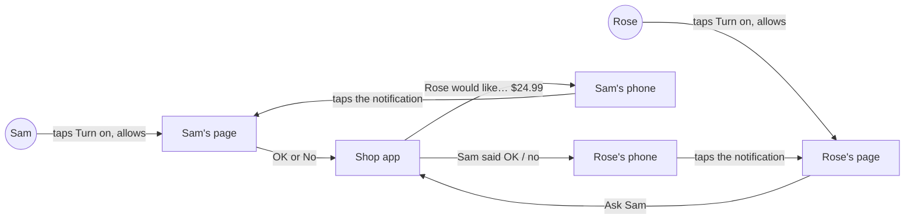
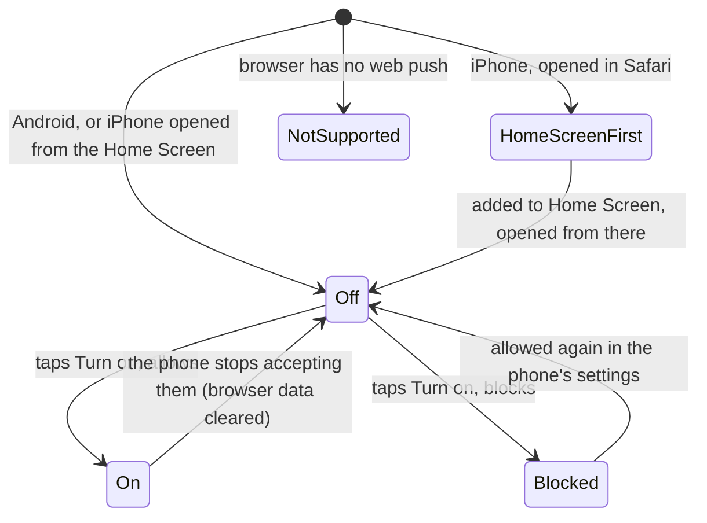

# Ping helper

**Version:** v1 · **Status:** Draft · **Type:** Feature · **Project type:** Web UI

**Shape doc:** docs/specs/shop-together/shape.md
**Depends on:** approve-and-pay, find-and-explain
**Page:** none. Skipped: you read the `.md` directly.

Sam's phone buzzes when Rose asks for something, and Rose's phone buzzes when Sam answers, so neither has to keep their page open. It is slice 3 in the shape, built now because slices 0 to 2 shipped with time left, and it makes "approve from afar" real on the video.

## Problem

Both pages only change while they are open on screen (D19). Sam has to keep opening their link to find out whether Rose asked, and Rose has to keep their page open to learn whether Sam said OK. A request Rose makes while Sam's phone is in their pocket can sit unseen for hours. On the video, approving from afar only looks real if Sam's phone buzzes.

## Slice test

| Check                         | Result |
| ----------------------------- | ------ |
| Cuts every layer it needs     | yes: a Turn on button on both pages, a background script that shows the notification, stored phones to notify, a send on Ask Sam and on Sam's answer, deployed |
| One e2e test walks it         | yes: one Playwright test with Rose's and Sam's pages: both turn on, Rose asks, Sam's notification opens Sam's page, Sam taps OK, Rose's notification opens the receipt. Whether Playwright's browser can receive a real push in CI is O5 |
| Worth shipping alone          | yes: Sam learns of a request, and Rose of Sam's answer, without keeping a page open |
| Fits (≤5 scenarios, ≤2 areas) | yes, at the limit: 5 scenarios; two areas, the shop pages (existing) and push notifications (new) |

**Path:** full. New controls on both pages, a new table, a background script, and the phones' push services.

## User story

As Sam, I want my phone to buzz when Rose asks for something, so that I can answer without keeping a page open.

As Rose, I want my phone to tell me when Sam has answered, so that I don't have to keep watching the page.

## Flow



Each person turns notifications on once from their own page; after that Rose's ask buzzes Sam's phone, Sam's answer buzzes Rose's, and tapping either notification opens that person's page.

## States

The notification control on each page, per phone:



## Acceptance criteria

```gherkin
Scenario Outline: Turning notifications on
  Given <person> opens their link on <phone>
  When <what they do>
  Then their page says "<message>"

  Examples:
    | person | phone                            | what they do                              | message                                                                                                   |
    | Sam    | an Android phone in Chrome       | taps "Turn on notifications", then Allow  | Notifications are on. Your phone will buzz when Rose asks for something.                                  |
    | Sam    | an Android phone in Chrome       | taps "Turn on notifications", then Block  | Notifications are blocked on this phone. Allow them for this site in your browser settings, or keep this page open. |
    | Rose   | an iPhone (iOS 16.4+) in Safari  | nothing yet                               | To get notifications on iPhone: tap Share, then Add to Home Screen, then open Shop-together from your Home Screen. |
    | Rose   | an iPhone in Firefox             | nothing yet                               | This browser can't show notifications. Keep this page open to see Sam's answer.                         |

Scenario: Rose turns notifications on from the iPhone Home Screen
  Given Rose has added their page to the Home Screen on an iPhone with iOS 16.4 or later
  When Rose taps the Shop-together icon
  Then Rose's own page opens, not the status page
  When Rose taps "Turn on notifications", then Allow
  Then Rose's page says "Notifications are on. Your phone will buzz when Sam answers."

Scenario: Rose asks, and Sam's phone buzzes with the page closed
  Given Sam turned notifications on, closed Sam's page and locked the phone
  When Rose picks "Dearfoams Women's Fireside Slipper" at $24.99 and taps "Ask Sam"
  Then within 10 seconds Sam's phone shows "Rose would like Dearfoams Women's Fireside Slipper" with "$24.99. Tap to see it and say OK or No."
  When Sam taps the notification
  Then Sam's page opens on that request, with "OK, pay $24.99" and "No"

Scenario Outline: Sam answers, and Rose's phone buzzes
  Given Rose turned notifications on, asked for "Dearfoams Women's Fireside Slipper" at $24.99, and closed their page
  When Sam taps <Sam taps> and <what happens>
  Then within 10 seconds Rose's phone shows "<title>" with "<text>"
  And tapping it opens Rose's page, showing <Rose's page>

  Examples:
    | Sam taps         | what happens                | title                      | text                                                                                   | Rose's page          |
    | "OK, pay $24.99" | the payment goes through    | Sam said OK                | Dearfoams Women's Fireside Slipper is paid: $24.99. Tap to see the receipt.            | the receipt          |
    | "No"             | nothing is charged          | Sam said no                | Sam said no to Dearfoams Women's Fireside Slipper. Nothing was taken.                  | "Sam said no to…"    |
    | "OK, pay $24.99" | PayPal refuses the payment  | Payment didn't go through  | Sam said OK, but the payment didn't go through. Nothing was taken.                     | "Payment didn't go through" |

Scenario: A phone that stopped accepting notifications changes nothing else
  Given Sam turned notifications on, then cleared the browser's data on that phone
  When Rose taps "Ask Sam" for "Dearfoams Women's Fireside Slipper" at $24.99
  Then Rose sees "Waiting for Sam" as before, with no delay or error
  And Sam's page shows the request as soon as it is opened
  And Sam's page offers "Turn on notifications" again
```

## Scope

**In:**

- A "Turn on notifications" control on Sam's page and on Rose's page, with the on, blocked, iPhone-Home-Screen-first and not-supported messages from scenario 1.
- iPhone: once the page is added to the Home Screen, its icon opens that person's own page.
- Sam's phone is notified when Rose asks: the item name and price. Tapping it opens Sam's page on the request.
- Rose's phone is notified when Sam answers: paid, said no, or the payment failed. Tapping it opens Rose's page.
- Every phone a person turned notifications on for gets them (O4).
- A notification that fails never delays or stops an ask or a payment. A phone that no longer accepts them is forgotten, and its page offers Turn on again.
- Open pages keep refreshing every 3 seconds (D19), as now.

**Out:**

- OK and No buttons on the notification itself: no slice planned. Sam checks the reason and the listing on the page before paying (find-and-explain scenario 2), and iPhone doesn't show notification buttons.
- A reminder when Sam hasn't answered: no slice planned.
- A Turn off button: no slice planned. The phone's own notification settings turn it off.
- Email or text messages: no slice planned (D1).
- Asking by voice: slice 4, `ask-by-voice`.

## Open items

| ID | What | Type | Raised at | Owner | Status | Answer |
| -- | ---- | ---- | --------- | ----- | ------ | ------ |
| O1 | On iPhone, the Home Screen icon opens the person's own secret link (not `/` or `/status`), and web push works from there. Only a real iPhone with iOS 16.4+ can show it | unproven | spec p1 | poc | Open | — |
| O2 | Which phones can you test on? "Both must work" needs an iPhone with iOS 16.4+ and an Android phone in hand, or the missing one ships untested | question | spec p1 | user | Open | — |
| O3 | Assuming a notification within 10 seconds of the tap is good enough. Delivery goes through Apple's and Google's push services, which this app doesn't control | assumption | spec p1 | user | Open | — |
| O4 | Assuming every phone a person turned notifications on for gets them, with no limit on how many | assumption | spec p1 | user | Open | — |
| O5 | Playwright's browser can get a push subscription and receive a push in CI. Its Chromium is an open-source build and may have no push service | unproven | spec p1 | spec p3 | Open | — |
| O6 | Assuming the notification shows the item and price, on the lock screen too. Anyone who sees Sam's phone sees what Rose is buying; phones can hide notification text on the lock screen in their own settings | assumption | spec p1 | user | Open | — |
| O7 | Both links opened on one phone, as when you test alone: does each person get their own notifications there? | question | spec p1 | spec p3 | Open | — |

_Never delete this section or its rows. See references/ledger.md._

## Glossary

- **Web push**: how a website shows a notification on a phone while the site is closed. The phone's own push service (Google's on Android, Apple's on iPhone) carries the message.
- **Home Screen web app**: a website saved to the iPhone's Home Screen with Share, then Add to Home Screen. It opens without Safari's bars, and on iPhone only these can get web push.
- **Push subscription**: the address a phone's browser hands out for one site. The app sends each notification to it, and it stops working if the browser's data is cleared.
- **e2e**: end-to-end, one test that walks the whole slice as a user would.
