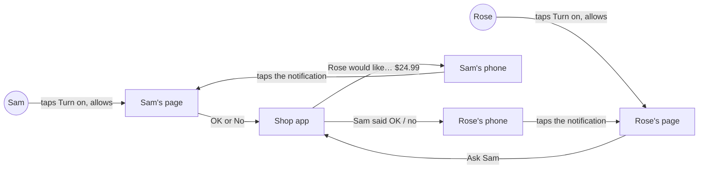
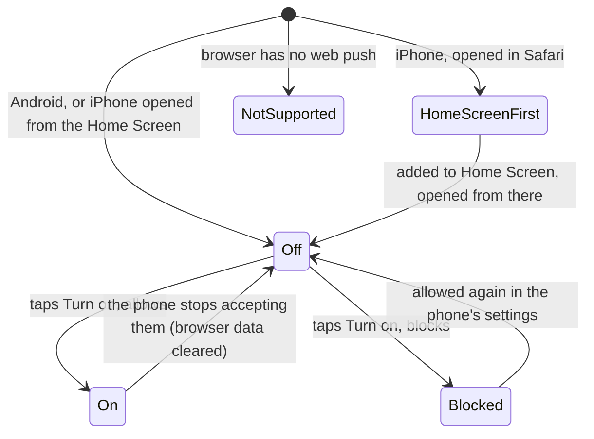
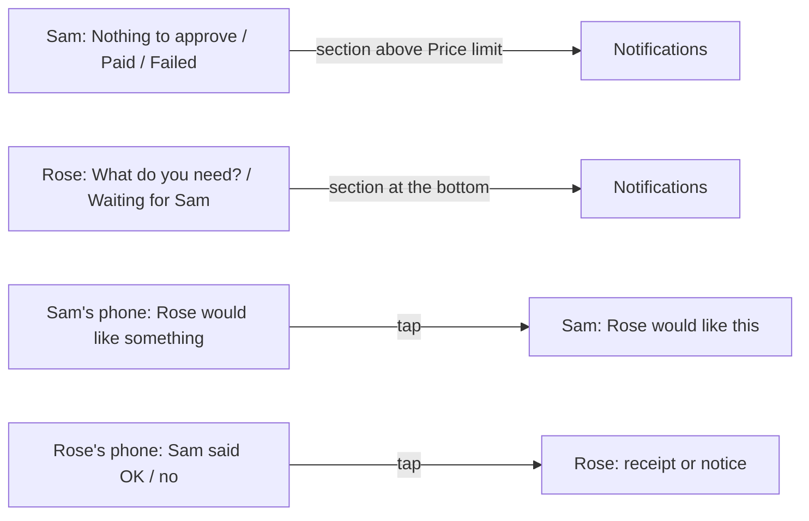
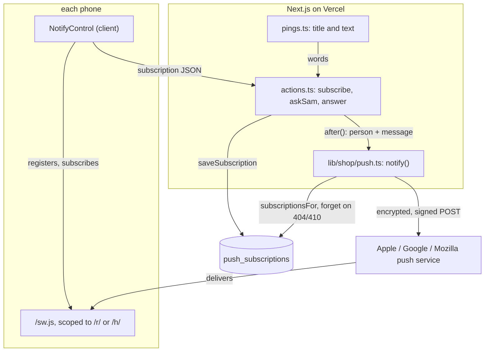
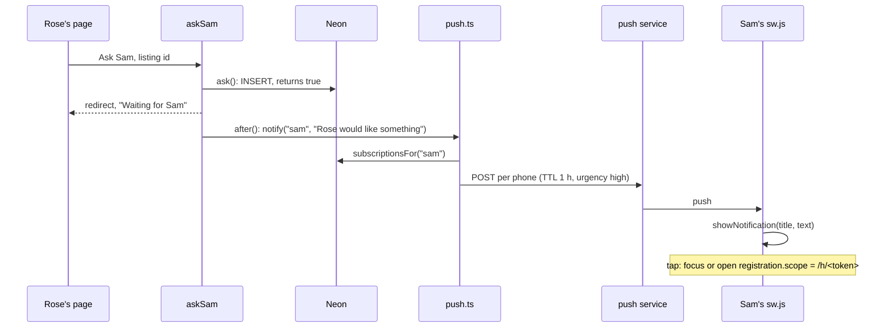
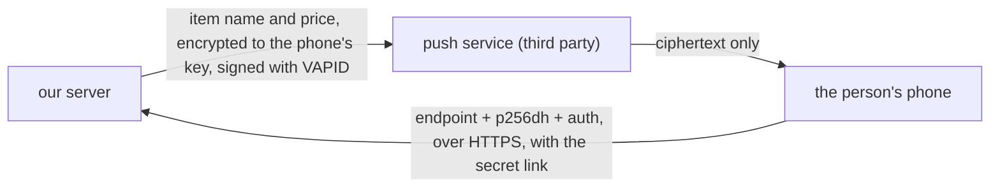
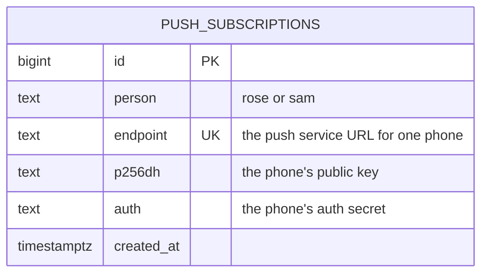

# Ping helper

**Version:** v1 · **Status:** Refined · **Type:** Feature · **Project type:** Web UI

**Shape doc:** docs/specs/shop-together/shape.md
**Depends on:** approve-and-pay, find-and-explain
**Page:** none. Skipped: you read the `.md` directly.

Sam's phone buzzes when Rose asks for something, and Rose's phone buzzes when Sam answers, so neither has to keep their page open. It is slice 3 in the shape, built now because slices 0 to 2 shipped with time left, and it makes "approve from afar" real on the video.

## Problem

Both pages only change while they are open on screen (D19). Sam has to keep opening their link to find out whether Rose asked, and Rose has to keep their page open to learn whether Sam said OK. A request Rose makes while Sam's phone is in their pocket can sit unseen for hours. On the video, approving from afar only looks real if Sam's phone buzzes.

## Slice test

| Check                         | Result |
| ----------------------------- | ------ |
| Cuts every layer it needs     | yes: a Turn on button on both pages, a background script that shows the notification, stored phones to notify, a send on Ask Sam and on Sam's answer, deployed |
| One e2e test walks it         | yes: one Playwright test with Rose's and Sam's pages: both turn on, Rose asks, Sam's notification opens Sam's page, Sam taps OK, Rose's notification opens the receipt. Whether Playwright's browser can receive a real push in CI is O5 |
| Worth shipping alone          | yes: Sam learns of a request, and Rose of Sam's answer, without keeping a page open |
| Fits (≤5 scenarios, ≤2 areas) | yes, at the limit: 5 scenarios; two areas, the shop pages (existing) and push notifications (new) |

**Path:** full. New controls on both pages, a new table, a background script, and the phones' push services.

## User story

As Sam, I want my phone to buzz when Rose asks for something, so that I can answer without keeping a page open.

As Rose, I want my phone to tell me when Sam has answered, so that I don't have to keep watching the page.

## Flow



Each person turns notifications on once from their own page; after that Rose's ask buzzes Sam's phone, Sam's answer buzzes Rose's, and tapping either notification opens that person's page.

## States

The notification control on each page, per phone:



## Acceptance criteria

```gherkin
Scenario Outline: Turning notifications on
  Given <person> opens their link on <phone>
  When <what they do>
  Then their page says "<message>"

  Examples:
    | person | phone                            | what they do                              | message                                                                                                   |
    | Sam    | an Android phone in Chrome                   | taps "Turn on notifications", then Allow  | On. Your phone will buzz when Rose asks for something. |
    | Sam    | an Android phone in Chrome                   | taps "Turn on notifications", then Block  | Blocked on this phone. To get them, allow notifications for this site in your browser's settings. Until then, keep this page open. |
    | Rose   | an iPhone (iOS 16.4+) in Safari              | nothing yet                               | On iPhone, add this page to your Home Screen first: tap Share, then Add to Home Screen. Then open KinCart from your Home Screen and turn them on there. |
    | Rose   | an iPhone on iOS 15, opened from the Home Screen | nothing yet                           | This browser can't show notifications. Keep this page open to see when Sam answers. |

Scenario: Rose turns notifications on from the iPhone Home Screen
  Given Rose has added their page to the Home Screen on an iPhone with iOS 16.4 or later
  When Rose taps the KinCart icon
  Then Rose's own page opens, not the status page
  When Rose taps "Turn on notifications", then Allow
  Then Rose's page says "On. Your phone will buzz when Sam answers."

Scenario: Rose asks, and Sam's phone buzzes with the page closed
  Given Sam turned notifications on, closed Sam's page and locked the phone
  When Rose picks "Dearfoams Women's Fireside Slipper" at $24.99 and taps "Ask Sam"
  Then within 10 seconds Sam's phone shows "Rose would like something" with "Dearfoams Women's Fireside Slipper, $24.99. Tap to see it and say OK or No."
  When Sam taps the notification
  Then Sam's page opens on that request, with "OK, pay $24.99" and "No"

Scenario Outline: Sam answers, and Rose's phone buzzes
  Given Rose turned notifications on, asked for "Dearfoams Women's Fireside Slipper" at $24.99, and closed their page
  When Sam taps <Sam taps> and <what happens>
  Then within 10 seconds Rose's phone shows "<title>" with "<text>"
  And tapping it opens Rose's page, showing <Rose's page>

  Examples:
    | Sam taps         | what happens                | title                      | text                                                                                   | Rose's page          |
    | "OK, pay $24.99" | the payment goes through    | Sam said OK                | Dearfoams Women's Fireside Slipper is paid: $24.99. Tap to see the receipt.            | the receipt          |
    | "No"             | nothing is charged          | Sam said no                | Sam said no to Dearfoams Women's Fireside Slipper. Nothing was taken.                  | "Sam said no to…"    |
    | "OK, pay $24.99" | PayPal refuses the payment  | Payment didn't go through  | Sam said OK, but the payment didn't go through. Nothing was taken.                     | "Payment didn't go through" |

Scenario: A phone that stopped accepting notifications changes nothing else
  Given Sam turned notifications on, then cleared the browser's data on that phone
  When Rose taps "Ask Sam" for "Dearfoams Women's Fireside Slipper" at $24.99
  Then Rose sees "Waiting for Sam" as before, with no delay or error
  And Sam's page shows the request as soon as it is opened
  And Sam's page offers "Turn on notifications" again
```

## Scope

**In:**

- A "Turn on notifications" control on Sam's page and on Rose's page, with the on, blocked, iPhone-Home-Screen-first and not-supported messages from scenario 1.
- iPhone: once the page is added to the Home Screen, its icon opens that person's own page.
- Sam's phone is notified when Rose asks: the item name and price. Tapping it opens Sam's page on the request.
- Rose's phone is notified when Sam answers: paid, said no, or the payment failed. Tapping it opens Rose's page.
- Every phone a person turned notifications on for gets them (O4).
- A notification that fails never delays or stops an ask or a payment. A phone that no longer accepts them is forgotten, and its page offers Turn on again.
- Open pages keep refreshing every 3 seconds (D19), as now.

**Out:**

- OK and No buttons on the notification itself: no slice planned. Sam checks the reason and the listing on the page before paying (find-and-explain scenario 2), and iPhone doesn't show notification buttons.
- A reminder when Sam hasn't answered: no slice planned.
- A Turn off button: no slice planned. The phone's own notification settings turn it off.
- Email or text messages: no slice planned (D1).
- Notifications through the PayPal app: no slice planned. In PayPal itself, these pings would be PayPal app notifications and none of the web push setup would exist. This slice is a stand-in for the hackathon, and the video and README say so.
- Asking by voice: slice 4, `ask-by-voice`.

## Interface

A Notifications section joins both pages, under a divider like Sam's price limit. It is composed from the system's existing pieces; the notifications themselves are drawn by the phone, so only their words are designed here.



The section sits on each person's resting screens, and each notification opens the screen that answers it.

| Page | Screens with the section | Not on |
| ---- | ------------------------ | ------ |
| Sam  | Nothing to approve, Paid, Payment didn't go through: under the outcome, above Price limit | the request screen, where OK and No stay the only actions |
| Rose | What do you need? (and the fixed list when Find is off), Waiting for Sam: at the bottom | Link PayPal, the options, the receipt |

| State | Text under "Notifications" | Control |
| ----- | -------------------------- | ------- |
| off | Turn them on to get a buzz when Rose asks for something, even with this page closed. (Rose: when Sam answers) | "Turn on notifications", secondary button |
| turning on | as off | the button shows the spinner and "Turning on…" while the phone asks |
| couldn't turn on | as off | the button, and red under it: "Couldn't turn them on. Try again in a minute." |
| on | On. Your phone will buzz when Rose asks for something. (Rose: when Sam answers) | none |
| blocked | Blocked on this phone. To get them, allow notifications for this site in your browser's settings. Until then, keep this page open. | none |
| iPhone, not from the Home Screen | On iPhone, add this page to your Home Screen first: tap Share, then Add to Home Screen. Then open KinCart from your Home Screen and turn them on there. | none |
| not supported | This browser can't show notifications. Keep this page open to see when Rose asks for something. (Rose: when Sam answers) | none |

Sam's "Nothing to approve" line drops "Keep this page open."; the section now says when that applies.

The notifications:

| To | When | Title | Text | Tapping it opens |
| -- | ---- | ----- | ---- | ---------------- |
| Sam | Rose taps Ask Sam | Rose would like something | Dearfoams Women's Fireside Slipper, $24.99. Tap to see it and say OK or No. | Sam's page, on the request |
| Rose | Sam's OK is paid | Sam said OK | Dearfoams Women's Fireside Slipper is paid: $24.99. Tap to see the receipt. | Rose's page, on the receipt |
| Rose | Sam taps No | Sam said no | Sam said no to Dearfoams Women's Fireside Slipper. Nothing was taken. | Rose's page, with "Sam said no to…" |
| Rose | the payment fails | Payment didn't go through | Sam said OK, but the payment didn't go through. Nothing was taken. | Rose's page, with "Payment didn't go through" |

The item name goes in the text, not the title, because Android shows one line of title and listing names run long.

The app icon is KinCart's tick cart, from the logo kit (`docs/design/logo/kit/`, guidelines in `guidelines.md`). The Home Screen name is "KinCart", seven letters, so iPhone shows it whole.

| Where | File in `kit/web/` |
| ----- | ------------------ |
| iPhone Home Screen | `apple-touch-icon.png`, 180px, opaque |
| Android Home Screen | `icon-192.png`, `icon-512.png`, and `maskable-512.png` for the circle crop |
| Beside each notification | `icon-192.png` |
| Android's status bar | `badge-96.png`, white on transparent |
| Browser tab | `favicon.ico`, `favicon.svg` |

Checked: no sideways scroll at 320px; light and dark both rendered. No new colour pairs: the section uses the price limit's label, muted text, divider and error colours. The button is 56px tall and the focus ring shows on it. The text line is a polite live region, so a screen reader hears "On." when it changes.

Craft checks: a one-line "notification settings" prompt gives a bell icon, a toggle switch and a custom "Allow notifications?" pop-up. Here there is no toggle, because the phone owns turning it off; the button says what it does, and every state that can't turn on says what to do instead. Against Stripe: each refusal names what happened and the next step, and the error sits under the button it belongs to.

**Motion tier:** 1, as approve-and-pay. Nothing new moves: "Turning on…" turns the existing spinner.

**Components used:** Button (secondary, busy), and from tokens as in the price limit: `field-label`, `small`, `field-error` and the divider. `NotifySection` is composed from these, like `LimitForm`. Design system: the Claude Design project `shop-together` (2b71c794), tokens in `docs/design/design-system/tokens/` (D15).

**Preview:** http://localhost:3000/preview/ping-helper with `pnpm dev`. It answers 404 in production.

## Technical plan

### Approach

Each phone that turns notifications on gets a service worker scoped to that person's link, `/r/<token>` or `/h/<token>`. It subscribes through the phone's push service and saves the subscription in a new `push_subscriptions` table, tagged Rose or Sam. When Rose's ask creates a request, or Sam's answer settles one, the server action schedules the push with Next's `after()`, so the tap answers at once. `lib/shop/push.ts` then encrypts and signs one message per saved phone with `web-push` and forgets any phone the push service says is gone. Each link also serves its own manifest, so the Home Screen icon opens that person's link (O1). The whole feature is on only when the three VAPID variables are set, the same pattern as `searchOn()`.

Relies on: D1, D2, D3, D4, D6, D7, D11, D12, D13, D18, D19, D20, D24, D25, D26, and the drafted D27, D28, D29 and D30 below.



The phone side subscribes once; after that every ask or answer becomes one encrypted POST per saved phone, carried by that phone's push service.



Rose's tap returns before any push goes out; the push is sent after the response and opens Sam's own link when tapped. Sam's answer runs the same path in reverse, from `answer()` to Rose's phone.



The push services only ever see ciphertext. Our server stores each phone's endpoint and keys and checks every endpoint against the known push services before saving it.

### Changes

| File | What changes | Why |
| ---- | ------------ | --- |
| `db/migrations/0004_push_subscriptions.up.sql`, `.down.sql` | New table, below. Down drops it | 1, 5 |
| `scripts/migrate.test.ts:28` | The up, down, up test also checks `push_subscriptions` | reverse path |
| `lib/shop/requests.ts:69` | `ask()` returns `true` when it inserted a row (`RETURNING id`), `false` when the one-open index dropped it. New: `saveSubscription(person, sub)` upserts on `endpoint`; `subscriptionsFor(person)`; `forgetSubscription(endpoint)`. All through the existing `query()` | 3, 4, 5 |
| `lib/shop/push.ts` (new) | `pushOn()`: all three VAPID variables set. `publicKey()`. `parseSubscription(json)`: `https` only, host must end in `googleapis.com`, `push.services.mozilla.com`, `push.apple.com` or `notify.windows.com`, and `p256dh`/`auth` must be base64url. `notify(person, {title, body})`: returns at once if `!pushOn()`; sends to every saved phone in parallel with `web-push` (TTL 3600 s, urgency high, 5 s timeout); deletes rows that answer 404 or 410; never throws; logs `push to=sam phones=1 sent=1 gone=0 failed=0` | 3, 4, 5 |
| `lib/shop/pay.ts:4`, `:17` | `pay()` returns its result, `paid`, `refused` or `unknown`, instead of nothing. `settleStuck()` returns `{ request, result }` when it settled one | 4 |
| `app/(shop)/pings.ts` (new) | Pure `ping(kind, item)` → `{ to, title, body }` for `asked`, `paid`, `declined` and `failed`, using `RELATIVE`, `HELPER` and `money()` from `ui.tsx`. The words are the notification table in Interface | 3, 4 |
| `app/(shop)/actions.ts:59` | `askSam`: when `ask()` returns `true`, `after(() => notify("sam", ping("asked", item)))` | 3 |
| `app/(shop)/actions.ts:77` | `answer`: after a decline, `ping("declined")` to Rose; after `pay()`, `ping("paid")` or `ping("failed")`, and nothing on `unknown` | 4 |
| `app/(shop)/actions.ts` | New `subscribe(token, json)`: `whoIs(token)` picks the person, `parseSubscription` checks the JSON, `saveSubscription` stores it; returns `true` or `false`, no redirect | 1, 5 |
| `app/(shop)/state.ts` | New pure `notifyState(env)`: from `hasServiceWorker`, `hasPushManager`, `isIPhone`, `standalone`, `permission` and `subscribed`, gives the five states in Interface | 1, 2 |
| `app/(shop)/NotifyControl.tsx` (new, client) | On mount: reads the environment, runs `notifyState`, re-saves an existing subscription (heals a row deleted after a 410). On Turn on: asks permission, registers `/sw.js` with the link as scope, subscribes with `publicKey`, calls `subscribe`. Renders `NotifySection` | 1, 2, 5 |
| `app/(shop)/Notify.tsx` | No change from pause 2 | — |
| `public/sw.js` (new) | `push`: `showNotification(title, { body, icon: "/icon-192.png", badge: "/badge-96.png" })`. `notificationclick`: focus an open window at `registration.scope`, else `clients.openWindow(registration.scope)`. No fetch handler, so nothing is cached | 3, 4 |
| `app/(shop)/manifest/[token]/route.ts` (new) | `GET /manifest/<token>`: 404 unless `whoIs(token)`; else `name` and `short_name` "KinCart", `start_url` and `scope` the person's link, `display: standalone`, icons `icon-192`, `icon-512`, `maskable-512` | 2 |
| `app/(shop)/r/[token]/page.tsx:22`, `h/[token]/page.tsx:19` | `generateMetadata`: `manifest: /manifest/<token>`, `appleWebApp: { capable: true, title: "KinCart" }`. Pass `notify={<NotifyControl … />}` when `pushOn()`. When `settleStuck()` settles a payment, `after()` pings Rose | 1, 2, 4 |
| `app/favicon.ico`, `app/apple-icon.png`, `public/icon-192.png`, `icon-512.png`, `maskable-512.png`, `badge-96.png` | Copied from `docs/design/logo/kit/web/`. Next's file conventions add the favicon and apple-touch-icon links to every page | 2, 3 |
| `package.json`, `pnpm-lock.yaml` | Add `web-push` (D27) | 3, 4 |
| `.env.example:21` | `VAPID_PUBLIC_KEY`, `VAPID_PRIVATE_KEY`, `VAPID_SUBJECT`, made with `pnpm exec web-push generate-vapid-keys`. With any unset, the Notifications section is hidden | rollout |
| `e2e/db.ts:15` | `reset()` also clears `push_subscriptions` | e2e |
| `e2e/ping-helper.spec.ts` (new) | The one e2e below, in a persistent Firefox profile (D26) | 1, 3, 4 |
| `.github/workflows/ci.yml:45` | Install `chromium firefox`; pass the three VAPID secrets | e2e |
| `README.md` | Setup: the VAPID keys and the iPhone Home Screen step. One line: in PayPal itself these would be PayPal app notifications (Scope, Out) | Scope |

Reusing: `whoIs()` for every new entry point, `query()` for storage, `money()`, `RELATIVE` and `HELPER` for the words, `NotifySection` from pause 2, the `searchOn()` on-switch pattern, `e2e/db.ts` `reset()` and `sql()`, and the one-open index that already stops a second ask.

### Data



It stands alone, with no foreign key: a phone belongs to a person, not to a request.

```sql
CREATE TABLE IF NOT EXISTS push_subscriptions (
  id bigint GENERATED ALWAYS AS IDENTITY PRIMARY KEY,
  person text NOT NULL CHECK (person IN ('rose', 'sam')),
  endpoint text NOT NULL UNIQUE,
  p256dh text NOT NULL,
  auth text NOT NULL,
  created_at timestamptz NOT NULL DEFAULT now()
);
```

**Migration:** expand only: one new table, nothing to backfill, nothing switches. CI runs it on Neon after tests pass on main (D11), before Vercel promotes the build that reads it (D10). No contract step.
**Reverse:** `0004_push_subscriptions.down.sql` is `DROP TABLE IF EXISTS push_subscriptions;`. `pnpm db:down` runs it; `scripts/migrate.test.ts` checks up, down, up. Dropping it only loses saved phones; each person taps Turn on again.

### Earn-it

| Added | Triggered by |
| ----- | ------------ |
| `web-push` dependency | Scenarios 3 and 4: every push must be encrypted and signed; it worked in both spikes (D27) |
| `push_subscriptions` table | Scenario 1 (a phone that turned on is remembered), O4 (every phone), scenario 5 (forget dead ones) |
| `/manifest/<token>` route | Scenario 2: the Home Screen opens the person's own link (O1, D28) |
| `public/sw.js` | Scenarios 3 and 4: something on the phone must receive the push while the page is closed |
| `NotifyControl` client component | Scenario 1: permission and the subscription exist only in the browser |
| `after()` at the call sites | Scenario 5: an ask or a payment never waits on a push service (D29) |
| Push-service host check in `parseSubscription` | Security: a link holder could otherwise make our server POST to any URL |
| VAPID variables as the on switch | Rollout and rollback; local runs without keys keep working, like `searchOn()` |
| Re-saving an existing subscription on page load | Scenario 5: a row deleted after a 410 while the browser still holds the subscription |

Cut: a `Cache-Control` header for `sw.js` (browsers skip the HTTP cache for the worker script by default), a `pushsubscriptionchange` handler (the re-save on load covers it), a queue (a push takes under a second).

### Non-functionals

|                      |                                                                               |
| -------------------- | ----------------------------------------------------------------------------- |
| **Load**             | Two people, a few asks a month. Each ask or answer is one query and one push per saved phone, usually one to three |
| **Breaks first**     | Nothing in this slice at 10×. Neon compute from the 3 s refresh (D19) runs out long before the push services would notice |
| **Security surface** | `subscribe` runs only with Rose's or Sam's link (`whoIs`). It trusts a subscription only after checking `https`, a known push-service host and the key shapes. Secret: `VAPID_PRIVATE_KEY`, server only. Stored: each phone's endpoint and keys, which act as capability URLs; never logged beyond the host, deleted on 404 or 410. Item names and prices travel encrypted; showing them on the lock screen is accepted (O6) |
| **Proof it works**   | In Vercel's log after an ask: `push to=sam phones=1 sent=1 gone=0 failed=0`. And Sam's phone buzzes |
| **Rollout**          | On when `VAPID_PUBLIC_KEY`, `VAPID_PRIVATE_KEY` and `VAPID_SUBJECT` are set on Vercel. Rollback: unset them and redeploy; the section disappears and nothing sends. The migration is additive; `pnpm db:down` drops the table |

### Test plan

| Scenario | Test | Command |
| -------- | ---- | ------- |
| 1 Turning on | `app/(shop)/state.test.ts`: `notifyState` gives on, off, blocked, home screen first and not supported for each environment, including an iPhone in Safari and one from the Home Screen. `app/(shop)/actions.test.ts`: `subscribe` saves for Rose's link and Sam's, and refuses an unknown link, `http`, a host outside the push services and bad keys. e2e below, Firefox allowing | `pnpm test`, `pnpm test:e2e` |
| 2 iPhone Home Screen | `app/(shop)/manifest/[token]/route.test.ts`: Rose's token gives `start_url` and `scope` `/r/<token>`, Sam's `/h/<token>`, an unknown token 404. On your iPhone by hand before the video, as in the O1 spike | `pnpm test` |
| 3 Rose asks, Sam buzzes | `app/(shop)/pings.test.ts`: the title and text. `lib/shop/push.test.ts` (`web-push` stubbed): one send per Sam phone, none to Rose's. `actions.test.ts`: `askSam` schedules a ping only when `ask()` created a request, not on a second ask while one is open. e2e below | `pnpm test`, `pnpm test:e2e` |
| 4 Sam answers, Rose buzzes | `pings.test.ts`: paid, declined and failed words. `actions.test.ts`: No sends `declined`, OK and paid sends `paid`, a refused charge sends `failed`, `unknown` sends nothing. e2e below covers paid | `pnpm test`, `pnpm test:e2e` |
| 5 A dead phone | `push.test.ts`: a 410 deletes the row and doesn't throw; a 500 keeps the row and logs `failed=1`; the other phones still get theirs. `actions.test.ts`: `askSam` still redirects to waiting when `notify` throws. `state.test.ts`: no subscription gives off | `pnpm test` |
| Storage and migration | `lib/shop/requests.test.ts`: `ask()` returns true then false; `saveSubscription` upserts on endpoint; `subscriptionsFor` filters by person; `forgetSubscription`. `scripts/migrate.test.ts`: up, down, up | `pnpm test` |

Tests that call actions mock `after` from `next/server` to run the callback at once, because there is no request around them.

**E2E:** `e2e/ping-helper.spec.ts`, test "Sam's phone buzzes on an ask, Rose's on the payment". One persistent Firefox profile at 390×844, with Mozilla's push server set, holds both links like one phone, which also proves O7. It turns notifications on at `/h/<sam>` and closes that page, turns them on at `/r/<rose>`, and asks for Reading glasses. Within 10 s, Sam's registration (read from Rose's page with `getRegistration("/h/<sam>")`) shows "Rose would like something" with "Reading glasses, +2.00, $18.99. Tap to see it and say OK or No.". The test then opens `/h/<sam>` (what tapping does), closes Rose's page and taps OK, pay $18.99. Within 10 s, Rose's registration shows "Sam said OK" with the paid text, and `/r/<rose>` shows the receipt. That is a real sandbox charge (D20) and a real push through Mozilla (D30). Stop `pnpm dev` before running it.

### Chunks

| Chunk | Scenarios | Files owned |
| ----- | --------- | ----------- |
| A · storage and sending | 3, 4, 5 | `db/migrations/0004_*`, `scripts/migrate.test.ts`, `lib/shop/requests.ts` and test, `lib/shop/push.ts` and test, `lib/shop/pay.ts` and test, `package.json`, `pnpm-lock.yaml`, `.env.example` |
| B · the phone side and the triggers | 1, 2, 3, 4 | `app/(shop)/actions.ts` and test, `pings.ts` and test, `state.ts` and test, `NotifyControl.tsx`, `manifest/[token]/route.ts` and test, `r/[token]/page.tsx`, `h/[token]/page.tsx`, `public/`, `app/favicon.ico`, `app/apple-icon.png` |
| C · e2e, CI and docs | all | `e2e/ping-helper.spec.ts`, `e2e/db.ts`, `.github/workflows/ci.yml`, `README.md` |

Shared files (`package.json`, the lockfile) belong to chunk A only. B and C build against A's signatures as written in Changes: `ask(): Promise<boolean>`, `saveSubscription`, `subscriptionsFor`, `forgetSubscription`, `pushOn`, `publicKey`, `parseSubscription`, `notify(person, { title, body })`, and `pay()` and `settleStuck()` returning their result.

### Risks

| Risk | Mitigation |
| ---- | ---------- |
| On iPhone, Rose must add the page to the Home Screen before push works | The section says how; Sam sets it up once; the video shows it |
| `after()` work cut short on Vercel | `after()` runs through Vercel's `waitUntil` up to the route's max duration; the log line proves each send in production, and both phones get checked by hand |
| CI depends on Mozilla's push service and a Firefox download | Accepted (O9); rerun on an outage |
| A subscription expires without telling us | A 404 or 410 deletes the row; a page load re-saves what the browser still holds; with nothing held, the section shows Off |
| Playwright has no official Firefox build for this RHEL machine | Its Ubuntu fallback ran the O5 spike fine; CI runs on Ubuntu |

### Decisions to record

```
## D27 · 2026-10-14 · Send pushes with the web-push package

Why: every push must be encrypted (RFC 8291) and signed (VAPID); `web-push` does both in one call and delivered in both spikes (ping-helper O1, O5).
Rejected: hand-rolled ECDH, HKDF, AES-GCM and ES256 signing with `node:crypto` (about 100 lines of crypto that only a real push proves right), a hosted push service such as OneSignal or Firebase Cloud Messaging (another account and SDK for two people).
Source: docs/specs/ping-helper.md
Status: active

## D28 · 2026-10-14 · One manifest and one service-worker scope per secret link

Why: the Home Screen icon must open the person's own link (O1), and Rose's and Sam's links on one phone each need their own subscription (O7).
Rejected: one site-wide manifest (its `start_url` can't hold a secret link, so the icon would open `/` and land on `/status`), one service worker for the whole site (both links on one phone would share a single subscription).
Source: docs/specs/ping-helper.md
Status: active

## D29 · 2026-10-14 · Pushes go out after the response, with Next's after()

Why: an ask or a payment never waits on a push service (ping-helper scenario 5).
Rejected: awaiting the sends inside the action (a slow push service would hold Rose's or Sam's tap), a queue (no push takes more than a second).
Source: docs/specs/ping-helper.md
Status: active

## D30 · 2026-10-14 · CI's e2e sends a real push through Mozilla's push service

Why: it proves our server's encrypted, signed send end to end on every push, matching D20 and D24.
Rejected: running the push e2e by hand only (CI would never catch a broken notification).
Source: docs/specs/ping-helper.md
Status: active
```

## Open items

| ID | What | Type | Raised at | Owner | Status | Answer |
| -- | ---- | ---- | --------- | ----- | ------ | ------ |
| O1 | On iPhone, the Home Screen icon opens the person's own secret link (not `/` or `/status`), and web push works from there. Only a real iPhone with iOS 16.4+ can show it | unproven | spec p1 | poc | Resolved | Yes. A throwaway page at `/spike/<token>`, with its own manifest (`start_url` and `scope` on that link, `display: standalone`, the kit's icons) and a service worker scoped to the link, was added to your iPhone's Home Screen from a Vercel preview. Opened from the Home Screen, it loaded the link, subscribed through Apple's push service, and a push sent with `web-push` and VAPID keys showed on the lock screen; tapping it opened `/spike/<token>?from=push`. Not captured: whether iPhone launched from the manifest's `start_url` or from Safari's address. Both are the person's link, and Android needs the per-link manifest anyway. Spike, 2026-10-14 |
| O2 | Which phones can you test on? "Both must work" needs an iPhone with iOS 16.4+ and an Android phone in hand, or the missing one ships untested | question | spec p1 | user | Resolved | Both, an iPhone and an Android phone. Each path gets checked by hand before the video. 2026-10-13 |
| O3 | Assuming a notification within 10 seconds of the tap is good enough. Delivery goes through Apple's and Google's push services, which this app doesn't control | assumption | spec p1 | user | Resolved | Confirmed with pause 1 approval, 2026-10-13 |
| O4 | Assuming every phone a person turned notifications on for gets them, with no limit on how many | assumption | spec p1 | user | Resolved | Confirmed with pause 1 approval, 2026-10-13 |
| O5 | Playwright's browser can get a push subscription and receive a push in CI. Its Chromium is an open-source build and may have no push service | unproven | spec p1 | poc | Resolved | Yes, in Playwright's Firefox only. Headless Firefox 157 with a persistent profile (`launchPersistentContext`) and `dom.push.serverURL` set to `wss://push.services.mozilla.com/` subscribed, and a real push sent with `web-push` and VAPID keys came back 201 and arrived through `updates.push.services.mozilla.com` in 337 ms; `getNotifications()` showed it. Firefox in a normal Playwright context fails with "Error retrieving push subscription". Chromium fails in every headless form: the headless shell says "push service not available", full Chromium and Google Chrome hang subscribing past 20 s, and a normal Playwright context is incognito, where Chrome refuses push ("Registration failed - permission denied"). A headless browser can't tap a notification, so the e2e reads the notification's data and opens its link itself. Spike, 2026-10-14 |
| O6 | Assuming the notification shows the item and price, on the lock screen too. Anyone who sees Sam's phone sees what Rose is buying; phones can hide notification text on the lock screen in their own settings | assumption | spec p1 | user | Resolved | Confirmed with pause 1 approval, 2026-10-13 |
| O7 | Both links opened on one phone, as when you test alone: does each person get their own notifications there? | question | spec p1 | spec p3 | Resolved | Yes, by design: each link registers the service worker under its own scope, and each registration holds its own subscription (D28). The e2e runs both links in one Firefox profile, like one phone, to prove it. 2026-10-14 |
| O8 | The design system has no app icon. The iPhone Home Screen and the notifications need one; without it iPhone uses a screenshot of the page | flag | spec p2 | /design-system | Resolved | The KinCart logo kit, `docs/design/logo/kit/`: a tick on two wheels, white on the violet tile, with every Home Screen, notification and badge size. Wired in at this slice's build. 2026-10-14 |
| O9 | CI's e2e sends a real push through Mozilla's push service; an outage turns CI red until rerun | flag | spec p3 | user | Accepted risk | Same trade as D24's real Channel3 and Claude calls; it proves the real send on every push (D30). Agreed 2026-10-14 |
| O10 | Encrypt and sign pushes with the `web-push` package, or by hand with `node:crypto` | question | spec p3 | user | Resolved | `web-push`: one dependency against about 100 lines of crypto that only a real push proves (D27). Agreed 2026-10-14 |

_Never delete this section or its rows. See references/ledger.md._

## Glossary

- **Web push**: how a website shows a notification on a phone while the site is closed. The phone's own push service (Google's on Android, Apple's on iPhone) carries the message.
- **Home Screen web app**: a website saved to the iPhone's Home Screen with Share, then Add to Home Screen. It opens without Safari's bars, and on iPhone only these can get web push.
- **Push subscription**: the address a phone's browser hands out for one site. The app sends each notification to it, and it stops working if the browser's data is cleared.
- **e2e**: end-to-end, one test that walks the whole slice as a user would.
- **Service worker**: a small script the browser keeps for a site. It receives a push and shows the notification while the page is closed.
- **VAPID**: the key pair that proves to a push service that a push really comes from our server.
- **Manifest**: a small file that tells the phone the app's name, icon and which page its Home Screen icon opens.
- **`after()`**: a Next.js function that runs work once the response has gone back to the phone.
- **Capability URL**: an address that grants access just by being known, like a push endpoint or a secret link.
- **Backfill**: filling a new column or table from data already there. Not needed here: the new table starts empty.
- **Lockfile**: `pnpm-lock.yaml`, which pins every dependency's exact version. Adding `web-push` changes it.
