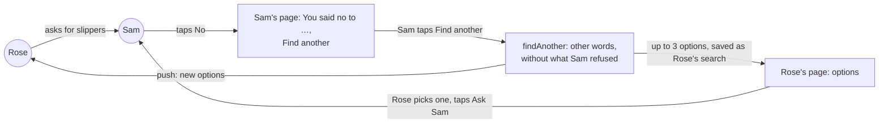
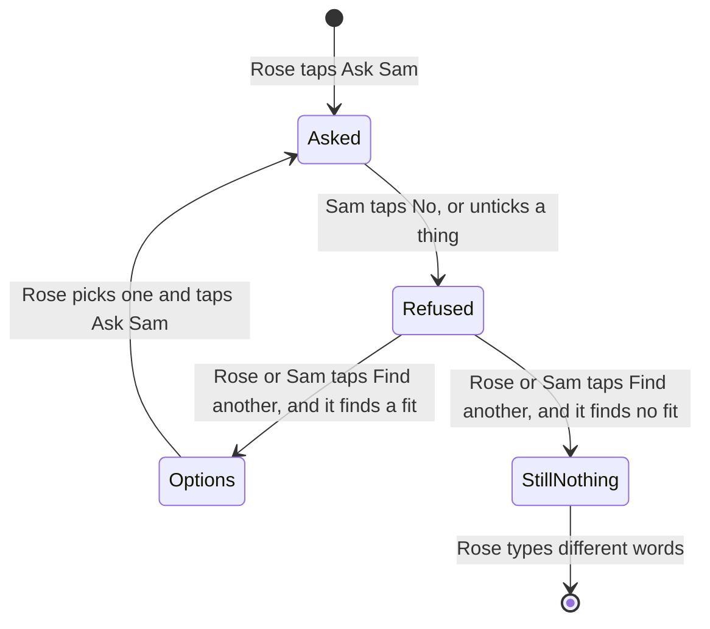
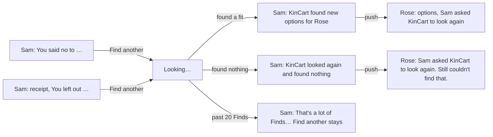
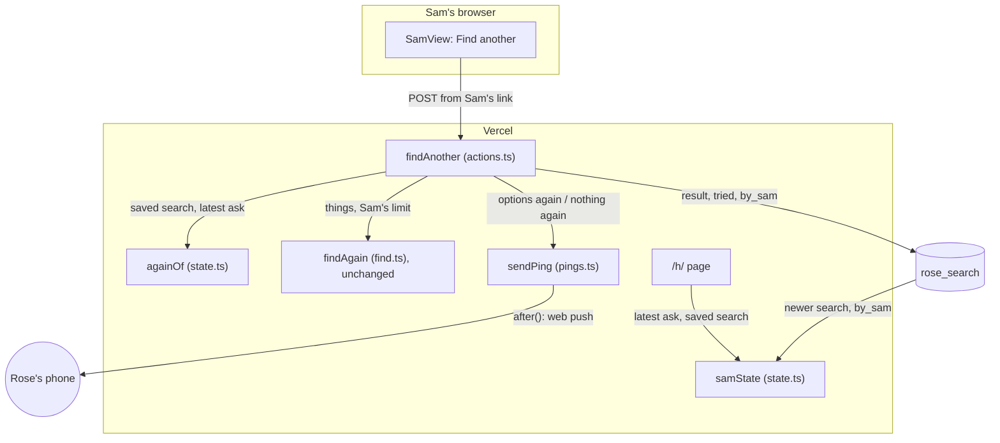
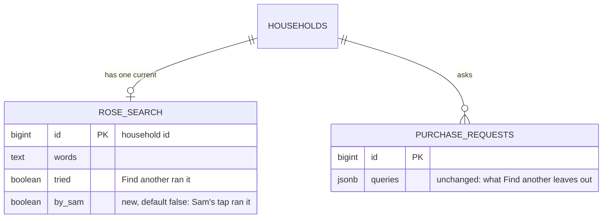

# Sam finds another

**Version:** v1 · **Status:** Refined · **Type:** Feature · **Project type:** Web UI, with an LLM path

**Shape doc:** docs/specs/after-review/shape.md
**Depends on:** find-another, allow-over-limit
**Page:** none. Skipped: you read the `.md` directly.

Sam taps Find another on Sam's own page, after a No or a thing Sam left out, and KinCart looks again for Rose. It ships now because it is the last slice of the after-review shape, and Rose's Find another already does the search.

## Problem

When Sam says No, Sam's page says "You said no to Dearfoams Women's Cozy Slippers. Rose can see that." (`app/(shop)/SamView.tsx:169`). Sam can do nothing more there. Rose must open Rose's page, read the notice, and tap Find another (find-another, D97).

Sam often knows why the pick was wrong and wants a swap now. Today Sam must call Rose and tell Rose to tap Find another. For an older shopper, that is one more step after a No, where Rose may give up.

## Slice test

| Check                         | Result |
| ----------------------------- | ------ |
| Cuts every layer it needs     | yes: a Find another button on Sam's page, Sam's side of the `findAnother` action, Rose's options screen, and a push to Rose |
| One e2e test walks it         | yes: Rose asks for slippers, Sam taps No, then Find another on Sam's page, and Rose sees new options without the refused one and asks Sam again |
| Worth shipping alone          | yes: after a No, Sam gets Rose new options in one tap, and Rose doesn't have to start it |
| Fits (≤5 scenarios, ≤2 areas) | yes: 5 scenarios, in Sam's and Rose's pages in `app/(shop)/`. Find in `lib/shop/` doesn't change |

**Path:** full. It adds a control to Sam's page, a new caller of `findAnother`, and a new push.

## User story

As Sam, when I say no to what Rose picked, I want to ask KinCart to look again from my own page, so that Rose gets new options without starting it.

## Flow



Sam says No, then taps Find another on Sam's page. KinCart searches as Rose's Find another does, and Rose gets a push and picks from the new options.

## States



One No or untick gives one Find another, and Rose or Sam can tap it (D115). After either tap, neither page offers it again for that No.

## Acceptance criteria

```gherkin
Scenario Outline: Sam taps Find another after saying no
  Given Sam's limit is $50
  And <what Sam did>
  And Sam's page says "<notice>"
  When Sam taps Find another under it
  Then KinCart searches again as Rose's Find another does, without <refused>
  And Rose's page shows up to 3 options for <things>, each at $50 or less
  And Rose's phone gets a push that says new options are ready
  And Rose picks one and taps Ask Sam, as today

  Examples:
    | what Sam did | notice | things | refused |
    | Sam said No to "Dearfoams Women's Cozy Slippers", $24.99, found for "warm slippers that are easy to put on, size 8" | You said no to Dearfoams Women's Cozy Slippers. | "warm slippers that are easy to put on, size 8" | the Dearfoams listing |
    | Sam paid for AA batteries and a phone charger, and left out "a night light" | You left out a night light. | "a night light" | the night light Sam left out |

Scenario: Sam's page says what happened after the tap
  Given Sam tapped Find another after saying no to the Dearfoams slippers
  When the search finds 3 options
  Then Sam's page says KinCart found new options and Rose picks one
  And Sam's page shows no Find another for that No

Scenario: One Find another for each No, whoever taps it
  Given Sam said No to the Dearfoams slippers
  And Rose already tapped Find another on Rose's page
  When Sam opens Sam's page
  Then Sam's page shows no Find another
  And the same is true the other way: after Sam's tap, Rose's page shows no Find another for that No

Scenario: Sam's Find another finds nothing either
  Given Sam's limit is $20
  And Sam said No to a $19.99 pill box for "a pill box that beeps"
  When Sam taps Find another, and it finds nothing at $40 or less
  Then Sam's page says it found nothing, and Rose can try different words
  And Rose's phone gets a push that says KinCart found nothing
  And Rose's page shows "Still couldn't find that. Try different words.", with no Find another

Scenario: Sam's Find another counts as a Find from Sam's address
  Given Sam's network address ran 20 Finds in the last 24 hours
  When Sam taps Find another
  Then nothing reaches Claude or Channel3
  And Sam's page says "That's a lot of Finds from here today. Try again in 3 hours."
  And Find another stays on Sam's page, and /status shows one more stopped Find
```

The slippers come from find-another's e2e, and the pill box from its O10 measure. `/build` swaps the examples for real listings it finds then.

## Scope

**In:**

- A Find another control on Sam's page under "You said no to …", for one thing or a basket, and under "You left out …" on Sam's receipt.
- Sam's tap runs Rose's Find another: the same `againOf` rule, other words, and no listing that Sam refused (D98, D99). Over-limit listings show as allow-over-limit says (D110, D111).
- The new options land on Rose's page as Rose's search. Rose picks and asks Sam, as today.
- A push to Rose when Sam's search finishes, with new options or with nothing found.
- One Find another for each No or untick, shared by Rose and Sam (D115).
- Sam's tap counts as a Find from Sam's network address: toward its 20 a day (D73), and on `/status` (D78).

**Out:**

- Sam picking from the new options, or paying one straight away. Rose picks (O1). No later slice.
- Find another on Sam's request screen, before Sam answers. Sam taps No first. No later slice.
- Sam telling the AI why Sam said No. No later slice, as find-another says.
- Sam starting a Find after Rose's empty Find. Sam's page doesn't show Rose's searches. No later slice.

## Interface

Sam's page gets Find another under two notices, and one notice for how the search ended. Rose's page names Sam on what Sam's tap found. Every piece comes from the design system: no new component, class or token.



Sam taps Find another under a No or a left-out notice. Sam's page then says how the search ended, and Rose gets a push and a screen that names Sam.

| Where | What it says |
| ----- | ------------ |
| Sam, after a No to one thing | Under "You said no to Dearfoams Women's Cozy Comfort Slippers. Rose can see that.": Find another, with "KinCart looks again for Rose, without the one you said no to. Rose picks from what it finds." |
| Sam, after a No to a basket | Find another, with "KinCart looks again for each of Rose's things, without the ones you said no to. Rose picks from what it finds." |
| Sam, receipt with a thing left out | Under "You left out a night light. Rose can ask for it again.": Find another, with "KinCart looks again for Rose, without the one you left out. Rose picks from what it finds." It says "the ones" for several |
| Sam, after either person's Find another found a fit | "KinCart found new options for Rose. Rose picks one and asks you." No Find another |
| Sam, after it found nothing | "KinCart looked again and found nothing. Rose can try different words." No Find another |
| Sam, stopped by the daily limit | "That's a lot of Finds from here today. Try again in 3 hours." on top. The No notice and Find another stay (D101) |
| Rose, options or basket from Sam's tap | The line under the heading: `For "…". Sam asked KinCart to look again with other words.` |
| Rose, nothing found from Sam's tap | "Sam asked KinCart to look again. Still couldn't find that. Try different words." The over-limit notice gets the same first sentence |
| Rose's push, a fit | Title "Sam asked KinCart to look again", body "New options are ready. Tap to pick one." |
| Rose's push, nothing | Title "Sam asked KinCart to look again", body "KinCart found nothing this time. Tap to try different words." |

**Pressed.** The button says "Looking…" with the existing spinner, as on Rose's page.

**Motion tier:** 1, as before. Nothing new moves: the notices rise and fade like every notice. Under reduced motion, nothing moves.

**Components used:** `Notice` (`neutral`), `AnotherForm` and `LimitNotice` (moved from `RoseView.tsx` to `ui.tsx`, so both pages share them), `Button` (secondary), `ReceiptCard`, `ListingPicker`, `.heading`, `.stack` and `.small`. The tokens come from `docs/design/design-system/` (D15).

**Built at pause 2:** `SamView` takes `findAnother`, and its `nothing` and `paid` states take `again` (`offer`, `options` or `nothing`) and `waitMinutes`. `RoseView`'s ask, options and basket states take `bySam`. Nothing passes these yet: `/build` wires them.

**Preview:** `/preview/sam-finds-another` on `pnpm dev`, from `app/(shop)/preview/sam-finds-another/page.tsx`. It shows Sam's and Rose's real pages in 11 frames, one or more for each scenario.

## Technical plan

### Approach

`findAnother` takes Sam's link as well as Rose's. For Sam, it runs only when Rose has no newer search, so Sam's tap answers a No or an untick and never Rose's own empty Find. It saves the result as Rose's search with a new `by_sam` flag, and sends Rose a push either way. Sam's page reads Rose's saved search too, and `samState` works out whether to offer Find another or say how the search ended, with the same `againOf` rule Rose's page uses (D115).

Relies on: D19, D23, D27, D29, D46, D73, D74, D78, D81, D83, D98, D99, D100, D101, D110, D113, D114, D115, D116



`againOf` decides what Sam's tap searches, `findAgain` searches as for Rose, and `samState` reads the saved search back to show Sam how it ended.

```mermaid
sequenceDiagram
    participant S as Sam's browser
    participant A as findAnother
    participant N as Neon
    participant F as findAgain
    participant P as push service
    S->>A: POST Find another, from /h/<token>
    A->>N: getSearch, latest
    N-->>A: no newer search; declined ask with its queries
    A->>A: againOf: the slippers, last query, refused [dearfoams]
    A->>N: takeUse find, Sam's address, 20 a day
    A->>F: findAgain(words, things, limit)
    F-->>A: 3 options
    A->>N: saveSearch(…, tried, by_sam), usage +1 Find
    A-->>S: redirect /h/<token>
    A-)P: after(): "Sam asked KinCart to look again"
    S->>N: page load: latest, getSearch
    N-->>S: newer search, tried, 3 options
    S->>S: samState: again = "options"
```

Sam's tap sends the same calls as Rose's Find another, plus one push. Sam's page then reads the saved search to say that Rose has new options.

### Changes

| File | What changes | Why |
| ---- | ------------ | --- |
| `db/migrations/0015_sam_finds_another.up.sql`, `.down.sql` | Add `rose_search.by_sam boolean NOT NULL DEFAULT false` with `IF NOT EXISTS`. The down file drops it | 1, 4 |
| `scripts/migrate.test.ts:33` | The first test checks `by_sam` up, down and up. `downToHouseholds()` also runs `0015_sam_finds_another.down.sql`, as the lesson says | migration |
| `lib/shop/requests.ts:65` | `SavedSearch` gains `bySam`. `getSearch()` (`:192`) reads `by_sam`. `saveSearch()` (`:230`) takes `bySam = false` after `tried` and writes it | 1, 4 |
| `app/(shop)/state.ts:126` | Export `currentOf`. `roseState` passes `bySam` to ask, options and basket. `samState(request, limitCents, saved?, waitMinutes?)` sets `again` on a declined ask and on a paid ask with things left out: `offer` when there is no newer search and `againOf()` returns one, `options` or `nothing` when the newer search is `tried`, and nothing otherwise. It passes `waitMinutes` to `nothing` and `paid` | 1 to 5 |
| `app/(shop)/actions.ts:138` | `findAnother` takes Sam's link too. For Sam, it ignores `another`, and returns to `/h/<token>` when `currentOf()` gives a newer search. A stopped one counts a stopped Find, saves nothing, and redirects to `/h/<token>?find=limit&until=` (D101). Otherwise it saves with `bySam`, adds one Find, and calls `sendPing(household, found ? "options again" : "nothing again", request)` | 1, 4, 5 |
| `app/(shop)/pings.ts:9` | `PingKind` gains `options again` and `nothing again`, both to Rose, with the titles and bodies from the Interface table | 1, 4 |
| `app/(shop)/h/[token]/page.tsx:35` | Reads `getSearch()` when Find is on, and `?find=limit&until=` as Rose's page does with `minutesUntil()`. It passes both to `samState`, and `findAnother.bind(null, token)` to `SamView` | 1 to 5 |
| `app/(shop)/SamView.tsx`, `app/(shop)/RoseView.tsx`, `app/(shop)/ui.tsx`, `app/(shop)/preview/sam-finds-another/page.tsx` | Built at pause 2. `/build` breaks each new line once, as the lesson says | 1 to 5 |
| `e2e/sam-finds-another.spec.ts` | The slice's e2e | 1, 2 |

Reusing: `againOf()`, `currentOf()`, `findAgain()`, `takeUse()`, `countUse()`, `minutesUntil()`, `addressKey()`, `sendPing()` with `after()`, `AnotherForm`, `LimitNotice`, `reset()` from `e2e/db.ts`, and the pause 2 views.

### Data



**Migration:** expand only. `0015_sam_finds_another.up.sql` adds one column with a default, so old rows read `false`, and old code ignores it. There is no backfill. CI runs `db:up` on Neon after tests pass on main (D11), and Vercel promotes after that (D10). There is no contract step.

**Reverse:** promote the previous deploy on Vercel. Then, if wanted, `pnpm db:down` runs `0015_sam_finds_another.down.sql`, which drops the column. `scripts/migrate.test.ts` tests this path.

### Earn-it

| Added | Triggered by |
| ----- | ------------ |
| `rose_search.by_sam` | O5 and D116: Rose's page names Sam, through the 3 s redraw (D19) and a reopened link |
| `again` on `samState` | Scenarios 2 to 4: Sam's page offers Find another once, and says how it ended |
| Two `PingKind`s | Scenarios 1 and 4: Rose hears how Sam's search ended (D114) |
| `getSearch()` on Sam's page | Scenarios 2 to 4: Sam's page must see Rose's newer search |

### Non-functionals

|                      |                                                                               |
| -------------------- | ----------------------------------------------------------------------------- |
| **Load**             | Judges and the video: a few a day. One Find another for each No, shared, so Sam's tap adds no searches that Rose's tap didn't already have. Sam's page adds one `getSearch()` read on each 3 s redraw |
| **Breaks first**     | Channel3's 1,000 free searches a month, as for Find. The new e2e adds 4 searches to each CI run. `/status` shows them (D78) |
| **Security surface** | Sam's link only adds a caller of `findAnother`. Sam's form sends nothing that it reads: words, queries and refused ids come from Neon (D23). Sam can't search for Rose's own empty Find, or for another household (D46). Sam's tap counts under Sam's address, kept only as an HMAC (D74). Secrets: as Find. Stored: one boolean |
| **Proof it works**   | `find outcome=options listings=3 searches=2 ms=9420 checked=8 unloaded=0 again=1` in Vercel's logs, then one push to Rose, and one more Find on `/status`. The numbers are whatever the run gave |
| **Rollout**          | No flag. CI migrates Neon, then Vercel promotes (D10, D11). Rollback: the two steps under Reverse |

### Test plan

| Scenario | Test | Command |
| -------- | ---- | ------- |
| 1, 2 | `e2e/sam-finds-another.spec.ts`, real Haiku and Channel3 (D24) | `pnpm test:e2e e2e/sam-finds-another.spec.ts` |
| 1, 4, 5 | `app/(shop)/actions.test.ts`: Sam's tap after a No searches without the refused id and saves `tried` and `bySam`; after an untick, only the left-out picks; with a newer search from Rose, it calls nothing; a group index from Sam's form is ignored; past 20 Finds, it calls nothing, counts a stopped Find, and redirects to `/h/<token>?find=limit`; it sends `options again` or `nothing again`; Rose's own tap sends no push and saves `bySam` false | `pnpm test "app/(shop)/actions.test.ts"` |
| 1 to 5 | `app/(shop)/state.test.ts`: `samState`'s `again` for a No, a basket No, an untick, a newer search found or empty, a newer untried search from Rose, a paid ask with nothing left out, and `waitMinutes`; `roseState` passes `bySam` | `pnpm test "app/(shop)/state.test.ts"` |
| 1, 4 | `app/(shop)/pings.test.ts`: the two new pushes' titles and bodies, both to Rose | `pnpm test "app/(shop)/pings.test.ts"` |
| 1 to 5 | `app/(shop)/SamView.test.tsx`: Find another and each hint; the found and nothing notices with no Find another; the limit notice with Find another kept. `app/(shop)/RoseView.test.tsx`: the Sam lines on options, basket and the "Still…" notice | `pnpm test "app/(shop)/SamView.test.tsx" "app/(shop)/RoseView.test.tsx"` |
| storage | `lib/shop/requests.test.ts`: `bySam` round trips; `scripts/migrate.test.ts`: 0015 up, down, up | `pnpm test lib/shop/requests.test.ts scripts/migrate.test.ts` |

**E2E:** `e2e/sam-finds-another.spec.ts`, one test: "Sam says no to Rose's slippers, and Sam's Find another gets Rose others". It resets with the saved PayPal, and has its own 90 s timeout, as the lesson says for two Finds. Rose finds "warm slippers that are easy to put on, size 8", keeps the first option's name, and asks Sam. Sam taps No, then Find another on Sam's page. Within 30 s, Sam's page shows "KinCart found new options for Rose. Rose picks one and asks you." with no Find another. Rose's page shows "Which one would you like?" with "Sam asked KinCart to look again with other words." and no option named `<name>` exactly. Rose picks one and asks Sam, and Sam's page shows "Rose would like this". Stop `pnpm dev` first, as the lesson says.

### Chunks

Single chunk. The change is small, and the views were built at pause 2.

### Risks

| Risk | Mitigation |
| ---- | ---------- |
| Rose and Sam tap Find another within the same 10 to 15 s. Both pass `againOf`, both search, and both count a Find. The last save wins | Accepted (O6): one extra Find and 2 Channel3 searches, and both results are valid |
| Sam's tap finds nothing, as find-another's measure found for most empty asks | The No path differs: it drops the refused listing, so the e2e's slippers come back with options, as in find-another's e2e |
| The push fails or Rose turned pushes off | Rose's page shows the result on the next 3 s redraw (D19), and it names Sam (D116) |

### Decisions to record

Drafted at pauses 1 and 2. `/build` appends them to DECISIONS.md.

## D113 · 2026-10-23 · Sam's Find another shows only after a No or an untick, and Rose picks from what it finds

Why: Rose is the one who shops, and Sam's OK still checks every buy (D83). The new options land on Rose's page as Rose's search, so Sam's page gets one button and Rose's page doesn't change.
Rejected: Sam picks and Sam's OK pays it (Rose never chooses the swap, and Sam's page needs a picker), Sam picks and Rose agrees (two new steps and a new state), a third button "No, find another" on the request screen (one more choice next to OK and No).
Source: docs/specs/sam-finds-another.md
Status: active

## D114 · 2026-10-23 · Rose gets a push when Sam's Find another finishes, with new options or with nothing found

Why: Sam's tap starts a search that Rose didn't ask for, so Rose must hear how it ended. A push for nothing found tells Rose to try different words instead of waiting.
Rejected: a push only for new options (Rose waits after an empty result), no push (Rose already heard "Sam said no", and may not open the page again).
Source: docs/specs/sam-finds-another.md
Status: active

## D115 · 2026-10-23 · Rose or Sam gets one Find another for each empty Find, No or untick, shared, and each one counts as a Find

Why: one try with other words gives Rose new options without a loop of empty searches. Rose's and Sam's pages read the same `againOf` rule, so whoever taps first uses it. It sends the same Claude and Channel3 calls as a Find, so it counts toward the tapper's address's 20 a day (D73) and on `/status` (D78).
Rejected: one each for Rose and Sam (two searches for one No, and KinCart must keep who tapped), taps until the daily limit, each with untried words (a loop of empty results, and KinCart must keep every tried query), a Find another that runs free (a script could tap it past the daily limit).
Supersedes: D97
Source: docs/specs/sam-finds-another.md
Status: active

## D116 · 2026-10-23 · Rose's page says when Sam asked KinCart to look again

Why: Sam's tap changes Rose's page while Rose didn't tap anything. An older shopper needs to see why new options appeared, and Rose's push may be off. A `by_sam` flag on `rose_search` keeps it through the 3 s redraw (D19), as `tried` does.
Rejected: the same "Looked again with other words." line as Rose's own tap (no data change, but Rose learns it was Sam only from the push).
Source: docs/specs/sam-finds-another.md
Status: active

## Open items

| ID | What | Type | Raised at | Owner | Status | Answer |
| -- | ---- | ---- | --------- | ----- | ------ | ------ |
| O1 | When Sam taps Find another, who picks the new listing: Sam, or Rose after Sam's tap (from shape O20) | question | shape | user | Resolved | Rose picks. The new options land on Rose's page, and Rose asks Sam, as today (D113). 2026-10-23 |
| O2 | Where Sam's Find another shows: only under the No and left-out notices, or also as "No, find another" on the request screen | question | spec p1 | user | Resolved | Only under "You said no to …" and "You left out …". The request screen keeps OK and No (D113). 2026-10-23 |
| O3 | What Rose hears when Sam's search finishes: a push either way, a push only for new options, or none | question | spec p1 | user | Resolved | A push either way: new options are ready, or KinCart found nothing (D114). 2026-10-23 |
| O4 | Is the one Find another for each No shared by Rose and Sam, or does each get one | question | spec p1 | user | Resolved | Shared. Whoever taps first uses it (D115, which supersedes D97). 2026-10-23 |
| O5 | What Rose's page says about options from Sam's tap | question | spec p2 | user | Resolved | It names Sam: "Sam asked KinCart to look again with other words." KinCart keeps who tapped with the search (D116). 2026-10-23 |
| O6 | Rose and Sam tap Find another within the same 10 to 15 s: both search, both count a Find, and the last save wins | flag | spec p3 | user | Accepted risk | Rare, since both must tap within seconds. The cost is one extra Find and 2 Channel3 searches, and both results are valid. No guard. 2026-10-23 |

_Never delete this section or its rows. See references/ledger.md._

## Glossary

- **Backfill** — filling a new column from the data already there, before the code reads it. This slice has none.
- **Channel3** — the hackathon sponsor whose API returns real product listings.
- **Untick** — Sam clears a thing's box in a basket, so Sam's OK doesn't pay for it.
- **Push** — a phone notification from a web page, sent while the page is closed.
- **e2e** — end to end: an automated test that drives the app as a person would, start to finish.
