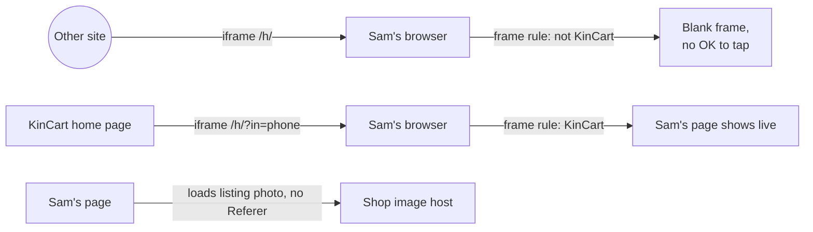
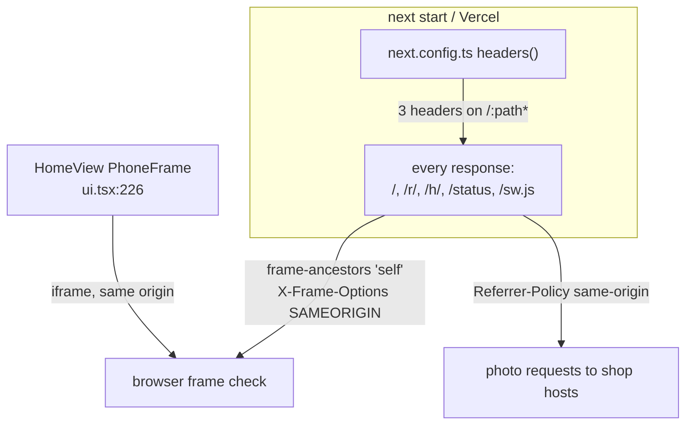
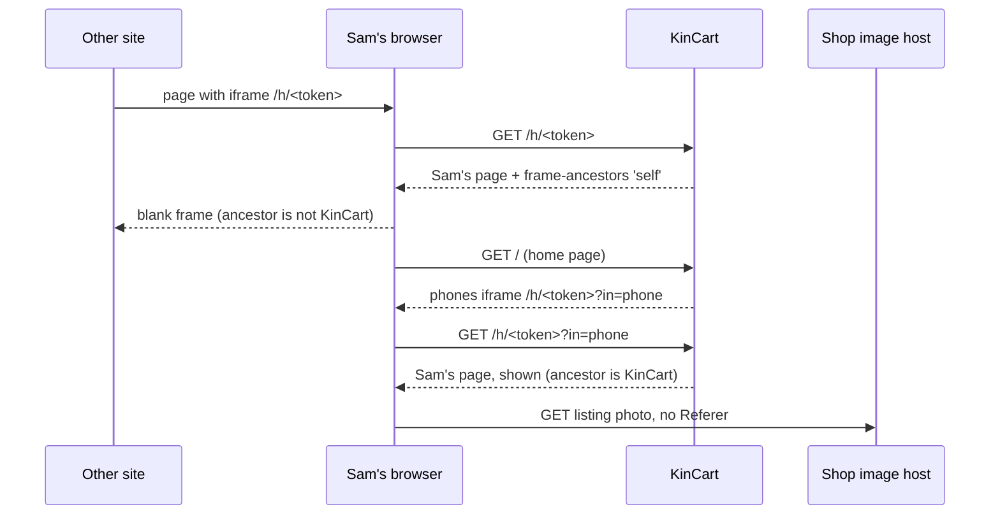

# Security headers

**Version:** v1 · **Status:** Built · **Type:** Technical · **Project type:** Web UI

**Shape doc:** docs/specs/security/shape.md
**Depends on:** None
**Page:** none. Skipped: you read the `.md` directly.

Every KinCart page tells the browser to refuse a frame from another site, and to send no page address to other sites. It comes now because a hidden frame over Sam's page could trick Sam into a tap on OK.

## Problem

KinCart sends no frame rule today. `next.config.ts` is empty, and there is no `proxy.ts`. Any site can show Sam's page `/h/<token>` in an invisible frame and put its own button over OK. A person who has Sam's link and a page Sam visits can then charge Rose's saved PayPal.

The home page frames Rose's and Sam's real pages itself (`app/(shop)/ui.tsx:226`, D53). The rule must let KinCart frame its own pages and refuse every other site.

Sam's and Rose's pages load listing photos from each shop's image host (`app/(shop)/SamView.tsx:80`, `lib/shop/search.ts:76`). Today the browser's default sends each shop the KinCart origin, `https://kincart.vercel.app/`, but not the path with the secret link. A rule of our own makes that hold in every browser, and sends nothing at all.

The shape's third point, "use https only", is already true. On 2026-10-23 the live site sent `strict-transport-security: max-age=63072000; includeSubDomains; preload`, which Vercel adds by itself.

## Slice test

| Check                         | Result |
| ----------------------------- | ------ |
| Cuts every layer it needs     | yes: the response headers are the only layer. No screen, data or action changes. |
| One e2e test walks it         | yes: one test opens Sam's page in a frame from another origin, then the home page's phones, then a listing photo request |
| Worth shipping alone          | yes: no other site can frame Sam's OK |
| Fits (≤5 scenarios, ≤2 areas) | yes: 4 scenarios, in the response headers only |

**Path:** full. It is not a bug fix, rename, bump or copy change. Pause 2 is skipped because no screen changes. The header values are written at pause 3.

## User story

As Sam, I want only KinCart to show my page, so that no other site can trick me into paying.

## Flow



A frame from another site stays blank, a frame from KinCart's own home page shows the page, and a shop's image host gets no page address.

## Acceptance criteria

```gherkin
Scenario: Another site can't show Sam's page
  Given Sam's page is /h/<token> on KinCart, with Rose's 2-pack of AA batteries at $6.99 waiting for OK
  When a page on another origin puts /h/<token> in an iframe
  Then the browser refuses to show it, and the frame has no OK button

Scenario: The home page's phones still show Rose's and Sam's pages
  Given a judge on a 1280px laptop has tapped Try KinCart
  When the home page loads
  Then Rose's phone shows Rose's page and Sam's phone shows Sam's page, live, as before

Scenario: A shop's image host gets no page address
  Given Sam's page shows a listing photo from a shop's image host
  When the browser asks the host for the photo
  Then the request has no Referer header

Scenario: Link PayPal still reaches PayPal
  Given Rose is on /r/<token> with no saved PayPal
  When Rose taps Link PayPal, in a full tab and in the home page's phone
  Then PayPal's sandbox approval page opens, as before
```

## Scope

**In:** on every KinCart response, `Content-Security-Policy: frame-ancestors 'self'`, `X-Frame-Options: SAMEORIGIN` and `Referrer-Policy: same-origin`.

**Out:**

- `Strict-Transport-Security`. Vercel already sends it on every response.
- A full content security policy, with script and image lists. Three pentests found no XSS hole, and a missed source could break the demo before the Nov 5 freeze. No later slice picks it up.
- Secret links out of the page address. The shape keeps this out, and `new-links` covers a leaked link.

## Technical plan

### Approach

`next.config.ts` gets a `headers()` that adds three headers to every path, `/:path*`. Next sends them on pages, route handlers such as `POST /r/<token>/link`, server action responses and files in `public/`. No code runs for each request, and no page changes.

Relies on: D53 (the home page frames KinCart's own pages), D60 and D61 (PayPal opens in a new tab from a phone frame), D117, D118 (drafted below)



The config adds the headers to every response. The browser then checks frames against them, and sends no `Referer` to other hosts.



### Changes

| File | What changes | Why |
| ---- | ------------ | --- |
| `next.config.ts:3` | Add `headers()` that returns one rule for `/:path*` with `Content-Security-Policy: frame-ancestors 'self'`, `X-Frame-Options: SAMEORIGIN` and `Referrer-Policy: same-origin` | Scenarios 1 to 4 |
| `e2e/security-headers.spec.ts` (new) | One test that walks scenarios 1, 3 and 4, and checks the home page's phones for scenario 2 | All scenarios |

Reusing: `reset()` and `sql()` from `e2e/db.ts`, the `ROSE_LINK_TOKEN` and `SAM_LINK_TOKEN` env, and the `roseAsksFor` steps from `e2e/approve-and-pay.spec.ts:24`, copied into the new spec as each spec file does. The other site is a `node:http` server on another `localhost` port, started by the test. A photo request is an `` that the test adds to Sam's page, with its `src` on that server, so no real Find is needed.

### Earn-it

| Added | Triggered by |
| ----- | ------------ |
| `headers()` in `next.config.ts` | Scenarios 1 and 3 |
| `X-Frame-Options: SAMEORIGIN` beside `frame-ancestors` | Scenario 1 in a browser that doesn't read CSP `frame-ancestors`. A browser that reads both obeys the CSP |

### Non-functionals

|                      |                                                                               |
| -------------------- | ----------------------------------------------------------------------------- |
| **Load**             | No change. The headers are about 100 bytes on each response. |
| **Breaks first**     | Nothing at 10×. The headers are fixed text. |
| **Security surface** | No new input, secret or stored data. It narrows what other sites can do with KinCart's pages. |
| **Proof it works**   | `curl -sI https://kincart.vercel.app/ \| grep -i "frame-ancestors\|referrer-policy"` shows both lines after the deploy. |
| **Rollout**          | No flag. The change is one commit, and `git revert` of it removes all three headers. |

### Test plan

| Scenario | Test | Command |
| -------- | ---- | ------- |
| 1 Another site can't show Sam's page | `e2e/security-headers.spec.ts` | `pnpm test:e2e e2e/security-headers.spec.ts` |
| 2 The home page's phones still show both pages | `e2e/security-headers.spec.ts`, and `e2e/demo-home.spec.ts` as before | `pnpm test:e2e e2e/demo-home.spec.ts` |
| 3 A shop's image host gets no page address | `e2e/security-headers.spec.ts` | `pnpm test:e2e e2e/security-headers.spec.ts` |
| 4 Link PayPal still reaches PayPal | `e2e/security-headers.spec.ts` for the full tab, `e2e/link-paypal-onboarding.spec.ts` for the phone | `pnpm test:e2e e2e/link-paypal-onboarding.spec.ts` |

**E2E:** `e2e/security-headers.spec.ts`. Then run the whole suite with `pnpm test:e2e`, because the headers reach every page.

### Chunks

Single chunk: `next.config.ts` and `e2e/security-headers.spec.ts`.

### Risks

| Risk | Mitigation |
| ---- | ---------- |
| A site we don't control frames kincart.vercel.app for judging, and now shows a blank frame | O3: accepted, judges open the site directly. |
| PayPal's sandbox page needs a `Referer` from KinCart | The new spec and `link-paypal-onboarding.spec.ts` both wait for `www.sandbox.paypal.com`. The return to `/r/<token>/linked` comes from PayPal, so our rule doesn't touch it. |
| `pnpm build` stops on Next 16.4.0's security notice | Run the e2e again, as the learning says. |

### Decisions to record

Recorded as D117, D118.

## Open items

| ID | What | Type | Raised at | Owner | Status | Answer |
| -- | ---- | ---- | --------- | ----- | ------ | ------ |
| O1 | A content security policy still has to allow listing photos from any shop's image host, the home page's phone frames, and Next's inline scripts (from shape O12) | unproven | shape | build | Resolved | The CSP carries only `frame-ancestors 'self'`, with `X-Frame-Options: SAMEORIGIN` beside it. No script or image lists, so no source list can break the demo. A full CSP is out. 2026-10-23 |
| O2 | Browsers already send shops only the KinCart origin, not the secret link. A referrer rule sends nothing at all, so the gain is small | flag | spec p1 | user | Resolved | Send `Referrer-Policy: same-origin`. It is one line and holds in every browser. 2026-10-23 |
| O3 | After this ships, any site that frames kincart.vercel.app shows a blank frame. If Devpost or a judging tool shows the live site in a frame, the judges see nothing there. Whether one does is not checked | flag | spec p3 | user | Accepted risk | Judges open the site directly from the Devpost link, and nothing frames it. 2026-10-23 |
| O4 | DECISIONS.md on main ends at D112, so the drafted entries would become D113 and D114. The unmerged `feat/sam-finds-another` already holds D113 to D116 | flag | build | user | Decided alone | Chose: keep D117 and D118, so the two branches don't share a number. Other: renumber to D113 and D114 now. Undo: renumber here if sam-finds-another is dropped. 2026-10-23 |
| O5 | The plan said the other origin is `http://127.0.0.1:3000`, served with Playwright's `page.route`. Chrome's local network checks block a fulfilled page from framing `localhost` | flag | build | user | Decided alone | Chose: a `node:http` server on another `localhost` port, started in the spec. Other: launch Chrome with local network checks off. Undo: swap the server for `page.route` and add the launch flag. 2026-10-23 |
| O6 | 8 e2e tests that run a real Find fail: `ask-again`, `basket`, `find-and-explain`, `find-another`, `find-limits`, `photo-ask`, `photo-ask-several`, `usage-on-status`. The find log says `reason=channel3 402` | flag | build | user | Decided alone | Chose: leave them. Channel3 refuses the server's search call, before any response header is set. The other 16 tests pass. Other: wait for Channel3 credit, then run them again. Undo: none needed. 2026-10-23 |

_Never delete this section or its rows. See references/ledger.md._

## Glossary

- **Clickjacking** — another site shows a page inside an invisible frame and tricks a person into a tap, such as Sam's OK.
- **Content security policy (CSP)** — a header that lists where a page may load scripts, images and frames from.
- **e2e** — end-to-end: one test that walks the whole slice as a user would.
- **Pentest** — a penetration test: someone attacks the app on purpose to find holes. The reports are in `docs/security/`.
- **Referer** — the request header that tells a site which page the request came from. The spelling is the header's own.
- **Strict-Transport-Security (HSTS)** — a header that tells the browser to use https only for this site.
- **XSS** — cross-site scripting: an attacker gets their own script to run on a page, for example through text the page shows.
