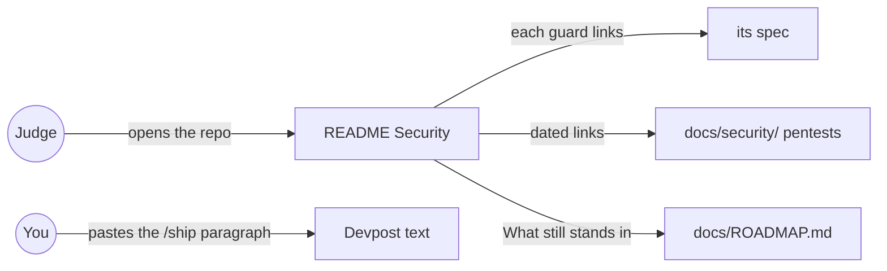
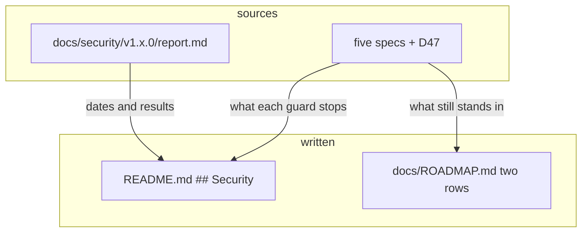

# Security story

**Version:** v1 · **Status:** Refined · **Type:** Enhancement · **Project type:** Web UI

**Shape doc:** docs/specs/security/shape.md
**Depends on:** confirm-ok
**Page:** none. Skipped: you read the `.md` directly.

The README gets a Security section: what each guard stops, what still stands in, and the dated pentest reports. It comes last in the security shape because it describes what shipped, and it must land before the Nov 5 freeze.

## Problem

Five security slices shipped from 2026-10-19 to 2026-10-26, and the README says nothing about any of them. A judge who reads the repo sees "Secret links, not accounts" and no word on how a leaked link, a script or a hidden frame is stopped. `docs/ROADMAP.md` is worse: it still says "Anyone holding Sam's link could OK a sandbox charge" and lists rate limits as future work.

## Slice test

| Check                         | Result                                                                         |
| ----------------------------- | ------------------------------------------------------------------------------ |
| Cuts every layer it needs     | yes — the README and ROADMAP are the only layer; no code changes               |
| One e2e test walks it         | yes — one link check reads every path the new text links to                    |
| Worth shipping alone          | yes — a judge learns what KinCart guards, and what it doesn't, from the README |
| Fits (≤5 scenarios, ≤2 areas) | yes — 4 scenarios, `README.md` and `docs/ROADMAP.md`                           |

**Path:** light — a copy change to two files, with no new interface, data or dependency. Pauses 1 and 3 are one pause, and pause 2 is skipped.

## User story

As a hackathon judge, I want to read how KinCart stops a leaked link or a script, and what it doesn't stop, so that I can judge the build as a real launch.

## Flow



A judge reads the Security section, follows a guard to its spec or a pentest report, and reads the same story in ROADMAP and on Devpost.

## Acceptance criteria

```gherkin
Scenario: A judge reads what each guard stops
  Given the README on main after confirm-ok merges
  When a judge reads the Security section
  Then a table lists six guards: hashed links, 20 Finds and 5 new households per address a day, the usage counts on /status, the frame and referrer headers, Make new links, and Confirm each OK
  And each row says what the guard stops in one sentence, and links the guard's spec

Scenario: A judge reads what still stands in
  Given the same Security section
  When the judge reads "What still stands in"
  Then it says secret links still live in the page address, the passkey is off by default with no recovery, household 1 gets neither Make new links nor the passkey, a script on many addresses is seen on /status but not stopped, and the shared demo login can have its password changed

Scenario: The pentest links say what they cover
  Given docs/security/ holds the v1.0.0, v1.1.0 and v1.2.0 reports, all passed with no findings, from 2026-10-15 and 2026-10-16
  When the judge reads the pentest line
  Then it links all three reports, and says they cover the code up to v1.2.0, before every guard except the hashed links

Scenario: ROADMAP agrees with the README
  Given docs/ROADMAP.md's "Secret links instead of accounts" and "Free tiers" rows
  When this slice ships
  Then the Secret links row says a leaked link works until Sam taps Make new links, and that the passkey stops a leaked Sam link alone
  And the Free tiers row says each address gets 20 Finds a day and /status shows the searches, and that a script on many addresses can still use the quota
```

The Devpost paragraph is not a scenario. `/ship` prints it, 80 words or fewer, in its reply, and you paste it into Devpost (O1).

## Scope

**In:** a `## Security` section in `README.md`, after "What this is, and isn't" and outside the zuko block; the two stale rows and the Status line of `docs/ROADMAP.md`; the Devpost paragraph in the `/ship` reply.

**Out:**

- A new pentest of the five guards. A `/release` of v1.3.0 after #30 merges runs one, and its report can join the links then (O2).
- The Anthropic spend limit and Channel3's reset date. They are not checked yet (find-limits O5), so the README claims neither. The pre-judging check covers them.
- Turning on Dependabot alerts and secret scanning. They are GitHub settings, not repo text (shape "Not doing").

## Technical plan

### Approach

Write the section by hand from the five shipped specs and D47. The zuko block stays generated from `OVERVIEW.md`, and the new section sits below it, so `render-readme-block.sh --check` still passes. Build waits until PR #30 is on main, so the README never describes code that isn't live (O4).

Relies on: D47, D74, D78, D117, D120, D122.



The draft text, for approval with this pause:

> ## Security
>
> KinCart moves sandbox money only, and every guard below shipped with tests in CI.
>
> | Guard | What it stops |
> | ----- | ------------- |
> | [Hashed links](docs/specs/households.md) | A copy of the database holds no working link. Links are kept as SHA-256 hashes. |
> | [Find limits](docs/specs/find-limits.md) | One network address runs at most 20 Finds and starts 5 households in 24 hours, so one script can't use up Channel3's month or the Claude key. |
> | [Usage on /status](docs/specs/usage-on-status.md) | A script on many addresses shows up as today's and this month's searches before the quota runs out. |
> | [Security headers](docs/specs/security-headers.md) | Another site can't hide Sam's page in a frame to trick a tap on OK, and shops get no page address. |
> | [Make new links](docs/specs/new-links.md) | A leaked link stops working when Sam taps it. The household keeps its PayPal, limits and past buys. |
> | [Confirm each OK](docs/specs/confirm-ok.md) | With Sam's passkey on, a leaked Sam link alone can't pay, make new links or turn the passkey off. |
>
> **What still stands in:**
>
> - Secret links live in the page address, with no accounts. Whoever reads one has that page until Sam makes new links.
> - The passkey is off by default, so the demo stays one tap. A lost passkey has no recovery, and Sam starts a new household.
> - Household 1, whose links live in Vercel's env, gets neither Make new links nor the passkey.
> - A script on many addresses is seen on `/status`, not stopped.
> - Anyone can change the shared demo PayPal login's password. Skip still works.
>
> **Pentests:** [v1.0.0](docs/security/v1.0.0/report.md), [v1.1.0](docs/security/v1.1.0/report.md) and [v1.2.0](docs/security/v1.2.0/report.md), on 2026-10-15 and 2026-10-16, each passed with no findings. They cover the code up to v1.2.0, before every guard above except the hashed links.

### Changes

| File                 | What changes                                                                                        | Why          |
| -------------------- | --------------------------------------------------------------------------------------------------- | ------------ |
| `README.md`          | A `## Security` section after "What this is, and isn't", as drafted above                            | scenarios 1–3 |
| `docs/ROADMAP.md:31` | The Secret links row's middle cell, as scenario 4 says                                               | scenario 4   |
| `docs/ROADMAP.md`    | The Free tiers row's middle cell, as scenario 4 says, and the `**Updated:**` line                    | scenario 4   |

Reusing: the facts in the five specs' ledgers and D47, word for word where they fit.

### Earn-it

Nothing added. No new file, script or dependency.

### Non-functionals

|                      |                                                                                         |
| -------------------- | --------------------------------------------------------------------------------------- |
| **Load**             | None. Text only.                                                                        |
| **Breaks first**     | A renamed spec or report breaks a link. The link check in the test plan catches it.     |
| **Security surface** | The text names no secret, link, key or address. It says what an attacker can still do, which the specs already say in public. |
| **Proof it works**   | GitHub's rendered README on main shows the Security section, and each link opens.       |
| **Rollout**          | No flag. `git revert` of the squash commit removes the section and the ROADMAP edits.  |

### Test plan

| Scenario | Test                                   | Command                                                                                                                          |
| -------- | -------------------------------------- | -------------------------------------------------------------------------------------------------------------------------------- |
| 1–3      | every relative link in README resolves | `grep -o '](docs/[^)#]*' README.md \| cut -c3- \| while read p; do test -e "$p" \|\| echo "missing $p"; done` prints nothing     |
| 1–3      | the zuko block is unchanged            | `render-readme-block.sh --check` exits 0                                                                                         |
| 4        | the stale sentences are gone           | `grep -c "Anyone holding Sam's link could OK" docs/ROADMAP.md` prints 0                                                          |

**E2E:** the link check above. No code changes, so `pnpm test` and `pnpm test:e2e` don't run for this slice.

### Chunks

Single chunk.

### Risks

| Risk                                                                 | Mitigation                                                          |
| -------------------------------------------------------------------- | ------------------------------------------------------------------- |
| #30 waits on Channel3 past Nov 5, and the README describes a passkey that never ships | Build waits for #30. If #30 is dropped, remove the Confirm each OK row and the passkey bullet first |
| The pentest line reads as a claim that the guards were attacked       | The line says plainly they cover the code before the guards (O2)    |

### Decisions to record

Recorded as D126.

## Open items

| ID  | What                                                                                                                                        | Type     | Raised at | Owner | Status   | Answer                                                                                                                              |
| --- | ------------------------------------------------------------------------------------------------------------------------------------------- | -------- | --------- | ----- | -------- | ----------------------------------------------------------------------------------------------------------------------------------- |
| O1  | The shape puts a matching paragraph in the Devpost text, which isn't in the repo                                                             | question | spec p1   | user  | Resolved | `/ship` drafts it in its reply, 80 words or fewer, and you paste it into Devpost. A `docs/DEVPOST.md` file was turned down. 2026-10-27 |
| O2  | The last pentest, v1.2.0 on 2026-10-16, came before all five security slices                                                                 | flag     | spec p1   | user  | Resolved | Link all three reports with their dates, and say they cover the code up to v1.2.0. A v1.3.0 pentest first was turned down (D126). 2026-10-27 |
| O3  | `docs/ROADMAP.md` still says anyone holding Sam's link can OK a charge, and lists rate limits as future work                                | question | spec p1   | user  | Resolved | Update the two rows in this slice. 2026-10-27                                                                                       |
| O4  | The section describes the passkey, but PR #30 (confirm-ok) waits on Channel3 and isn't merged                                                | question | spec p1   | user  | Resolved | Spec now on `docs/security-story` from origin/main. `/build` waits until #30 is on main. 2026-10-27                                 |
| O5  | O4 said `/build` waits until #30 is on main. `/build` ran on 2026-10-27 with #30 still open and its CI red on Channel3 | flag | build | user | Decided alone | Chose: build now on top of `feat/confirm-ok`, so the confirm-ok links resolve, and merge only after #30. Other: stop and wait for #30. Undo: after #30 squash-merges, run `git rebase --onto origin/main feat/confirm-ok`; if #30 is dropped, remove the Confirm each OK row and the passkey bullet. 2026-10-27 |

_Never delete this section or its rows. See references/ledger.md._

## Glossary

- **Pentest** — a penetration test: someone attacks the app on purpose to find holes. The reports are in `docs/security/`.
- **Passkey** — a key kept on the phone and unlocked with a face or fingerprint.
- **SHA-256 hash** — a one-way scramble of a link; the database can check a link against it but can't turn it back into the link.
- **Zuko block** — the part of the README between the zuko markers, generated from `OVERVIEW.md`.
- **e2e** — end-to-end: one test that walks the whole slice as a user would.
