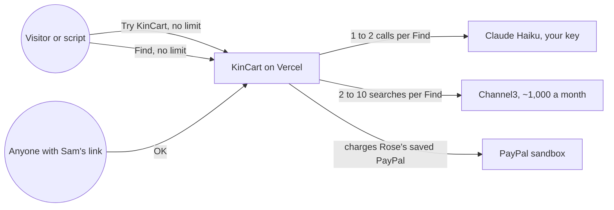
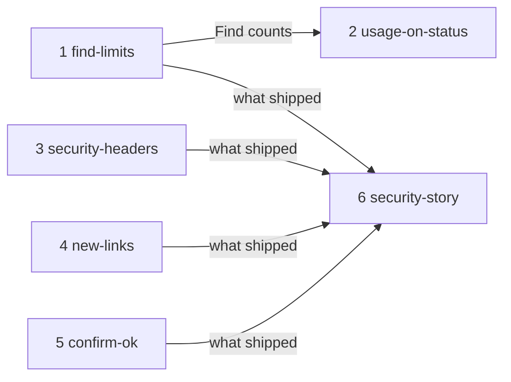

# Security

**Project type:** Web app with UI · **Status:** Shaped

## Problem

Anyone can run Find without limit, and each Find spends Claude money and up to 10 of Channel3's ~1,000 free searches a month. One script can use up a month of searches during judging, and then Find fails for every judge without warning.

## Today

The pain is on the two "no limit" arrows. `find()` at `app/(shop)/actions.ts:80` is the only code that calls Claude or Channel3, and nothing counts its calls. Three pentests found no holes, but a leaked Sam link still approves charges, and the README tells judges nothing about how KinCart stays safe.

## Slices

Slices 1 and 2 answer the main worry, abuse of the Claude and Channel3 keys. Slices 3 to 5 are the basics of a real launch. Slice 6 tells judges about whatever shipped.

| # | Slice | What ships | Why this order |
|---|-------|-----------|----------------|
| 1 | `find-limits` | One machine, or one household, can start only so many households and run only so many Finds in an hour. Past the limit, Rose sees a plain "Try again in N minutes", and no call goes to Claude or Channel3. A script of 200 Finds is stopped, and a judge's next Find still works. | The only gap that can break the entry. It is the main worry and the smallest thing worth shipping. |
| 2 | `usage-on-status` | `/status` shows how many Finds and Channel3 searches ran today and this month, and how many were stopped. You see abuse before the quota runs out. | Reads the counts that slice 1 keeps. Without it, you learn about abuse only when Find fails. |
| 3 | `security-headers` | Every page tells the browser not to show it inside another site, not to send the page address to shops, and to use https only. The home page's own phone frames still work. | Small, and it touches nothing else. Clickjacking a Sam OK is the next easiest attack after slice 1. |
| 4 | `new-links` | Sam taps one button to replace both links when one leaks. The old links stop working at once, and Sam gets the new Rose link to send. | Today a leaked Sam link approves charges forever. Start a new one loses the PayPal link and every receipt. |
| 5 | `confirm-ok` | Sam can choose to confirm each OK with Face ID or a fingerprint. It is off by default. When it is on, a leaked link alone can't approve a charge. | The largest slice, with one unproven claim (O10). It comes after the cheaper slices so a late problem costs only this one. |
| 6 | `security-story` | The README gets a Security section: what each slice guards, what still stands in, and links to the pentest reports. A matching paragraph goes into the Devpost text before Nov 12. | Describes what shipped, so it comes last, before the freeze. |

## Not doing

- **A CAPTCHA on Try KinCart.** It adds a step before a judge can try it, and slice 1's limit stops a script without one.
- **Secret links out of the page address.** Only you can read Vercel's logs (find-and-explain O3). The change touches every page, the manifest and service worker kept for each link (D28), and the home page's phones, so it can break the demo in the last weeks. Slice 4 covers a leaked link.
- **Real accounts or a PayPal sign-in for Sam.** They replace the one-tap demo (D42, D43). Slice 5 stops a leaked link without a sign-up.
- **Guarding the shared demo PayPal login.** Anyone who reads it can change its password, and code can't stop that. The pre-judging check catches it, and Skip still works (ROADMAP).
- **Dependabot alerts and secret scanning.** These are GitHub repo settings, not code. Turn them on in the repo's Settings, under Code security.

## Open items

| ID | What | Type | Raised at | Owner | Status | Answer |
| -- | ---- | ---- | --------- | ----- | ------ | ------ |
| O1 | households O1 turned down a cap on Finds on 2026-10-15. This shape reverses that call | flag | shape | user | Resolved | The main worry is now abuse of the Claude and Channel3 keys, and the test is "a script can't break Find". 2026-10-19 |
| O2 | Judges on one office network or VPN share one address. A per-address limit could stop them together | flag | shape | user | Handed to find-limits | — |
| O3 | Where the counts live: a table in Neon, or Vercel Firewall rate-limit rules. Whether Vercel Hobby has rate-limit rules is not checked | unproven | shape | poc | Handed to find-limits | — |
| O4 | Limits per address and per household don't stop a script that uses many addresses. A daily ceiling on all Finds keeps one burst from using a month of searches, but a script can then use up one day for everyone | flag | shape | user | Handed to find-limits | — |
| O5 | CI's e2e makes real Channel3 searches and Claude calls on every push (D24). Whether CI uses the same keys as the live site is not known | question | shape | user | Handed to find-limits | — |
| O6 | The Anthropic spend limit is not confirmed set, and Channel3's monthly reset is assumed (households O1) | question | shape | user | Handed to find-limits | — |
| O7 | The rules forbid any change to the submission after Nov 12, 12:00 pm PT, and judges use the live site. A late slice that breaks the demo can't be fixed after that | flag | shape | user | Resolved | Main freezes on Nov 5, which leaves a week to fix a broken demo. A slice not shipped by then is dropped. 2026-10-19 |
| O8 | Household 1's links live in Vercel's env (D47), so a button can't replace them | question | shape | user | Handed to new-links | — |
| O9 | After new links, Rose's old Home Screen icon and push taps open the old link, which no longer works | flag | shape | user | Handed to new-links | — |
| O10 | Passkeys work inside the home page's phone frames in Chrome and Safari | unproven | shape | poc | Handed to confirm-ok | — |
| O11 | A new step on Sam's OK makes the app differ from the video that judges watch | flag | shape | user | Handed to confirm-ok | — |
| O12 | A content security policy still has to allow listing photos from any shop's image host, the home page's phone frames, and Next's inline scripts | unproven | shape | build | Handed to security-headers | — |

## Glossary

- **e2e** — an end-to-end test: a script drives a real browser through the app, the way a person would.
- **Pentest** — a penetration test: someone attacks the app on purpose to find holes. The reports are in `docs/security/`.
- **Rate limit** — a cap on how many times one machine or one household can do something in a set time.
- **Quota** — the number of calls a free tier allows each month. Channel3's is about 1,000 searches.
- **Vercel Firewall** — Vercel's rules that can block or slow requests before they reach the app.
- **Clickjacking** — another site shows a page inside an invisible frame and tricks a person into a tap, such as Sam's OK.
- **Security headers** — lines the server sends with each page that tell the browser what the page may do, such as `Content-Security-Policy` and `Referrer-Policy`.
- **Content security policy (CSP)** — a header that lists where a page may load scripts, images and frames from.
- **Passkey** — a sign-in key kept on the phone and unlocked with Face ID or a fingerprint. Websites use it through WebAuthn.
