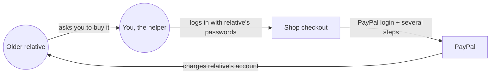
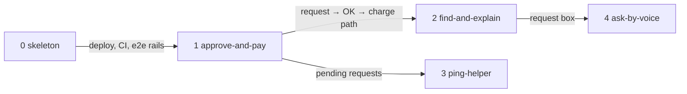

# Shop-together

**Project type:** Web app with UI (slice 2 adds an LLM path) · **Status:** Shaped

## Problem

An older person who wants to buy something online, a few times a month, can't get through checkout alone because it has too many steps and passwords. So a relative logs in as them and makes the purchase, which costs the relative time every time and means handing over the older person's passwords.

## Today

The pain sits on the two login arrows: the relative can't get through them alone, and you only can by using their passwords.

## Slices

Slices 0 to 2 are the minimum entry: the rules require AI, and it arrives in slice 2. Slices 3 and 4 get built only if time is left.

| # | Slice | What ships | Why this order |
|---|-------|-----------|----------------|
| 0 | `skeleton` | One phone-sized page, one endpoint, one stored row, deployed, with one e2e test running in CI. Stack picked at `/spec`. | Empty repo. Proves the rails before anything real goes on them. |
| 1 | `approve-and-pay` | The relative links their sandbox PayPal once. They pick an item from a short fixed list. You see the request on your phone and tap OK or No. On OK, the saved PayPal is charged and both of you see a plain receipt. On No, they see that you said no. | Rests on the riskiest claim (O1), so it fails early if it's going to fail. It's also the core value: no shared passwords. |
| 2 | `find-and-explain` | The relative types what they need in plain words. AI pulls real listings, shows three, and explains each one plainly. Their pick goes into slice 1's approval, replacing the fixed list. | Brings the AI the rules require. |
| 3 | `ping-helper` | A new request reaches your phone as a notification, so you don't have to keep the page open. | Only if time is left. Makes "approve from afar" real on video. |
| 4 | `ask-by-voice` | The relative says what they need instead of typing it. | Only if time is left. Needs slice 2's request box. |

## Not doing

- **Real orders with shops.** Sandbox money only, and the video says so (O9).
- **Scam checks.** PayPal has run AI scam alerts on Friends and Family payments since 2025, with far more data than this app would have.
- **Spend limits or auto-approve.** You approve every purchase.
- **Native phone app.** A web page on the phone is enough (O3).
- **Sign-up and logins.** Two fixed demo people, unless slice 1 finds a reason otherwise (O8).
- **The earlier lanes**: invoice chaser, dispute helper, group trip splitting, pay-when-done, haggle bots. Each was already crowded, already built into PayPal, or too heavy for 22 to 44 hours.

## Open items

| ID | What | Type | Raised at | Owner | Status | Answer |
| -- | ---- | ---- | --------- | ----- | ------ | ------ |
| O1 | Saving the relative's PayPal once (vault), then charging it later with only the helper's OK, works in sandbox | unproven | shape | poc | Handed to approve-and-pay | — |
| O2 | Fallback if the vault fails. Normal checkout puts the relative's PayPal login back in the path | question | shape | user | Handed to approve-and-pay | — |
| O3 | Assuming a web page on a phone is enough, with no native app | assumption | shape | user | Resolved | Web page only, 2026-10-12 |
| O4 | Assuming your relative will try it once on camera and agree to be quoted | assumption | shape | user | Accepted risk | Not asked yet. Fallback: you play both people. Agreed 2026-10-12 |
| O5 | Hosted demo URL, or run-it-yourself steps in the README, for judges | question | shape | user | Handed to skeleton | — |
| O6 | Which AI model, and what a demo's worth of calls costs | question | shape | user | Handed to find-and-explain | — |
| O7 | Where you're based. Channel3 search is US-first, which decides whose listings and which currency show | question | shape | user | Handed to find-and-explain | — |
| O8 | Assuming two fixed demo people (relative and helper) and no sign-up. Anyone holding the helper link could approve a sandbox charge | assumption | shape | user | Handed to approve-and-pay | — |
| O9 | No real order reaches a shop. The sandbox charge lands in a test business account standing in for the store | flag | shape | user | Accepted risk | The rules allow sandbox-only builds; the video says so plainly. Agreed 2026-10-12 |
| O10 | 22 to 44 hours left (Oct 12 to Nov 12, 12:00 pm PT) for 5 slices, the video and the README. Slices 3 and 4 may not get built | flag | shape | user | Accepted risk | 0 to 2 are the must-have; the last week goes to the video and README. Agreed 2026-10-12 |

## Glossary

- **Vault** — PayPal's store for a saved payment method. The account holder approves once, and the app can charge later without them logging in.
- **Sandbox** — PayPal's test environment. Fake accounts, fake money, real API.
- **Walking skeleton** — the thinnest working path through every layer, deployed, so later slices have rails to run on.
- **e2e** — end to end: one automated test that drives the app the way a person would, start to finish.
- **CI** — a service that runs the tests on every push.
- **Channel3** — a hackathon sponsor whose API returns real product listings. 1,000 free searches a month.
- **LLM** — the AI model that reads the request and explains the options.
